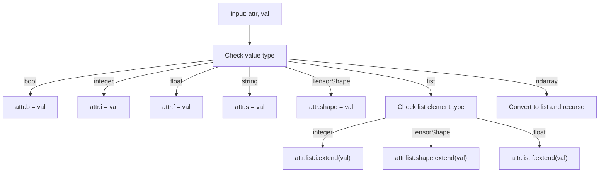
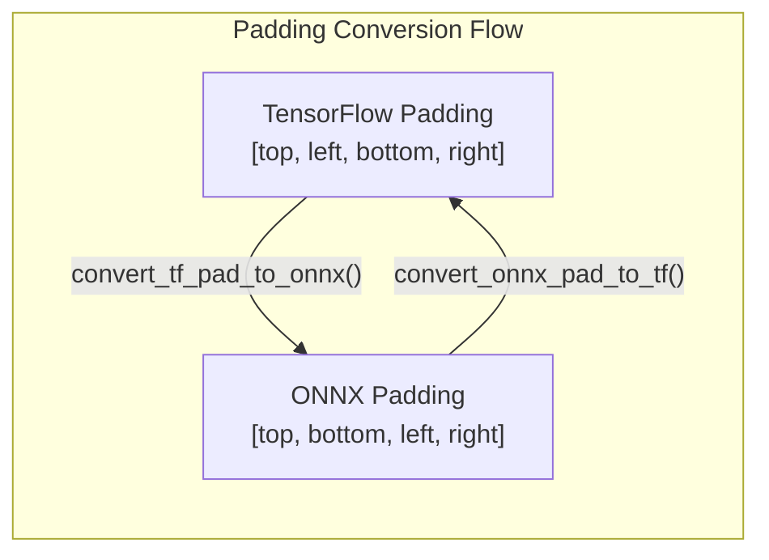
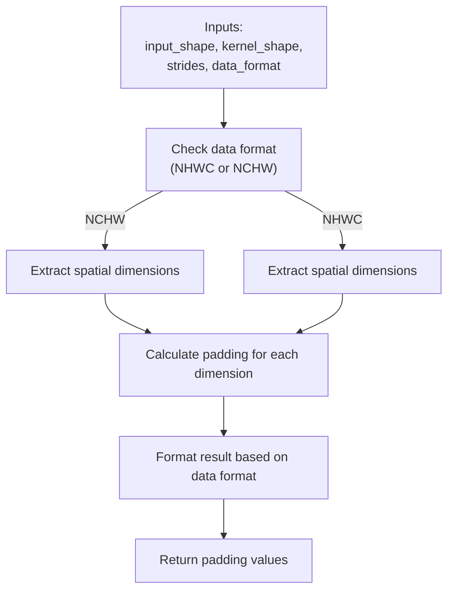
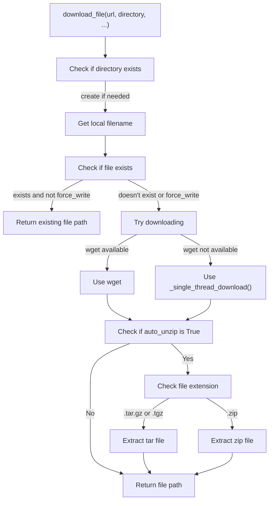
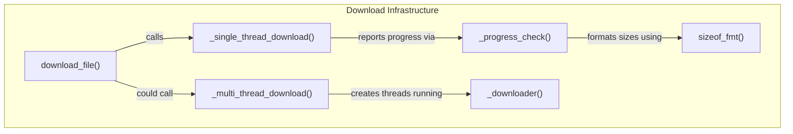
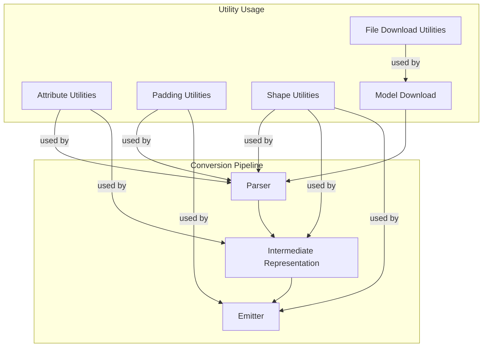

<!-- source: DeepWiki mcp.deepwiki.com · repo microsoft/MMdnn · page 7 Utilities · fetched 2026-10-26 -->

# Utilities

<details>
<summary>Relevant source files</summary>

The following files were used as context for generating this wiki page:

- [.gitignore](.gitignore)
- [mmdnn/conversion/common/utils.py](mmdnn/conversion/common/utils.py)

</details>


This page documents the utility functions used throughout the MMdnn framework. These utilities provide common functionality for the model conversion process, including attribute handling, padding conversions, shape transformations, and file downloading capabilities. For information about the overall conversion architecture, see [System Architecture](#1.1).

## Overview

The MMdnn utilities module provides a collection of helper functions that support various aspects of the deep learning model conversion process. These utilities can be categorized into several functional groups:

```mermaid
flowchart TD
    subgraph "MMdnn Utilities"
        AttrUtils["Attribute Utilities"]
        PaddingUtils["Padding Utilities"]
        ShapeUtils["Shape Utilities"]
        FileUtils["File Download Utilities"]
    end
    
    AttrUtils --> |"includes"| AssignAttrValue["assign_attr_value()"]
    AttrUtils --> |"includes"| AssignIRNodeValues["assign_IRnode_values()"]
    
    PaddingUtils --> |"includes"| ConvertTFPadToOnnx["convert_tf_pad_to_onnx()"]
    PaddingUtils --> |"includes"| ConvertOnnxPadToTF["convert_onnx_pad_to_tf()"]
    PaddingUtils --> |"includes"| IsValidPadding["is_valid_padding()"]
    PaddingUtils --> |"includes"| ComputeTFSamePadding["compute_tf_same_padding()"]
    
    ShapeUtils --> |"includes"| ShapeToList["shape_to_list()"]
    ShapeUtils --> |"includes"| ListToShape["list_to_shape()"]
    
    FileUtils --> |"includes"| DownloadFile["download_file()"]
    FileUtils --> |"includes"| SizeofFmt["sizeof_fmt()"]
    FileUtils --> |"includes"| ProgressCheck["_progress_check()"]
    FileUtils --> |"includes"| SingleThreadDownload["_single_thread_download()"]
    FileUtils --> |"includes"| MultiThreadDownload["_multi_thread_download()"]
```



Sources: [mmdnn/conversion/common/utils.py:1-269]()

## Attribute Utilities

The attribute utilities provide functions for assigning values to IR node attributes during the model conversion process.

### assign_attr_value

This function assigns values to AttrValue proto objects according to their data type. It handles various data types including boolean, integer, float, string, TensorShape, and lists of these types.



Sources: [mmdnn/conversion/common/utils.py:19-47]()

### assign_IRnode_values

This function assigns multiple attribute values to an IR node at once, using a dictionary of name-value pairs.

```python
def assign_IRnode_values(IR_node, val_dict):
    for name, val in val_dict.items():
        assign_attr_value(IR_node.attr[name], val)
```

Sources: [mmdnn/conversion/common/utils.py:50-52]()

## Padding Utilities

The padding utilities handle conversions between different padding formats used by various deep learning frameworks.

### Padding Format Conversion

These functions convert between the padding formats used by TensorFlow and ONNX:

- `convert_tf_pad_to_onnx`: Converts TensorFlow's padding format to ONNX format
- `convert_onnx_pad_to_tf`: Converts ONNX's padding format to TensorFlow format
- `is_valid_padding`: Checks if a padding configuration is "valid" (all zero)



Sources: [mmdnn/conversion/common/utils.py:56-73]()

### compute_tf_same_padding

This function computes the padding values needed to achieve 'SAME' padding in TensorFlow, converting them to the format used by ONNX. It handles different data formats (NHWC and NCHW) and calculates the appropriate padding values based on input shape, kernel shape, and strides.



Sources: [mmdnn/conversion/common/utils.py:88-124]()

## Shape Utilities

The shape utilities convert between TensorShape protobuf objects and Python lists, facilitating easy manipulation of tensor shapes during model conversion.

### shape_to_list and list_to_shape

These complementary functions convert between TensorShape protobuf objects and Python lists:

- `shape_to_list`: Converts a TensorShape protobuf to a Python list
- `list_to_shape`: Converts a Python list to a TensorShape protobuf


Sources: [mmdnn/conversion/common/utils.py:76-85]()

## File Download Utilities

These utilities handle downloading files from URLs, with progress tracking and support for both single-threaded and multi-threaded downloads.

### download_file

The main function for downloading files from a URL. It supports:
- Resuming downloads if files already exist
- Progress tracking during download
- Automatic file extraction (zip, tar.gz)
- Both single-threaded and multi-threaded downloading



Sources: [mmdnn/conversion/common/utils.py:194-268]()

### Helper Functions for Download

Several helper functions support the file download process:

- `sizeof_fmt`: Formats file sizes in human-readable format (KB, MB, GB, etc.)
- `_progress_check`: Displays download progress information
- `_single_thread_download`: Downloads a file using a single thread
- `_multi_thread_download`: Downloads a file using multiple threads
- `_downloader`: Helper for multi-threaded downloads, downloads a specific byte range



Sources: [mmdnn/conversion/common/utils.py:129-192]()

## Integration with MMdnn Conversion Process

The utility functions are used throughout the MMdnn conversion pipeline to support various aspects of model conversion between different deep learning frameworks.



Sources: [mmdnn/conversion/common/utils.py:1-269]()

## Usage Examples

### Assigning IR Node Values

When building an IR node during parsing, you would use `assign_IRnode_values` to set multiple attributes:

```python
# Example usage in a parser
attrs = {
    'dilations': [1, 1, 1, 1],
    'strides': [1, 2, 2, 1],
    'padding': [0, 1, 0, 1],
    'data_format': 'NHWC'
}
assign_IRnode_values(IR_node, attrs)
```

### Converting Padding Formats

When working with different padding formats between frameworks:

```python
# Convert TensorFlow padding to ONNX format
tf_padding = [[0, 0], [1, 1], [1, 1], [0, 0]]  # NHWC format
onnx_padding = convert_tf_pad_to_onnx(tf_padding)  # [0, 0, 1, 1, 1, 1, 0, 0]

# Convert ONNX padding back to TensorFlow format
tf_padding_restored = convert_onnx_pad_to_tf(onnx_padding)  # [[0, 0], [1, 1], [1, 1], [0, 0]]
```

### Downloading Pre-trained Models

The file download utilities are particularly useful for the model downloading functionality:

```python
# Download a pre-trained model
model_url = "https://example.com/models/resnet50.h5"
local_file = download_file(
    url=model_url,
    directory="./models",
    auto_unzip=True
)
```

Sources: [mmdnn/conversion/common/utils.py:1-269]()

---

