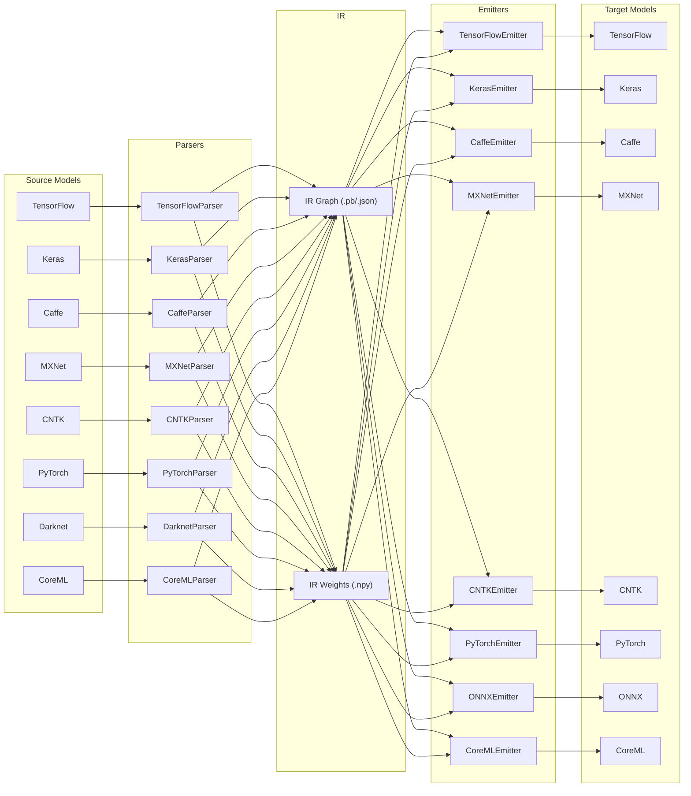
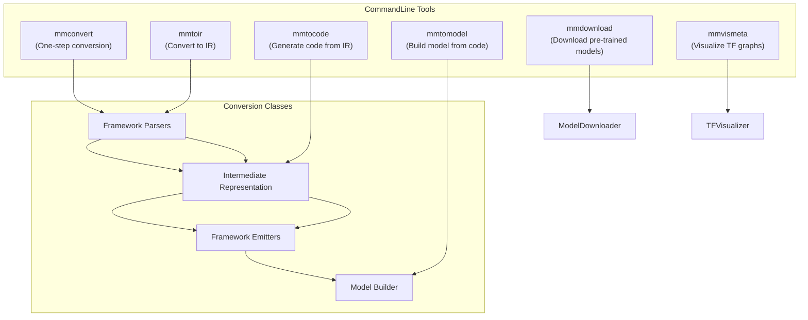
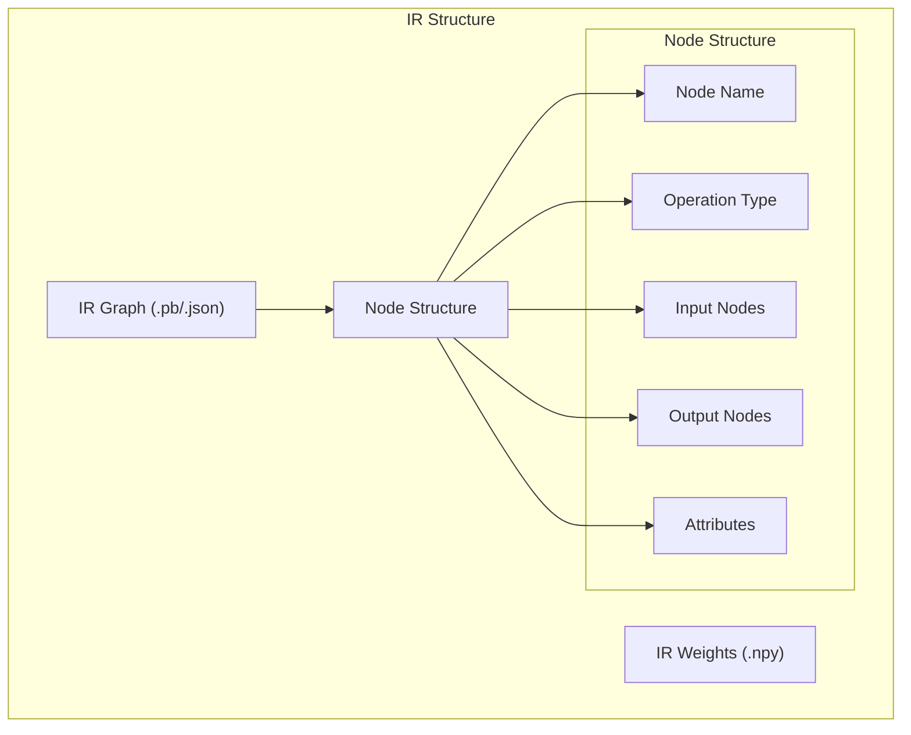
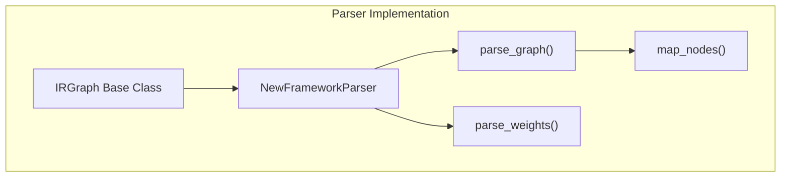
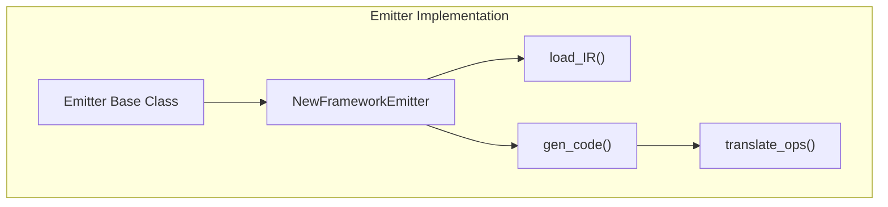
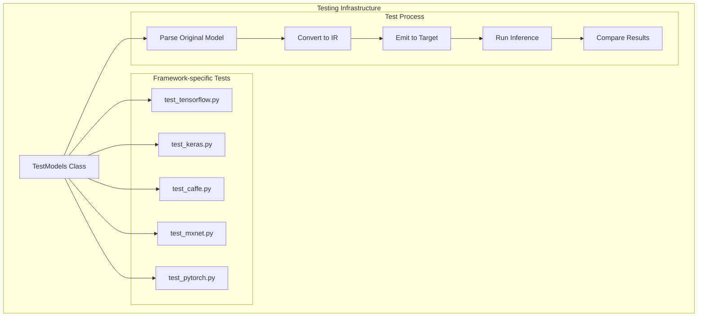

<!-- source: DeepWiki mcp.deepwiki.com · repo microsoft/MMdnn · page 8 Developer Guide · fetched 2026-10-26 -->

# Developer Guide

<details>
<summary>Relevant source files</summary>

The following files were used as context for generating this wiki page:

- [README.md](README.md)
- [mmdnn/conversion/tensorflow/README.md](mmdnn/conversion/tensorflow/README.md)
- [requirements/linux-py3.txt](requirements/linux-py3.txt)
- [setup.py](setup.py)

</details>


## Purpose and Scope

This developer guide provides detailed information for developers who want to contribute to or extend the functionality of MMdnn. It covers the development environment setup, architecture overview, guidelines for extending the framework with new parsers and emitters, and testing procedures. For general usage information, see [Overview](#1).

## Development Environment Setup

### Prerequisites

To develop for MMdnn, you'll need Python 3.6+ and the following dependencies:

```
numpy >= 1.15.0
protobuf >= 3.6.0
six >= 1.10.0
pillow >= 6.2.1
```

Additional framework-specific dependencies are required depending on which parsers/emitters you're working with:

```
tensorflow >= 1.15.2
keras >= 2.2.4
coremltools >= 2.1.0
mxnet >= 1.2.0
cntk >= 2.6
pytorch >= 0.4.0
onnx >= 1.4.1
```

Sources: [requirements/linux-py3.txt](), [setup.py:78-83]()

### Development Installation

For development, install MMdnn in development mode:

```bash
git clone https://github.com/microsoft/MMdnn.git
cd MMdnn
pip install -e .
```

This allows you to modify the code and have changes immediately available for testing.

## Architecture Overview

### MMdnn Conversion Pipeline

MMdnn uses a two-step process to convert models between frameworks:
1. **Parsing**: Convert a source model to the Intermediate Representation (IR)
2. **Emitting**: Convert the IR to a target framework model

This approach allows MMdnn to support N×M conversions with only N+M components.

**Conversion Pipeline Diagram**



Sources: [README.md:82-92](), [mmdnn/conversion/tensorflow/README.md]()

### Command-Line Tools

MMdnn provides several command-line tools, which are actually entry points to the core conversion functionality:



Sources: [setup.py:89-96](), [README.md:12-32]()

## Intermediate Representation (IR)

The IR is the core component of MMdnn, serving as a bridge between source and target frameworks. It consists of:

1. **IR Graph**: A protobuf file (.pb/.json) that stores the network architecture
2. **IR Weights**: A NumPy file (.npy) that stores the model weights

The IR uses a fixed set of operators that can represent operations from all supported frameworks. The IR weight data is stored in NHWC (channel last) format.

**IR Structure Diagram**



Sources: [README.md:212-217]()

## Extending MMdnn

### Adding a New Parser

Parsers convert models from a specific framework to the IR. To add a new parser:

1. Create a new directory in `mmdnn/conversion/[framework_name]/`
2. Implement a class that inherits from `mmdnn.conversion.common.IRGraph`
3. Implement the necessary parsing logic to convert the framework's model to IR

**Parser Implementation Diagram**



Key components to implement:
- Graph structure conversion
- Weight extraction and format conversion
- Node mapping between framework-specific operations and IR operations

### Adding a New Emitter

Emitters convert the IR to models for a specific framework. To add a new emitter:

1. Create a new directory in `mmdnn/conversion/[framework_name]/`
2. Implement a class that inherits from `mmdnn.conversion.common.Emitter`
3. Implement the necessary emitting logic to convert IR to the target framework's format

**Emitter Implementation Diagram**



Key components to implement:
- IR graph parsing
- Code generation for the target framework
- Operation translation from IR operations to framework-specific operations
- Weight transformation to the target framework's format

### Converting a New Model Type

To support a new model type (e.g., object detection, segmentation):

1. Identify the new operations needed in the IR
2. Update the IR definition in `mmdnn/conversion/common/IR/ops.pbtxt` and `graph.proto`
3. Implement the parsing logic for the new operations in relevant parsers
4. Implement the emitting logic for the new operations in relevant emitters

Sources: [README.md:217-221]()

## Testing and Validation

MMdnn has a comprehensive testing system to validate model conversions. The testing process checks that models converted through MMdnn produce similar results to the original models.

**Testing Framework Diagram**



### Adding Tests for a New Model

1. Add the model to the appropriate test file in `tests/`
2. Define test cases that include:
   - Model loading
   - Conversion to IR
   - Conversion from IR to target frameworks
   - Validation of results against the original model

### Running Tests

To run tests for a specific framework:

```bash
python -m pytest tests/test_[framework].py
```

To run all tests:

```bash
python -m pytest tests/
```

## Contribution Guidelines

### Code Style

- Follow PEP 8 for Python code style
- Use meaningful variable and function names
- Include docstrings for all public functions and classes
- Keep functions small and focused on a single task

### Pull Request Process

1. Fork the repository and create a new branch for your feature
2. Add tests for your changes
3. Ensure all tests pass
4. Submit a pull request with a detailed description of your changes

### Documentation

When adding new features, update the documentation to include:
- Description of the feature
- Usage examples
- Any limitations or caveats

## Troubleshooting Common Issues

### Parser Development Issues

- **Missing operations**: Identify missing operations in the IR and add them to `ops.pbtxt`
- **Weight format mismatch**: Ensure weights are correctly converted to the NHWC format expected by IR

### Emitter Development Issues

- **Code generation errors**: Verify the generated code syntax is correct for the target framework
- **Weight loading issues**: Check that weight shapes match the expectations of the target framework

Sources: [README.md:198-221](), [mmdnn/conversion/tensorflow/README.md:168-196]()

## Framework Support Status

The following table shows the current support status for various frameworks as sources and targets:

| Framework | Source Parser | Target Emitter |
|-----------|---------------|---------------|
| TensorFlow | ✓ (with limitations) | ✓ |
| Keras | ✓ | ✓ |
| Caffe | ✓ | ✓ |
| CNTK | ✓ | ✓ |
| MXNet | ✓ | ✓ |
| PyTorch | ✓ | ✓ |
| CoreML | ✓ | ✓ |
| ONNX | ✗ | ✓ |
| Darknet | ✓ | ✗ |

Sources: [README.md:94-106](), [mmdnn/conversion/tensorflow/README.md:7-22]()

## Help and Support

If you encounter issues during development, you can:
- Check existing issues on GitHub
- Open a new issue with detailed information about your problem
- Join the community discussions

Remember to review the [Code of Conduct](https://opensource.microsoft.com/codeofconduct/) before contributing.

Sources: [README.md:198-209]()