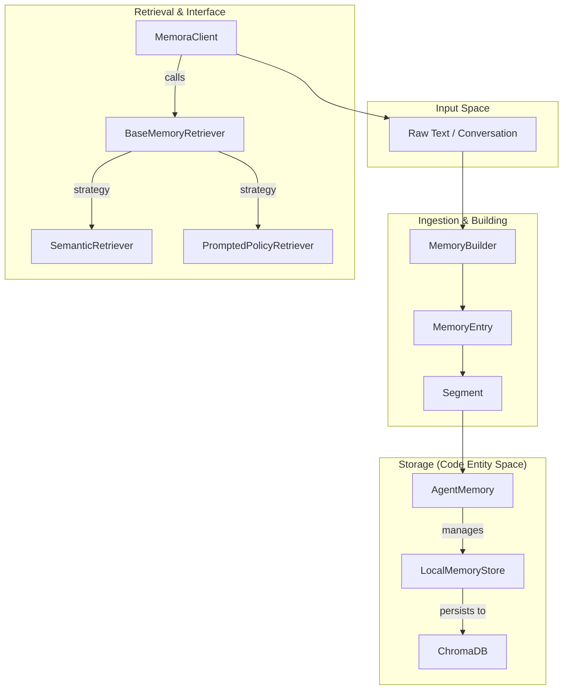

<!-- source: DeepWiki mcp.deepwiki.com · repo microsoft/Memora · page 1 Memora Overview · fetched 2026-10-26 -->

# Memora Overview

<details>
<summary>Relevant source files</summary>

The following files were used as context for generating this wiki page:

- [README.md](README.md)
- [quickstart.py](quickstart.py)
- [src/memora/__init__.py](src/memora/__init__.py)
- [src/memora/browser/__init__.py](src/memora/browser/__init__.py)

</details>


Memora is a sophisticated memory management system for AI agents designed to handle the complexity of long-term information storage, organization, and retrieval. Unlike traditional RAG (Retrieval-Augmented Generation) pipelines that rely on flat vector similarity, Memora introduces a **harmonic memory representation** that separates raw data from the structures used to index it.

By providing a unified memory layer, Memora allows developers to focus on agent logic while the framework manages the lifecycle of factual, episodic, and procedural knowledge.

### Purpose and Design Philosophy

The core philosophy of Memora is to balance **abstraction** and **specificity**. It addresses the "fuzziness" of standard vector search by creating a structured scaffolding over high-fidelity data [README.md:18-30]().

| Component | Indexed? | Role |
| :--- | :--- | :--- |
| **Memory Value** | No | The full, uncompressed information (e.g., a specific quote or fact) [README.md:23-23](). |
| **Primary Abstraction** | Yes | A one-to-one summary serving as the canonical unit for updates and deduplication [README.md:24-24](). |
| **Cue Anchors** | Yes | Semantic entry points (e.g., `<entity> + <aspect>`) creating a many-to-many map between related memories [README.md:25-25](). |

This design ensures that retrieval is guided by well-defined representations while the agent still has access to the rich, original context.

**Sources:**
- [README.md:12-45]()
- [src/memora/__init__.py:4-9]()

---

### System Architecture

Memora operates as a lifecycle manager, moving data from raw ingestion to structured storage and eventually to adaptive retrieval for answer generation.

#### Bridge: Natural Language to Code Entities
The following diagram illustrates how natural language inputs flow through the system's primary code abstractions.

Memora Lifecycle Flow

**Sources:**
- [README.md:46-60]()
- [quickstart.py:78-114]()
- [src/memora/memora_client.py:1-118]() (inferred from package structure)

---

### Key Subsystems

#### 1. Core Memory System
The `MemoraClient` serves as the primary entry point for developers. It abstracts the complexity of the `AgentMemory` coordinator, which handles the retrieval pipeline, query generation, and parallel search across different indices (Primary vs. Cue) [quickstart.py:78-81]().

#### 2. Memory Ingestion & Building
Memora transforms raw text into structured `MemoryEntry` objects. This process includes extracting relevant facts, segmenting conversations into topical episodes, and performing deduplication to ensure the memory store remains clean over time [README.md:50-52]().

#### 3. Adaptive Retrieval Strategies
Memora supports multiple ways to pull information:
*   **Semantic:** Standard vector similarity search [README.md:55-55]().
*   **Prompted Policy:** An iterative, LLM-guided search that refines queries based on initial results [README.md:56-56]().
*   **Hybrid:** A combination of semantic and keyword (BM25) matching [README.md:57-57]().
*   **GRPO:** An experimental reinforcement learning-based policy for complex retrieval tasks [README.md:58-58]().

#### 4. Browser & Utilities
For debugging and inspection, Memora includes a CLI and an `InteractiveMemoryBrowser` to explore `ChromaDB` collections and analyze memory distributions [src/memora/browser/__init__.py:4-18]().

**Sources:**
- [README.md:46-60]()
- [quickstart.py:45-70]()
- [src/memora/browser/__init__.py:10-12]()

---

### Getting Started

To begin using Memora, you must configure your environment for either Azure OpenAI or standard OpenAI, then initialize the `MemoraClient`.

```python
# Minimal setup example
from memora.memora_client import MemoraClient
from omegaconf import OmegaConf

cfg = OmegaConf.create({
    "memory": {"memory_store": "my_store", "persist_path": "./db"},
    "llm": {"model": "gpt-4.1-mini"},
    "retrieval": {"strategy": "semantic"}
})

client = MemoraClient(cfg=cfg, user_id="user_123")
client.add("The project deadline is Friday.", type="doc")
results = client.query("When is the deadline?")
```

**Sources:**
- [README.md:62-93]()
- [quickstart.py:16-71]()

---

### Documentation Map

For detailed information on specific components, refer to the following child pages:

*   **[Getting Started & Installation](#1.1)**: Detailed installation steps, environment variable requirements, and configuration via `OmegaConf`.
*   **[Core Concepts & Terminology](#1.2)**: Deep dive into the harmonic memory representation, cue anchors, and the memory lifecycle (Frontier vs. Working Set).

---

