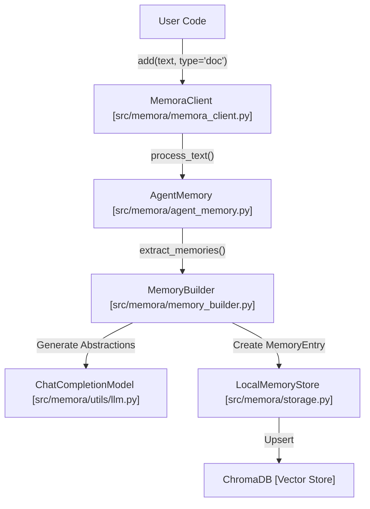
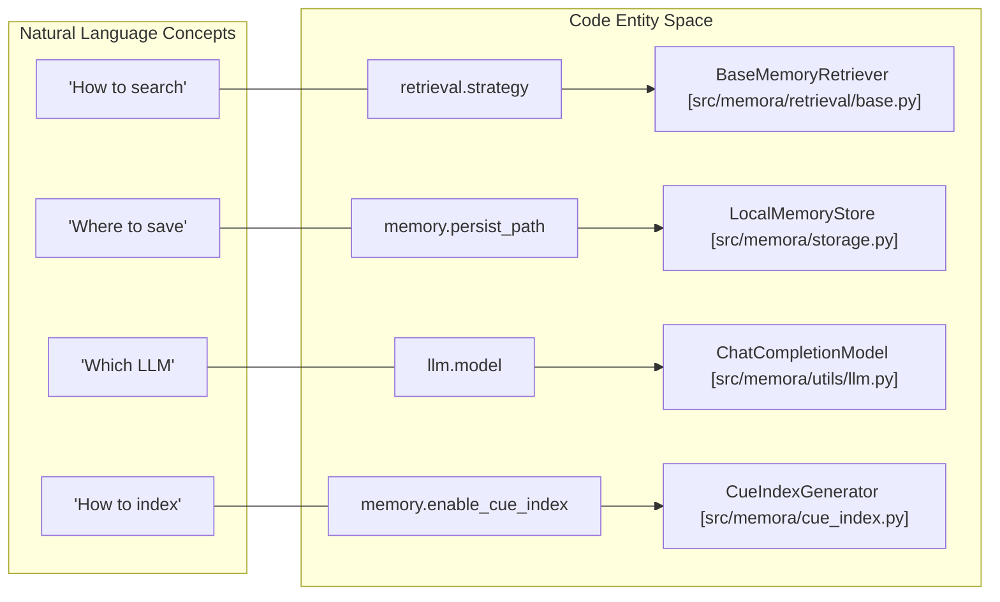

<!-- source: DeepWiki mcp.deepwiki.com · repo microsoft/Memora · page 1.1 Getting Started & Installation · fetched 2026-10-26 -->

# Getting Started & Installation

<details>
<summary>Relevant source files</summary>

The following files were used as context for generating this wiki page:

- [README.md](README.md)
- [app/locomo/conf/config.yaml](app/locomo/conf/config.yaml)
- [app/locomo/conf/mem0_config.yaml](app/locomo/conf/mem0_config.yaml)
- [app/longmemeval/conf/config.yaml](app/longmemeval/conf/config.yaml)
- [quickstart.py](quickstart.py)

</details>


This page provides a comprehensive technical guide for installing Memora, configuring the necessary environment variables and OmegaConf structures, and running the quickstart example. Memora is designed to be a lightweight integration for agent systems, providing a harmonic memory representation that balances raw memory values with indexed primary abstractions and cue anchors [README.md:18-30]().

## Installation

Memora requires **Python 3.10** or higher [README.md:64](). It is currently recommended to install the package in editable mode from the source repository to ensure access to all benchmark applications and configuration templates.

```bash
# Clone the repository
git clone https://github.com/microsoft/Memora
cd Memora

# Install in editable mode with dependencies
pip install -e .
```

### Core Dependencies
The installation process resolves dependencies for:
* **ChromaDB**: The default vector database for storing memory entries and cue indices [README.md:52]().
* **OmegaConf/Hydra**: Used for hierarchical configuration management [app/locomo/conf/config.yaml:1-10]().
* **OpenAI/Azure OpenAI**: For LLM-based memory extraction, abstraction, and retrieval policies [quickstart.py:19-22]().

Sources: [README.md:62-71](), [quickstart.py:10-13]()

---

## Configuration & Credentials

Memora uses a combination of environment variables and `OmegaConf` objects to manage credentials and system behavior. It supports both standard OpenAI and Azure OpenAI endpoints.

### Environment Variables
Before running Memora, set the following variables based on your provider:

| Variable | Description | Provider |
| :--- | :--- | :--- |
| `OPENAI_API_TYPE` | Either `azure` or `openai` | Both |
| `OPENAI_API_KEY` | Your OpenAI API key | OpenAI |
| `AZURE_OPENAI_ENDPOINT` | Your Azure resource endpoint URL | Azure |
| `AZURE_MANAGED_IDENTITY_CLIENT_ID` | Client ID for Managed Identity (optional) | Azure |

### OmegaConf Structure
The `MemoraClient` expects a configuration object (typically built via `OmegaConf`) that defines the behavior of the LLM, storage, and retrieval layers.

#### Key Parameters in `memory` section:
* `persist_path`: Local filesystem path where ChromaDB data is stored [app/longmemeval/conf/config.yaml:66]().
* `enable_cue_index`: Boolean to enable the many-to-many cue anchor indexing system [app/locomo/conf/config.yaml:88]().
* `update_score_threshold`: Similarity threshold (e.g., 0.8) for merging new information into existing memories [quickstart.py:51]().
* `query_score_threshold`: Minimum similarity for a memory to be considered relevant during retrieval [quickstart.py:50]().

#### Key Parameters in `retrieval` section:
* `strategy`: Selection between `semantic` (vector search), `prompt` (LLM-guided iterative search), or `grpo` (RL-trained policy) [app/longmemeval/conf/config.yaml:111]().

Sources: [quickstart.py:16-71](), [app/longmemeval/conf/config.yaml:44-63](), [app/locomo/conf/config.yaml:51-68]()

---

## Quick Start Example

The `quickstart.py` script demonstrates the basic lifecycle of adding and querying memories using the `MemoraClient`.

### Implementation Flow
The following diagram illustrates how the `MemoraClient` interacts with internal components to process a memory addition request.

**Memory Ingestion Data Flow**

Sources: [quickstart.py:74-94](), [README.md:97-115]()

### Running the Example
You can run the provided quickstart script to verify your installation and configuration:

```python
from memora.memora_client import MemoraClient
from quickstart import make_config

# 1. Initialize configuration
cfg = make_config()

# 2. Instantiate the client
client = MemoraClient(cfg=cfg, user_id="demo_user")

# 3. Ingest data
client.add("Alice is moving to Seattle for a new job at Microsoft.", type="doc")

# 4. Perform a semantic query
results = client.query("Where is Alice moving?")
for entry in results:
    print(f"Memory: {entry.value}")
```
Sources: [quickstart.py:74-117](), [README.md:73-93]()

---

## Configuration Mapping: Natural Language to Code Entities

To help developers navigate the configuration, the following diagram maps high-level concepts to the specific code classes and configuration keys that implement them.

**System Configuration Mapping**

Sources: [app/longmemeval/conf/config.yaml:37-40,66,81,111](), [quickstart.py:25-70]()

---

## Troubleshooting & Verification

### Validating the Memory Store
After running the quickstart, you can verify that memories were persisted by checking the `persist_path` (default: `./memory_store/example_store`). Memora uses ChromaDB, which creates a directory containing `sqlite3` and `parquet` files.

### Common Configuration Issues
1. **API Version Mismatch**: Ensure `openai.llm_api_version` matches your Azure deployment (default: `2024-12-01-preview`) [quickstart.py:34]().
2. **Embedding Model**: The default embedding model is `text-embedding-3-small`. If using a different model, update `openai.embedding_model` and ensure the dimensions match your existing ChromaDB collection [app/locomo/conf/config.yaml:66-67]().
3. **Managed Identity**: If `api_type` is `azure` and you are not using an API key, `managed_identity` must be provided or available via environment variables [app/longmemeval/conf/config.yaml:47]().

Sources: [quickstart.py:19-44](), [app/longmemeval/conf/config.yaml:44-62]()

---

