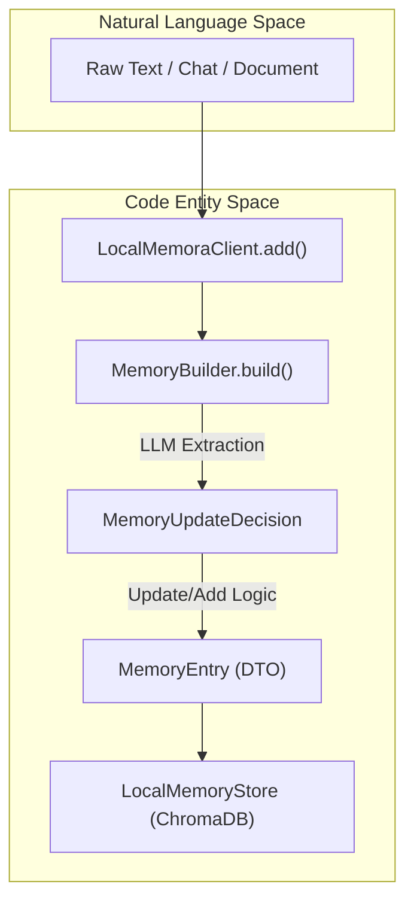
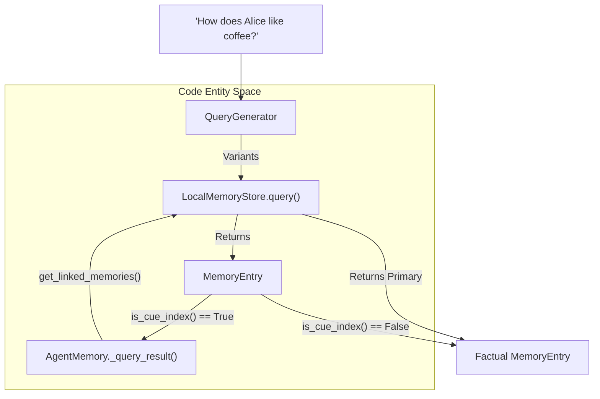

<!-- source: DeepWiki mcp.deepwiki.com · repo microsoft/Memora · page 1.2 Core Concepts & Terminology · fetched 2026-10-26 -->

# Core Concepts & Terminology

Relevant source files

The following files were used as context for generating this wiki page:

- [src/memora/builder/chat_memory_builder.py](src/memora/builder/chat_memory_builder.py)
- [src/memora/builder/document_memory_builder.py](src/memora/builder/document_memory_builder.py)
- [src/memora/builder/memory_builder.py](src/memora/builder/memory_builder.py)
- [src/memora/core/local_client.py](src/memora/core/local_client.py)
- [src/memora/core/memory.py](src/memora/core/memory.py)
- [src/memora/core/memory_entry.py](src/memora/core/memory_entry.py)
- [src/memora/utils/memory.py](src/memora/utils/memory.py)

This page details the foundational architecture and terminology used in Memora. It explains the relationship between memory types, the distinction between primary and cue indices, and the lifecycle of memory entries within the system.

## Memory Abstractions

Memora distinguishes between the data being stored (the **Memory Value**) and the structures used to find that data (the **Primary Index** and **Cue Anchors**).

### Memory Values vs. Indices
*   **Memory Value**: The core content or factual statement extracted from a source (e.g., "Alice prefers dark roast coffee"). [src/memora/core/memory_entry.py:53-55]()
*   **Primary Index**: A short, human-readable, and semantically rich phrase that identifies the memory (e.g., "Alice's Coffee Preference"). It serves as the main key for retrieval and identification. [src/memora/core/memory_entry.py:62-65]()
*   **Cue Anchors (Cue Indices)**: Supplemental phrases linked to a primary memory to improve retrieval coverage. They act as "aliases" or alternative search terms (e.g., "Alice's morning routine", "Alice's favorite drink"). [src/memora/core/memory_entry.py:109-118]()

### Memory Types
Memora categorizes information into three distinct types to optimize for different retrieval needs:

| Type | Description | Code Identifier |
| :--- | :--- | :--- |
| **Factual** | Atomic, verifiable facts extracted from content. | `factual` [src/memora/builder/chat_memory_builder.py:117-117]() |
| **Episodic** | Summaries of specific events or conversation segments, preserving narrative context. | `episodic` [src/memora/core/memory_entry.py:76-76]() |
| **Procedural** | Multi-step workflows, decision logic, or "how-to" instructions. | `procedural` [src/memora/builder/document_memory_builder.py:38-45]() |

**Sources:**
- [src/memora/core/memory_entry.py:52-118]()
- [src/memora/builder/document_memory_builder.py:33-46]()
- [src/memora/builder/chat_memory_builder.py:116-118]()

---

## The Memory Lifecycle

The transformation of raw input into a persistent `MemoryEntry` involves extraction, de-duplication, and indexing.

### Building and Ingestion
The `MemoryBuilder` classes ([src/memora/builder/memory_builder.py:127-150]()) coordinate the extraction of memories using LLM prompts. 
1.  **Extraction**: The system uses specialized prompts like `PROMPT_BUILD_MEMORY` to identify facts. [src/memora/builder/memory_builder.py:38-76]()
2.  **Update Decision**: When a new memory is extracted, the system checks for existing similar memories. The `MemoryUpdateDecision` model determines if the new information should result in a **new entry** or an **update** to an existing one. [src/memora/utils/memory.py:12-48]()
3.  **History Preservation**: If a memory is updated, the previous value is stored in the `history` field of the `MemoryEntry`. [src/memora/utils/memory.py:139-164]()

### Diagram: Ingestion Data Flow

"Natural Language Space" meets "Code Entity Space" during the ingestion process.

**Memory Construction Flow**

**Sources:**
- [src/memora/core/local_client.py:175-200]()
- [src/memora/builder/memory_builder.py:151-180]()
- [src/memora/utils/memory.py:12-48]()

---

## Retrieval Concepts: Working Set and Frontier

Memora uses a sophisticated retrieval strategy beyond simple vector search, managed by the `AgentMemory` facade. [src/memora/core/memory.py:43-53]()

### Query Modes
The system supports different `QueryMode` settings to target specific index types:
*   `PRIMARY_ONLY`: Searches only the main memory indices.
*   `CUE_ONLY`: Searches only the supplemental cue anchors.
*   `BOTH`: A hybrid search across both primary and cue indices.
[src/memora/core/memory.py:36-41]()

### Retrieval Pipeline
1.  **Query Generation**: The `QueryGenerator` expands a single user query into multiple variants. [src/memora/core/query_generator.py]()
2.  **Parallel Search**: The system queries the `LocalMemoryStore` for all variants. [src/memora/core/memory.py:137-142]()
3.  **Cue Resolution**: If a search result is a `cue_index`, the system automatically resolves it to its `linked_memory` (the primary entry). [src/memora/core/memory.py:155-172]()
4.  **Filtering**: The `MemoryFilter` uses an LLM to prune irrelevant results based on the original user intent. [src/memora/core/memory_filter.py]()

### Diagram: Retrieval Logic and Cue Resolution

This diagram illustrates how code entities handle the transition from a search query to a factual memory.

**Retrieval & Cue Resolution**

**Sources:**
- [src/memora/core/memory.py:111-183]()
- [src/memora/core/memory_entry.py:141-165]()
- [src/memora/core/query_generator.py]()

---

## Key Data Structures

### MemoryEntry
The `MemoryEntry` is the central DTO (Data Transfer Object) in Memora. [src/memora/core/memory_entry.py:28-50]()

| Field | Purpose |
| :--- | :--- |
| `value` | The actual content of the memory. |
| `index` | The primary retrieval key. |
| `history` | List of previous versions of this memory. |
| `cue_indices` | Delimited string (`||`) of linked cue anchors. |
| `linked_memory` | If this is a cue entry, it points to the primary index. |
| `memory_type` | Factual, Episodic, or Procedural. |

**Sources:**
- [src/memora/core/memory_entry.py:52-124]()
- [src/memora/utils/memory.py:49-90]()

---

