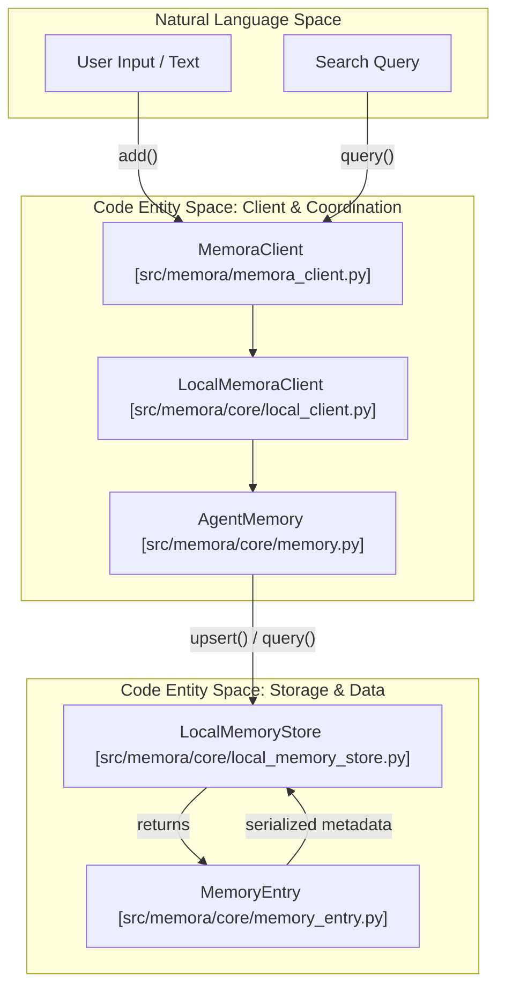
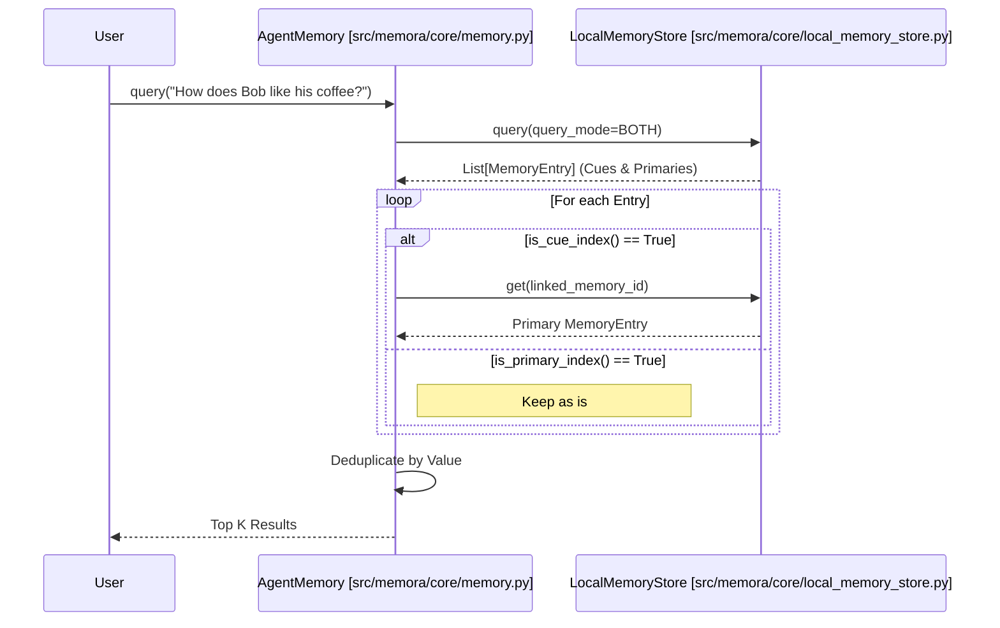

<!-- source: DeepWiki mcp.deepwiki.com · repo microsoft/Memora · page 2 Core Memory System · fetched 2026-10-26 -->

# Core Memory System

Relevant source files

The following files were used as context for generating this wiki page:

- [src/memora/core/base.py](src/memora/core/base.py)
- [src/memora/core/local_client.py](src/memora/core/local_client.py)
- [src/memora/core/memory.py](src/memora/core/memory.py)
- [src/memora/core/memory_entry.py](src/memora/core/memory_entry.py)
- [src/memora/core/remote_client.py](src/memora/core/remote_client.py)
- [src/memora/memora_client.py](src/memora/memora_client.py)

The Core Memory System is the architectural backbone of Memora, responsible for the persistent storage, retrieval, and management of memory entries. It abstracts the complexities of vector databases and LLM-driven query expansion into a unified interface, allowing agents to interact with a long-term memory store as a cohesive system rather than a collection of disparate data points.

### System Architecture

The architecture is divided into three primary layers: the **Client Facade**, the **AgentMemory Coordinator**, and the **Storage Backends**.

#### Memory System Flow
The following diagram illustrates how natural language inputs are processed through the code entities of the core system.

**Sources:** [src/memora/memora_client.py:21-50](), [src/memora/core/local_client.py:36-64](), [src/memora/core/memory.py:43-94](), [src/memora/core/memory_entry.py:28-50]()

---

### Key Components

#### 1. MemoraClient Facade
The `MemoraClient` serves as the primary entry point for developers. It handles the routing between local execution (`LocalMemoraClient`) and remote API calls (`RemoteMemoraClient`) based on the provided configuration. Its main role is to provide a simplified API for adding text or files and querying the memory store without exposing internal coordination logic.

For details, see [MemoraClient API](#2.1).

**Sources:** [src/memora/memora_client.py:21-50](), [src/memora/core/remote_client.py:9-33]()

#### 2. AgentMemory Coordinator
`AgentMemory` is the "brain" of the core system. It implements the `MemoryBase` abstract class and coordinates between various sub-modules:
*   **Query Generation:** Uses `QueryGenerator` to expand a single user query into multiple variants to improve recall.
*   **Retrieval Pipeline:** Manages the parallel search across primary and cue indices.
*   **Memory Filtering:** Employs `MemoryFilter` (LLM-based) to prune irrelevant results post-retrieval.
*   **Deduplication:** Ensures that when multiple "Cue Indices" point to the same "Primary Memory," only one instance is returned to the user.

For details, see [AgentMemory & Storage Backends](#2.3).

**Sources:** [src/memora/core/memory.py:43-101](), [src/memora/core/memory.py:120-183](), [src/memora/core/base.py:13-23]()

#### 3. Memory Data Model
All data within the system is encapsulated in the `MemoryEntry` object. This model tracks not just the memory value, but its history, its type (factual, episodic, procedural), and its relationships (links between indices).

For details, see [Memory Data Model](#2.2).

**Sources:** [src/memora/core/memory_entry.py:52-124]()

#### 4. Storage Backends
Memora supports different storage implementations through the `MemoryStoreBase` interface. The default implementation is `LocalMemoryStore`, which utilizes **ChromaDB** for vector similarity search and metadata persistence.

For details, see [AgentMemory & Storage Backends](#2.3).

**Sources:** [src/memora/core/base.py:73-85](), [src/memora/core/memory.py:94-94]()

---

### Memory Interaction Logic

The system distinguishes between **Primary Indices** (the core factual content) and **Cue Indices** (alternative phrases or anchors that point to a primary memory).

#### Retrieval Logic Diagram
This diagram shows how `AgentMemory` interacts with `LocalMemoryStore` to resolve indices.

**Sources:** [src/memora/core/memory.py:111-183](), [src/memora/core/memory_entry.py:141-165]()

### Summary Table of Core Classes

| Class | Responsibility | File Path |
| :--- | :--- | :--- |
| `MemoraClient` | Top-level routing (Local vs Remote) | [src/memora/memora_client.py]() |
| `AgentMemory` | Coordination of search, filtering, and indexing | [src/memora/core/memory.py]() |
| `MemoryEntry` | Data Transfer Object (DTO) for memory records | [src/memora/core/memory_entry.py]() |
| `LocalMemoryStore` | ChromaDB persistence and vector search | [src/memora/core/local_memory_store.py]() |
| `QueryGenerator` | LLM-based query expansion | [src/memora/core/query_generator.py]() |
| `MemoryFilter` | LLM-based post-retrieval relevance filtering | [src/memora/core/memory_filter.py]() |

**Sources:** [src/memora/core/memory.py:84-94](), [src/memora/core/local_client.py:63-80]()

---

