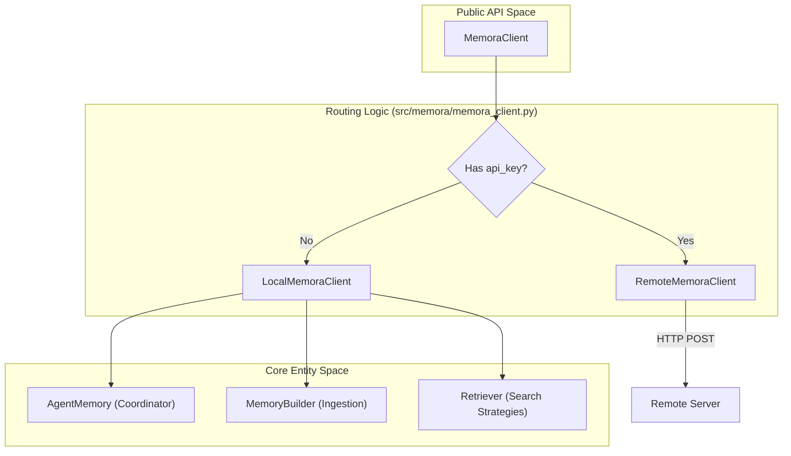
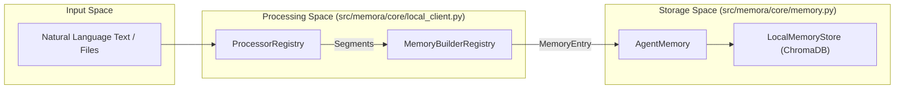

<!-- source: DeepWiki mcp.deepwiki.com · repo microsoft/Memora · page 2.1 MemoraClient API · fetched 2026-10-26 -->

# MemoraClient API

Relevant source files

The following files were used as context for generating this wiki page:

- [src/memora/core/base.py](src/memora/core/base.py)
- [src/memora/core/local_client.py](src/memora/core/local_client.py)
- [src/memora/core/memory.py](src/memora/core/memory.py)
- [src/memora/core/memory_entry.py](src/memora/core/memory_entry.py)
- [src/memora/core/remote_client.py](src/memora/core/remote_client.py)
- [src/memora/memora_client.py](src/memora/memora_client.py)

The `MemoraClient` serves as the primary public-facing facade for the Memora system. It abstracts the complexity of memory storage, retrieval strategies, and document processing into a high-level interface. Depending on the initialization parameters, it transparently routes requests to either a `LocalMemoraClient` for direct disk-based operations or a `RemoteMemoraClient` for HTTP-based interactions.

### Architecture Overview

The `MemoraClient` acts as a routing layer. When initialized with an `api_key`, it assumes a remote server configuration. If initialized with a `DictConfig` and `user_id`, it operates locally.

#### Client Routing and Data Flow

This diagram illustrates how the `MemoraClient` dispatches calls to specialized implementations and how data flows through the system.

**Sources:** [src/memora/memora_client.py:21-50](), [src/memora/core/local_client.py:36-80]()

---

### Core API Reference

#### 1. `add()` and `add_file()`
These methods are used to ingest information into the memory system. The `LocalMemoraClient` uses a `MemoryBuilderRegistry` to select the appropriate builder (e.g., `ChatMemoryBuilder`, `DocumentMemoryBuilder`) based on the input type.

*   **`add(text, type, metadata, ...)`**: Accepts raw strings, lists of strings, or structured dictionaries. It stamps the `user_id` onto the resulting `MemoryEntry` objects.
*   **`add_file(file_path, metadata)`**: Utilizes the `ProcessorRegistry` to parse files (PDF, Markdown, Word, etc.) into `Segment` objects before passing them to the memory builders.

**Sources:** [src/memora/memora_client.py:52-100](), [src/memora/core/local_client.py:114-154](), [src/memora/core/local_client.py:175-212]()

#### 2. `query()`
The standard query method performs vector similarity search. It supports:
*   **Hybrid Search**: Combining semantic vector search with keyword-based BM25 search.
*   **LLM Filtering**: Post-retrieval pruning where an LLM evaluates the relevance of retrieved memories.
*   **Query Modes**: Defined in `QueryMode`, allowing users to target the `PRIMARY_ONLY` index, `CUE_ONLY` (anchors), or `BOTH`.

**Sources:** [src/memora/memora_client.py:102-143](), [src/memora/core/memory.py:36-41](), [src/memora/core/memory.py:111-183]()

#### 3. `advance_query()`
This method provides access to sophisticated retrieval strategies beyond simple similarity search.

| Strategy | Retriever Class | Description |
| :--- | :--- | :--- |
| `semantic` | `SemanticRetriever` | Standard vector search with optional filtering. |
| `prompt` | `PromptedPolicyRetriever` | Iterative, LLM-guided retrieval using the Memora-Control policy. |
| `grpo` | `LocalPolicyRetriever` | Uses a GRPO-trained LoRA checkpoint for high-performance, model-driven retrieval. |

**Sources:** [src/memora/memora_client.py:145-185]()

#### 4. `list_memories()`
Provides a way to inspect the current state of the memory store, returning a list of `MemoryEntry` objects.

**Sources:** [src/memora/memora_client.py:188-204]()

---

### Internal Data Representation: MemoryEntry

Every interaction with the API involves the `MemoryEntry` DTO. This class ensures that whether a memory is being built or retrieved, it carries consistent metadata and history.

| Field | Type | Purpose |
| :--- | :--- | :--- |
| `value` | `str` | The core text content. |
| `index` | `str` | The natural language key used for embedding. |
| `memory_type` | `str` | `factual`, `episodic`, or `procedural`. |
| `linked_memory` | `str` | Used by Cue Anchors to point to a primary memory. |
| `history` | `List[Dict]` | Stores previous versions of the memory for temporal tracking. |

**Sources:** [src/memora/core/memory_entry.py:28-140]()

---

### Remote Interface (`RemoteMemoraClient`)

When an `api_key` is provided, `MemoraClient` initializes a `RemoteMemoraClient`. This implementation mirrors the local API but routes all calls to a remote server via RESTful endpoints.

*   **Base URL**: Configured via `MEMORA_REMOTE_SERVER_URL` (default: `http://localhost:8000`).
*   **Authentication**: Uses Bearer Token auth derived from the `api_key`.
*   **Endpoints**:
    *   `POST /api/v1/memory/add`
    *   `POST /api/v1/memory/query`

**Sources:** [src/memora/core/remote_client.py:9-153]()

---

### Memory Ingestion Logic

The following diagram maps the natural language input to the specific code entities responsible for processing and storing the memory.

**Sources:** [src/memora/core/local_client.py:70-81](), [src/memora/core/local_client.py:156-173](), [src/memora/core/memory.py:93-94]()

---

