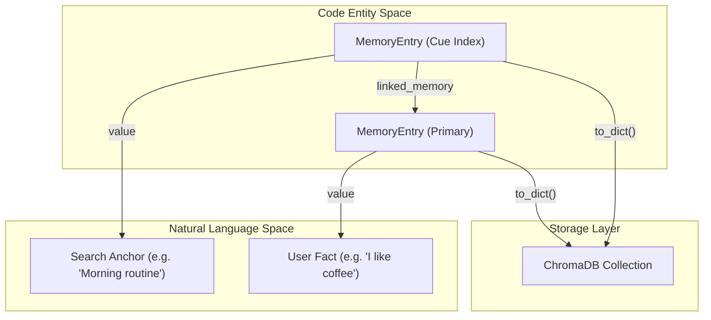
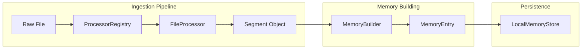

<!-- source: DeepWiki mcp.deepwiki.com · repo microsoft/Memora · page 2.2 Memory Data Model · fetched 2026-10-26 -->

# Memory Data Model

Relevant source files

The following files were used as context for generating this wiki page:

- [src/memora/core/local_client.py](src/memora/core/local_client.py)
- [src/memora/core/memory.py](src/memora/core/memory.py)
- [src/memora/core/memory_entry.py](src/memora/core/memory_entry.py)
- [src/memora/core/segment.py](src/memora/core/segment.py)

The Memory Data Model defines the core structures used to represent, store, and retrieve information within Memora. It bridges the gap between raw unstructured data (e.g., chat logs, documents) and the structured, vector-indexed representation used for retrieval-augmented generation.

## MemoryEntry

The `MemoryEntry` class is the central Data Transfer Object (DTO) in Memora. It provides a unified interface for memories regardless of whether they are being extracted from new content or retrieved from the vector database [src/memora/core/memory_entry.py:28-36]().

### Core Fields
A `MemoryEntry` contains the following primary fields:

| Field | Type | Description |
| :--- | :--- | :--- |
| `value` | `str` | The main processed content/text of the memory [src/memora/core/memory_entry.py:53-55](). |
| `index` | `str` | Unique key for retrieval and identification within the store [src/memora/core/memory_entry.py:62-65](). |
| `memory_type` | `str` | Categorization: `factual`, `procedural`, or `episodic` [src/memora/core/memory_entry.py:74-77](). |
| `history` | `List[Dict]` | Historical versions of the memory for tracking updates over time [src/memora/core/memory_entry.py:68-71](). |
| `cue_indices` | `str` | A string of multiple anchors (separated by `||`) used for multi-vector retrieval [src/memora/core/memory_entry.py:116-118](). |
| `linked_memory` | `str` | For cue entries, this points back to the primary memory index [src/memora/core/memory_entry.py:110-113](). |
| `score` | `float` | The similarity score assigned during retrieval [src/memora/core/memory_entry.py:86-89](). |

### Primary vs. Cue Indices
Memora distinguishes between "Primary" memories and "Cue" indices to improve retrieval recall.
*   **Primary Index**: The main entry containing the full memory value and history [src/memora/core/memory_entry.py:145-147]().
*   **Cue Index**: A lightweight entry that acts as a "search anchor." It contains a specific phrase or keyword in its `value` but points to a Primary Index via the `linked_memory` field [src/memora/core/memory_entry.py:141-143]().

### Serialization
Because vector databases like ChromaDB often only support flat metadata types, `MemoryEntry` handles serialization of complex types (lists and dicts) to JSON strings [src/memora/core/memory_entry.py:190-203]().

**Data Flow: Entity Mapping**
"Natural Language Space" to "Code Entity Space" mapping:

**Sources:** [src/memora/core/memory_entry.py:52-160](), [src/memora/core/memory_entry.py:190-217]()

---

## Segment

The `Segment` is an intermediate object used during the ingestion pipeline. Before text becomes a `MemoryEntry`, it is parsed and partitioned into `Segment` objects by a `Processor` [src/memora/core/segment.py:13-19]().

### Fields
*   **content**: The raw text extracted from a specific part of a file or conversation [src/memora/core/segment.py:17]().
*   **segment_type**: Identifies the origin (e.g., `chat`, `markdown`, `pdf`) [src/memora/core/segment.py:18]().
*   **metadata**: Contextual information such as `file_path`, `page_number`, or `speaker_id` [src/memora/core/segment.py:19]().

**Data Flow: Ingestion to Memory**

**Sources:** [src/memora/core/segment.py:1-28](), [src/memora/core/local_client.py:156-174](), [src/memora/core/local_client.py:114-154]()

---

## Memory Retrieval Logic

When querying, the `AgentMemory` coordinator interacts with the `MemoryEntry` objects to resolve links between cues and primary memories.

1.  **Search**: The system queries the `LocalMemoryStore`, which returns a list of `MemoryEntry` objects [src/memora/core/memory.py:137-139]().
2.  **Resolution**: 
    *   If a returned entry is a **Primary Index**, it is added to the result set [src/memora/core/memory.py:174-181]().
    *   If a returned entry is a **Cue Index**, the system uses the `linked_memory` field to fetch the corresponding Primary Index from storage [src/memora/core/memory.py:155-172]().
3.  **Deduplication**: The system ensures that if multiple cues point to the same primary memory, the primary memory is only returned once [src/memora/core/memory.py:168-172]().

### Query Modes
The `QueryMode` enum defines how the system filters the search space [src/memora/core/memory.py:36-40]():
*   `PRIMARY_ONLY`: Filters where `linked_memory` is empty [src/memora/core/memory.py:131-134]().
*   `CUE_ONLY`: Filters where `linked_memory` is not empty [src/memora/core/memory.py:125-130]().
*   `BOTH`: Searches the entire index.

**Sources:** [src/memora/core/memory.py:36-40](), [src/memora/core/memory.py:111-183](), [src/memora/core/memory_entry.py:141-166]()

---

