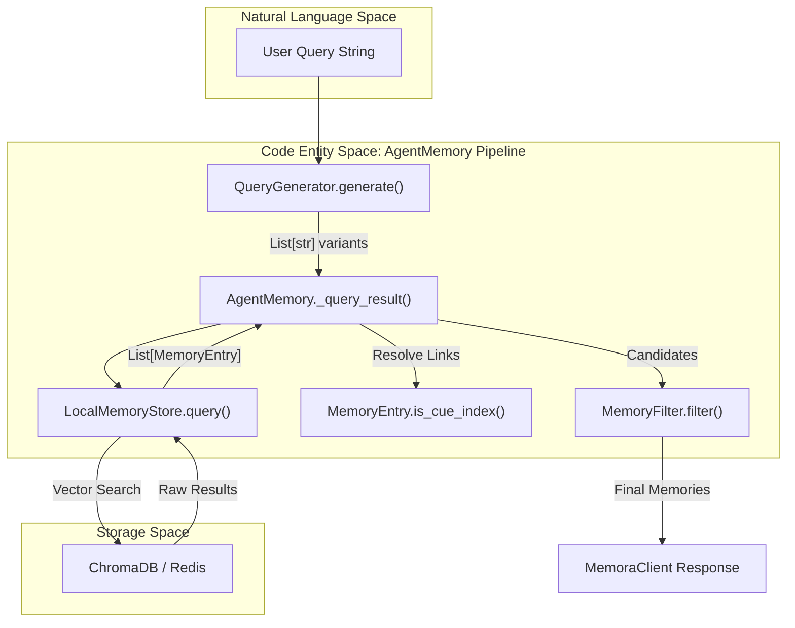
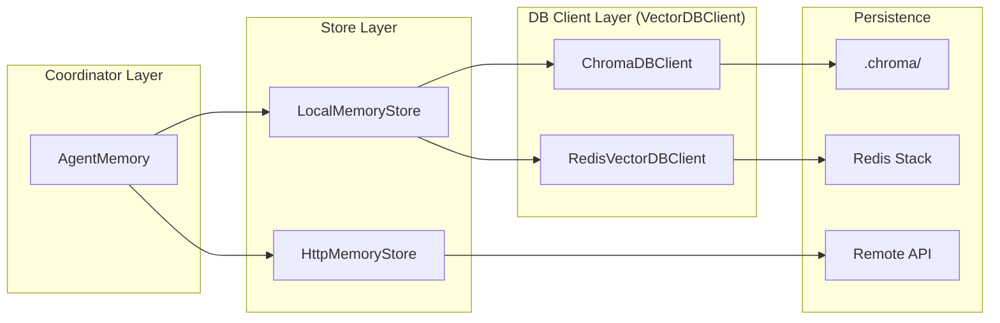

<!-- source: DeepWiki mcp.deepwiki.com · repo microsoft/Memora · page 2.3 AgentMemory & Storage Backends · fetched 2026-10-26 -->

# AgentMemory & Storage Backends

Relevant source files

The following files were used as context for generating this wiki page:

- [src/memora/core/http_memory_store.py](src/memora/core/http_memory_store.py)
- [src/memora/core/local_client.py](src/memora/core/local_client.py)
- [src/memora/core/local_memory_store.py](src/memora/core/local_memory_store.py)
- [src/memora/core/memory.py](src/memora/core/memory.py)
- [src/memora/core/memory_entry.py](src/memora/core/memory_entry.py)
- [src/memora/db_clients/__init__.py](src/memora/db_clients/__init__.py)
- [src/memora/db_clients/base.py](src/memora/db_clients/base.py)
- [src/memora/db_clients/chromadb_client.py](src/memora/db_clients/chromadb_client.py)
- [src/memora/db_clients/factory.py](src/memora/db_clients/factory.py)
- [src/memora/db_clients/redis_client.py](src/memora/db_clients/redis_client.py)

The `AgentMemory` coordinator serves as the central orchestration layer for all memory operations in Memora. It bridges the high-level client requests (add, query) with the low-level persistence mechanisms, managing the retrieval pipeline, cue index resolution, and metadata filtering.

## AgentMemory Coordinator

`AgentMemory` is a facade class that implements the `MemoryBase` interface [src/memora/core/memory.py:43-53](). It is responsible for initializing the storage backend and coordinating between the `QueryGenerator`, `MemoryFilter`, and the underlying `LocalMemoryStore` [src/memora/core/memory.py:84-94]().

### Retrieval Pipeline
The retrieval process in `AgentMemory` follows a multi-stage pipeline designed to maximize recall while maintaining high precision through LLM-based filtering.

1.  **Query Generation**: The system uses `QueryGenerator` to expand a single natural language input into multiple query variants [src/memora/core/memory.py:85]().
2.  **Parallel Search**: The coordinator executes searches across these variants using the storage backend [src/memora/core/memory.py:137-139]().
3.  **Cue Index Resolution**: If a retrieved entry is a "cue index" (indicated by a non-empty `linked_memory` field), the system automatically fetches the associated primary memory entries [src/memora/core/memory.py:155-172]().
4.  **RRF Merging & Deduplication**: Results are merged, sorted by relevance score, and deduplicated based on their content value [src/memora/core/memory.py:144-181]().
5.  **LLM Filtering**: Finally, the `MemoryFilter` uses an LLM to prune irrelevant results that passed the vector similarity threshold [src/memora/core/memory.py:86]().

### Data Flow: Query to Code Entity
The following diagram maps the logical retrieval flow to specific code entities and functions.

**Retrieval Pipeline Mapping**

**Sources:** [src/memora/core/memory.py:111-183](), [src/memora/core/local_memory_store.py:170-200](), [src/memora/core/memory_entry.py:141-147]()

---

## Cue Index Lifecycle

Cue indices are specialized `MemoryEntry` objects used for enhanced retrieval. Unlike primary memories, which store actual knowledge, cue indices act as alternative "anchors" pointing to primary memories [src/memora/core/memory_entry.py:109-118]().

| Action | Implementation Detail |
| :--- | :--- |
| **Creation** | Created during the build phase when `linked_memory` is populated with a primary index [src/memora/core/memory_entry.py:110-113](). |
| **Resolution** | In `_query_result`, if `entry.is_cue_index()` is true, the system calls `_store.get(primary_index)` to retrieve the actual content [src/memora/core/memory.py:155-162](). |
| **Deletion** | The `delete_cue_index` method removes specific anchors from a memory's `cue_indices` metadata string [src/memora/core/memory_entry.py:155-159](). |

**Sources:** [src/memora/core/memory_entry.py:141-166](), [src/memora/core/memory.py:155-172]()

---

## Storage Backends

Memora supports multiple persistence layers through the `VectorDBClient` abstraction [src/memora/db_clients/base.py:11-70](). The `LocalMemoryStore` is the default implementation, providing a thread-safe interface to vector databases [src/memora/core/local_memory_store.py:32-42]().

### LocalMemoryStore
`LocalMemoryStore` manages user-specific collections and provides an LRU cache for embeddings to minimize redundant API calls [src/memora/core/local_memory_store.py:76-118](). It uses a per-user locking mechanism (`_user_locks`) to ensure thread safety during concurrent writes to the same user's memory [src/memora/core/local_memory_store.py:44-53]().

### Vector DB Implementations
The system dispatches to specific database clients via `create_vector_db_client` [src/memora/db_clients/factory.py:14-37]():

1.  **ChromaDBClient**: The primary backend. It uses a `PersistentClient` and a custom `ChromaDBEmbeddingFunction` to handle local file-based storage [src/memora/db_clients/chromadb_client.py:31-59]().
2.  **RedisVectorDBClient**: An alternative backend using Redis Stack. It maps metadata to `TAG` fields for efficient exact filtering and `VectorField` for HNSW similarity search [src/memora/db_clients/redis_client.py:30-85]().
3.  **HttpMemoryStore**: A remote storage implementation that communicates with a memory service via REST API endpoints like `/api/memory/upsert` and `/api/memory/query` [src/memora/core/http_memory_store.py:21-54]().

**Storage Backend Architecture**

**Sources:** [src/memora/core/local_memory_store.py:71-86](), [src/memora/db_clients/factory.py:27-37](), [src/memora/db_clients/chromadb_client.py:31-59](), [src/memora/db_clients/redis_client.py:129-167]()

---

