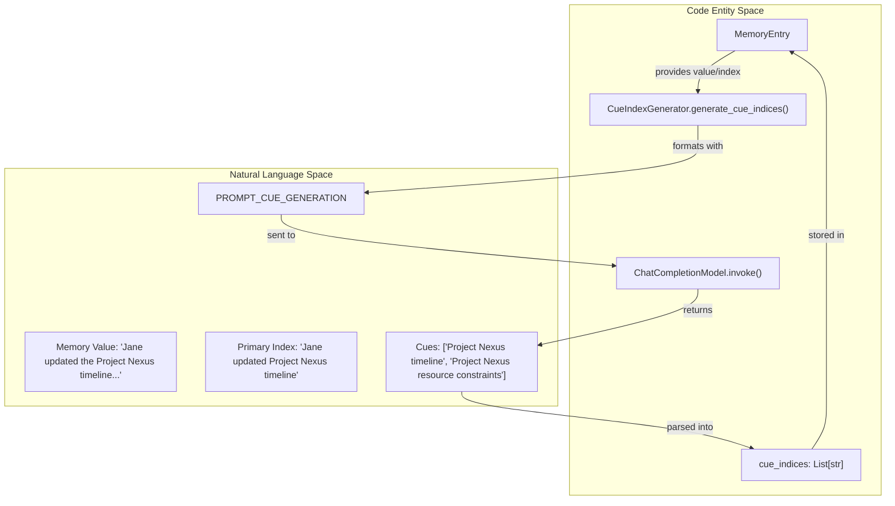
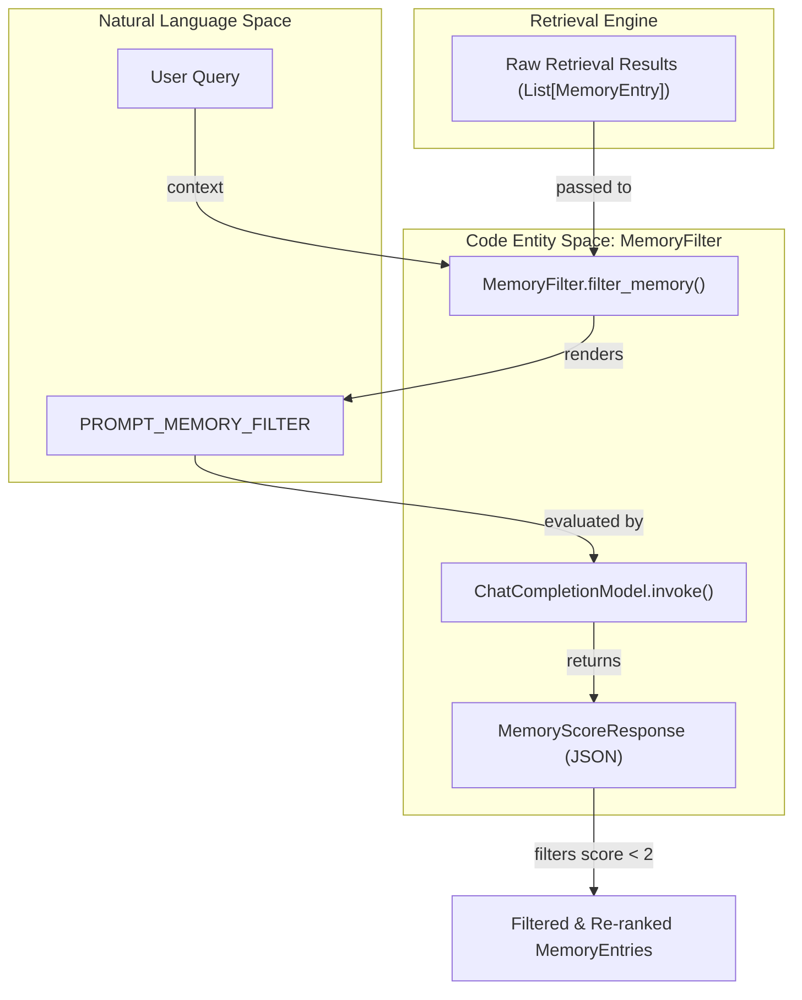

<!-- source: DeepWiki mcp.deepwiki.com · repo microsoft/Memora · page 2.4 Cue Index & Query Generation · fetched 2026-10-26 -->

# Cue Index & Query Generation

Relevant source files

The following files were used as context for generating this wiki page:

- [src/memora/core/cue_index_generator.py](src/memora/core/cue_index_generator.py)
- [src/memora/core/memory_filter.py](src/memora/core/memory_filter.py)
- [src/memora/core/query_generator.py](src/memora/core/query_generator.py)

This section details the specialized components responsible for expanding the semantic reach of memories and optimizing the retrieval process. Memora employs a dual-indexing strategy where each memory is associated with a primary index (the main summary) and multiple **Cue Anchors** (secondary semantic keys).

The retrieval pipeline leverages LLM-driven **Query Generation** to expand a single user request into multiple search variants and uses a **Memory Filter** to prune irrelevant results after retrieval.

## CueIndexGenerator

The `CueIndexGenerator` class is responsible for generating 0-3 short, meaningful "Cue Indices" for a given memory. While the primary index usually captures the core summary, cue indices provide additional semantic anchors that focus on different perspectives, such as specific actors, actions, concepts, or causal relations [src/memora/core/cue_index_generator.py:11-37]().

### Generation Logic
The generator uses structured prompting to ensure cues follow a `[Main Entity] + [Key Aspect]` pattern (e.g., "Project Phoenix kickoff", "Sarah hiking trip") [src/memora/core/cue_index_generator.py:116-125](). Cues are designed to be:
*   **Compact**: 2-5 words [src/memora/core/cue_index_generator.py:20-20]().
*   **Contextually Anchored**: They must specify the "who" or "what domain" the memory belongs to [src/memora/core/cue_index_generator.py:22-22]().
*   **Distinct**: Each cue covers a different aspect (factual vs. relational) [src/memora/core/cue_index_generator.py:24-27]().

### Implementation Detail
The generator operates in batches to improve efficiency. It maps raw `MemoryEntry` objects into a text format for the LLM and parses the results back into a structured dictionary where keys are the primary indices and values are lists of generated cue strings [src/memora/core/cue_index_generator.py:146-175]().

**Data Flow: From Memory Value to Cue Anchors**

Sources: [src/memora/core/cue_index_generator.py:110-144](), [src/memora/core/cue_index_generator.py:146-175]()

---

## QueryGenerator

The `QueryGenerator` class handles the transformation of a user context into optimized search queries. It supports two primary modes: semantic query expansion and keyword extraction [src/memora/core/query_generator.py:60-65]().

### Functions
*   **`generate_queries(context)`**: Infers the user's intent and generates 1-3 concise (6-14 words) queries targeting different memory types (factual, procedural, episodic) [src/memora/core/query_generator.py:67-83]().
*   **`extract_keywords(context)`**: Identifies 1-4 important entities or short phrases (2-4 words) for exact-match or keyword-based searches [src/memora/core/query_generator.py:85-108]().

### Prompts and Schemas
The class uses Pydantic models (`MemoryQueries`, `Keywords`) to enforce structured output from the LLM, ensuring that the retrieval pipeline receives clean lists of strings [src/memora/core/query_generator.py:40-58]().

| Feature | Prompt Symbol | Output Type | Word Count |
| :--- | :--- | :--- | :--- |
| Semantic Expansion | `PROMPT_GENERATE_QUERIES` | `MemoryQueries` | 6–14 words |
| Keyword Extraction | `PROMPT_EXTRACT_KEYWORDS` | `Keywords` | 2–4 words |

Sources: [src/memora/core/query_generator.py:8-37](), [src/memora/core/query_generator.py:67-108]()

---

## MemoryFilter

The `MemoryFilter` is a post-retrieval component that uses an LLM to evaluate the relevance of retrieved memories against the original query. This step is crucial for discarding "hallucinated" retrievals or outdated information that vector similarity might still rank highly [src/memora/core/memory_filter.py:95-99]().

### Scoring Mechanism
The filter assigns a relevance score from 1 to 3 to each retrieved memory [src/memora/core/memory_filter.py:52-57]():
*   **Score 3**: Highly relevant; directly answers the query.
*   **Score 2**: Somewhat relevant; provides context/background.
*   **Score 1**: Irrelevant or outdated.

### Pruning and Re-ranking
1.  **Filtering**: Only memories with a score of 2 or 3 are kept [src/memora/core/memory_filter.py:155-155]().
2.  **Sorting**: Results are re-sorted primarily by the LLM relevance score and secondarily by the original search engine score (e.g., vector similarity) [src/memora/core/memory_filter.py:159-160]().

**Retrieval Refinement Pipeline**

Sources: [src/memora/core/memory_filter.py:52-93](), [src/memora/core/memory_filter.py:101-169]()

---

## Technical Data Flow Summary

The following table summarizes how these components interact during the memory lifecycle:

| Component | Trigger | Input | Output |
| :--- | :--- | :--- | :--- |
| **CueIndexGenerator** | Memory Ingestion (Batch) | `MemoryEntry` (Value + Primary Index) | `cue_indices` metadata |
| **QueryGenerator** | Retrieval Start | User Context String | `List[str]` (Queries/Keywords) |
| **MemoryFilter** | Post-Search | `List[MemoryEntry]` + Query | `List[MemoryEntry]` (Pruned/Sorted) |

Sources: [src/memora/core/cue_index_generator.py:146-147](), [src/memora/core/query_generator.py:67-70](), [src/memora/core/memory_filter.py:101-105]()

---

