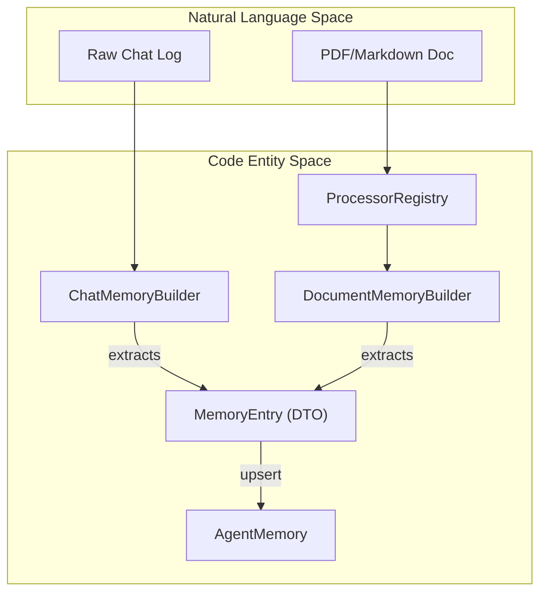
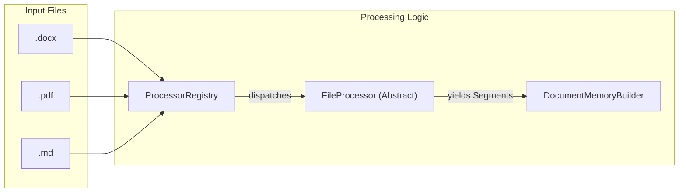

<!-- source: DeepWiki mcp.deepwiki.com · repo microsoft/Memora · page 3 Memory Ingestion & Building · fetched 2026-10-26 -->

# Memory Ingestion & Building

Relevant source files

The following files were used as context for generating this wiki page:

- [src/memora/builder/chat_memory_builder.py](src/memora/builder/chat_memory_builder.py)
- [src/memora/builder/document_memory_builder.py](src/memora/builder/document_memory_builder.py)
- [src/memora/builder/memory_builder.py](src/memora/builder/memory_builder.py)
- [src/memora/utils/memory.py](src/memora/utils/memory.py)

Memory ingestion is the process of transforming unstructured data—such as raw text, chat logs, and complex documents—into the structured `MemoryEntry` objects used by the Memora system. This subsystem bridges the gap between natural language inputs and the indexed, queryable "Code Entity Space."

The ingestion process is governed by the `MemoryBuilder` pipeline, which manages extraction, multimodal processing, and the logic for updating or deduplicating memories within the storage backend.

## Ingestion Overview

The ingestion flow starts with raw content and ends with a synchronized state in the `AgentMemory`. The system supports two primary builder implementations tailored for different data sources:

1.  **Chat Ingestion**: Optimized for dialogue, focusing on factual extraction and episodic summarization.
2.  **Document Ingestion**: Optimized for structured files, supporting both factual data and multi-step procedural workflows.

### From Natural Language to Memory Entities

The following diagram illustrates how natural language inputs are routed through specific code entities to become structured memories.

**Ingestion Path: Text to MemoryEntry**

Sources: [src/memora/builder/memory_builder.py:127-151](), [src/memora/builder/chat_memory_builder.py:66-76](), [src/memora/builder/document_memory_builder.py:109-117]()

---

## Memory Builder Pipeline

The `MemoryBuilder` is an abstract base class that defines the three-phase lifecycle for creating memories:

1.  **Extraction**: Using LLM prompts like `PROMPT_BUILD_MEMORY` to identify key facts or procedures.
2.  **Processing**: Generating `CueIndex` anchors for efficient retrieval and handling multimodal elements (images/text).
3.  **Upsert/Deduplication**: Comparing new memories against existing ones using `MemoryUpdateDecision` to determine if a memory should be added as new or merged into an existing entry.

| Component | Responsibility |
| :--- | :--- |
| `MemoryBuilder` | Base logic for multimodal handling and LLM interaction. |
| `ChatMemoryBuilder` | Extracts factual memories and generates episodic summaries from conversations. |
| `DocumentMemoryBuilder` | Parses segments into factual and procedural (step-by-step) memories. |
| `MemoryUpdateDecision` | Pydantic model for LLM-based deduplication logic. |

For details, see [Memory Builder Pipeline](#3.1).

Sources: [src/memora/builder/memory_builder.py:38-76](), [src/memora/builder/memory_builder.py:127-149](), [src/memora/utils/memory.py:12-48]()

---

## Document Processors

Before a document can be turned into a memory, it must be parsed into manageable `Segment` objects. This is handled by a specialized processing infrastructure:

*   **ProcessorRegistry**: Detects file types and routes them to the appropriate `FileProcessor`.
*   **FileProcessors**: Specialized handlers for formats including Markdown, Word (`.docx`), Excel (`.xlsx`), PowerPoint (`.pptx`), PDF, and plain text.
*   **Segmentation**: Logic that breaks large documents into semantically coherent chunks while preserving hierarchical context (e.g., Section > Subsection).

The following diagram shows the relationship between file types and the processing classes.

**Document Processing Architecture**

For details, see [Document Processors](#3.2).

Sources: [src/memora/builder/document_memory_builder.py:25-81](), [src/memora/builder/document_memory_builder.py:115-145]()

---

## Upsert & History Preservation

Memora does not simply overwrite data. When the `MemoryBuilder` identifies a conflict between a new memory and an existing one, it uses `generate_history` to preserve the evolution of that memory.

*   **Deduplication**: The system uses a similarity threshold (`UPDATE_SCORE_THRESHOLD`) to find candidate memories in the `AgentMemory` store.
*   **Merging**: If an update is decided, the `updated_value` combines the new information with the old, and the previous state is appended to the `history` field of the `MemoryEntry`.

Sources: [src/memora/builder/memory_builder.py:144-146](), [src/memora/utils/memory.py:139-164]()

---

