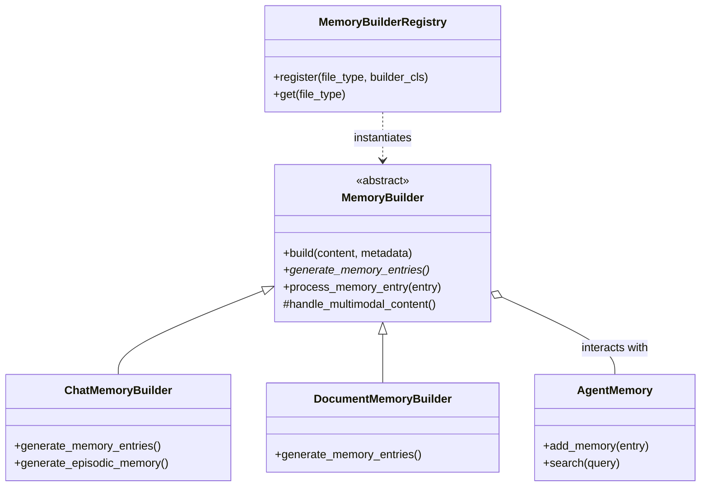
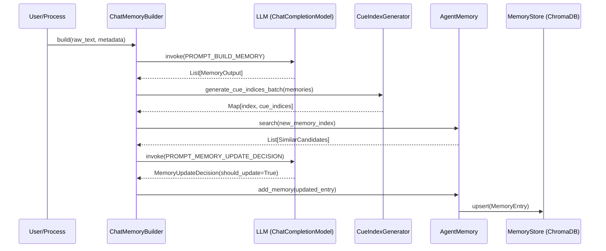

<!-- source: DeepWiki mcp.deepwiki.com · repo microsoft/Memora · page 3.1 Memory Builder Pipeline · fetched 2026-10-26 -->

# Memory Builder Pipeline

Relevant source files

The following files were used as context for generating this wiki page:

- [src/memora/builder/chat_memory_builder.py](src/memora/builder/chat_memory_builder.py)
- [src/memora/builder/document_memory_builder.py](src/memora/builder/document_memory_builder.py)
- [src/memora/builder/memory_builder.py](src/memora/builder/memory_builder.py)
- [src/memora/builder/memory_builder_registry.py](src/memora/builder/memory_builder_registry.py)
- [src/memora/utils/memory.py](src/memora/utils/memory.py)

The Memory Builder Pipeline is the core ingestion engine of Memora. It is responsible for transforming raw, unstructured data (such as chat transcripts, multimodal inputs, or documents) into structured, searchable `MemoryEntry` objects. The pipeline follows a standardized three-phase lifecycle: **Extraction**, **Processing**, and **Upsert/Deduplication**.

## Architecture Overview

The pipeline is anchored by the `MemoryBuilder` abstract base class, which defines the template for memory construction. Concrete implementations specialize in different content types, such as `ChatMemoryBuilder` for conversational flows and `DocumentMemoryBuilder` for structured knowledge.

### Pipeline Lifecycle
The `MemoryBuilder.build()` method coordinates the following flow:
1.  **Normalization**: Raw content is converted into a standard format (text or multimodal dictionary) [src/memora/builder/memory_builder.py:31]().
2.  **Extraction**: LLM-based prompts identify factual or procedural segments [src/memora/builder/memory_builder.py:171-177]().
3.  **Cue Generation**: If enabled, specific "cue anchors" are generated to improve retrieval [src/memora/builder/memory_builder.py:180-198]().
4.  **Deduplication & Update**: New memories are compared against existing ones to decide whether to add a new entry or update an existing one [src/memora/builder/memory_builder.py:202-210]().

### Class Relationship Diagram
This diagram maps the high-level builder concepts to their specific code entities.

**Sources:** [src/memora/builder/memory_builder.py:127-150](), [src/memora/builder/chat_memory_builder.py:66-70](), [src/memora/builder/document_memory_builder.py:109-112](), [src/memora/builder/memory_builder_registry.py:10-23]()

---

## The Three-Phase Lifecycle

### 1. Extraction Phase
During extraction, the pipeline uses specialized prompts to identify memories.
*   **Factual Memories**: Extracted using `PROMPT_BUILD_MEMORY` [src/memora/builder/memory_builder.py:38-76](). It focuses on neutral, self-contained sentences where pronouns are replaced with specific entities.
*   **Procedural Memories**: Supported by `DocumentMemoryBuilder` via `PROMPT_BUILD_DOCUMENT_MEMORY` [src/memora/builder/document_memory_builder.py:25-107](). These include ordered steps and summary logic.
*   **Episodic Memories**: Generated by `ChatMemoryBuilder` to summarize "what happened" in a conversation segment [src/memora/builder/chat_memory_builder.py:25-55]().

### 2. Processing & Cue Generation
Once extracted, entries are converted into `MemoryEntry` DTOs. If `enable_cue_index` is active, the `CueIndexGenerator` performs a batch LLM call to generate search-optimized keywords for each memory [src/memora/builder/chat_memory_builder.py:119-136]().

### 3. Upsert and Deduplication
The pipeline prevents memory bloat by checking for semantic redundancy before saving.

1.  **Similarity Search**: The `AgentMemory` searches for existing memories similar to the new entry using a similarity threshold (`UPDATE_SCORE_THRESHOLD`) [src/memora/builder/memory_builder.py:255-263]().
2.  **Decision Logic**: If similar memories are found, the LLM uses `PROMPT_MEMORY_UPDATE_DECISION` to determine if the new info is a duplicate, an update, or a distinct fact [src/memora/builder/memory_builder.py:79-94]().
3.  **Update Execution**: If an update is chosen, the system:
    *   Generates a combined value.
    *   Preserves history by appending the old entry to the `history` field of the new one [src/memora/utils/memory.py:139-164]().
    *   Deletes the old candidate and its associated cue indices [src/memora/utils/memory.py:116-138]().

### Data Flow: Ingestion to Storage
This diagram shows how a raw input string moves through the system components.

**Sources:** [src/memora/builder/memory_builder.py:151-226](), [src/memora/builder/chat_memory_builder.py:71-143](), [src/memora/core/memory.py:26](), [src/memora/utils/memory.py:12-47]()

---

## Key Components

### MemoryUpdateDecision
A Pydantic model that structures the LLM's choice during deduplication.
| Field | Description |
| :--- | :--- |
| `should_update` | Boolean indicating if an existing entry should be merged. |
| `best_candidate_index` | The integer index of the candidate selected for merging. |
| `updated_value` | The new string combining old and new information. |
| `updated_index` | A refined title for the memory entry. |
| `updated_cues` | A refreshed list of cue anchors for retrieval. |

**Sources:** [src/memora/utils/memory.py:12-47]()

### Multimodal Handling
The pipeline supports multimodal content by checking for `image` keys in the input dictionary. If present, `handle_multimodal_content` processes both text and image URLs, instructing the LLM to merge visual facts (e.g., "cake with candles") into the factual memory values [src/memora/builder/memory_builder.py:228-253]().

### History Preservation
Memora maintains a provenance trail for every memory. When a memory is updated, the `generate_history` function captures the `index`, `value`, `creation_time`, and `timestamp` of the previous version and stores it within the new `MemoryEntry.history` list [src/memora/utils/memory.py:139-164]().

**Sources:** [src/memora/builder/memory_builder.py:38-76](), [src/memora/builder/chat_memory_builder.py:88-110](), [src/memora/builder/document_memory_builder.py:130-145](), [src/memora/utils/memory.py:139-164]()

---

