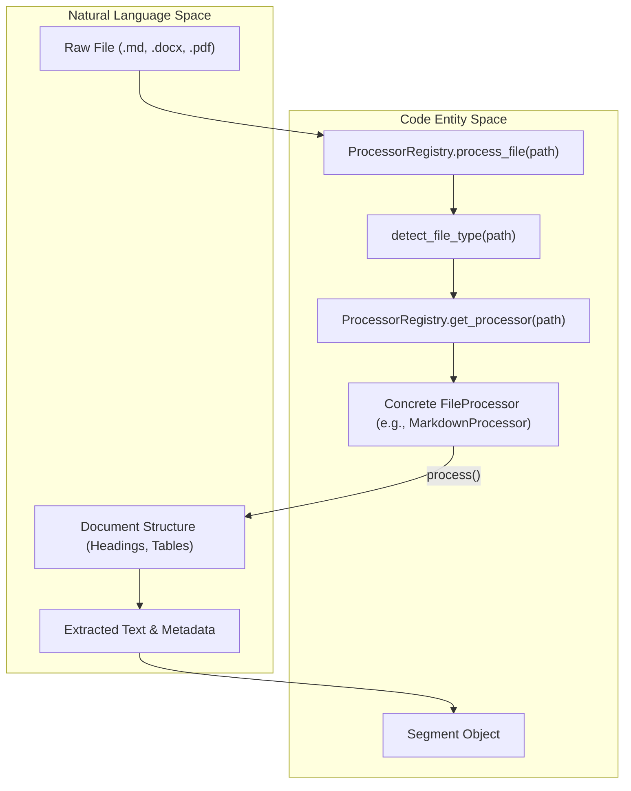
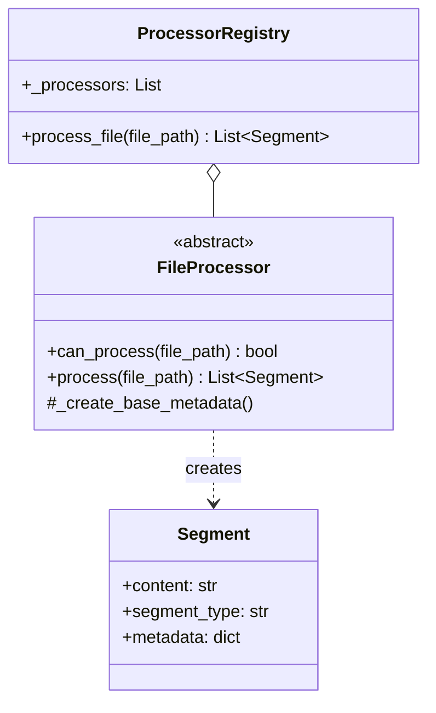

<!-- source: DeepWiki mcp.deepwiki.com · repo microsoft/Memora · page 3.2 Document Processors · fetched 2026-10-26 -->

# Document Processors

Relevant source files

The following files were used as context for generating this wiki page:

- [src/memora/processors/__init__.py](src/memora/processors/__init__.py)
- [src/memora/processors/base_processor.py](src/memora/processors/base_processor.py)
- [src/memora/processors/excel_processor.py](src/memora/processors/excel_processor.py)
- [src/memora/processors/markdown_processor.py](src/memora/processors/markdown_processor.py)
- [src/memora/processors/pdf_processor.py](src/memora/processors/pdf_processor.py)
- [src/memora/processors/powerpoint_processor.py](src/memora/processors/powerpoint_processor.py)
- [src/memora/processors/processor_registry.py](src/memora/processors/processor_registry.py)
- [src/memora/processors/simple_text_processor.py](src/memora/processors/simple_text_processor.py)
- [src/memora/processors/text_processor.py](src/memora/processors/text_processor.py)
- [src/memora/processors/word_processor.py](src/memora/processors/word_processor.py)

The Document Processor system is responsible for transforming raw files into structured `Segment` objects. This subsystem handles file type detection, structural parsing (headings, tables, slides, rows), and metadata enrichment. It provides a unified interface for the `DocumentMemoryBuilder` to ingest diverse data formats into the Memora memory store.

## Architecture Overview

The architecture follows a registry-based strategy pattern. The `ProcessorRegistry` acts as a central dispatcher that identifies the correct `FileProcessor` for a given file extension. Each processor is specialized in a specific file format and implements the logic required to preserve the document's semantic structure (e.g., keeping a heading with its following paragraph).

### Data Flow: File to Segment

The following diagram illustrates how a file is routed through the system and converted into segments.

**Document Processing Flow**

Sources: [src/memora/processors/processor_registry.py:61-78](), [src/memora/processors/base_processor.py:51-62]()

## Processor Registry

The `ProcessorRegistry` maintains a list of available processors and provides the primary entry point for the rest of the system.

- **Initialization**: Upon instantiation, it registers default processors for Markdown, Text, Word, Excel, PowerPoint, and PDF [src/memora/processors/processor_registry.py:28-35]().
- **Routing**: The `get_processor` method iterates through registered processors and calls `can_process(file_path)` on each until a match is found [src/memora/processors/processor_registry.py:56-59]().
- **Extension Support**: It provides `get_supported_extensions()` to help external callers determine which files can be ingested [src/memora/processors/processor_registry.py:80-100]().

Sources: [src/memora/processors/processor_registry.py:20-101]()

## Base Processor & File Detection

All processors inherit from `FileProcessor` (which extends the abstract `BaseProcessor`). This base class provides utility methods for common tasks.

### File Type Mapping
The system uses a centralized mapping of extensions to categories:

| Category | Extensions |
| :--- | :--- |
| `markdown` | .md, .markdown, .mdown, .mdx |
| `word` | .doc, .docx, .docm, .dotx, .dotm |
| `excel` | .xls, .xlsx, .xlsm, .csv |
| `powerpoint` | .ppt, .pptx, .potx |
| `pdf` | .pdf |
| `text` | .txt, .text, .log, .readme |

Sources: [src/memora/processors/base_processor.py:15-42]()

### Core Methods
- `_read_file_content(file_path)`: Reads text files with a fallback from UTF-8 to Latin-1 encoding to handle legacy files [src/memora/processors/base_processor.py:124-141]().
- `_create_base_metadata(file_path, file_type)`: Generates standard metadata including `source_file`, `file_name`, and `file_size` [src/memora/processors/base_processor.py:142-158]().

## Specialized Processors

### MarkdownProcessor
The `MarkdownProcessor` preserves the hierarchical structure of markdown files. It uses regex to detect ATX headings (`#`) and tracks a `heading_hierarchy` to ensure every segment knows its position within the document [src/memora/processors/markdown_processor.py:60-108]().

- **HTML Cleaning**: It uses the `markdownify` library to convert embedded HTML tags back into markdown format [src/memora/processors/markdown_processor.py:149-155]().
- **Metadata**: Every segment includes a `heading_path` (e.g., "Introduction > Methods") and the specific `heading` it belongs to [src/memora/processors/markdown_processor.py:177-190]().

Sources: [src/memora/processors/markdown_processor.py:16-137]()

### WordProcessor
The `WordProcessor` utilizes `python-docx` to parse Word documents. It implements a logic similar to the Markdown processor where it combines headings with their subsequent paragraphs into a single `Segment` until a `max_segment_size` is reached [src/memora/processors/word_processor.py:64-128]().

Sources: [src/memora/processors/word_processor.py:14-156]()

### Excel & CSV Processor
The `ExcelProcessor` handles both tabular CSV data and multi-sheet Workbooks.
- **CSV**: Detects dialects using `csv.Sniffer` and treats the first row as a `table_header` segment, while subsequent rows are `table_row` segments [src/memora/processors/excel_processor.py:41-88]().
- **Excel**: Uses `openpyxl` to iterate through sheets. Each sheet name is captured as a `worksheet` segment, and rows are converted to comma-separated strings within `table_row` segments [src/memora/processors/excel_processor.py:90-141]().

Sources: [src/memora/processors/excel_processor.py:14-141]()

### PDF Processor
The `PDFProcessor` uses `pdfplumber` to extract both text and tables.
- **Text**: Split into paragraphs based on double newlines [src/memora/processors/pdf_processor.py:50-53]().
- **Tables**: Extracted as separate `table` segments with `row_count` and `column_count` metadata [src/memora/processors/pdf_processor.py:68-93]().

Sources: [src/memora/processors/pdf_processor.py:14-94]()

## Implementation Details

### Segment Creation
Each processor eventually outputs a list of `Segment` objects. The `Segment` is an intermediate DTO used before the data is finalized into a `MemoryEntry`.

**Entity Relationship: Processors to Segments**

Sources: [src/memora/processors/processor_registry.py:20-60](), [src/memora/processors/base_processor.py:95-122]()

### Extensibility Model
To add a new file format:
1.  Create a new class inheriting from `FileProcessor`.
2.  Implement `can_process` to return `True` for the target extension.
3.  Implement `process` to return a list of `Segment` objects.
4.  Register the instance with `processor_registry.register(MyNewProcessor())` [src/memora/processors/processor_registry.py:37-44]().

---

