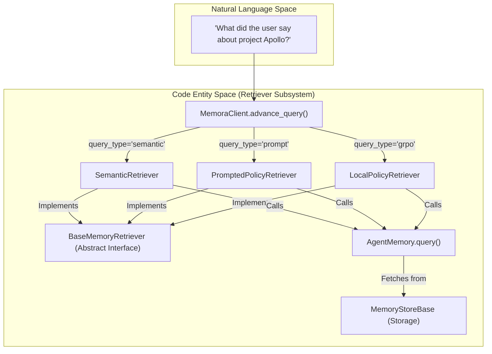

<!-- source: DeepWiki mcp.deepwiki.com · repo microsoft/Memora · page 4 Retrieval Strategies · fetched 2026-10-26 -->

# Retrieval Strategies

Relevant source files

The following files were used as context for generating this wiki page:

- [src/memora/core/base.py](src/memora/core/base.py)
- [src/memora/core/remote_client.py](src/memora/core/remote_client.py)
- [src/memora/memora_client.py](src/memora/memora_client.py)
- [src/memora/retriever/__init__.py](src/memora/retriever/__init__.py)
- [src/memora/retriever/base_retriever.py](src/memora/retriever/base_retriever.py)
- [src/memora/retriever/semantic_retriever.py](src/memora/retriever/semantic_retriever.py)
- [src/memora/rl/__init__.py](src/memora/rl/__init__.py)

The retrieval system in Memora is designed to navigate complex memory structures—including hierarchical links between factual, episodic, and procedural memories—using a variety of strategies. All retrieval logic is governed by the `BaseMemoryRetriever` contract, which ensures a consistent interface for the `MemoraClient` regardless of whether the underlying mechanism is a simple vector search or an iterative RL-based policy.

### Retrieval Architecture Overview

The `MemoraClient` serves as the primary entry point for retrieval, offering two main methods: `query` for standard semantic search and `advance_query` for sophisticated strategies [src/memora/memora_client.py:102-185](). The architecture separates the "Search Mechanism" (how candidates are found in the vector store) from the "Retrieval Strategy" (how those candidates are selected, filtered, and expanded).

#### Retrieval Component Mapping
The following diagram illustrates how natural language queries transition into code entities within the retrieval subsystem.

**Diagram: Query Execution Flow**

**Sources:** [src/memora/memora_client.py:145-185](), [src/memora/retriever/base_retriever.py:20-45](), [src/memora/core/base.py:73-85]()

---

### The BaseMemoryRetriever Contract

Every retrieval strategy in Memora must implement the `BaseMemoryRetriever` abstract base class [src/memora/retriever/base_retriever.py:20-81](). This contract ensures that the system can execute queries, apply ranking, and return a standardized list of `MemoryEntry` objects.

| Method | Description |
| :--- | :--- |
| `retrieve(query, top_k, ...)` | The core execution method. It handles the complete pipeline: query processing, search, filtering, and ranking [src/memora/retriever/base_retriever.py:57-81](). |
| `__init__(cfg)` | Initializes the retriever with a `DictConfig` containing hyperparameters like `top_k` and `enable_llm_filter` [src/memora/retriever/base_retriever.py:47-55](). |

**Sources:** [src/memora/retriever/base_retriever.py:1-81]()

---

### Strategy 1: Semantic Retriever

The `SemanticRetriever` is the baseline strategy. It performs a single-step vector similarity search using the `AgentMemory` interface [src/memora/retriever/semantic_retriever.py:20-39]().

*   **Hybrid Search:** Can combine BM25 keyword matching with dense vector embeddings [src/memora/retriever/semantic_retriever.py:59]().
*   **Query Modes:** Supports `PRIMARY_ONLY` (searching only main memory values) or `BOTH` (searching both primary values and the cue index) [src/memora/retriever/semantic_retriever.py:62-65]().
*   **Factual Filtering:** By default, it filters for `memory_type == "factual"`, relying on the memory system's internal links to pull in related episodic context [src/memora/retriever/semantic_retriever.py:107]().

For details, see [Semantic Retriever](#4.1).

**Sources:** [src/memora/retriever/semantic_retriever.py:41-111]()

---

### Strategy 2: Prompted Policy Retriever

The `PromptedPolicyRetriever` implements an iterative, agentic retrieval loop. Instead of a single search, it treats retrieval as a multi-step decision process [src/memora/retriever/prompted_policy_retriever.py:8-19]().

*   **Memora-Control:** An LLM persona that manages the "Working Set" (currently retrieved memories) and the "Frontier" (potential links to explore).
*   **Iterative Actions:** The policy can choose to `EXPAND` (follow links), `RE_QUERY` (generate new search terms), or `STOP` (finalize results).
*   **Local vs. Hosted:** `PromptedPolicyRetriever` uses hosted LLMs, while `LocalPolicyRetriever` is optimized for local models [src/memora/retriever/__init__.py:8-13]().

For details, see [Prompted Policy Retriever](#4.2).

**Sources:** [src/memora/memora_client.py:174-175](), [src/memora/retriever/__init__.py:8-19]()

---

### Strategy 3: GRPO-Trained Retrieval Policy

The most advanced strategy utilizes Reinforcement Learning (RL) to optimize the retrieval trajectory. This strategy is invoked via `advance_query(query_type="grpo")` [src/memora/memora_client.py:176-179]().

*   **QwenPolicy:** A specialized policy based on the Qwen model architecture [src/memora/rl/policy_qwen.py:10]().
*   **GRPO Training:** The model is fine-tuned using Group Relative Policy Optimization (GRPO) to minimize retrieval steps while maximizing the relevance of the "Working Set".
*   **Checkpoint Loading:** Uses `LocalPolicyRetriever` to load specific LoRA checkpoints that have been trained for efficient memory navigation [src/memora/memora_client.py:179]().

For details, see [GRPO-Trained Retrieval Policy](#4.3).

**Sources:** [src/memora/memora_client.py:162-180](), [src/memora/rl/__init__.py:4-10]()

---

### Strategy Comparison

The following table summarizes the trade-offs between the three primary strategies.

| Strategy | Type | Complexity | Latency | Best Use Case |
| :--- | :--- | :--- | :--- | :--- |
| **Semantic** | Single-step | Low | Low | Simple factual lookups. |
| **Prompted Policy** | Multi-step (LLM) | High | High | Complex reasoning across disparate memory segments. |
| **GRPO Policy** | Multi-step (RL) | High | Medium | High-performance, specialized memory navigation. |

**Sources:** [src/memora/memora_client.py:170-185](), [src/memora/retriever/semantic_retriever.py:28-32]()

---

