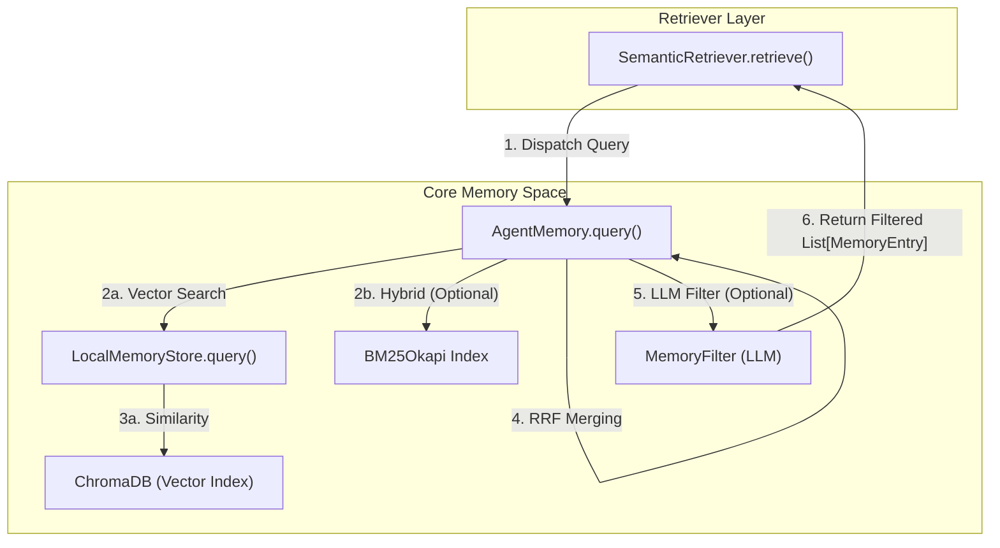
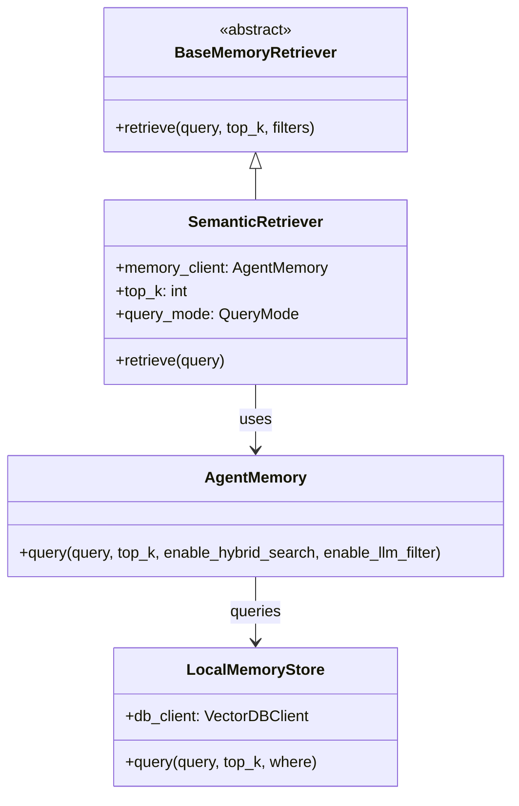

<!-- source: DeepWiki mcp.deepwiki.com · repo microsoft/Memora · page 4.1 Semantic Retriever · fetched 2026-10-26 -->

# Semantic Retriever

Relevant source files

The following files were used as context for generating this wiki page:

- [src/memora/core/http_memory_store.py](src/memora/core/http_memory_store.py)
- [src/memora/core/local_memory_store.py](src/memora/core/local_memory_store.py)
- [src/memora/retriever/__init__.py](src/memora/retriever/__init__.py)
- [src/memora/retriever/base_retriever.py](src/memora/retriever/base_retriever.py)
- [src/memora/retriever/semantic_retriever.py](src/memora/retriever/semantic_retriever.py)
- [src/memora/rl/__init__.py](src/memora/rl/__init__.py)

The `SemanticRetriever` is the foundational retrieval implementation in Memora. It provides a single-turn retrieval interface that leverages vector similarity search, optional keyword-based hybrid search, and LLM-based post-filtering to surface relevant memories. Unlike iterative policies, the `SemanticRetriever` is designed for low-latency, high-precision retrieval of factual data.

## Overview and Purpose

The `SemanticRetriever` implements the `BaseMemoryRetriever` abstract interface [src/memora/retriever/base_retriever.py:20-45](). Its primary role is to bridge the gap between a natural language query and the structured `MemoryEntry` objects stored in the underlying vector database. It delegates the heavy lifting of vector search and hybrid merging to the `AgentMemory` coordinator [src/memora/retriever/semantic_retriever.py:101-109]().

### Key Features
*   **Vector Similarity Search**: Uses embeddings to find semantically related memories [src/memora/retriever/semantic_retriever.py:24-26]().
*   **Hybrid Search (BM25 + Semantic)**: Optionally combines dense vector results with sparse keyword results [src/memora/retriever/semantic_retriever.py:59]().
*   **QueryMode Control**: Supports searching only the primary index or both the primary and cue anchor indices [src/memora/retriever/semantic_retriever.py:62-65]().
*   **Factual-Only Filtering**: By design, it filters for `memory_type == "factual"` to ensure retrieved memories are grounded, while relying on memory links to pull in associated episodic context [src/memora/retriever/semantic_retriever.py:107]().

---

## Architecture and Data Flow

The following diagram illustrates how the `SemanticRetriever` interacts with the core memory components to transform a query into a set of filtered results.

### Semantic Retrieval Pipeline

Sources: [src/memora/retriever/semantic_retriever.py:101-109](), [src/memora/core/local_memory_store.py:170-192]()

---

## Implementation Details

### Query Modes
The retriever operates in two primary modes based on the `enable_cue_index` configuration:
1.  **`PRIMARY_ONLY`**: Searches only the main memory index containing the actual memory values [src/memora/retriever/semantic_retriever.py:65]().
2.  **`BOTH`**: Searches both the primary index and the `CueIndex`, which contains generated "cue anchors" (alternative phrasing or hypothetical questions) that point back to the primary memories [src/memora/retriever/semantic_retriever.py:63]().

### Hybrid Search and RRF
When `enable_hybrid_search` is enabled, the system performs both a vector search and a BM25 keyword search. The results are merged using **Reciprocal Rank Fusion (RRF)** within the `AgentMemory` layer. This ensures that memories containing specific rare keywords are surfaced even if their semantic embedding distance is relatively high [src/memora/retriever/semantic_retriever.py:59]().

### LLM Filtering
If `enable_llm_filter` is true, the retrieved candidates are passed to a `MemoryFilter`. This component uses an LLM to evaluate the relevance of each candidate memory against the original query, pruning "hallucinated" or irrelevant matches that the vector search might have picked up due to high-dimensional proximity [src/memora/retriever/semantic_retriever.py:60]().

---

## Configuration Parameters

The `SemanticRetriever` behavior is governed by the `memory` and `retrieval` sections of the configuration object (`cfg`).

| Parameter | Type | Default | Description |
| :--- | :--- | :--- | :--- |
| `top_k` | `int` | `30` | Number of memories to retrieve from the database [src/memora/retriever/semantic_retriever.py:58](). |
| `enable_hybrid_search` | `bool` | `False` | Enables BM25 keyword search alongside vector search [src/memora/retriever/semantic_retriever.py:59](). |
| `enable_llm_filter` | `bool` | `False` | Uses an LLM to post-process and prune retrieved results [src/memora/retriever/semantic_retriever.py:60](). |
| `enable_cue_index` | `bool` | `False` | If true, sets `QueryMode.BOTH` to search cue anchors [src/memora/retriever/semantic_retriever.py:62-65](). |

Sources: [src/memora/retriever/semantic_retriever.py:57-65]()

---

## Factual-Only Filter Design Choice

A critical implementation detail in `SemanticRetriever.retrieve` is the hardcoded metadata filter:
`where={"memory_type": {"$eq": "factual"}}` [src/memora/retriever/semantic_retriever.py:107]().

This design choice reflects Memora's "Harmonic Memory Representation":
1.  **Factual Memories** act as the primary retrieval targets because they contain the most concise information.
2.  **Episodic/Procedural Memories** are linked to factual memories.
3.  By retrieving the factual "anchor," the system can later traverse links to provide the user with the original conversation context (episodic) if required, without cluttering the initial vector search space with redundant or noisy conversational segments [src/memora/retriever/semantic_retriever.py:107]().

---

## Code-to-System Mapping

This diagram maps the logical retrieval concepts to specific classes and methods within the codebase.

### Retrieval Class Relationships

Sources: [src/memora/retriever/base_retriever.py:20-45](), [src/memora/retriever/semantic_retriever.py:20-40](), [src/memora/core/local_memory_store.py:32-55]()

---

