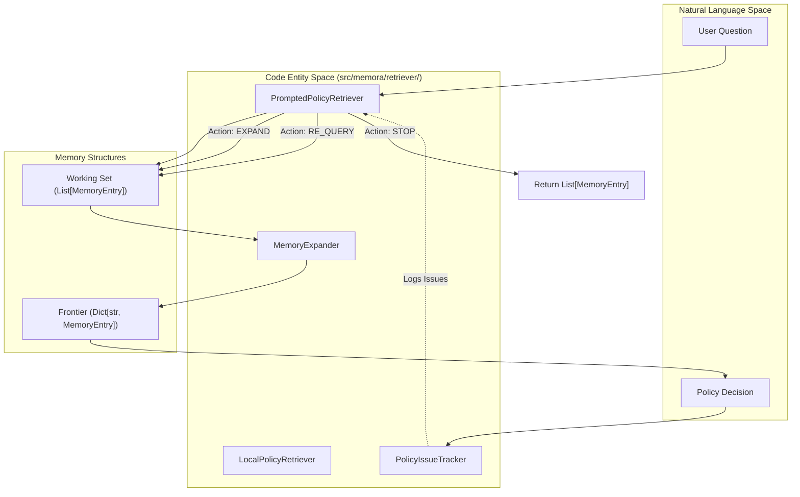
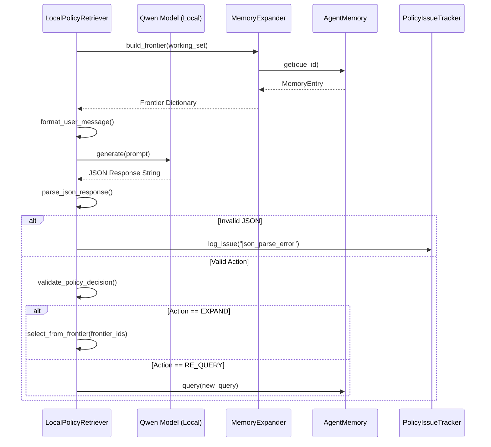

<!-- source: DeepWiki mcp.deepwiki.com · repo microsoft/Memora · page 4.2 Prompted Policy Retriever · fetched 2026-10-26 -->

# Prompted Policy Retriever

Relevant source files

The following files were used as context for generating this wiki page:

- [src/memora/core/memory_expander.py](src/memora/core/memory_expander.py)
- [src/memora/retriever/local_policy_retriever.py](src/memora/retriever/local_policy_retriever.py)
- [src/memora/retriever/policy_utils.py](src/memora/retriever/policy_utils.py)
- [src/memora/retriever/prompted_policy_retriever.py](src/memora/retriever/prompted_policy_retriever.py)

The **Prompted Policy Retriever** implements an iterative, LLM-guided retrieval loop designed to navigate complex memory structures. Unlike standard semantic search, which performs a single-shot retrieval, this system uses a decision policy (the **Memora-Control** persona) to interactively manage a **Working Set** of retrieved information and a **Frontier** of potential expansion candidates [src/memora/retriever/prompted_policy_retriever.py:28-35]().

This module provides two primary implementations:
1.  `PromptedPolicyRetriever`: Uses hosted LLMs (e.g., GPT-4) via `ChatCompletionModel` [src/memora/retriever/prompted_policy_retriever.py:96-115]().
2.  `LocalPolicyRetriever`: Uses local open-source models (e.g., Qwen2.5) and supports loading GRPO-trained LoRA checkpoints [src/memora/retriever/local_policy_retriever.py:112-133]().

## Iterative Retrieval State Machine

The retrieval process is modeled as a state machine where the LLM evaluates the current context at each step and selects one of three actions to reach the goal of answering a `UserQuestion`.

### The Retrieval Loop
The core logic resides in the `retrieve()` method, which executes up to `max_steps` (default: 5) [src/memora/retriever/prompted_policy_retriever.py:202-210]().

1.  **Initial Retrieval**: A semantic search is performed to populate the initial **Working Set (W)** [src/memora/retriever/prompted_policy_retriever.py:214-216]().
2.  **Frontier Building**: The `MemoryExpander` identifies linked memories (via cue anchors) reachable from **W** to form the **Frontier (F)** [src/memora/core/memory_expander.py:70-88]().
3.  **Policy Decision**: The LLM receives the `WorkingSetSummary` and `FrontierSummary` and chooses an action [src/memora/retriever/policy_utils.py:143-162]().
4.  **Action Execution**:
    *   `EXPAND`: Moves specific IDs from the Frontier into the Working Set [src/memora/retriever/prompted_policy_retriever.py:160-183]().
    *   `RE_QUERY`: Generates a new search query and performs a fresh retrieval against the corpus [src/memora/retriever/prompted_policy_retriever.py:255-265]().
    *   `STOP`: Terminates the loop and returns the current Working Set [src/memora/retriever/prompted_policy_retriever.py:268-270]().

### Action Policy Definitions
| Action | Description | When to use |
| :--- | :--- | :--- |
| `EXPAND` | Grow memory from expansion candidates in Frontier. | When F contains high-novelty items likely to fill gaps. |
| `RE_QUERY` | Regenerate a query and retrieve from the full corpus. | When facts are missing and expansion is unlikely to find them (e.g., relative pointers). |
| `STOP` | Terminate the retrieval loop. | When W is sufficient to answer the question with high confidence. |

**Sources:** [src/memora/retriever/prompted_policy_retriever.py:27-59](), [src/memora/retriever/policy_utils.py:90-120]()

## Code Entity Map: Retrieval Flow

The following diagram bridges the natural language concepts to the specific code entities that manage them.

**Sources:** [src/memora/retriever/prompted_policy_retriever.py:96-280](), [src/memora/core/memory_expander.py:16-35](), [src/memora/retriever/policy_utils.py:25-45]()

## Memory Expansion & The Frontier

The `MemoryExpander` is responsible for traversing the "harmonic memory representation" by following links between primary memories and their associated cue anchors.

*   **Direct Expansion**: Collects all `cue_indices` from the current working set and fetches the primary memories they point to [src/memora/core/memory_expander.py:104-120]().
*   **Relaxed Frontier**: If `enable_relaxed_frontier` is true, the expander performs a semantic search for cues *similar* to the existing ones to find related but not explicitly linked content [src/memora/core/memory_expander.py:124-143]().
*   **Parallel Processing**: Uses `ThreadPoolExecutor` to handle multiple cue lookups simultaneously [src/memora/core/memory_expander.py:129-139]().

**Sources:** [src/memora/core/memory_expander.py:37-60](), [src/memora/core/memory_expander.py:70-166]()

## Local LLM & LoRA Support

The `LocalPolicyRetriever` allows Memora to run without external API dependencies and serves as the evaluation harness for RL-trained models.

*   **Model Caching**: Uses a global `_LOCAL_MODEL_CACHE` to ensure only one instance of a large model (e.g., Qwen) is loaded in memory at a time [src/memora/retriever/local_policy_retriever.py:43-59]().
*   **LoRA Loading**: If a `checkpoint_path` is provided, it uses the `peft` library to wrap the base model with a trained adapter [src/memora/retriever/local_policy_retriever.py:94-102]().
*   **Quantization**: Supports `load_in_8bit` via `BitsAndBytesConfig` for memory-efficient local execution [src/memora/retriever/local_policy_retriever.py:78-81]().

**Sources:** [src/memora/retriever/local_policy_retriever.py:135-195](), [src/memora/retriever/local_policy_retriever.py:228-255]()

## Prompting & Parsing Logic

The system uses strict JSON formatting to ensure policy decisions can be parsed programmatically.

### JSON Schema
The LLM must output a JSON object with the following fields:
*   `action`: The chosen action string.
*   `reason`: A short explanation for the choice.
*   `confidence`: A float between 0.0 and 1.0.
*   `frontier_ids`: A list of exact memory index strings (required for `EXPAND`).
*   `new_query`: A string for the next search (required for `RE_QUERY`).

**Sources:** [src/memora/retriever/policy_utils.py:123-141]()

### PolicyIssueTracker
The `PolicyIssueTracker` (a singleton) monitors the health of the retrieval loop [src/memora/retriever/policy_utils.py:25-34](). It logs specific failures such as:
*   `expand_no_valid_ids`: LLM chose EXPAND but provided invalid or missing IDs.
*   `requery_no_new_query`: LLM chose RE_QUERY but did not provide a new string.
*   `json_parse_error`: The LLM failed to output valid JSON.

**Sources:** [src/memora/retriever/policy_utils.py:39-56]()

## Data Flow: Iterative Step

This diagram details the internal data flow during a single step of the `LocalPolicyRetriever`.

**Sources:** [src/memora/retriever/local_policy_retriever.py:228-300](), [src/memora/retriever/policy_utils.py:228-265](), [src/memora/core/memory_expander.py:70-90]()

---

