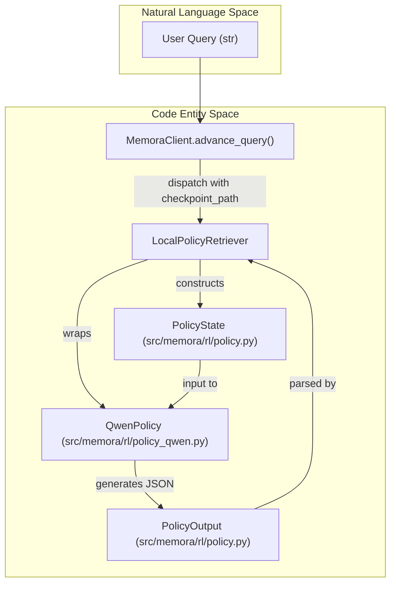
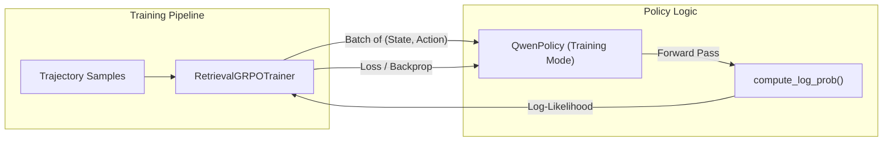

<!-- source: DeepWiki mcp.deepwiki.com · repo microsoft/Memora · page 4.3 GRPO-Trained Retrieval Policy · fetched 2026-10-26 -->

# GRPO-Trained Retrieval Policy

Relevant source files

The following files were used as context for generating this wiki page:

- [src/memora/retriever/preference_optimized_retriever.py](src/memora/retriever/preference_optimized_retriever.py)
- [src/memora/rl/llm_policy.py](src/memora/rl/llm_policy.py)
- [src/memora/rl/policy.py](src/memora/rl/policy.py)
- [src/memora/rl/policy_qwen.py](src/memora/rl/policy_qwen.py)

The **GRPO-Trained Retrieval Policy** is a reinforcement learning-based strategy designed to optimize the iterative retrieval process in Memora. Unlike the standard `PromptedPolicyRetriever` which relies on zero-shot prompting of hosted LLMs, this policy utilizes a local **Qwen-based** model fine-tuned using **Group Relative Policy Optimization (GRPO)**. It is specifically optimized to navigate the memory space by making sequential decisions: expanding the "Working Set," re-querying with new terms, or stopping once sufficient information is gathered.

## Architecture Overview

The GRPO-trained policy is implemented via the `QwenPolicy` class, which serves as the brain for the `LocalPolicyRetriever`. During inference, this policy processes the current retrieval state and outputs a JSON-formatted action.

### Code-to-Entity Mapping: Inference Pipeline

The following diagram illustrates how natural language queries are transformed into code-level state objects and processed by the GRPO-trained model.

**Retrieval Dispatch and Policy Execution**

Sources: [src/memora/rl/policy_qwen.py:19-23](), [src/memora/rl/policy.py:28-36](), [src/memora/rl/policy.py:39-48]()

## The QwenPolicy Implementation

The `QwenPolicy` class inherits from `BasePolicy` and manages the lifecycle of the local decoder model (typically `Qwen2.5-7B-Instruct`). It supports Parameter-Efficient Fine-Tuning (PEFT) via LoRA checkpoints generated during the GRPO training phase.

### Key Features
*   **Lazy Loading**: The model and tokenizer are initialized only upon the first call to `_load_model` [src/memora/rl/policy_qwen.py:47-50]().
*   **Quantization Support**: Supports 8-bit loading via `BitsAndBytesConfig` to reduce VRAM usage on consumer hardware [src/memora/rl/policy_qwen.py:70-74]().
*   **LoRA Integration**: Loads fine-tuned weights targeting specific modules (`q_proj`, `v_proj`, `k_proj`, `o_proj`, etc.) [src/memora/rl/policy_qwen.py:86-98]().
*   **Differentiable Log-Probs**: Provides `get_action_logprobs` to compute the log probabilities of generated action tokens, which is essential for the GRPO advantage calculation [src/memora/rl/policy_qwen.py:149-161]().

### Data Flow: State to Action

The policy converts the `PolicyState` into a structured prompt using a chat template.

| Step | Component | Action |
| :--- | :--- | :--- |
| 1 | `build_messages` | Combines `POLICY_SYSTEM_MESSAGE` with formatted state [src/memora/rl/policy.py:68-73](). |
| 2 | `apply_chat_template` | Converts messages into model-specific tokens with a generation prompt [src/memora/rl/policy_qwen.py:126-131](). |
| 3 | `model.generate` | Autoregressively predicts the JSON action string. |
| 4 | `_parse_action` | Validates the JSON and maps it to `PolicyOutput` [src/memora/rl/policy.py:85-94](). |

Sources: [src/memora/rl/policy_qwen.py:113-146](), [src/memora/rl/policy.py:53-62]()

## State and Action Representation

The policy operates within a Markov Decision Process (MDP) where the state includes the current query and the state of the memory indices.

### PolicyState
The `PolicyState` [src/memora/rl/policy.py:28-36]() encapsulates:
*   `query`: The original user question.
*   `current_query`: The most recent re-query string.
*   `working_set`: List of `MemoryEntry` objects already retrieved.
*   `frontier`: A dictionary of potential `MemoryEntry` candidates discovered but not yet fully retrieved.
*   `step` / `max_steps`: Current iteration in the retrieval loop.

### PolicyOutput
The `PolicyOutput` [src/memora/rl/policy.py:39-48]() contains the model's decision:
*   `action`: One of `EXPAND`, `RE_QUERY`, or `STOP`.
*   `frontier_ids`: Indices of memories from the frontier to move into the working set.
*   `new_query`: The string for the next retrieval pass (if `RE_QUERY`).

## Training Integration (GRPO)

The `QwenPolicy` is the primary artifact trained by the `RetrievalGRPOTrainer`. During training, the policy must compute log probabilities for entire sequences to update the weights based on the relative reward of a group of trajectories.

**GRPO Training Data Flow**

Sources: [src/memora/rl/policy_qwen.py:149-198](), [src/memora/rl/policy_qwen.py:200-204]()

### Log Probability Computation
The `get_action_logprobs` function extracts logits only for the tokens corresponding to the "assistant" response (the action). It uses `torch.gather` to align the logits with the actual `action_ids` provided in the training trajectory [src/memora/rl/policy_qwen.py:180-196](). This allows the trainer to penalize or reward specific actions taken during the iterative retrieval process.

Sources: [src/memora/rl/policy_qwen.py:172-198]()

---

