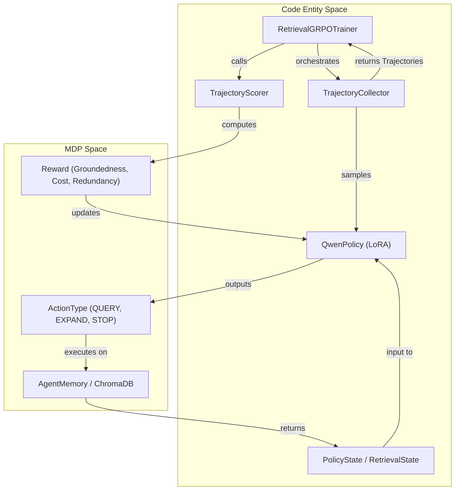

<!-- source: DeepWiki mcp.deepwiki.com · repo microsoft/Memora · page 5 Reinforcement Learning Training (GRPO) · fetched 2026-10-26 -->

# Reinforcement Learning Training (GRPO)

Relevant source files

The following files were used as context for generating this wiki page:

- [src/memora/rl/grpo_trainer.py](src/memora/rl/grpo_trainer.py)
- [src/memora/rl/trajectory_collector.py](src/memora/rl/trajectory_collector.py)
- [src/memora/rl/trajectory_utils.py](src/memora/rl/trajectory_utils.py)

The reinforcement learning (RL) pipeline in Memora is designed to optimize the retrieval policy using **Group Relative Policy Optimization (GRPO)**. This pipeline fine-tunes a local language model (typically a Qwen-based model) to make sequential decisions about which memories to retrieve, when to expand the search via cue indices, and when to terminate the retrieval process.

By framing retrieval as a Markov Decision Process (MDP), the system learns to balance retrieval precision (groundedness) against search efficiency (cost and redundancy).

## Retrieval MDP Overview

The retrieval process is modeled as a sequence of actions taken by the `QwenPolicy` [src/memora/rl/policy_qwen.py:19-20](). At each step, the policy observes the `RetrievalState` [src/memora/rl/trajectory_utils.py:61-68]() and selects an action to modify the `Working Set` or explore the `Frontier`.

### Action Space
The policy can select from several `ActionType` values [src/memora/rl/trajectory_utils.py:37-46]():
*   **QUERY_PRIMARY_INDEX**: Performs a semantic search against the primary memory store.
*   **EXPAND**: Follows links from a memory in the frontier to its associated cue anchors.
*   **RE_QUERY**: Reformulates the search string based on currently retrieved information.
*   **STOP**: Terminates the loop and returns the current `Working Set`.

### System Mapping: Code to MDP
The following diagram bridges the natural language concepts of RL training to the specific code entities in the `memora.rl` package.

**Retrieval RL Architecture**

**Sources:** [src/memora/rl/grpo_trainer.py:75-84](), [src/memora/rl/trajectory_collector.py:169-180](), [src/memora/rl/trajectory_utils.py:37-46](), [src/memora/rl/policy_qwen.py:19-20]()

---

## Trajectory Collection & Scoring

Before a training update occurs, the system must collect "rollouts" or trajectories. A `Trajectory` consists of a sequence of `TrajectoryStep` objects, documenting every action, log probability, and state transition [src/memora/rl/trajectory_collector.py:26-41]().

*   **Collection**: The `TrajectoryCollector` uses either the current model (for on-policy exploration) or a heuristic behavior policy to gather data [src/memora/rl/trajectory_collector.py:169-180]().
*   **Scoring**: The `TrajectoryScorer` evaluates the final `Working Set` against ground truth evidence. It calculates a composite reward based on:
    *   **Groundedness**: How much of the required evidence was retrieved [src/memora/rl/grpo_trainer.py:61]().
    *   **Redundancy**: Penalties for retrieving overlapping or irrelevant information [src/memora/rl/grpo_trainer.py:62]().
    *   **Cost**: Penalties for excessive API calls or retrieval steps [src/memora/rl/grpo_trainer.py:63]().

For details, see [Trajectory Collection & Scoring](#5.1).

**Sources:** [src/memora/rl/trajectory_collector.py:26-81](), [src/memora/rl/grpo_trainer.py:113-121]()

---

## GRPO Trainer

The `RetrievalGRPOTrainer` implements the Group Relative Policy Optimization algorithm. Unlike standard PPO, which requires a separate value function (critic), GRPO estimates the baseline by averaging rewards across a group of trajectories sampled from the same prompt [src/memora/rl/grpo_trainer.py:75-84]().

### Key Training Features
*   **Group Advantage**: Advantages are computed by mean-centering rewards within a group of $K$ rollouts (defined by `group_size`) [src/memora/rl/grpo_trainer.py:51](), [src/memora/rl/grpo_trainer.py:188-193]().
*   **KL Divergence**: A penalty is applied to prevent the policy from drifting too far from the reference model [src/memora/rl/grpo_trainer.py:57-59]().
*   **LoRA Fine-tuning**: Training typically targets a low-rank adaptation (LoRA) of the base Qwen model to maintain efficiency [src/memora/rl/grpo_trainer.py:127-131]().

**Training Data Flow**

```mermaid
graph LR
    Queries["query_data (JSON)"] -->|Batch| Collector["TrajectoryCollector"]
    Collector -->|K Rollouts| Groups["Grouped Trajectories"]
    Groups -->|Scoring| Scorer["TrajectoryScorer"]
    Scorer -->|Rewards| AdvCalc["Advantage Calculation"]
    AdvCalc -->|Loss| Optimizer["AdamW / LoRA Update"]
    Optimizer -->|Updated Weights| Policy["QwenPolicy"]
```

**Sources:** [src/memora/rl/grpo_trainer.py:45-72](), [src/memora/rl/grpo_trainer.py:187-195]()

For details, see [GRPO Trainer](#5.2).

---

## Diagnostic Outputs

Training progress is monitored through several artifacts generated in the `output_dir` [src/memora/rl/grpo_trainer.py:48]():
*   **TensorBoard**: Logs scalars like `loss/total`, `reward/groundedness`, and `policy/kl_divergence` [src/memora/rl/grpo_trainer.py:145]().
*   **Groundedness Log**: A JSONL file (`groundedness_log.jsonl`) containing the detailed text of retrieved memories and their scores for manual inspection.
*   **Checkpoints**: Periodic saves of the LoRA adapter weights [src/memora/rl/grpo_trainer.py:69]().

**Sources:** [src/memora/rl/grpo_trainer.py:141-146]()

---

