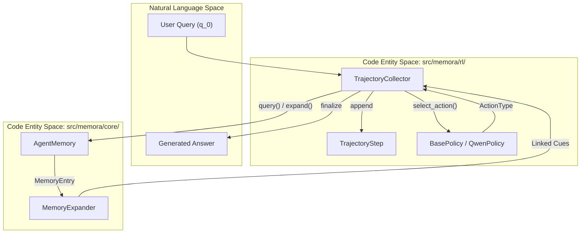
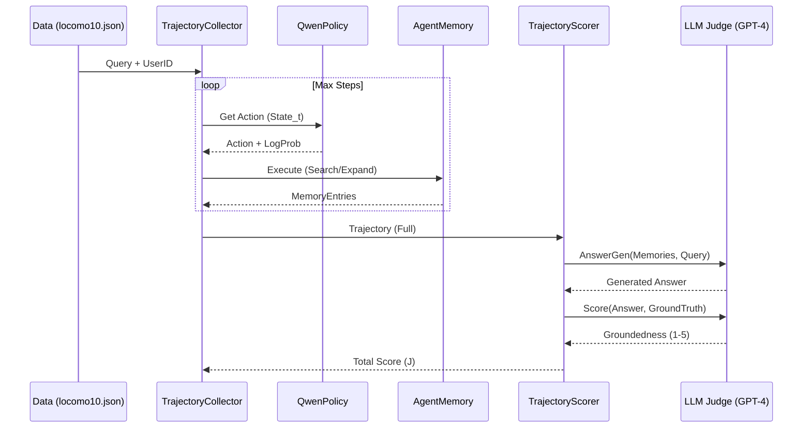

<!-- source: DeepWiki mcp.deepwiki.com · repo microsoft/Memora · page 5.1 Trajectory Collection & Scoring · fetched 2026-10-26 -->

# Trajectory Collection & Scoring

Relevant source files

The following files were used as context for generating this wiki page:

- [src/memora/rl/collect_trajectories.py](src/memora/rl/collect_trajectories.py)
- [src/memora/rl/data_utils.py](src/memora/rl/data_utils.py)
- [src/memora/rl/trajectory_collector.py](src/memora/rl/trajectory_collector.py)
- [src/memora/rl/trajectory_scorer.py](src/memora/rl/trajectory_scorer.py)
- [src/memora/rl/trajectory_utils.py](src/memora/rl/trajectory_utils.py)

In the context of reinforcement learning for memory retrieval, a **trajectory** represents a sequence of decision-making steps taken by a retrieval policy to answer a specific user query. This page details the Markov Decision Process (MDP) formulation, the collection mechanisms for both heuristic and RL-based behaviors, and the multi-faceted scoring system used to calculate rewards for Group Relative Policy Optimization (GRPO).

## MDP Formulation for Retrieval

The retrieval process is modeled as a sequential decision task where an agent interacts with the memory index to assemble a "Working Set" of relevant information.

### State Space
The state $s_t$ at step $t$ is defined by the `RetrievalState` class:
*   **Current Query ($q_t$):** The original or reformulated search string.
*   **Working Set ($W_t$):** The set of `MemoryEntry` objects already retrieved.
*   **Frontier ($F_t$):** A list of candidate memory indices (cues or primary links) discovered but not yet fetched.
*   **Budget ($b_t$):** Remaining computational or token resources.

Sources: `[src/memora/rl/trajectory_utils.py:61-68]()`

### Action Space
The policy selects from several `ActionType` options at each step:
*   `QUERY_PRIMARY_INDEX`: Perform a vector search against the main factual/episodic memory store.
*   `QUERY_CUE_INDEX`: Search against the cue anchor index to find entry points into memory clusters.
*   `EXPAND`: (Implicit in policy) Follow links from a retrieved memory to its associated cue indices.
*   `STOP`: Terminate the retrieval loop and proceed to answer generation.

Sources: `[src/memora/rl/trajectory_utils.py:37-46]()`, `[src/memora/rl/trajectory_collector.py:178-193]()`

### Cost Model
Each action (except `STOP`) incurs a cost defined in `ACTION_COSTS`, which is subtracted from the trajectory's budget to discourage excessive or redundant retrieval.

Sources: `[src/memora/rl/trajectory_utils.py:50-58]()`

## Trajectory Data Structures

Memora uses a hierarchical data model to track rollouts for training and evaluation.

| Class | Description | Key Fields |
| :--- | :--- | :--- |
| `TrajectoryStep` | A single transition in the MDP. | `action`, `log_prob`, `state_text`, `new_query` |
| `Trajectory` | A full sequence of steps for one rollout. | `steps`, `retrieved_memories`, `trajectory_score`, `cost` |
| `QueryTrajectories` | A group of $G$ trajectories for the same query. | `query`, `trajectories`, `rewards`, `advantages` |

Sources: `[src/memora/rl/trajectory_collector.py:26-154]()`

## Trajectory Collection

The `TrajectoryCollector` is responsible for executing "rollouts." It supports two primary modes:
1.  **Heuristic/Behavioral:** Uses existing logic (e.g., `PromptedPolicyRetriever`) to generate baseline trajectories.
2.  **RL Policy:** Uses a model (like `QwenPolicy`) to sample actions based on log probabilities.

### Collection Flow
The `collect_trajectories_for_query` method generates $G$ independent trajectories (groups) for a single query to facilitate the relative advantage calculation required by GRPO.

### Code-to-Entity Mapping: Collection Pipeline
The following diagram illustrates how the `TrajectoryCollector` interacts with core memory components to generate a rollout.

Sources: `[src/memora/rl/trajectory_collector.py:169-201]()`, `[src/memora/rl/trajectory_collector.py:255-300]()`

## Scoring and Rewards

The `TrajectoryScorer` computes a scalar reward $J(\tau)$ for a completed trajectory. The goal is to maximize information retrieval while minimizing redundancy and cost.

### Scoring Components
The total score is a weighted sum:
$$J(\tau) = w_g \cdot \text{Groundedness} - w_r \cdot \text{Redundancy} - w_c \cdot \text{Cost}$$

1.  **Groundedness ($w_g$):** Calculated by an LLM Judge (`ACCURACY_PROMPT_SCALED`). It compares the `generated_answer` (produced from `retrieved_memories`) against the `ground_truth`. It uses a 1-5 scale to provide a dense signal.
2.  **Redundancy ($w_r$):** Penalizes trajectories that retrieve the same or highly similar `MemoryEntry` objects multiple times.
3.  **Cost ($w_c$):** Penalizes the number of steps taken and the tokens consumed, encouraging efficiency.

Sources: `[src/memora/rl/trajectory_scorer.py:7-15]()`, `[src/memora/rl/trajectory_scorer.py:99-131]()`, `[src/memora/rl/trajectory_scorer.py:246-270]()`

### Group Relative Advantage
In `collect_trajectories.py`, the rewards within a group (trajectories for the same query) are normalized to compute the advantage $A_i$:
$$A_i = R_i - \text{mean}(R_{group})$$
This ensures that the policy learns from the relative quality of different retrieval paths for the same problem.

Sources: `[src/memora/rl/collect_trajectories.py:21-26]()`, `[src/memora/rl/collect_trajectories.py:153-164]()`

## Data Flow: Collection to Scoring

The following diagram tracks a single query through the collection and scoring lifecycle.

Sources: `[src/memora/rl/collect_trajectories.py:103-151]()`, `[src/memora/rl/trajectory_scorer.py:215-244]()`

---

