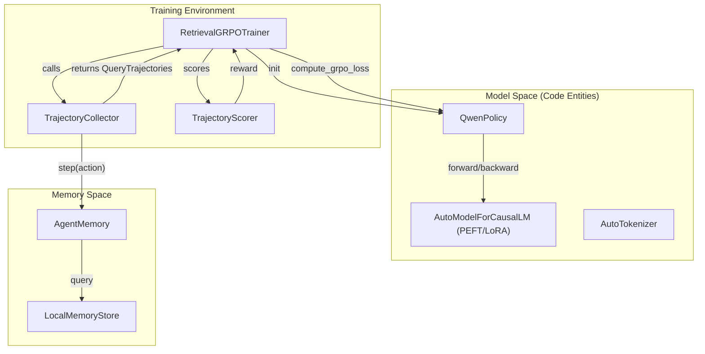
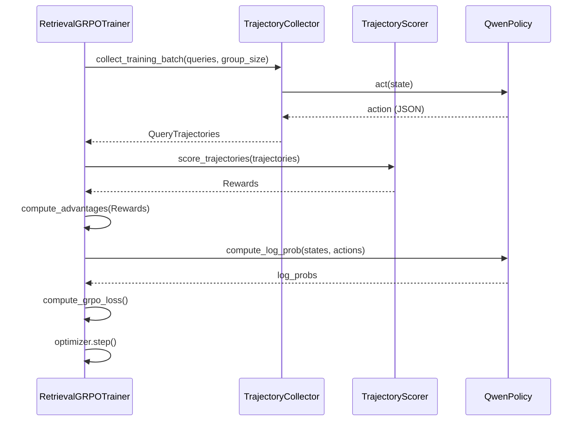

<!-- source: DeepWiki mcp.deepwiki.com · repo microsoft/Memora · page 5.2 GRPO Trainer · fetched 2026-10-26 -->

# GRPO Trainer

Relevant source files

The following files were used as context for generating this wiki page:

- [src/memora/rl/grpo_trainer.py](src/memora/rl/grpo_trainer.py)
- [src/memora/rl/policy_qwen.py](src/memora/rl/policy_qwen.py)

The `RetrievalGRPOTrainer` is the central component of Memora's reinforcement learning pipeline, designed to optimize the retrieval policy through **Group Relative Policy Optimization (GRPO)**. It fine-tunes a local `QwenPolicy` (typically Qwen2.5-7B) to make better decisions during iterative memory retrieval by maximizing rewards derived from groundedness, redundancy, and retrieval cost [src/memora/rl/grpo_trainer.py:75-84]().

## Training Architecture

The trainer implements an iterative loop that alternates between trajectory collection and policy updates. It utilizes a group-based advantage estimation strategy where multiple rollouts are sampled for the same query to establish a baseline for reward normalization [src/memora/rl/grpo_trainer.py:51-51]().

### Core Data Flow
The following diagram illustrates the interaction between the trainer, the policy, and the environment (Memory Store).

**GRPO Training Loop and Entity Association**

Sources: [src/memora/rl/grpo_trainer.py:86-110](), [src/memora/rl/policy_qwen.py:19-45](), [src/memora/rl/trajectory_collector.py:21-25]()

## GRPO Configuration (`GRPOConfig`)

The trainer is parameterized by `GRPOConfig`, which defines the hyperparameters for the RL optimization and reward weighting [src/memora/rl/grpo_trainer.py:45-73]().

| Parameter | Description | Default |
| :--- | :--- | :--- |
| `group_size` | Number of rollouts (K) per query for relative advantage. | 4 |
| `clip_range` | PPO-style clipping parameter for the policy ratio. | 0.2 |
| `kl_coef` | Coefficient for the KL divergence penalty. | 0.05 |
| `w_groundedness` | Weight for the groundedness reward component. | 1.0 |
| `w_redundancy` | Penalty weight for retrieving redundant information. | 0.4 |
| `w_cost` | Penalty weight for retrieval steps/budget usage. | 0.4 |
| `reward_scale_strategy` | Strategy for advantage normalization (`group` or `batch`). | "batch" |

Sources: [src/memora/rl/grpo_trainer.py:45-73]()

## Advantage and Loss Calculation

### Group-Relative Advantages
Instead of a learned value function (critic), GRPO uses the mean reward of a group of rollouts for the same query as a baseline. The advantage $A_i$ for rollout $i$ in a group is calculated as:
$$A_i = \frac{R_i - \text{mean}(R)}{\text{std}(R)}$$

The trainer implements this in `compute_advantages` [src/memora/rl/grpo_trainer.py:172-205](). If `reward_scale_strategy` is set to `"batch"`, it normalizes advantages using the global standard deviation across the entire training batch [src/memora/rl/grpo_trainer.py:199-205]().

### GRPO Loss Function
The loss function combines the clipped surrogate objective with a KL divergence penalty to prevent the policy from drifting too far from the reference model [src/memora/rl/grpo_trainer.py:207-257]().

1.  **Policy Ratio**: $r_t(\theta) = \exp(\log \pi_\theta(a|s) - \log \pi_{old}(a|s))$ [src/memora/rl/grpo_trainer.py:241-241]().
2.  **Clipped Objective**: $\min(r_t(\theta)A, \text{clip}(r_t(\theta), 1-\epsilon, 1+\epsilon)A)$ [src/memora/rl/grpo_trainer.py:244-248]().
3.  **KL Penalty**: Calculated between the current policy and the initial reference policy [src/memora/rl/grpo_trainer.py:251-252]().

Sources: [src/memora/rl/grpo_trainer.py:172-257]()

## Model Implementation: `QwenPolicy`

The `QwenPolicy` class wraps a Qwen-series model (e.g., `Qwen/Qwen2.5-7B-Instruct`) and adds LoRA adapters for efficient fine-tuning [src/memora/rl/policy_qwen.py:19-45]().

### LoRA Configuration
The policy targets the following modules for adaptation:
*   Attention: `q_proj`, `v_proj`, `k_proj`, `o_proj` [src/memora/rl/policy_qwen.py:93-93]().
*   MLP: `gate_proj`, `up_proj`, `down_proj` [src/memora/rl/policy_qwen.py:94-94]().

### Token-Level Log Probabilities
The trainer requires log probabilities for the generated JSON actions. The `get_action_logprobs` function:
1.  Performs a forward pass on the complete sequence (Prompt + Action) [src/memora/rl/policy_qwen.py:163-167]().
2.  Extracts logits specifically for the action tokens [src/memora/rl/policy_qwen.py:180-183]().
3.  Computes the sum of log probabilities for the action sequence [src/memora/rl/policy_qwen.py:190-196]().

Sources: [src/memora/rl/policy_qwen.py:19-110](), [src/memora/rl/policy_qwen.py:149-198]()

## Checkpoint and Diagnostic Management

The trainer provides extensive logging and persistence features to monitor the RL process:

*   **Checkpointing**: Saves LoRA adapters and trainer state every `checkpoint_every` epochs [src/memora/rl/grpo_trainer.py:69-69](), [src/memora/rl/grpo_trainer.py:355-365]().
*   **Groundedness Log**: A JSONL file (`groundedness_log.jsonl`) recording the specific rewards and trajectories for every rollout, used for offline analysis of policy behavior [src/memora/rl/grpo_trainer.py:141-142]().
*   **Training Metrics**: Real-time logging to TensorBoard (Loss, Rewards, KL Divergence, Advantage Std) [src/memora/rl/grpo_trainer.py:145-145](), [src/memora/rl/grpo_trainer.py:317-330]().
*   **Visualizations**: Automatically generates `training_metrics.png` summarizing reward trends across epochs [src/memora/rl/grpo_trainer.py:382-385]().

**Training Step Data Flow**

Sources: [src/memora/rl/grpo_trainer.py:263-314](), [src/memora/rl/grpo_trainer.py:332-353]()

---

