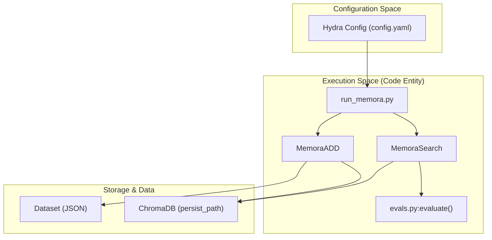
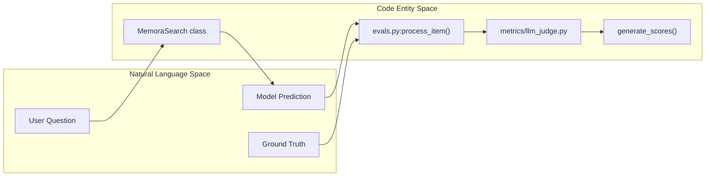

<!-- source: DeepWiki mcp.deepwiki.com · repo microsoft/Memora · page 6 Benchmark Evaluation Framework · fetched 2026-10-26 -->

# Benchmark Evaluation Framework

<details>
<summary>Relevant source files</summary>

The following files were used as context for generating this wiki page:

- [app/locomo/README.md](app/locomo/README.md)
- [app/locomo/conf/config.yaml](app/locomo/conf/config.yaml)
- [app/locomo/conf/mem0_config.yaml](app/locomo/conf/mem0_config.yaml)
- [app/locomo/evals.py](app/locomo/evals.py)
- [app/locomo/run.sh](app/locomo/run.sh)
- [app/locomo/run_experiments.py](app/locomo/run_experiments.py)
- [app/locomo/run_memora.py](app/locomo/run_memora.py)
- [app/longmemeval/README.md](app/longmemeval/README.md)
- [app/longmemeval/conf/config.yaml](app/longmemeval/conf/config.yaml)
- [app/longmemeval/evals.py](app/longmemeval/evals.py)
- [app/longmemeval/run.sh](app/longmemeval/run.sh)
- [app/longmemeval/run_memora.py](app/longmemeval/run_memora.py)
- [app/longmemeval/run_parallel_splits.sh](app/longmemeval/run_parallel_splits.sh)

</details>


The Benchmark Evaluation Framework provides a standardized environment for assessing Memora's performance against long-term memory datasets. It currently supports two primary benchmark applications: **LoCoMo** (Long-term Conversations as Memory) and **LongMemEval**. 

The framework is designed as a three-stage pipeline that ensures reproducibility through **Hydra** configuration management [app/locomo/run_memora.py:122-123]().

### Experiment Pipeline Overview

Every benchmark experiment follows a consistent lifecycle managed by an experiment runner (e.g., `run_memora.py`).

1.  **Build Stage**: Raw conversation data is processed into structured memories. If a memory store already exists at `memory.persist_path`, this stage is skipped unless `memory.force_rebuild` is set to `True` [app/longmemeval/run_memora.py:54-68]().
2.  **Retrieve & Answer Stage**: The system iterates through benchmark questions. For each question, it uses the configured `retrieval.strategy` (semantic, prompt, or grpo) to fetch context and generate a response [app/locomo/run_memora.py:101-106]().
3.  **Evaluate Stage**: Model responses are scored against ground truth using automated metrics (BLEU, F1) and an LLM-as-judge [app/locomo/run_memora.py:111-119]().

#### Benchmark Execution Flow
This diagram illustrates the relationship between the configuration, the runner, and the memory providers.


**Sources:** [app/locomo/run_memora.py:22-24](), [app/longmemeval/run_memora.py:20-22](), [app/longmemeval/conf/config.yaml:63-75]()

---

### Supported Benchmarks

The framework includes specialized runners and configurations for different memory evaluation datasets.

#### LoCoMo Benchmark
LoCoMo focuses on long-term conversation history. It includes specific logic for handling multi-speaker dialogues and can optionally use a `use_combined_user` mode to merge speakers into a single identity [app/locomo/conf/config.yaml:125-127](). It supports various baselines including Mem0, RAG, and Full Context [app/locomo/run_experiments.py:8-10]().

For details, see [LoCoMo Benchmark](#6.1).

#### LongMemEval Benchmark
LongMemEval tests a wider range of memory capabilities across different question types (e.g., temporal reasoning, knowledge update). To handle the larger scale of this dataset, the framework supports multi-process parallel execution using `tmux` splits [app/longmemeval/run_parallel_splits.sh:139-152]().

For details, see [LongMemEval Benchmark](#6.2).

---

### Configuration and Execution

Experiments are configured via `config.yaml` and executed using Python entry points.

| Component | Code Entity | Purpose |
| :--- | :--- | :--- |
| **Main Runner** | `run_memora.py` | Orchestrates the build-retrieve-evaluate loop [app/locomo/run_memora.py:30-42](). |
| **Config Manager** | `Hydra` | Handles parameter overrides and directory management [app/locomo/run_memora.py:7-8](). |
| **Memory Builder** | `MemoraADD` | Handles ingestion of raw data into the vector store [app/locomo/run_experiments.py:55](). |
| **Search Provider** | `MemoraSearch` | Interfaces with the `MemoraClient` to perform retrieval [app/locomo/run_memora.py:105](). |

#### Evaluation Components and Data Flow
This diagram bridges the high-level evaluation concepts to the specific scripts and classes that implement them.


**Sources:** [app/locomo/evals.py:23-59](), [app/longmemeval/evals.py:141-189](), [app/locomo/run_memora.py:105-119]()

---

### Evaluation Metrics

The framework calculates three primary metrics to determine performance:
1.  **BLEU Score**: Measures N-gram overlap between generated and ground truth answers [app/locomo/evals.py:42]().
2.  **F1 Score**: Measures token-level precision and recall [app/locomo/evals.py:41]().
3.  **LLM Score**: A binary (0/1) correctness score determined by an LLM judge using specific rubrics for different question types [app/longmemeval/evals.py:165-176]().

For details, see [Evaluation Metrics & LLM Judge](#6.3).

---

### Running Experiments

To run a standard experiment, use the `run_memora.py` script within the respective benchmark directory:

```bash
# Example: Running LoCoMo with prompted retrieval
python run_memora.py \
    llm.model="gpt-4.1-mini" \
    memory.memory_store="locomo-prompt-v1" \
    retrieval.strategy="prompt"
```

For large-scale evaluations in LongMemEval, use the parallel split script:
```bash
# Example: Launching 5 parallel splits via tmux
./run_parallel_splits.sh --output-dir my_experiment_results
```
**Sources:** [app/longmemeval/README.md:39-50](), [app/longmemeval/run_parallel_splits.sh:5-9]()

---

