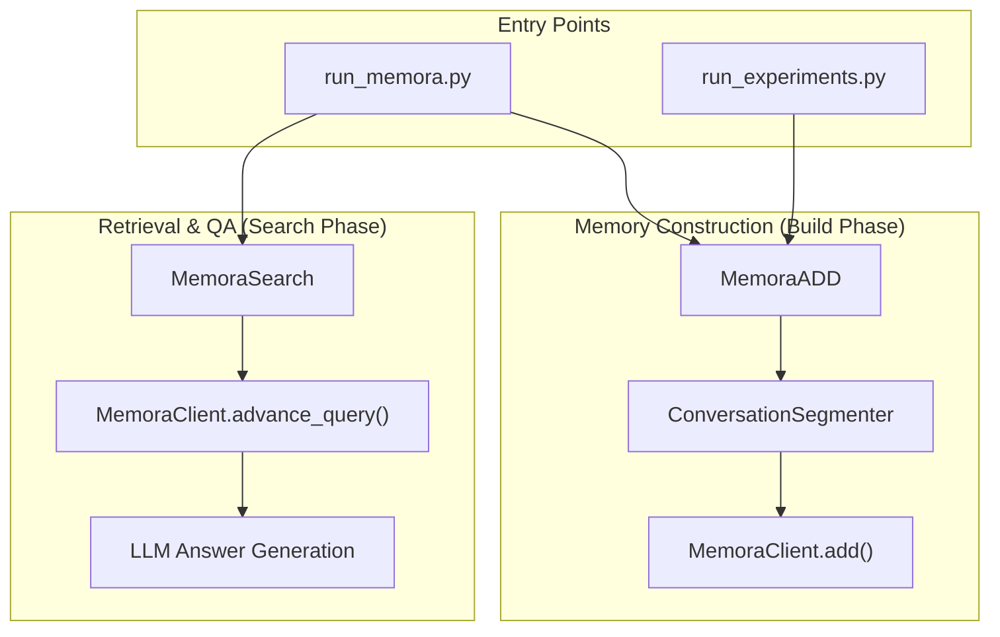
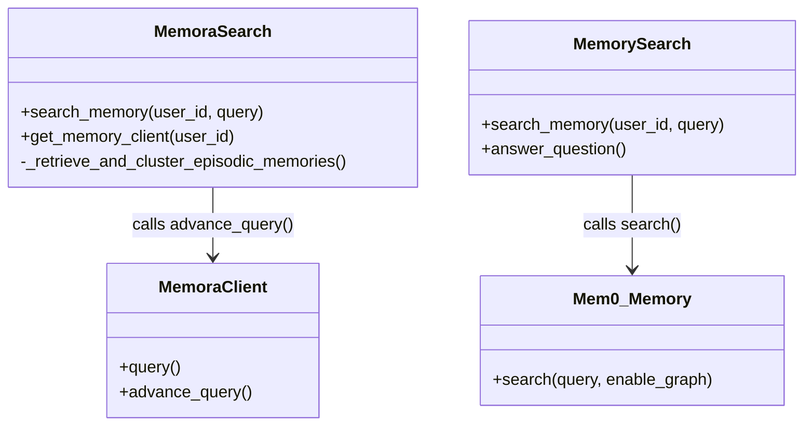

<!-- source: DeepWiki mcp.deepwiki.com · repo microsoft/Memora · page 6.1 LoCoMo Benchmark · fetched 2026-10-26 -->

# LoCoMo Benchmark

Relevant source files

The following files were used as context for generating this wiki page:

- [app/locomo/evals.py](app/locomo/evals.py)
- [app/locomo/providers/full_context.py](app/locomo/providers/full_context.py)
- [app/locomo/providers/memora/add.py](app/locomo/providers/memora/add.py)
- [app/locomo/providers/memora/search.py](app/locomo/providers/memora/search.py)
- [app/locomo/providers/memora/segmentation.py](app/locomo/providers/memora/segmentation.py)
- [app/locomo/providers/memzero/add.py](app/locomo/providers/memzero/add.py)
- [app/locomo/providers/memzero/search.py](app/locomo/providers/memzero/search.py)
- [app/locomo/providers/rag.py](app/locomo/providers/rag.py)
- [app/locomo/run_experiments.py](app/locomo/run_experiments.py)
- [app/locomo/run_memora.py](app/locomo/run_memora.py)
- [app/locomo/utils.py](app/locomo/utils.py)
- [app/longmemeval/evals.py](app/longmemeval/evals.py)
- [app/longmemeval/providers/memora/add.py](app/longmemeval/providers/memora/add.py)
- [app/longmemeval/providers/memora/search.py](app/longmemeval/providers/memora/search.py)
- [app/longmemeval/providers/memora/segmentation.py](app/longmemeval/providers/memora/segmentation.py)
- [app/longmemeval/run_memora.py](app/longmemeval/run_memora.py)
- [app/longmemeval/utils.py](app/longmemeval/utils.py)

The **LoCoMo (Long-term Conversations with Multimodal context)** benchmark serves as the primary evaluation framework for Memora. It tests a memory system's ability to handle long-term dialogue, multi-session topical shifts, and multimodal inputs (images and text). The benchmark pipeline automates memory construction, question answering (inference), and scoring against gold-standard answers.

### System Architecture & Data Flow

The benchmark operates through two primary entry points: `run_memora.py` for targeted Memora experiments and `run_experiments.py` for comparative analysis against baselines like Mem0, RAG, and Full Context.

#### LoCoMo Experiment Pipeline
1.  **Ingestion**: The `MemoraADD` class loads the `locomo10.json` dataset and processes conversations session-by-session.
2.  **Segmentation**: Conversations are partitioned into topical episodes using the `ConversationSegmenter`.
3.  **Storage**: Segments are passed to `MemoraClient.add()`, which invokes the core memory building logic (extraction, deduplication, and indexing).
4.  **Inference**: `MemoraSearch` executes queries against the memory store using specified strategies (Semantic, Prompted, or GRPO).
5.  **Evaluation**: Results are scored using BLEU, F1, and an LLM-based judge.

**LoCoMo Execution Logic**

**Sources:** [app/locomo/run_memora.py:30-120](), [app/locomo/run_experiments.py:42-90](), [app/locomo/providers/memora/add.py:115-200]()

---

### Memory Construction & Segmentation

Memory building in LoCoMo is handled by `MemoraADD`. It supports two modes: **Split User** (default), where speakers have isolated memory stores, and **Combined User**, where a single memory store represents the shared context of both speakers [app/locomo/providers/memora/add.py:124-139]().

#### ConversationSegmenter
To maintain topical coherence, the `ConversationSegmenter` groups messages into "Episodes" before they are committed to memory.
- **LLM-based Segmentation**: Uses a specialized prompt (`SEGMENTATION_PROMPT_TEMPLATE`) to identify topical shifts, transitions, and time gaps [app/locomo/providers/memora/segmentation.py:33-107]().
- **Batch-based Segmentation**: A fallback mode that groups messages by a fixed `batch_size` (default 2) if LLM segmentation is disabled [app/locomo/providers/memora/segmentation.py:120-130]().

#### Multimodal Handling
LoCoMo includes image descriptions (BLIP captions) and raw image URLs. `MemoraADD` validates these URLs via `is_valid_image_url` and constructs multimodal message payloads for the `MemoraClient` [app/locomo/providers/memora/add.py:159-183]().

**Sources:** [app/locomo/providers/memora/add.py:19-200](), [app/locomo/providers/memora/segmentation.py:110-200](), [app/locomo/utils.py:172-208]()

---

### Search Providers & Retrieval Strategies

The benchmark supports various search providers to compare Memora against industry standards.

| Provider | Implementation Class | Key Characteristics |
| :--- | :--- | :--- |
| **Memora** | `MemoraSearch` | Supports `semantic`, `prompt`, and `grpo` strategies via `advance_query` [app/locomo/providers/memora/search.py:82-102](). |
| **Mem0** | `MemorySearch` | Interfaces with the Mem0 library; supports optional Graph-based retrieval [app/locomo/providers/memzero/search.py:23-47](). |
| **RAG** | `RAGManager` | Standard chunk-based retrieval using fixed sizes [app/locomo/run_experiments.py:179-184](). |
| **Full Context** | `FullContextManager` | Passes the entire conversation history to the LLM (no retrieval) [app/locomo/run_experiments.py:201-210](). |

#### Memora Retrieval Pipeline
`MemoraSearch` encapsulates the logic for querying the `MemoraClient` and formatting the retrieved memories for the answering LLM. It includes a specialized method `_retrieve_and_cluster_episodic_memories` which groups factual memories by their linked conversation episodes to provide the LLM with richer context [app/locomo/providers/memora/search.py:132-170]().

**Search Implementation Mapping**

**Sources:** [app/locomo/providers/memora/search.py:25-130](), [app/locomo/providers/memzero/search.py:23-102](), [app/locomo/run_experiments.py:7-36]()

---

### Dataset Format: locomo10.json

The LoCoMo dataset is structured to represent long-term interactions. The benchmark primarily uses `locomo10.json`, which contains:
- **Conversation Metadata**: `speaker_a`, `speaker_b`, and session counts [app/locomo/providers/memora/add.py:117-120]().
- **Sessions**: Individual chat blocks indexed as `session_1`, `session_2`, etc., each with a `date_time` timestamp [app/locomo/providers/memora/add.py:142-152]().
- **QA Pairs**: Questions (`question`), gold-standard answers (`answer`), and `evidence` pointers to specific sessions/messages [app/locomo/providers/memzero/search.py:146-152]().

**Sources:** [app/locomo/providers/memora/add.py:142-160](), [app/locomo/providers/memzero/search.py:146-180](), [app/locomo/utils.py:76-84]()

---

### Evaluation Metrics

The evaluation phase is triggered after the inference runner generates an `output.json` file. The `evals.py` module (shared across benchmarks) calculates:
1.  **Lexical Metrics**: BLEU and F1 scores comparing generated answers to gold-standard text [app/longmemeval/evals.py:161-162]().
2.  **LLM Judge**: A GPT-4 based evaluator that determines if the response is semantically correct. It uses specific rubrics for:
    - **Temporal Reasoning**: Validates dates and durations [app/longmemeval/evals.py:25-38]().
    - **Knowledge Update**: Checks if the model correctly identified the most recent information [app/longmemeval/evals.py:40-53]().
    - **Single Session Preference**: Evaluates personalization based on user-specific info [app/longmemeval/evals.py:55-68]().

**Sources:** [app/longmemeval/evals.py:24-83](), [app/longmemeval/evals.py:141-189](), [app/locomo/run_memora.py:112-120]()

---

