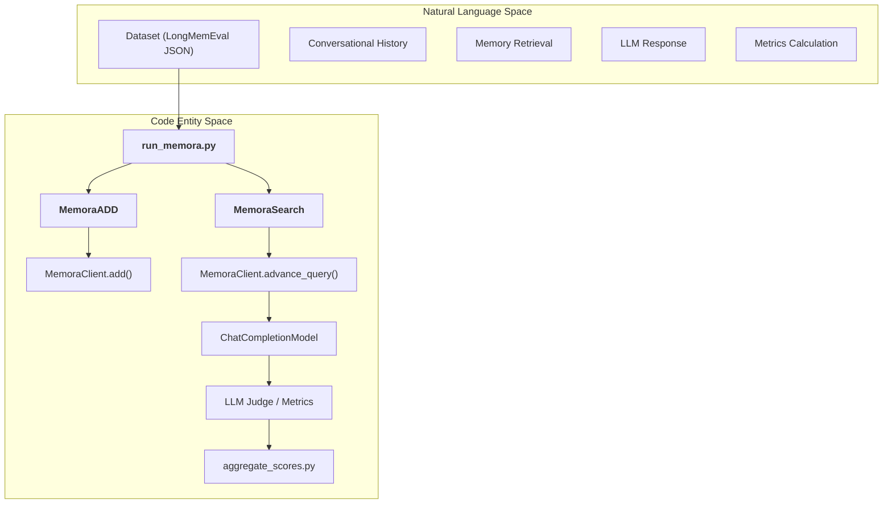
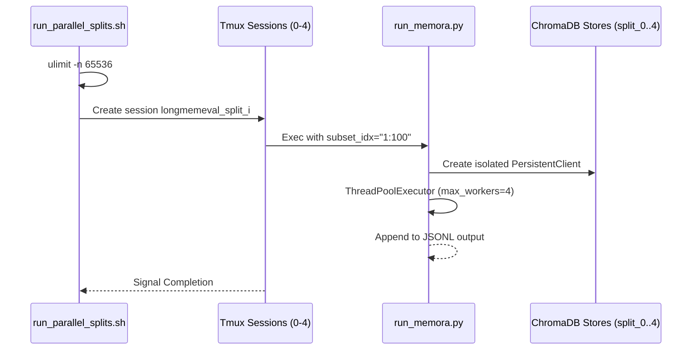

<!-- source: DeepWiki mcp.deepwiki.com · repo microsoft/Memora · page 6.2 LongMemEval Benchmark · fetched 2026-10-26 -->

# LongMemEval Benchmark

Relevant source files

The following files were used as context for generating this wiki page:

- [app/locomo/README.md](app/locomo/README.md)
- [app/locomo/providers/memora/add.py](app/locomo/providers/memora/add.py)
- [app/locomo/providers/memora/search.py](app/locomo/providers/memora/search.py)
- [app/locomo/providers/memzero/add.py](app/locomo/providers/memzero/add.py)
- [app/locomo/providers/memzero/search.py](app/locomo/providers/memzero/search.py)
- [app/locomo/run.sh](app/locomo/run.sh)
- [app/longmemeval/README.md](app/longmemeval/README.md)
- [app/longmemeval/aggregate_scores.py](app/longmemeval/aggregate_scores.py)
- [app/longmemeval/check_status.sh](app/longmemeval/check_status.sh)
- [app/longmemeval/gather_results.sh](app/longmemeval/gather_results.sh)
- [app/longmemeval/providers/memora/add.py](app/longmemeval/providers/memora/add.py)
- [app/longmemeval/providers/memora/search.py](app/longmemeval/providers/memora/search.py)
- [app/longmemeval/run.sh](app/longmemeval/run.sh)
- [app/longmemeval/run_parallel_splits.sh](app/longmemeval/run_parallel_splits.sh)

The **LongMemEval** benchmark is a specialized experiment runner within the Memora ecosystem designed to evaluate the long-term memory capabilities of conversational agents across diverse question types (e.g., temporal reasoning, knowledge updates, and session-specific preferences) [app/longmemeval/README.md:1-3](). This framework supports high-throughput evaluation via parallel split execution, robust resource management for large-scale ChromaDB operations, and automated result aggregation.

## System Architecture & Data Flow

The LongMemEval runner follows a three-stage pipeline: **Memory Construction**, **Retrieval/Answering**, and **Evaluation** [app/longmemeval/README.md:174-184](). 

### Natural Language to Code Entity Mapping

The following diagram bridges the conceptual benchmark requirements to the specific implementation entities in the codebase.

**LongMemEval Execution Pipeline**

**Sources:** [app/longmemeval/run_memora.py](), [app/longmemeval/providers/memora/add.py:22-31](), [app/longmemeval/providers/memora/search.py:24-32](), [app/longmemeval/aggregate_scores.py:5-11]()

## Experiment Runner: run_memora.py

The main entry point, `run_memora.py`, utilizes Hydra for configuration management [app/longmemeval/README.md:155-157](). It orchestrates the lifecycle of an experiment, from building the memory store to generating final scores.

### Memory Ingestion (MemoraADD)
The `MemoraADD` class in the LongMemEval context is tailored for session-based segmentation [app/longmemeval/providers/memora/add.py:165-166]().
- **Subset Parsing**: Supports complex range strings (e.g., `"1:100"`) or comma-separated lists to target specific questions [app/longmemeval/providers/memora/add.py:90-108]().
- **Skip Logic**: The `check_question_has_memories` function queries the underlying `chromadb.PersistentClient` to determine if a question-specific collection already contains data, enabling efficient retries [app/longmemeval/providers/memora/add.py:61-81]().
- **Parallel Building**: Uses `ThreadPoolExecutor` to process multiple conversations concurrently [app/longmemeval/providers/memora/add.py:10-11]().

### Retrieval and Answering (MemoraSearch)
The `MemoraSearch` class manages the retrieval process and LLM interaction.
- **LRU Client Cache**: To prevent file descriptor exhaustion (a common issue with many ChromaDB tenants), `MemoraSearch` implements an `OrderedDict` as an LRU cache for `MemoraClient` instances [app/longmemeval/providers/memora/search.py:49-53]().
- **Eviction Mechanism**: The `_evict_oldest_client` function manually triggers garbage collection (`gc.collect()`) after popping the oldest client to ensure resources are freed [app/longmemeval/providers/memora/search.py:58-64]().
- **Retrieval Dispatch**: Supports `semantic`, `prompt`, and `grpo` strategies via `client.advance_query` or standard `client.query` [app/longmemeval/providers/memora/search.py:111-123]().

**Sources:** [app/longmemeval/providers/memora/add.py:61-108](), [app/longmemeval/providers/memora/search.py:49-64](), [app/longmemeval/providers/memora/search.py:111-123]()

## Parallel Split Execution

For full-dataset runs (500 questions), Memora provides a multi-process execution model using `tmux` and `run_parallel_splits.sh`.

### Architecture of Parallel Splits
To avoid ChromaDB write-lock contention, the benchmark splits the dataset into 5 isolated chunks, each assigned to a dedicated tmux session and a unique memory store directory [app/longmemeval/run_parallel_splits.sh:41-43, 81-84]().

**Parallel Execution Flow**

### Key Components
| Component | Responsibility |
| :--- | :--- |
| `run_parallel_splits.sh` | Orchestrates 5 tmux sessions, configures environment (e.g., `ulimit`), and assigns Azure endpoints [app/longmemeval/run_parallel_splits.sh:41-66](). |
| `check_status.sh` | Monitors tmux sessions, checks `chroma.sqlite3` file sizes, and counts processed lines in JSONL outputs [app/longmemeval/check_status.sh:18-78](). |
| **JSONL Output** | In parallel mode, results are written to JSONL files to ensure thread-safe/process-safe line appending [app/longmemeval/README.md:70-71](). |

**Sources:** [app/longmemeval/run_parallel_splits.sh:41-84](), [app/longmemeval/check_status.sh:18-78](), [app/longmemeval/README.md:70-71]()

## Result Aggregation

Once all splits are complete, `aggregate_scores.py` is used to merge the fragmented results into a unified performance report.

### aggregation_scores.py Implementation
- **Dynamic Discovery**: The script searches for `memora_*_scores.json` files across all split directories [app/longmemeval/aggregate_scores.py:20-35]().
- **Weighted Averaging**: It calculates averages for metrics (BLEU, F1, LLM-as-judge) weighted by the question count per category to ensure statistical accuracy across uneven splits [app/longmemeval/aggregate_scores.py:38-42, 84-91]().
- **Categorization**: Scores are grouped by `mean_scores_per_question_type` to provide insights into specific memory challenges like temporal reasoning [app/longmemeval/aggregate_scores.py:100-108]().

**Sources:** [app/longmemeval/aggregate_scores.py:20-42](), [app/longmemeval/aggregate_scores.py:84-108]()

## Summary of Configuration Parameters

The benchmark behavior is controlled via `conf/config.yaml`.

| Parameter | Impact | File Reference |
| :--- | :--- | :--- |
| `eval.parallel_search` | Enables multi-threading within a single process. | [app/longmemeval/providers/memora/search.py:56]() |
| `eval.max_cached_clients` | Sets the LRU limit for file descriptor management. | [app/longmemeval/providers/memora/search.py:50]() |
| `memory.force_rebuild` | Deletes existing collections before ingestion. | [app/longmemeval/providers/memora/add.py:183]() |
| `eval.answer_template` | Switches between `nemori`, `evermemos`, or `longmemeval` prompt styles. | [app/longmemeval/providers/memora/search.py:35-41]() |

**Sources:** [app/longmemeval/providers/memora/search.py:35-56](), [app/longmemeval/providers/memora/add.py:183]()

---

