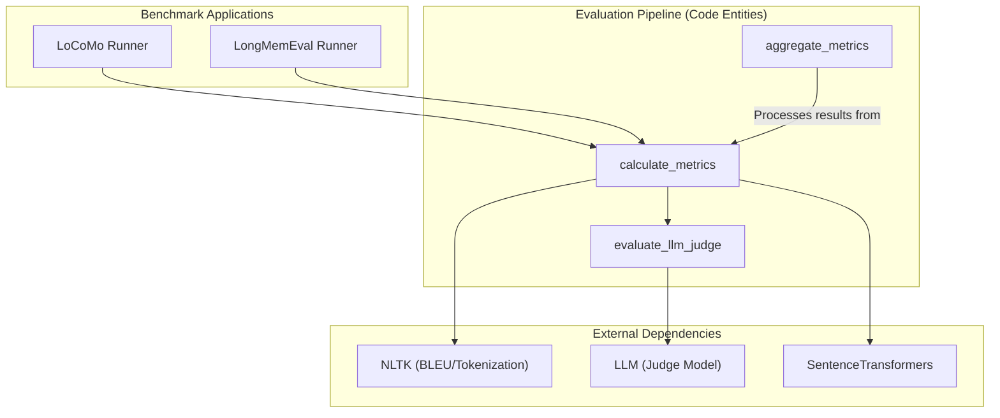
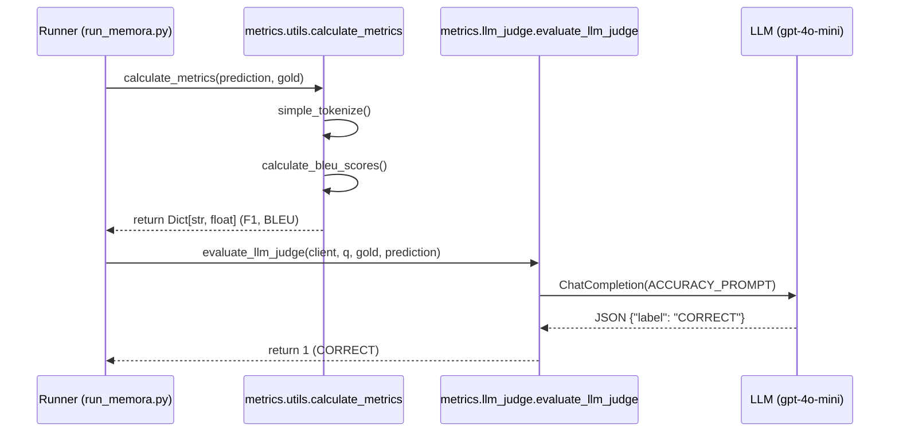

<!-- source: DeepWiki mcp.deepwiki.com · repo microsoft/Memora · page 6.3 Evaluation Metrics & LLM Judge · fetched 2026-10-26 -->

# Evaluation Metrics & LLM Judge

Relevant source files

The following files were used as context for generating this wiki page:

- [app/locomo/metrics/llm_judge.py](app/locomo/metrics/llm_judge.py)
- [app/locomo/metrics/utils.py](app/locomo/metrics/utils.py)
- [app/locomo/prompts.py](app/locomo/prompts.py)
- [app/longmemeval/metrics/llm_judge.py](app/longmemeval/metrics/llm_judge.py)
- [app/longmemeval/metrics/utils.py](app/longmemeval/metrics/utils.py)
- [app/longmemeval/prompts.py](app/longmemeval/prompts.py)
- [app/longmemeval/test_endpoints.py](app/longmemeval/test_endpoints.py)

The Memora evaluation framework provides a standardized pipeline for measuring the accuracy and quality of memory-based retrieval and generation. It combines traditional lexical metrics with a sophisticated "LLM-as-a-judge" approach to handle the nuances of long-term memory, such as temporal reasoning and semantic equivalence across multi-hop queries.

## Evaluation Pipeline Overview

The evaluation process follows a structured flow from raw model output to aggregated performance reports. This pipeline is shared across both the LoCoMo and LongMemEval benchmarks, ensuring consistency in how different retrieval strategies (Semantic vs. Prompted Policy vs. GRPO) are compared.

### Data Flow

1.  **Response Generation**: The `AgentMemory` system generates a response using specific answer prompts that enforce concise, fact-dense outputs [app/locomo/prompts.py:68-107](), [app/longmemeval/prompts.py:46-112]().
2.  **Lexical Scoring**: The generated answer is compared against the "gold" ground truth using token-based metrics (F1, BLEU) [app/locomo/metrics/utils.py:120-168]().
3.  **LLM Judge Scoring**: An LLM (typically `gpt-4o-mini`) evaluates the answer based on a specific rubric, focusing on semantic correctness rather than exact string matching [app/locomo/metrics/llm_judge.py:12-36]().
4.  **Aggregation**: Scores are grouped by category (e.g., temporal reasoning, knowledge update) to identify specific system weaknesses [app/locomo/metrics/utils.py:171-202]().

### System Architecture: Evaluation Components

The following diagram illustrates the relationship between the evaluation utilities and the benchmark applications.

**Evaluation Entity Map**

**Sources:** [app/locomo/metrics/utils.py:120-168](), [app/locomo/metrics/llm_judge.py:39-69](), [app/longmemeval/metrics/utils.py:140-188]().

---

## Lexical & Semantic Metrics

Memora utilizes `app/locomo/metrics/utils.py` and `app/longmemeval/metrics/utils.py` to compute a suite of standard NLP metrics. These are useful for detecting large regressions in model performance.

| Metric | Implementation Detail | Purpose |
| :--- | :--- | :--- |
| **F1 Score** | `simple_tokenize` based on set intersection of tokens [app/locomo/metrics/utils.py:146-157]() | Measures overlap between prediction and gold answer. |
| **BLEU (1-4)** | `nltk.translate.bleu_score` with `SmoothingFunction.method1` [app/locomo/metrics/utils.py:64-81]() | Measures n-gram precision for different lengths. |
| **Exact Match** | Case-insensitive string comparison [app/locomo/metrics/utils.py:144-144]() | Strict verification of identity. |
| **SBERT Similarity** | `SentenceTransformer("all-MiniLM-L6-v2")` cosine similarity [app/locomo/metrics/utils.py:103-117]() | Measures semantic proximity in embedding space. |
| **BERTScore** | `bert_score` library for contextual embeddings [app/locomo/metrics/utils.py:84-91]() | Captures semantic similarity using deep LLM embeddings. |

**Sources:** [app/locomo/metrics/utils.py:46-117](), [app/longmemeval/metrics/utils.py:50-137]().

---

## LLM-as-a-Judge

Because memory tasks often involve complex temporal calculations (e.g., "last year" relative to a memory timestamp) or multi-hop reasoning, lexical metrics often fail to capture correctness. The `evaluate_llm_judge` function addresses this by using a high-capability model to verify answers against a rubric [app/locomo/metrics/llm_judge.py:39-60]().

### The Accuracy Rubric (`ACCURACY_PROMPT`)
The judge is instructed to be "generous" but accurate regarding specific entities and dates:
*   **Topic Coverage**: As long as the answer touches the same topic as the gold answer, it is `CORRECT` [app/locomo/metrics/llm_judge.py:23-23]().
*   **Temporal Generosity**: Different date formats (e.g., "May 7th" vs "7 May") or relative references that resolve to the same period are marked `CORRECT` [app/locomo/metrics/llm_judge.py:25-25]().
*   **Constraint**: The judge must return a JSON object with a single `"label"` key (`CORRECT` or `WRONG`) to facilitate automated parsing [app/locomo/metrics/llm_judge.py:32-35]().

### Category-Specific Evaluation
Results are aggregated by question category to provide insights into memory capabilities:
1.  **Temporal Reasoning**: Questions requiring date calculations.
2.  **Knowledge Update**: Questions where memories contain conflicting info and the most recent must be prioritized.
3.  **Single Session Preference**: Questions involving specific speaker preferences within one session.
4.  **Multi-hop Reasoning**: (Specific to LongMemEval) Connecting facts across disparate time periods.

**Sources:** [app/locomo/metrics/llm_judge.py:12-36](), [app/locomo/metrics/llm_judge.py:93-106]().

---

## Implementation Details

### Parallel Evaluation
To handle large datasets like LongMemEval efficiently, the evaluation pipeline supports parallel execution. The `LongMemEval` runner utilizes split execution (via `run_parallel_splits.sh`) and thread-safe logging to process thousands of queries across multiple LLM endpoints [app/longmemeval/test_endpoints.py:36-62]().

### Data Flow: From Code to Metric
The following sequence diagram tracks how a generated response is processed by the evaluation utilities.

**Metric Calculation Sequence**

**Sources:** [app/locomo/metrics/utils.py:120-168](), [app/locomo/metrics/llm_judge.py:39-60]().

### Aggregation Logic
The `aggregate_metrics` function in `utils.py` computes mean, standard deviation, and median for every metric across the entire dataset and per category [app/locomo/metrics/utils.py:171-202](). This is critical for generating the final performance tables used in Memora's benchmark reports.

**Sources:** [app/locomo/metrics/utils.py:171-202](), [app/longmemeval/metrics/utils.py:191-203]().

---

