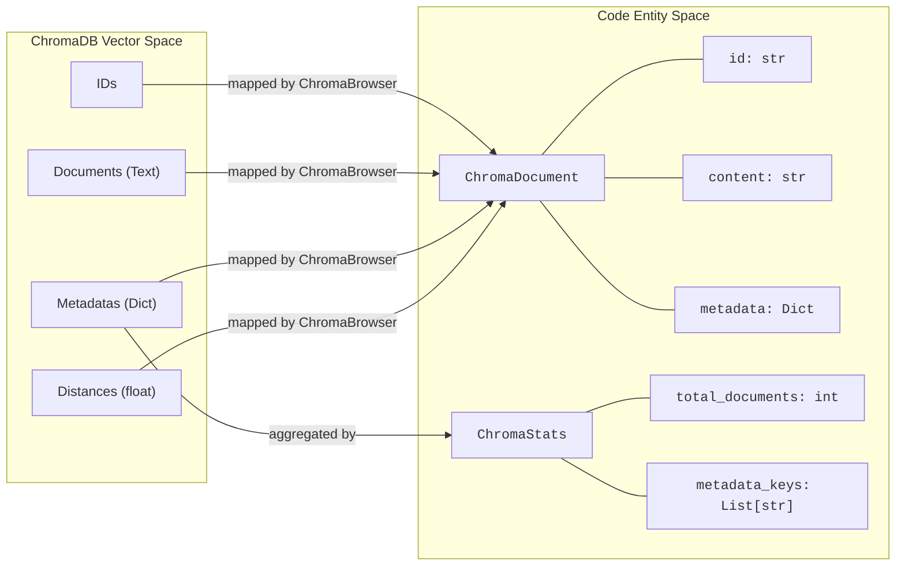

<!-- source: DeepWiki mcp.deepwiki.com · repo microsoft/Memora · page 7 Memory Browser & CLI · fetched 2026-10-26 -->

# Memory Browser & CLI

Relevant source files

The following files were used as context for generating this wiki page:

- [src/memora/browser/README.md](src/memora/browser/README.md)
- [src/memora/browser/__main__.py](src/memora/browser/__main__.py)
- [src/memora/browser/chroma_browser.py](src/memora/browser/chroma_browser.py)
- [src/memora/browser/interactive_browser.py](src/memora/browser/interactive_browser.py)
- [src/memora/browser/memory_viewer.py](src/memora/browser/memory_viewer.py)
- [src/memora/cli.py](src/memora/cli.py)

The **Memora Browser** utility is a suite of tools designed for inspecting, analyzing, and managing memory stores persisted in ChromaDB [src/memora/browser/README.md:1-7](). It provides both a high-level Command Line Interface (CLI) for rapid inspection and a professional interactive REPL for deep exploration of memory collections [src/memora/browser/interactive_browser.py:23-29]().

### System Architecture Overview

The browser subsystem bridges the gap between raw vector storage and human-readable memory analysis. It operates by interfacing directly with ChromaDB collections without requiring the full Memora agent stack to be active [src/memora/browser/README.md:26-31]().

**Browser Component Relationships**

```mermaid
graph TD
    subgraph "CLI Entry Points"
        CLI["src/memora/cli.py"] -->|dispatches| BMain["src/memora/browser/__main__.py"]
    end

    subgraph "Logic Layer"
        BMain -->|interactive mode| IMB["InteractiveMemoryBrowser"]
        BMain -->|batch/script mode| MV["MemoryViewer"]
        IMB --> CB["ChromaBrowser"]
        MV --> CB["ChromaBrowser"]
    end

    subgraph "Data Access Layer"
        CB -->|PersistentClient| CDB[("ChromaDB Store")]
        CB -->|maps to| CDoc["ChromaDocument (Data Class)"]
    end

    classDef code font-family:monospace;
    class CLI,BMain,IMB,MV,CB,CDoc code;
```

Sources: [src/memora/cli.py:21-52](), [src/memora/browser/__main__.py:23-45](), [src/memora/browser/interactive_browser.py:43-51](), [src/memora/browser/memory_viewer.py:43-51](), [src/memora/browser/chroma_browser.py:31-40]()

---

## Operational Modes

The utility supports four primary operational modes, selectable via CLI flags [src/memora/browser/__main__.py:64-103]():

| Mode | Flag | Description |
|:---|:---|:---|
| **Stats** | `--stats` | Displays high-level collection metrics: document counts, character totals, and metadata field density [src/memora/browser/__main__.py:125-127](). |
| **Search** | `--search` | Executes a semantic similarity search against the memory store and prints ranked results with distance scores [src/memora/browser/__main__.py:129-158](). |
| **Analyze** | `--analyze` | Generates a comprehensive JSON report covering metadata patterns and content distribution [src/memora/browser/__main__.py:160-169](). |
| **Interactive** | (Default) | Launches a REPL for real-time exploration, collection switching, and document inspection [src/memora/browser/__main__.py:171-177](). |

Sources: [src/memora/browser/__main__.py:107-196](), [src/memora/browser/README.md:42-75]()

---

## Core Components

### CLI & MemoryViewer
The `MemoryViewer` class provides the programmatic backbone for non-interactive analysis [src/memora/browser/memory_viewer.py:23-29](). It is responsible for generating summaries via `get_memory_summary()` and exporting structured reports [src/memora/browser/memory_viewer.py:53-57](). It utilizes `ChromaStats` to encapsulate metadata distribution and content length statistics [src/memora/browser/chroma_browser.py:43-52]().

For details, see [CLI & MemoryViewer](#7.1).

### Interactive Browser
The `InteractiveMemoryBrowser` provides a professional command-line interface with a dedicated command loop [src/memora/browser/interactive_browser.py:57-83](). It supports advanced features like metadata filtering (`filter key=value`), collection switching, and real-time result pagination [src/memora/browser/interactive_browser.py:120-148]().

For details, see [Interactive Browser](#7.2).

### Data Mapping: Vector Space to Code Entities

The browser translates low-level ChromaDB results into structured Python objects for analysis.

Sources: [src/memora/browser/chroma_browser.py:31-52](), [src/memora/browser/chroma_browser.py:178-196]()

---

## Export Pipeline

The browser supports exporting memory data into various formats for external analysis [src/memora/browser/README.md:141-144](). The `ChromaBrowser.export_documents` method handles the transformation of `ChromaDocument` lists into the following formats [src/memora/browser/chroma_browser.py:152-153]():

1.  **JSON**: A full fidelity export including all metadata and content [src/memora/browser/README.md:190-207]().
2.  **CSV**: A flattened representation suitable for spreadsheet analysis.
3.  **TXT**: A raw text dump of document contents.

The export process includes directory validation and error handling for large-scale data writes [src/memora/browser/README.md:260-267]().

Sources: [src/memora/browser/interactive_browser.py:102-103](), [src/memora/browser/README.md:188-234]()

---

