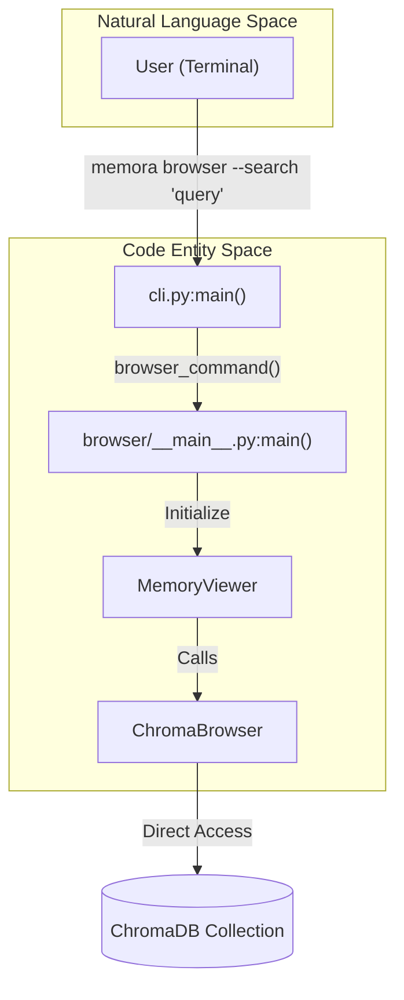
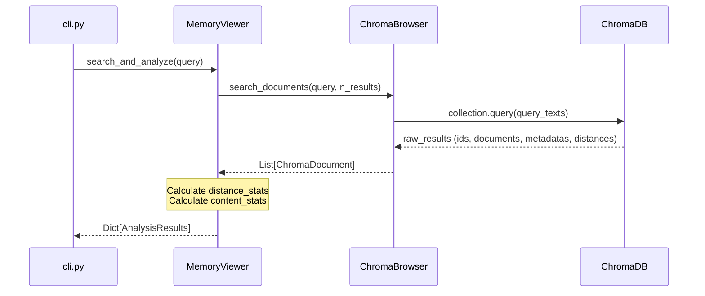

<!-- source: DeepWiki mcp.deepwiki.com · repo microsoft/Memora · page 7.1 CLI & MemoryViewer · fetched 2026-10-26 -->

# CLI & MemoryViewer

Relevant source files

The following files were used as context for generating this wiki page:

- [src/memora/browser/README.md](src/memora/browser/README.md)
- [src/memora/browser/__main__.py](src/memora/browser/__main__.py)
- [src/memora/browser/memory_viewer.py](src/memora/browser/memory_viewer.py)
- [src/memora/cli.py](src/memora/cli.py)

The Memora CLI and `MemoryViewer` provide a suite of tools for inspecting, analyzing, and managing memory data persisted in ChromaDB. These tools allow developers to bypass high-level agent abstractions and interact directly with the underlying vector store for debugging and reporting purposes.

## Memora CLI Entry Point

The primary entry point for the Memora framework is `src/memora/cli.py` [[src/memora/cli.py:1-8]](). It uses `argparse` to route commands to specific subsystems, primarily the `browser` subcommand which handles memory inspection [[src/memora/cli.py:91-112]]().

### Mode Selection and Argument Parsing
The CLI supports several operational modes defined by the flags passed to the `browser` command:

| Mode | Flag | Description |
| :--- | :--- | :--- |
| **Interactive** | (Default) | Launches a REPL for real-time exploration of collections [[src/memora/browser/__main__.py:58-62]](). |
| **Quick Stats** | `--stats` | Prints a summary of document counts and metadata keys then exits [[src/memora/browser/__main__.py:65-68]](). |
| **Search & Analyze**| `--search <query>` | Performs semantic search and returns distance statistics for the results [[src/memora/browser/__main__.py:77-79]](). |
| **Comprehensive** | `--analyze` | Generates a full JSON report of metadata patterns and content distributions [[src/memora/browser/__main__.py:71-74]](). |

When the `browser` command is invoked, the CLI delegates execution to `src/memora/browser/__main__.py` by dynamically updating `sys.argv` and calling its `main()` function [[src/memora/cli.py:21-51]]().

### CLI Data Flow
The following diagram illustrates how the CLI bridges the user's natural language requests to the underlying code entities.

**CLI to Memory Space Mapping**

Sources: [[src/memora/cli.py:21-51]](), [[src/memora/browser/__main__.py:23-105]](), [[src/memora/browser/memory_viewer.py:23-51]]()

## MemoryViewer

The `MemoryViewer` class in `src/memora/browser/memory_viewer.py` provides a programmatic, non-interactive interface for memory analysis [[src/memora/browser/memory_viewer.py:23-29]](). It acts as a wrapper around `ChromaBrowser`, adding analytical logic on top of raw document retrieval.

### Key Functions

#### quick_stats()
Returns a formatted string containing basic information about the current collection, including the total document count and available metadata keys [[src/memora/browser/memory_viewer.py:254-275]]().

#### get_memory_summary()
Generates a dictionary containing comprehensive statistics, including `content_stats` (average length, total characters) and optionally a list of sample documents [[src/memora/browser/memory_viewer.py:53-92]]().

#### search_and_analyze()
Executes a semantic search using the `ChromaBrowser.search_documents()` method [[src/memora/browser/memory_viewer.py:119-122]](). It calculates:
* **Distance Stats**: Minimum, maximum, and average cosine distance of results [[src/memora/browser/memory_viewer.py:138-142]]().
* **Content Stats**: Length distribution of the retrieved snippets [[src/memora/browser/memory_viewer.py:144-148]]().

#### export_analysis_report()
Compiles the results of `get_memory_summary()`, `analyze_metadata_patterns()`, and search examples into a single JSON file for external reporting [[src/memora/browser/memory_viewer.py:220-252]]().

Sources: [[src/memora/browser/memory_viewer.py:53-161]](), [[src/memora/browser/memory_viewer.py:220-275]]()

## Data Structures

The browser module uses specialized dataclasses to represent ChromaDB entities consistently.

### ChromaDocument
Represents a single entry retrieved from the vector store.
* `id`: Unique identifier (string).
* `content`: The raw text of the memory.
* `metadata`: A dictionary of key-value pairs (e.g., `source_file`, `memory_type`).
* `distance`: The similarity score (only present during search operations).
[[src/memora/browser/README.md:166-175]]()

### ChromaStats
A container for collection-level metrics.
* `total_documents`: Integer count.
* `collection_name`: Name of the active collection.
* `metadata_keys`: List of all keys found across documents.
* `unique_metadata_values`: Dictionary mapping keys to the count of unique values.
* `content_stats`: Dictionary containing character counts and average lengths.
[[src/memora/browser/README.md:177-186]]()

## Implementation Details

The `MemoryViewer` relies on the `ChromaBrowser` to interface with the database. The initialization sequence ensures that a valid database path is provided before attempting to list or switch collections [[src/memora/browser/memory_viewer.py:31-51]]().

**Data Retrieval and Processing Flow**

Sources: [[src/memora/browser/memory_viewer.py:102-161]](), [[src/memora/browser/README.md:132-153]]()

### Error Handling
The CLI includes a global try-except block to catch `KeyboardInterrupt` (graceful exit) and logging of any `Exception` that occurs during database initialization or report generation [[src/memora/browser/__main__.py:197-203]](). If a database path does not exist, the CLI exits with a clear error message [[src/memora/browser/__main__.py:113-115]]().

Sources: [[src/memora/browser/__main__.py:113-203]](), [[src/memora/cli.py:170-179]]()

---

