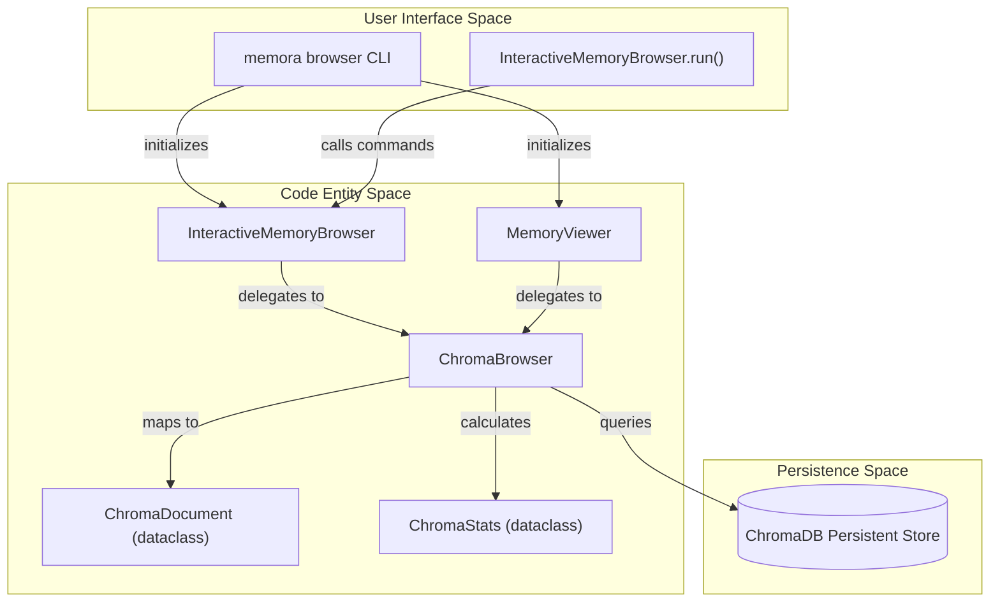
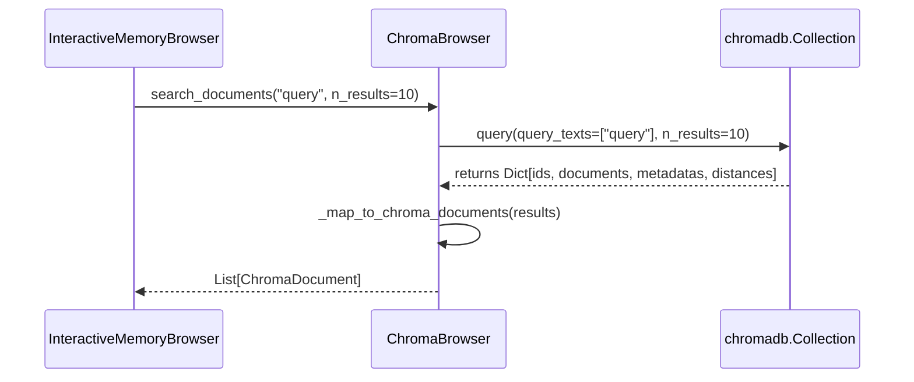

<!-- source: DeepWiki mcp.deepwiki.com · repo microsoft/Memora · page 7.2 Interactive Browser · fetched 2026-10-26 -->

# Interactive Browser

Relevant source files

The following files were used as context for generating this wiki page:

- [src/memora/browser/README.md](src/memora/browser/README.md)
- [src/memora/browser/__main__.py](src/memora/browser/__main__.py)
- [src/memora/browser/chroma_browser.py](src/memora/browser/chroma_browser.py)
- [src/memora/browser/interactive_browser.py](src/memora/browser/interactive_browser.py)
- [src/memora/cli.py](src/memora/cli.py)

The Interactive Browser provides a professional REPL (Read-Eval-Print Loop) and programmatic interface for exploring, analyzing, and managing memory data stored within ChromaDB collections. It serves as a diagnostic and administrative tool for developers to inspect the state of the memory store without writing custom scripts.

## System Architecture

The browser subsystem is built on a layered architecture that separates the low-level database interaction from the high-level interactive user experience.

### Data Flow and Component Interaction

The `InteractiveMemoryBrowser` acts as the primary orchestrator, receiving user input and delegating data retrieval to the `ChromaBrowser`. The `ChromaBrowser` interacts directly with the `chromadb.PersistentClient` to execute queries and fetch metadata.

**Browser Architecture and Entity Mapping**

Sources: [src/memora/browser/interactive_browser.py:23-56](), [src/memora/browser/chroma_browser.py:54-80](), [src/memora/browser/memory_viewer.py:23-45](), [src/memora/browser/__main__.py:23-105]()

## InteractiveMemoryBrowser REPL

The `InteractiveMemoryBrowser` class [src/memora/browser/interactive_browser.py:23-29]() provides a command-line interface for real-time exploration. It maintains internal state regarding the currently loaded documents (`self.current_documents`) and active filters (`self.current_filter`) [src/memora/browser/interactive_browser.py:53-55]().

### Supported Commands

The REPL loop in `run()` [src/memora/browser/interactive_browser.py:57-113]() processes the following primary command categories:

| Command | Function | Description |
| :--- | :--- | :--- |
| `collections` | `_list_collections()` | Lists all available collections in the current database path. |
| `switch <name>` | `_switch_collection(args)` | Switches the active ChromaDB collection and invalidates local caches. |
| `list [limit]` | `_list_documents(args)` | Retrieves a paginated list of documents (default limit: 10). |
| `show <id\|index>` | `_show_document_detail(args)` | Displays the full content and metadata for a specific memory. |
| `search <query>` | `_search_documents(args)` | Performs semantic similarity search using the collection's embedding function. |
| `metadata [key]` | `_show_metadata_info(args)` | Analyzes and displays distribution statistics for metadata fields. |
| `export <fmt> <path>`| `_export_documents(args)` | Exports the current result set to JSON, CSV, or TXT formats. |

Sources: [src/memora/browser/interactive_browser.py:84-108](), [src/memora/browser/README.md:79-107]()

## ChromaBrowser: Low-Level Interface

The `ChromaBrowser` class [src/memora/browser/chroma_browser.py:54-60]() handles direct integration with ChromaDB. It bypasses the standard `MemoraClient` abstractions to allow for raw inspection of stored vectors and metadata.

### Implementation Details
*   **Initialization**: It establishes a `chromadb.PersistentClient` with `anonymized_telemetry=False` [src/memora/browser/chroma_browser.py:86-93]().
*   **Data Mapping**: Database results are mapped into `ChromaDocument` dataclasses [src/memora/browser/chroma_browser.py:30-39](), which include the document ID, content, metadata, and optional distance/embeddings.
*   **Statistics Generation**: The `get_collection_stats()` method [src/memora/browser/chroma_browser.py:230-280]() calculates character counts, average lengths, and unique metadata value distributions, returning a `ChromaStats` object [src/memora/browser/chroma_browser.py:42-51]().

**ChromaDB Interaction Flow**

Sources: [src/memora/browser/chroma_browser.py:208-228](), [src/memora/browser/interactive_browser.py:43-48]()

## Resource Management and Robustness

The browser implementation focuses on efficiency and graceful failure to handle large-scale memory stores.

### Key Strategies
1.  **Lazy Loading**: Documents are not loaded into memory until a `list`, `search`, or `show` command is issued [src/memora/browser/chroma_browser.py:152-166]().
2.  **Graceful Interrupts**: The REPL catches `KeyboardInterrupt` to ensure the session exits cleanly without leaving the terminal in a broken state [src/memora/browser/interactive_browser.py:111-113]().
3.  **Collection Fallback**: If no collection name is provided during initialization, the browser automatically connects to the first available collection in the database [src/memora/browser/chroma_browser.py:108-110]().
4.  **Cache Management**: The `ChromaBrowser` maintains a `_document_cache` which is explicitly invalidated via `_cache_valid = False` whenever the collection is switched [src/memora/browser/chroma_browser.py:145-146]().

Sources: [src/memora/browser/chroma_browser.py:82-84](), [src/memora/browser/interactive_browser.py:69-117](), [src/memora/browser/README.md:268-274]()

---

