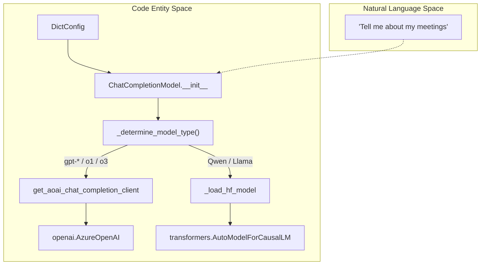
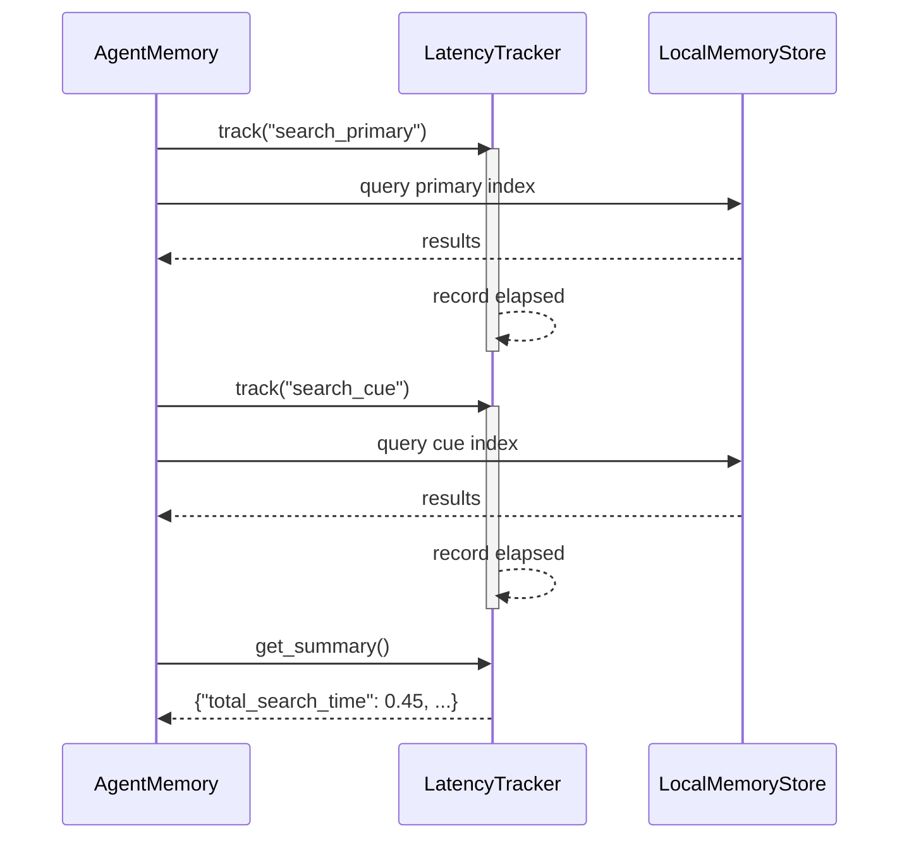

<!-- source: DeepWiki mcp.deepwiki.com · repo microsoft/Memora · page 8 Utilities & Infrastructure · fetched 2026-10-26 -->

# Utilities & Infrastructure

Relevant source files

The following files were used as context for generating this wiki page:

- [src/memora/utils/embedding.py](src/memora/utils/embedding.py)
- [src/memora/utils/latency.py](src/memora/utils/latency.py)
- [src/memora/utils/llm.py](src/memora/utils/llm.py)
- [src/memora/utils/log.py](src/memora/utils/log.py)

The **Utilities & Infrastructure** layer provides the shared foundational components required for the Memora library to interact with external AI services and monitor internal performance. This subsystem centralizes the management of Large Language Model (LLM) clients, embedding generation, execution timing, and system-wide logging.

By abstracting these concerns, Memora ensures that core logic—such as memory retrieval or building—remains agnostic of specific API implementations (e.g., Azure OpenAI vs. standard OpenAI) and can be consistently instrumented for performance analysis.

### System Infrastructure Overview

The infrastructure layer bridges the gap between high-level memory operations and the underlying technical execution.

| Component | Code Entity | Responsibility |
| :--- | :--- | :--- |
| **LLM Client** | `ChatCompletionModel` | Unified interface for chat completions across Azure, OpenAI, and Hugging Face. |
| **Embedding Client** | `BaseEmbeddingModel` | Handles vector generation for memory indexing and retrieval. |
| **Latency Tracking** | `LatencyTracker` | Hierarchical measurement of search, retrieval steps, and generation time. |
| **Logging** | `configure_logging` | Standardizes output format and suppresses noisy third-party library logs. |

**Sources:** [src/memora/utils/llm.py:59-64](), [src/memora/utils/embedding.py:72-75](), [src/memora/utils/latency.py:20-44](), [src/memora/utils/log.py:26-38]()

---

### LLM & Embedding Clients

Memora utilizes a wrapper architecture to support multiple model providers. The `ChatCompletionModel` class dynamically determines the model type based on the configuration and routes requests to either the `AzureOpenAI` client, standard `OpenAI` client, or local Hugging Face models using `transformers`.

#### LLM Provider Routing Logic
The system uses a name-based heuristic to determine how to load a model.

**Sources:** [src/memora/utils/llm.py:59-92](), [src/memora/utils/llm.py:93-110](), [src/memora/utils/llm.py:112-140]()

For more details on token usage tracking, Azure AD token providers, and local model loading, see **[LLM & Embedding Clients](#8.1)**.

---

### Latency Tracking & Logging

Performance monitoring is integrated directly into the retrieval and building pipelines. The `LatencyTracker` allows developers to wrap specific code blocks in context managers to record execution time, which is essential for evaluating the overhead of multi-step retrieval policies.

#### Performance Instrumentation
The following diagram illustrates how the `LatencyTracker` captures metrics during a retrieval operation.

**Sources:** [src/memora/utils/latency.py:61-82](), [src/memora/utils/latency.py:157-187]()

#### Logging Infrastructure
The `log.py` utility provides structured logging for memory operations, ensuring that additions and updates to the memory store are visible for debugging. It also configures global logging levels to silence verbose SDKs like `azure.identity` and `httpx`.

**Sources:** [src/memora/utils/log.py:42-54](), [src/memora/utils/log.py:65-101]()

For details on the specific operation categories and how to generate metadata for memory entries, see **[Latency Tracking & Logging](#8.2)**.

---

## Child Pages
- **[LLM & Embedding Clients](#8.1)**: Details on `ChatCompletionModel`, `BaseEmbeddingModel`, and API authentication.
- **[Latency Tracking & Logging](#8.2)**: Details on `LatencyTracker`, logging configurations, and miscellaneous token counting utilities.

---

