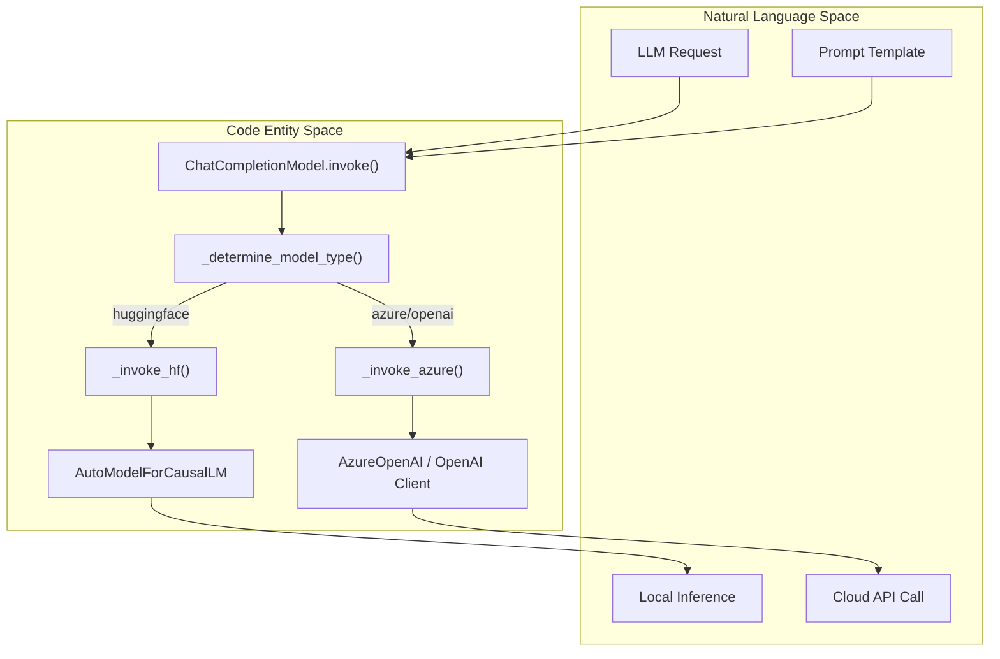
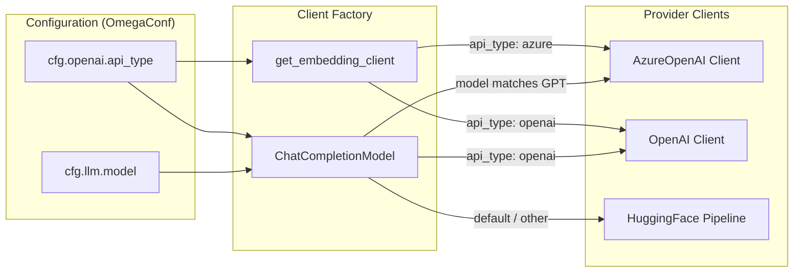

<!-- source: DeepWiki mcp.deepwiki.com · repo microsoft/Memora · page 8.1 LLM & Embedding Clients · fetched 2026-10-26 -->

# LLM & Embedding Clients

Relevant source files

The following files were used as context for generating this wiki page:

- [requirements.txt](requirements.txt)
- [src/memora/rl/requirements.txt](src/memora/rl/requirements.txt)
- [src/memora/utils/embedding.py](src/memora/utils/embedding.py)
- [src/memora/utils/llm.py](src/memora/utils/llm.py)
- [src/memora/utils/token_usage.py](src/memora/utils/token_usage.py)

This page details the utility wrappers and clients used by Memora to interact with Large Language Models (LLMs) and embedding services. The system supports both hosted providers (Azure OpenAI, standard OpenAI) and local models via Hugging Face, providing a unified interface for text generation, embedding, and token usage telemetry.

## ChatCompletionModel

The `ChatCompletionModel` class serves as the primary interface for all LLM interactions within the Memora library [src/memora/utils/llm.py:59-64](). It abstracts the underlying client implementation, allowing the system to switch between Azure OpenAI, standard OpenAI, and local Hugging Face models (like Qwen) based on configuration [src/memora/utils/llm.py:75-91]().

### Model Routing and Initialization
Upon initialization, the class determines the `model_type` by inspecting the model name in the configuration [src/memora/utils/llm.py:76-77]().
*   **Azure/OpenAI**: If the model name contains GPT-related prefixes (e.g., "gpt-4", "o1"), it initializes an OpenAI-compatible client [src/memora/utils/llm.py:103-107]().
*   **Hugging Face**: Otherwise, it assumes a local model and loads it using the `transformers` library with `bfloat16` precision and automatic device mapping [src/memora/utils/llm.py:112-137]().

### Unified Invocation Flow
The `invoke` method provides a consistent entry point regardless of the backend [src/memora/utils/llm.py:141-168](). It supports both raw string prompts with template arguments and structured message sequences [src/memora/utils/llm.py:170-190]().

LLM Client Architecture: Natural Language to Code Entity Space

**Sources:** [src/memora/utils/llm.py:59-206]()

---

## Embedding Generation

The embedding layer is managed by the `BaseEmbeddingModel` class [src/memora/utils/embedding.py:72-75](). Unlike the chat completion model, the embedding layer currently focuses on OpenAI-compatible providers (Azure or standard OpenAI) [src/memora/utils/embedding.py:57-70]().

### Key Functions
*   **`get_aoai_embedding_client`**: Configures an `AzureOpenAI` client using `ManagedIdentityCredential` for secure, keyless authentication in Azure environments [src/memora/utils/embedding.py:14-37]().
*   **`generate_embeddings`**: Accepts a list of strings and returns a list of vector embeddings (lists of floats) [src/memora/utils/embedding.py:93-108](). It defaults to the `text-embedding-3-small` model if not specified in the configuration [src/memora/utils/embedding.py:104]().

**Sources:** [src/memora/utils/embedding.py:1-109]()

---

## Token Usage Tracking

To monitor costs and performance, Memora utilizes a `TokenUsageCallback` [src/memora/utils/token_usage.py:4-8](). This utility tracks prompt, completion, and total tokens across different models and system sources (e.g., retrieval, summarization, building) [src/memora/utils/token_usage.py:9-13]().

### Telemetry and Cost Estimation
The callback maintains a `cost_per_token` mapping for common OpenAI models to provide real-time cost estimates [src/memora/utils/token_usage.py:16-24]().

| Feature | Implementation |
| :--- | :--- |
| **Update Mechanism** | `update(prompt_tokens, completion_tokens, model, source)` [src/memora/utils/token_usage.py:26-48]() |
| **Reporting** | `token_usage_report()` generates a formatted string breakdown by source and model [src/memora/utils/token_usage.py:49-114]() |
| **Integration** | Passed to `ChatCompletionModel` during init to capture metrics during `_invoke_azure` [src/memora/utils/llm.py:66-73]() |

**Sources:** [src/memora/utils/token_usage.py:4-114](), [src/memora/utils/llm.py:66-73]()

---

## Dependency Requirements

The LLM and Embedding clients rely on several key external libraries defined in the project's requirements files.

### Core Dependencies
*   **`openai`**: The primary SDK for Azure and standard OpenAI interactions [requirements.txt:2]().
*   **`azure-identity`**: Handles Managed Identity and token providers for Azure authentication [requirements.txt:3]().
*   **`transformers` & `torch`**: Required for local Hugging Face model execution and `bfloat16` inference [requirements.txt:23-24]().
*   **`omegaconf`**: Used for the `DictConfig` objects that drive client initialization [requirements.txt:4]().

### RL-Specific Dependencies
For Reinforcement Learning tasks (e.g., GRPO retrieval policy), additional libraries are required to handle LoRA adapters and quantization:
*   **`peft`**: Parameter-Efficient Fine-Tuning for loading LoRA checkpoints [src/memora/rl/requirements.txt:3]().
*   **`bitsandbytes`**: Used for quantized model operations [src/memora/rl/requirements.txt:2]().
*   **`accelerate`**: Manages distributed execution and device placement [src/memora/rl/requirements.txt:1]().

**Sources:** [requirements.txt:1-34](), [src/memora/rl/requirements.txt:1-3]()

---

## Client Selection Logic

The following diagram illustrates how the system resolves which client to use based on the `api_type` and `model` configurations.

Client Selection and Data Flow

**Sources:** [src/memora/utils/llm.py:75-91](), [src/memora/utils/embedding.py:57-70]()

---

