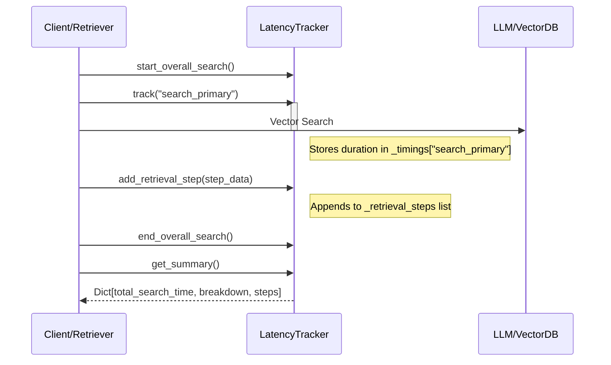
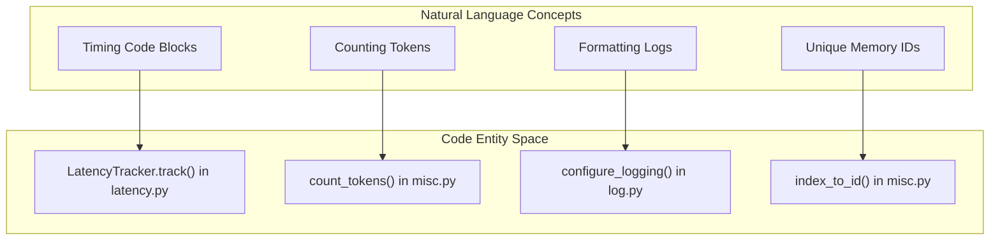

<!-- source: DeepWiki mcp.deepwiki.com · repo microsoft/Memora · page 8.2 Latency Tracking & Logging · fetched 2026-10-26 -->

# Latency Tracking & Logging

Relevant source files

The following files were used as context for generating this wiki page:

- [src/memora/utils/latency.py](src/memora/utils/latency.py)
- [src/memora/utils/log.py](src/memora/utils/log.py)
- [src/memora/utils/misc.py](src/memora/utils/misc.py)

This page describes the observability infrastructure of Memora, focusing on the `LatencyTracker` for performance profiling, the logging configuration for system monitoring, and various utility functions for metadata and token management. These components provide the diagnostic data necessary for evaluating retrieval policies and system efficiency.

## Latency Tracking

The `LatencyTracker` class in `src/memora/utils/latency.py` is the primary utility for measuring performance across the memory retrieval and answer generation pipeline [src/memora/utils/latency.py:7-9](). It provides a hierarchical structure to track timing for specific operations, such as primary index searches, cue resolution, and LLM-based filtering.

### Implementation Details
The tracker uses a context manager pattern to capture elapsed time for code blocks and maintains internal state for complex, multi-step retrieval processes.

*   **Operation Timing**: Captured via the `track` context manager [src/memora/utils/latency.py:61-81]().
*   **Hierarchical Retrieval Steps**: Specifically designed for policy-based retrievers (like the `PromptedPolicyRetriever`) to record iterations of the `EXPAND` or `RE_QUERY` loop [src/memora/utils/latency.py:105-118]().
*   **Prompt Statistics**: Tracks token counts and memory density in prompts to correlate latency with input size [src/memora/utils/latency.py:120-131]().

### Latency Data Flow

The following diagram illustrates how `LatencyTracker` captures data during a retrieval operation and generates a summary.

**Latency Tracking Sequence**

**Sources:** [src/memora/utils/latency.py:20-60](), [src/memora/utils/latency.py:213-260]()

### Summary Statistics
The `get_summary()` method produces a comprehensive report including:
*   `total_search_time`: The duration between `start_overall_search` and `end_overall_search` [src/memora/utils/latency.py:220]().
*   `search_breakdown`: Individual timings for `search_primary`, `search_cue`, `search_hybrid`, and `search_llm_filter` [src/memora/utils/latency.py:157-187]().
*   `retrieval_steps`: Detailed logs of policy actions and durations [src/memora/utils/latency.py:189-211]().

## Logging Configuration

Memora uses a centralized logging setup defined in `src/memora/utils/log.py` to ensure consistent formatting across the core library and its dependencies.

### configure_logging
The `configure_logging` function initializes the Python `logging` module with a specific format: `%(asctime)s - %(name)s - %(levelname)s - %(message)s` [src/memora/utils/log.py:34-38](). 

Crucially, it silences noisy third-party libraries that might clutter the console during high-frequency memory operations:
*   **Azure SDKs**: `azure.core`, `azure.identity` [src/memora/utils/log.py:43-46]().
*   **HTTP Clients**: `httpx`, `httpcore` [src/memora/utils/log.py:49-50]().
*   **ChromaDB**: `chromadb.telemetry` [src/memora/utils/log.py:53]().

### Memory Operation Logs
Specific helpers exist for logging the lifecycle of memory entries:
*   `log_memory_operation`: Formats a structured log entry for `Add`, `Update`, or `Delete` actions, including the `MemoryEntry.index`, `value`, and `cue_indices` [src/memora/utils/log.py:65-101]().
*   `log_segments`: Logs the `heading_path` of segments during the ingestion process to track document structure extraction [src/memora/utils/log.py:13-24]().

**Sources:** [src/memora/utils/log.py:26-55](), [src/memora/utils/log.py:88-101]()

## Miscellaneous Utilities

The `src/memora/utils/misc.py` module contains helper functions for data normalization and metadata handling.

### Token Counting
Token counting is performed using the `tiktoken` library, defaulting to the `cl100k_base` encoding (used by GPT-4 and GPT-3.5) [src/memora/utils/misc.py:15-24]().

| Function | Purpose |
| :--- | :--- |
| `count_tokens(content)` | Returns the integer token count for a string [src/memora/utils/misc.py:15-24](). |
| `count_memories_tokens(memories)` | Aggregates tokens across a list of `MemoryEntry` or `Segment` objects [src/memora/utils/latency.py:282-297](). |

### Content Normalization
The `normalize_content` function handles the transition from raw inputs (strings or message lists) to standardized internal formats [src/memora/utils/misc.py:27-109]().

*   **Text-only**: Joins lists of strings into a single newline-separated string [src/memora/utils/misc.py:107-109]().
*   **Multimodal**: Detects `image_url` types in message dictionaries and returns a structured dict containing both `text` and `image` parts [src/memora/utils/misc.py:101-105]().

### Metadata Management
*   **index_to_id**: Generates a deterministic `sha256` hash from a memory index string to be used as a primary key in storage [src/memora/utils/misc.py:10-12]().
*   **merge_metadata**: Combines system-generated segment metadata (like file paths) with user-provided metadata, giving precedence to the user [src/memora/utils/misc.py:172-190]().
*   **add_and_condition**: Helper for building ChromaDB `where` clauses by nesting conditions under a `$and` operator [src/memora/utils/misc.py:124-130]().

**Natural Language to Code Entity Mapping**

**Sources:** [src/memora/utils/misc.py:10-24](), [src/memora/utils/log.py:26-38](), [src/memora/utils/latency.py:61-70]()

---

