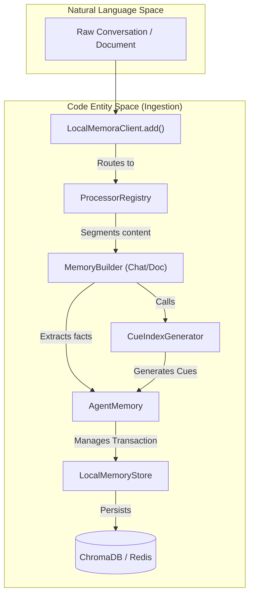
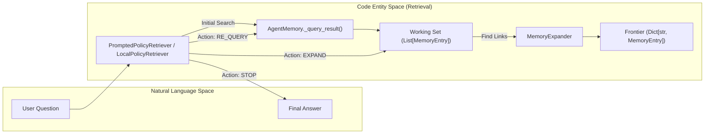

<!-- source: DeepWiki mcp.deepwiki.com · repo microsoft/Memora · page 9 Glossary · fetched 2026-10-26 -->

# Glossary

Relevant source files

The following files were used as context for generating this wiki page:

- [app/locomo/README.md](app/locomo/README.md)
- [app/locomo/evals.py](app/locomo/evals.py)
- [app/locomo/run.sh](app/locomo/run.sh)
- [app/locomo/run_experiments.py](app/locomo/run_experiments.py)
- [app/locomo/run_memora.py](app/locomo/run_memora.py)
- [app/longmemeval/README.md](app/longmemeval/README.md)
- [app/longmemeval/evals.py](app/longmemeval/evals.py)
- [app/longmemeval/run.sh](app/longmemeval/run.sh)
- [app/longmemeval/run_memora.py](app/longmemeval/run_memora.py)
- [app/longmemeval/run_parallel_splits.sh](app/longmemeval/run_parallel_splits.sh)
- [src/memora/builder/chat_memory_builder.py](src/memora/builder/chat_memory_builder.py)
- [src/memora/builder/document_memory_builder.py](src/memora/builder/document_memory_builder.py)
- [src/memora/builder/memory_builder.py](src/memora/builder/memory_builder.py)
- [src/memora/core/local_client.py](src/memora/core/local_client.py)
- [src/memora/core/memory.py](src/memora/core/memory.py)
- [src/memora/core/memory_entry.py](src/memora/core/memory_entry.py)
- [src/memora/db_clients/chromadb_client.py](src/memora/db_clients/chromadb_client.py)
- [src/memora/db_clients/redis_client.py](src/memora/db_clients/redis_client.py)
- [src/memora/retriever/local_policy_retriever.py](src/memora/retriever/local_policy_retriever.py)
- [src/memora/retriever/policy_utils.py](src/memora/retriever/policy_utils.py)
- [src/memora/retriever/prompted_policy_retriever.py](src/memora/retriever/prompted_policy_retriever.py)
- [src/memora/rl/grpo_trainer.py](src/memora/rl/grpo_trainer.py)
- [src/memora/utils/memory.py](src/memora/utils/memory.py)

This page provides technical definitions for terms, abbreviations, and domain-specific concepts used throughout the Memora codebase. It serves as a reference for engineers to map conceptual architectural components to their implementation in the code.

## Core Memory Abstractions

### MemoryEntry
The fundamental Data Transfer Object (DTO) representing a single unit of stored information. It encapsulates content, relevance scores, and structural links.
*   **Implementation**: Defined in `MemoryEntry` class [src/memora/core/memory_entry.py:28-50]().
*   **Key Fields**:
    *   `value`: The factual statement [src/memora/core/memory_entry.py:53-55]().
    *   `index`: A short, human-readable phrase used for retrieval [src/memora/core/memory_entry.py:62-65]().
    *   `linked_memory`: A pointer used by **Cue Anchors** to refer to a **Primary Memory** [src/memora/core/memory_entry.py:109-113]().
    *   `history`: A list of previous versions of the memory, allowing for temporal updates [src/memora/core/memory_entry.py:68-71]().

### Primary Memory vs. Cue Anchor
Memora uses a dual-indexing strategy to improve retrieval recall.
*   **Primary Memory**: The main `MemoryEntry` containing the full factual content and history. Its `linked_memory` field is empty [src/memora/core/memory_entry.py:145-147]().
*   **Cue Anchor (Cue Index)**: A lightweight entry that acts as a "pointer" or "alias" to a primary memory. It contains a specific semantic "cue" in its `index` field and points to the primary memory via the `linked_memory` field [src/memora/core/memory_entry.py:141-143]().
*   **Logic**: During retrieval, if a Cue Anchor is matched, the system automatically fetches the associated Primary Memory [src/memora/core/memory.py:155-172]().

### Working Set (W) and Frontier (F)
Concepts used in iterative retrieval strategies (Prompted Policy and GRPO).
*   **Working Set (W)**: The collection of memories already retrieved and deemed relevant to the user's question [src/memora/retriever/prompted_policy_retriever.py:38-38]().
*   **Frontier (F)**: A set of "expansion candidates"—memories that are logically or semantically linked to the current Working Set but have not been fully retrieved yet [src/memora/retriever/prompted_policy_retriever.py:39-39]().

## Retrieval Concepts

### Retrieval Policy
A decision-making component (either a prompted LLM or a GRPO-trained model) that manages the retrieval lifecycle.
*   **Actions**:
    *   `EXPAND`: Move candidates from the Frontier to the Working Set [src/memora/retriever/prompted_policy_retriever.py:33-33]().
    *   `RE_QUERY`: Generate a new search string to find missing information [src/memora/retriever/prompted_policy_retriever.py:34-34]().
    *   `STOP`: Terminate retrieval when the Working Set is sufficient [src/memora/retriever/prompted_policy_retriever.py:35-35]().

### GRPO (Group Relative Policy Optimization)
A reinforcement learning algorithm used to train the retrieval policy to maximize retrieval accuracy while minimizing cost (number of steps).
*   **Trainer**: `RetrievalGRPOTrainer` [src/memora/rl/grpo_trainer.py:75-84]().
*   **Advantage Calculation**: Unlike standard PPO, GRPO computes advantages relative to a group of rollouts for the same query, eliminating the need for a separate value function [src/memora/rl/grpo_trainer.py:172-208]().

### RRF (Reciprocal Rank Fusion)
A technique used to merge results from multiple search modes (e.g., semantic search on primary indices vs. cue indices) by combining their rankings.
*   **Implementation**: Referenced in the retrieval pipeline coordinator [src/memora/core/memory.py:137-150]().

## System Architecture Mapping

The following diagrams bridge the gap between high-level concepts and the specific code entities that implement them.

### Memory Ingestion Data Flow
This diagram shows how raw content is transformed into structured `MemoryEntry` objects and persisted.

**Sources**: [src/memora/core/local_client.py:175-198](), [src/memora/builder/memory_builder.py:127-154](), [src/memora/core/memory.py:93-94]().

### Iterative Retrieval State Machine
This diagram maps the logical retrieval loop to the policy classes and their state management.

**Sources**: [src/memora/retriever/prompted_policy_retriever.py:96-115](), [src/memora/retriever/local_policy_retriever.py:112-133](), [src/memora/core/memory.py:111-120]().

## Technical Terms Table

| Term | Implementation / Code Pointer | Description |
| :--- | :--- | :--- |
| **AgentMemory** | `src/memora/core/memory.py:43` | The central facade coordinating query generation, storage, and filtering. |
| **LocalMemoryStore** | `src/memora/core/local_memory_store.py` | The abstraction layer for local vector databases (ChromaDB or Redis). |
| **MemoryBuilder** | `src/memora/builder/memory_builder.py:127` | Base class for logic that extracts `MemoryEntry` objects from raw text. |
| **CueIndexGenerator** | `src/memora/core/cue_index_generator.py` | Generates semantic "cue" phrases to improve retrieval recall. |
| **QueryMode** | `src/memora/core/memory.py:36` | Enum defining search targets: `PRIMARY_ONLY`, `CUE_ONLY`, or `BOTH`. |
| **MemoryUpdateDecision** | `src/memora/utils/memory.py` | Logic determining if a new fact should update an existing entry or be added as a new one. |
| **TrajectoryCollector** | `src/memora/rl/trajectory_collector.py:21` | Records the steps taken during retrieval for RL training purposes. |
| **LoCoMo** | `app/locomo/run_experiments.py` | A benchmark dataset and runner for evaluating long-context memory. |
| **PersistentClient** | `src/memora/db_clients/chromadb_client.py:39` | A thread-safe singleton wrapper for the ChromaDB backend. |

**Sources**: [src/memora/core/memory.py:36-43](), [src/memora/builder/memory_builder.py:127-142](), [src/memora/core/memory_entry.py:28-30](), [src/memora/rl/grpo_trainer.py:75-84]().