# Page: Memora Overview

# Memora Overview

<details>
<summary>Relevant source files</summary>

The following files were used as context for generating this wiki page:

- [README.md](README.md)
- [quickstart.py](quickstart.py)
- [src/memora/__init__.py](src/memora/__init__.py)
- [src/memora/browser/__init__.py](src/memora/browser/__init__.py)

</details>


Memora is a sophisticated memory management system for AI agents designed to handle the complexity of long-term information storage, organization, and retrieval. Unlike traditional RAG (Retrieval-Augmented Generation) pipelines that rely on flat vector similarity, Memora introduces a **harmonic memory representation** that separates raw data from the structures used to index it.

By providing a unified memory layer, Memora allows developers to focus on agent logic while the framework manages the lifecycle of factual, episodic, and procedural knowledge.

### Purpose and Design Philosophy

The core philosophy of Memora is to balance **abstraction** and **specificity**. It addresses the "fuzziness" of standard vector search by creating a structured scaffolding over high-fidelity data [README.md:18-30]().

| Component | Indexed? | Role |
| :--- | :--- | :--- |
| **Memory Value** | No | The full, uncompressed information (e.g., a specific quote or fact) [README.md:23-23](). |
| **Primary Abstraction** | Yes | A one-to-one summary serving as the canonical unit for updates and deduplication [README.md:24-24](). |
| **Cue Anchors** | Yes | Semantic entry points (e.g., `<entity> + <aspect>`) creating a many-to-many map between related memories [README.md:25-25](). |

This design ensures that retrieval is guided by well-defined representations while the agent still has access to the rich, original context.

**Sources:**
- [README.md:12-45]()
- [src/memora/__init__.py:4-9]()

---

### System Architecture

Memora operates as a lifecycle manager, moving data from raw ingestion to structured storage and eventually to adaptive retrieval for answer generation.

#### Bridge: Natural Language to Code Entities
The following diagram illustrates how natural language inputs flow through the system's primary code abstractions.

Memora Lifecycle Flow
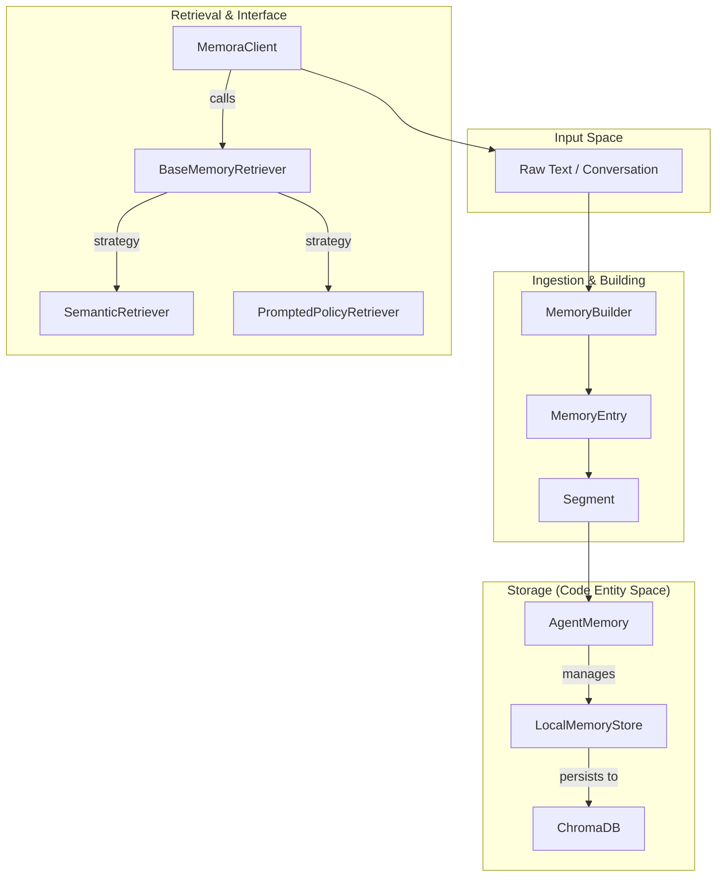
**Sources:**
- [README.md:46-60]()
- [quickstart.py:78-114]()
- [src/memora/memora_client.py:1-118]() (inferred from package structure)

---

### Key Subsystems

#### 1. Core Memory System
The `MemoraClient` serves as the primary entry point for developers. It abstracts the complexity of the `AgentMemory` coordinator, which handles the retrieval pipeline, query generation, and parallel search across different indices (Primary vs. Cue) [quickstart.py:78-81]().

#### 2. Memory Ingestion & Building
Memora transforms raw text into structured `MemoryEntry` objects. This process includes extracting relevant facts, segmenting conversations into topical episodes, and performing deduplication to ensure the memory store remains clean over time [README.md:50-52]().

#### 3. Adaptive Retrieval Strategies
Memora supports multiple ways to pull information:
*   **Semantic:** Standard vector similarity search [README.md:55-55]().
*   **Prompted Policy:** An iterative, LLM-guided search that refines queries based on initial results [README.md:56-56]().
*   **Hybrid:** A combination of semantic and keyword (BM25) matching [README.md:57-57]().
*   **GRPO:** An experimental reinforcement learning-based policy for complex retrieval tasks [README.md:58-58]().

#### 4. Browser & Utilities
For debugging and inspection, Memora includes a CLI and an `InteractiveMemoryBrowser` to explore `ChromaDB` collections and analyze memory distributions [src/memora/browser/__init__.py:4-18]().

**Sources:**
- [README.md:46-60]()
- [quickstart.py:45-70]()
- [src/memora/browser/__init__.py:10-12]()

---

### Getting Started

To begin using Memora, you must configure your environment for either Azure OpenAI or standard OpenAI, then initialize the `MemoraClient`.

```python
# Minimal setup example
from memora.memora_client import MemoraClient
from omegaconf import OmegaConf

cfg = OmegaConf.create({
    "memory": {"memory_store": "my_store", "persist_path": "./db"},
    "llm": {"model": "gpt-4.1-mini"},
    "retrieval": {"strategy": "semantic"}
})

client = MemoraClient(cfg=cfg, user_id="user_123")
client.add("The project deadline is Friday.", type="doc")
results = client.query("When is the deadline?")
```

**Sources:**
- [README.md:62-93]()
- [quickstart.py:16-71]()

---

### Documentation Map

For detailed information on specific components, refer to the following child pages:

*   **[Getting Started & Installation](#1.1)**: Detailed installation steps, environment variable requirements, and configuration via `OmegaConf`.
*   **[Core Concepts & Terminology](#1.2)**: Deep dive into the harmonic memory representation, cue anchors, and the memory lifecycle (Frontier vs. Working Set).

---

# Page: Getting Started & Installation

# Getting Started & Installation

<details>
<summary>Relevant source files</summary>

The following files were used as context for generating this wiki page:

- [README.md](README.md)
- [app/locomo/conf/config.yaml](app/locomo/conf/config.yaml)
- [app/locomo/conf/mem0_config.yaml](app/locomo/conf/mem0_config.yaml)
- [app/longmemeval/conf/config.yaml](app/longmemeval/conf/config.yaml)
- [quickstart.py](quickstart.py)

</details>


This page provides a comprehensive technical guide for installing Memora, configuring the necessary environment variables and OmegaConf structures, and running the quickstart example. Memora is designed to be a lightweight integration for agent systems, providing a harmonic memory representation that balances raw memory values with indexed primary abstractions and cue anchors [README.md:18-30]().

## Installation

Memora requires **Python 3.10** or higher [README.md:64](). It is currently recommended to install the package in editable mode from the source repository to ensure access to all benchmark applications and configuration templates.

```bash
# Clone the repository
git clone https://github.com/microsoft/Memora
cd Memora

# Install in editable mode with dependencies
pip install -e .
```

### Core Dependencies
The installation process resolves dependencies for:
* **ChromaDB**: The default vector database for storing memory entries and cue indices [README.md:52]().
* **OmegaConf/Hydra**: Used for hierarchical configuration management [app/locomo/conf/config.yaml:1-10]().
* **OpenAI/Azure OpenAI**: For LLM-based memory extraction, abstraction, and retrieval policies [quickstart.py:19-22]().

Sources: [README.md:62-71](), [quickstart.py:10-13]()

---

## Configuration & Credentials

Memora uses a combination of environment variables and `OmegaConf` objects to manage credentials and system behavior. It supports both standard OpenAI and Azure OpenAI endpoints.

### Environment Variables
Before running Memora, set the following variables based on your provider:

| Variable | Description | Provider |
| :--- | :--- | :--- |
| `OPENAI_API_TYPE` | Either `azure` or `openai` | Both |
| `OPENAI_API_KEY` | Your OpenAI API key | OpenAI |
| `AZURE_OPENAI_ENDPOINT` | Your Azure resource endpoint URL | Azure |
| `AZURE_MANAGED_IDENTITY_CLIENT_ID` | Client ID for Managed Identity (optional) | Azure |

### OmegaConf Structure
The `MemoraClient` expects a configuration object (typically built via `OmegaConf`) that defines the behavior of the LLM, storage, and retrieval layers.

#### Key Parameters in `memory` section:
* `persist_path`: Local filesystem path where ChromaDB data is stored [app/longmemeval/conf/config.yaml:66]().
* `enable_cue_index`: Boolean to enable the many-to-many cue anchor indexing system [app/locomo/conf/config.yaml:88]().
* `update_score_threshold`: Similarity threshold (e.g., 0.8) for merging new information into existing memories [quickstart.py:51]().
* `query_score_threshold`: Minimum similarity for a memory to be considered relevant during retrieval [quickstart.py:50]().

#### Key Parameters in `retrieval` section:
* `strategy`: Selection between `semantic` (vector search), `prompt` (LLM-guided iterative search), or `grpo` (RL-trained policy) [app/longmemeval/conf/config.yaml:111]().

Sources: [quickstart.py:16-71](), [app/longmemeval/conf/config.yaml:44-63](), [app/locomo/conf/config.yaml:51-68]()

---

## Quick Start Example

The `quickstart.py` script demonstrates the basic lifecycle of adding and querying memories using the `MemoraClient`.

### Implementation Flow
The following diagram illustrates how the `MemoraClient` interacts with internal components to process a memory addition request.

**Memory Ingestion Data Flow**
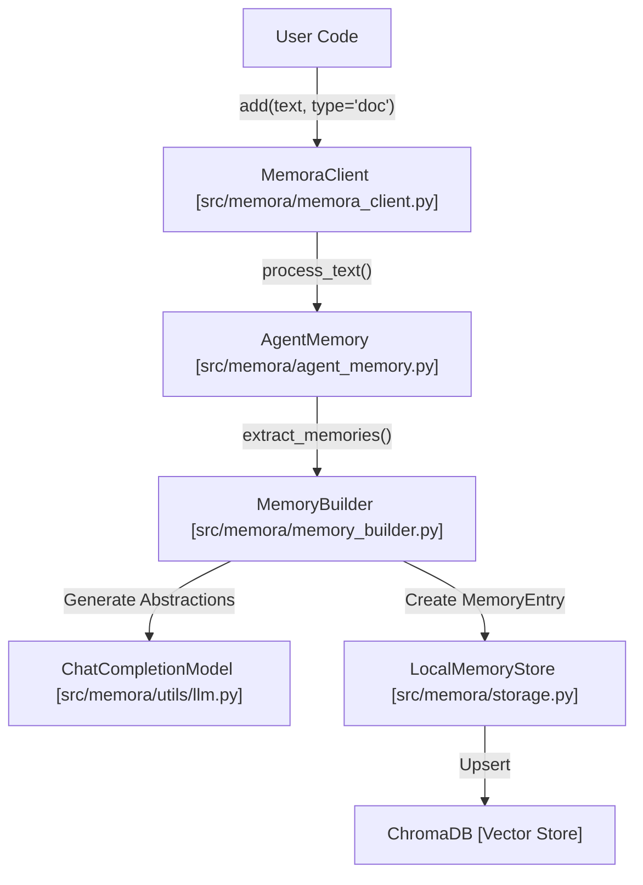
Sources: [quickstart.py:74-94](), [README.md:97-115]()

### Running the Example
You can run the provided quickstart script to verify your installation and configuration:

```python
from memora.memora_client import MemoraClient
from quickstart import make_config

# 1. Initialize configuration
cfg = make_config()

# 2. Instantiate the client
client = MemoraClient(cfg=cfg, user_id="demo_user")

# 3. Ingest data
client.add("Alice is moving to Seattle for a new job at Microsoft.", type="doc")

# 4. Perform a semantic query
results = client.query("Where is Alice moving?")
for entry in results:
    print(f"Memory: {entry.value}")
```
Sources: [quickstart.py:74-117](), [README.md:73-93]()

---

## Configuration Mapping: Natural Language to Code Entities

To help developers navigate the configuration, the following diagram maps high-level concepts to the specific code classes and configuration keys that implement them.

**System Configuration Mapping**
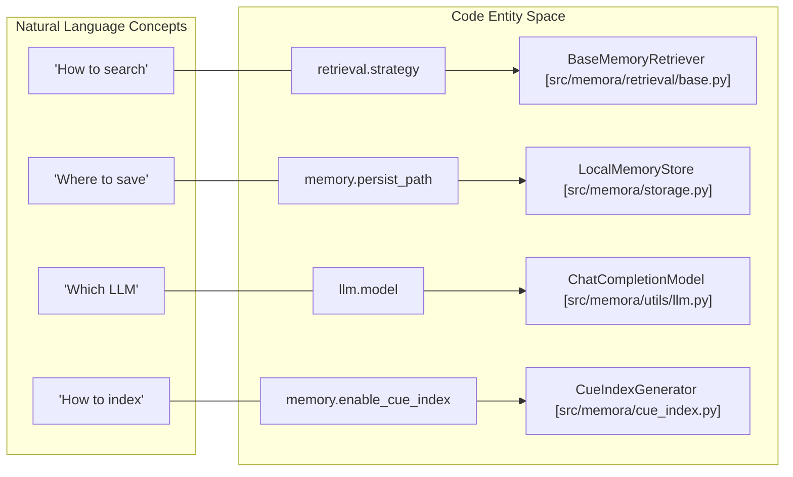
Sources: [app/longmemeval/conf/config.yaml:37-40,66,81,111](), [quickstart.py:25-70]()

---

## Troubleshooting & Verification

### Validating the Memory Store
After running the quickstart, you can verify that memories were persisted by checking the `persist_path` (default: `./memory_store/example_store`). Memora uses ChromaDB, which creates a directory containing `sqlite3` and `parquet` files.

### Common Configuration Issues
1. **API Version Mismatch**: Ensure `openai.llm_api_version` matches your Azure deployment (default: `2024-12-01-preview`) [quickstart.py:34]().
2. **Embedding Model**: The default embedding model is `text-embedding-3-small`. If using a different model, update `openai.embedding_model` and ensure the dimensions match your existing ChromaDB collection [app/locomo/conf/config.yaml:66-67]().
3. **Managed Identity**: If `api_type` is `azure` and you are not using an API key, `managed_identity` must be provided or available via environment variables [app/longmemeval/conf/config.yaml:47]().

Sources: [quickstart.py:19-44](), [app/longmemeval/conf/config.yaml:44-62]()

---

# Page: Core Concepts & Terminology

# Core Concepts & Terminology

<details>
<summary>Relevant source files</summary>

The following files were used as context for generating this wiki page:

- [src/memora/builder/chat_memory_builder.py](src/memora/builder/chat_memory_builder.py)
- [src/memora/builder/document_memory_builder.py](src/memora/builder/document_memory_builder.py)
- [src/memora/builder/memory_builder.py](src/memora/builder/memory_builder.py)
- [src/memora/core/local_client.py](src/memora/core/local_client.py)
- [src/memora/core/memory.py](src/memora/core/memory.py)
- [src/memora/core/memory_entry.py](src/memora/core/memory_entry.py)
- [src/memora/utils/memory.py](src/memora/utils/memory.py)

</details>


This page details the foundational architecture and terminology used in Memora. It explains the relationship between memory types, the distinction between primary and cue indices, and the lifecycle of memory entries within the system.

## Memory Abstractions

Memora distinguishes between the data being stored (the **Memory Value**) and the structures used to find that data (the **Primary Index** and **Cue Anchors**).

### Memory Values vs. Indices
*   **Memory Value**: The core content or factual statement extracted from a source (e.g., "Alice prefers dark roast coffee"). [src/memora/core/memory_entry.py:53-55]()
*   **Primary Index**: A short, human-readable, and semantically rich phrase that identifies the memory (e.g., "Alice's Coffee Preference"). It serves as the main key for retrieval and identification. [src/memora/core/memory_entry.py:62-65]()
*   **Cue Anchors (Cue Indices)**: Supplemental phrases linked to a primary memory to improve retrieval coverage. They act as "aliases" or alternative search terms (e.g., "Alice's morning routine", "Alice's favorite drink"). [src/memora/core/memory_entry.py:109-118]()

### Memory Types
Memora categorizes information into three distinct types to optimize for different retrieval needs:

| Type | Description | Code Identifier |
| :--- | :--- | :--- |
| **Factual** | Atomic, verifiable facts extracted from content. | `factual` [src/memora/builder/chat_memory_builder.py:117-117]() |
| **Episodic** | Summaries of specific events or conversation segments, preserving narrative context. | `episodic` [src/memora/core/memory_entry.py:76-76]() |
| **Procedural** | Multi-step workflows, decision logic, or "how-to" instructions. | `procedural` [src/memora/builder/document_memory_builder.py:38-45]() |

**Sources:**
- [src/memora/core/memory_entry.py:52-118]()
- [src/memora/builder/document_memory_builder.py:33-46]()
- [src/memora/builder/chat_memory_builder.py:116-118]()

---

## The Memory Lifecycle

The transformation of raw input into a persistent `MemoryEntry` involves extraction, de-duplication, and indexing.

### Building and Ingestion
The `MemoryBuilder` classes ([src/memora/builder/memory_builder.py:127-150]()) coordinate the extraction of memories using LLM prompts. 
1.  **Extraction**: The system uses specialized prompts like `PROMPT_BUILD_MEMORY` to identify facts. [src/memora/builder/memory_builder.py:38-76]()
2.  **Update Decision**: When a new memory is extracted, the system checks for existing similar memories. The `MemoryUpdateDecision` model determines if the new information should result in a **new entry** or an **update** to an existing one. [src/memora/utils/memory.py:12-48]()
3.  **History Preservation**: If a memory is updated, the previous value is stored in the `history` field of the `MemoryEntry`. [src/memora/utils/memory.py:139-164]()

### Diagram: Ingestion Data Flow

"Natural Language Space" meets "Code Entity Space" during the ingestion process.

**Memory Construction Flow**
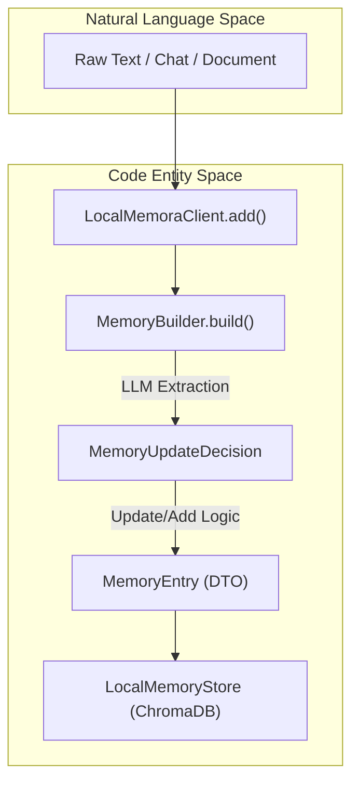
**Sources:**
- [src/memora/core/local_client.py:175-200]()
- [src/memora/builder/memory_builder.py:151-180]()
- [src/memora/utils/memory.py:12-48]()

---

## Retrieval Concepts: Working Set and Frontier

Memora uses a sophisticated retrieval strategy beyond simple vector search, managed by the `AgentMemory` facade. [src/memora/core/memory.py:43-53]()

### Query Modes
The system supports different `QueryMode` settings to target specific index types:
*   `PRIMARY_ONLY`: Searches only the main memory indices.
*   `CUE_ONLY`: Searches only the supplemental cue anchors.
*   `BOTH`: A hybrid search across both primary and cue indices.
[src/memora/core/memory.py:36-41]()

### Retrieval Pipeline
1.  **Query Generation**: The `QueryGenerator` expands a single user query into multiple variants. [src/memora/core/query_generator.py]()
2.  **Parallel Search**: The system queries the `LocalMemoryStore` for all variants. [src/memora/core/memory.py:137-142]()
3.  **Cue Resolution**: If a search result is a `cue_index`, the system automatically resolves it to its `linked_memory` (the primary entry). [src/memora/core/memory.py:155-172]()
4.  **Filtering**: The `MemoryFilter` uses an LLM to prune irrelevant results based on the original user intent. [src/memora/core/memory_filter.py]()

### Diagram: Retrieval Logic and Cue Resolution

This diagram illustrates how code entities handle the transition from a search query to a factual memory.

**Retrieval & Cue Resolution**
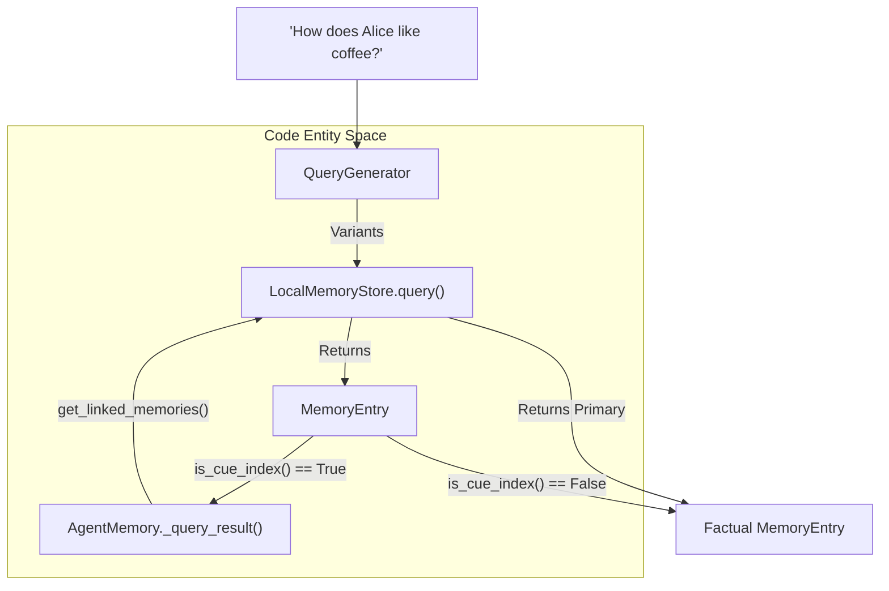
**Sources:**
- [src/memora/core/memory.py:111-183]()
- [src/memora/core/memory_entry.py:141-165]()
- [src/memora/core/query_generator.py]()

---

## Key Data Structures

### MemoryEntry
The `MemoryEntry` is the central DTO (Data Transfer Object) in Memora. [src/memora/core/memory_entry.py:28-50]()

| Field | Purpose |
| :--- | :--- |
| `value` | The actual content of the memory. |
| `index` | The primary retrieval key. |
| `history` | List of previous versions of this memory. |
| `cue_indices` | Delimited string (`||`) of linked cue anchors. |
| `linked_memory` | If this is a cue entry, it points to the primary index. |
| `memory_type` | Factual, Episodic, or Procedural. |

**Sources:**
- [src/memora/core/memory_entry.py:52-124]()
- [src/memora/utils/memory.py:49-90]()

---

# Page: Core Memory System

# Core Memory System

<details>
<summary>Relevant source files</summary>

The following files were used as context for generating this wiki page:

- [src/memora/core/base.py](src/memora/core/base.py)
- [src/memora/core/local_client.py](src/memora/core/local_client.py)
- [src/memora/core/memory.py](src/memora/core/memory.py)
- [src/memora/core/memory_entry.py](src/memora/core/memory_entry.py)
- [src/memora/core/remote_client.py](src/memora/core/remote_client.py)
- [src/memora/memora_client.py](src/memora/memora_client.py)

</details>


The Core Memory System is the architectural backbone of Memora, responsible for the persistent storage, retrieval, and management of memory entries. It abstracts the complexities of vector databases and LLM-driven query expansion into a unified interface, allowing agents to interact with a long-term memory store as a cohesive system rather than a collection of disparate data points.

### System Architecture

The architecture is divided into three primary layers: the **Client Facade**, the **AgentMemory Coordinator**, and the **Storage Backends**.

#### Memory System Flow
The following diagram illustrates how natural language inputs are processed through the code entities of the core system.

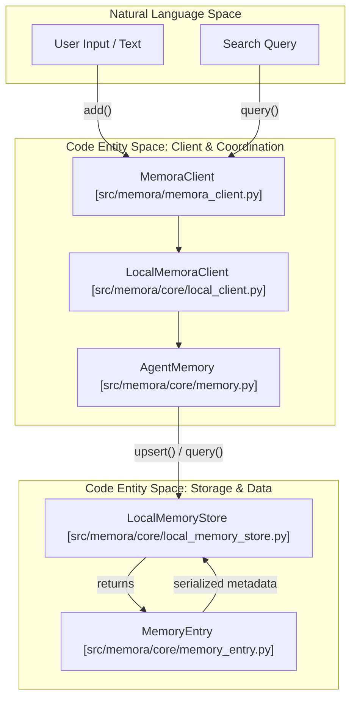
**Sources:** [src/memora/memora_client.py:21-50](), [src/memora/core/local_client.py:36-64](), [src/memora/core/memory.py:43-94](), [src/memora/core/memory_entry.py:28-50]()

---

### Key Components

#### 1. MemoraClient Facade
The `MemoraClient` serves as the primary entry point for developers. It handles the routing between local execution (`LocalMemoraClient`) and remote API calls (`RemoteMemoraClient`) based on the provided configuration. Its main role is to provide a simplified API for adding text or files and querying the memory store without exposing internal coordination logic.

For details, see [MemoraClient API](#2.1).

**Sources:** [src/memora/memora_client.py:21-50](), [src/memora/core/remote_client.py:9-33]()

#### 2. AgentMemory Coordinator
`AgentMemory` is the "brain" of the core system. It implements the `MemoryBase` abstract class and coordinates between various sub-modules:
*   **Query Generation:** Uses `QueryGenerator` to expand a single user query into multiple variants to improve recall.
*   **Retrieval Pipeline:** Manages the parallel search across primary and cue indices.
*   **Memory Filtering:** Employs `MemoryFilter` (LLM-based) to prune irrelevant results post-retrieval.
*   **Deduplication:** Ensures that when multiple "Cue Indices" point to the same "Primary Memory," only one instance is returned to the user.

For details, see [AgentMemory & Storage Backends](#2.3).

**Sources:** [src/memora/core/memory.py:43-101](), [src/memora/core/memory.py:120-183](), [src/memora/core/base.py:13-23]()

#### 3. Memory Data Model
All data within the system is encapsulated in the `MemoryEntry` object. This model tracks not just the memory value, but its history, its type (factual, episodic, procedural), and its relationships (links between indices).

For details, see [Memory Data Model](#2.2).

**Sources:** [src/memora/core/memory_entry.py:52-124]()

#### 4. Storage Backends
Memora supports different storage implementations through the `MemoryStoreBase` interface. The default implementation is `LocalMemoryStore`, which utilizes **ChromaDB** for vector similarity search and metadata persistence.

For details, see [AgentMemory & Storage Backends](#2.3).

**Sources:** [src/memora/core/base.py:73-85](), [src/memora/core/memory.py:94-94]()

---

### Memory Interaction Logic

The system distinguishes between **Primary Indices** (the core factual content) and **Cue Indices** (alternative phrases or anchors that point to a primary memory).

#### Retrieval Logic Diagram
This diagram shows how `AgentMemory` interacts with `LocalMemoryStore` to resolve indices.

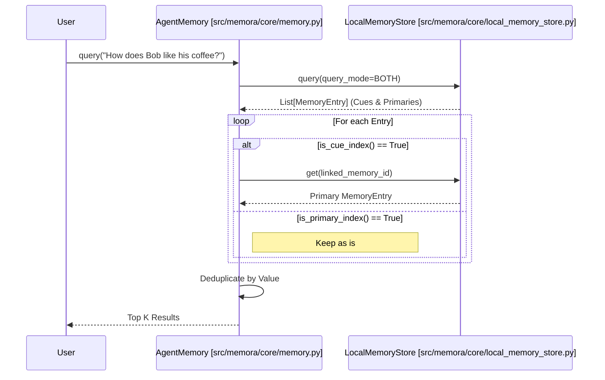
**Sources:** [src/memora/core/memory.py:111-183](), [src/memora/core/memory_entry.py:141-165]()

### Summary Table of Core Classes

| Class | Responsibility | File Path |
| :--- | :--- | :--- |
| `MemoraClient` | Top-level routing (Local vs Remote) | [src/memora/memora_client.py]() |
| `AgentMemory` | Coordination of search, filtering, and indexing | [src/memora/core/memory.py]() |
| `MemoryEntry` | Data Transfer Object (DTO) for memory records | [src/memora/core/memory_entry.py]() |
| `LocalMemoryStore` | ChromaDB persistence and vector search | [src/memora/core/local_memory_store.py]() |
| `QueryGenerator` | LLM-based query expansion | [src/memora/core/query_generator.py]() |
| `MemoryFilter` | LLM-based post-retrieval relevance filtering | [src/memora/core/memory_filter.py]() |

**Sources:** [src/memora/core/memory.py:84-94](), [src/memora/core/local_client.py:63-80]()

---

# Page: MemoraClient API

# MemoraClient API

<details>
<summary>Relevant source files</summary>

The following files were used as context for generating this wiki page:

- [src/memora/core/base.py](src/memora/core/base.py)
- [src/memora/core/local_client.py](src/memora/core/local_client.py)
- [src/memora/core/memory.py](src/memora/core/memory.py)
- [src/memora/core/memory_entry.py](src/memora/core/memory_entry.py)
- [src/memora/core/remote_client.py](src/memora/core/remote_client.py)
- [src/memora/memora_client.py](src/memora/memora_client.py)

</details>


The `MemoraClient` serves as the primary public-facing facade for the Memora system. It abstracts the complexity of memory storage, retrieval strategies, and document processing into a high-level interface. Depending on the initialization parameters, it transparently routes requests to either a `LocalMemoraClient` for direct disk-based operations or a `RemoteMemoraClient` for HTTP-based interactions.

### Architecture Overview

The `MemoraClient` acts as a routing layer. When initialized with an `api_key`, it assumes a remote server configuration. If initialized with a `DictConfig` and `user_id`, it operates locally.

#### Client Routing and Data Flow

This diagram illustrates how the `MemoraClient` dispatches calls to specialized implementations and how data flows through the system.

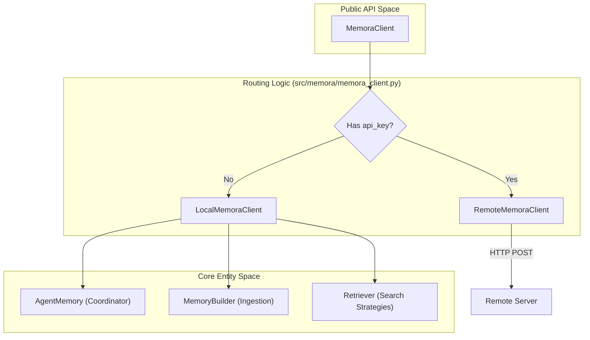
**Sources:** [src/memora/memora_client.py:21-50](), [src/memora/core/local_client.py:36-80]()

---

### Core API Reference

#### 1. `add()` and `add_file()`
These methods are used to ingest information into the memory system. The `LocalMemoraClient` uses a `MemoryBuilderRegistry` to select the appropriate builder (e.g., `ChatMemoryBuilder`, `DocumentMemoryBuilder`) based on the input type.

*   **`add(text, type, metadata, ...)`**: Accepts raw strings, lists of strings, or structured dictionaries. It stamps the `user_id` onto the resulting `MemoryEntry` objects.
*   **`add_file(file_path, metadata)`**: Utilizes the `ProcessorRegistry` to parse files (PDF, Markdown, Word, etc.) into `Segment` objects before passing them to the memory builders.

**Sources:** [src/memora/memora_client.py:52-100](), [src/memora/core/local_client.py:114-154](), [src/memora/core/local_client.py:175-212]()

#### 2. `query()`
The standard query method performs vector similarity search. It supports:
*   **Hybrid Search**: Combining semantic vector search with keyword-based BM25 search.
*   **LLM Filtering**: Post-retrieval pruning where an LLM evaluates the relevance of retrieved memories.
*   **Query Modes**: Defined in `QueryMode`, allowing users to target the `PRIMARY_ONLY` index, `CUE_ONLY` (anchors), or `BOTH`.

**Sources:** [src/memora/memora_client.py:102-143](), [src/memora/core/memory.py:36-41](), [src/memora/core/memory.py:111-183]()

#### 3. `advance_query()`
This method provides access to sophisticated retrieval strategies beyond simple similarity search.

| Strategy | Retriever Class | Description |
| :--- | :--- | :--- |
| `semantic` | `SemanticRetriever` | Standard vector search with optional filtering. |
| `prompt` | `PromptedPolicyRetriever` | Iterative, LLM-guided retrieval using the Memora-Control policy. |
| `grpo` | `LocalPolicyRetriever` | Uses a GRPO-trained LoRA checkpoint for high-performance, model-driven retrieval. |

**Sources:** [src/memora/memora_client.py:145-185]()

#### 4. `list_memories()`
Provides a way to inspect the current state of the memory store, returning a list of `MemoryEntry` objects.

**Sources:** [src/memora/memora_client.py:188-204]()

---

### Internal Data Representation: MemoryEntry

Every interaction with the API involves the `MemoryEntry` DTO. This class ensures that whether a memory is being built or retrieved, it carries consistent metadata and history.

| Field | Type | Purpose |
| :--- | :--- | :--- |
| `value` | `str` | The core text content. |
| `index` | `str` | The natural language key used for embedding. |
| `memory_type` | `str` | `factual`, `episodic`, or `procedural`. |
| `linked_memory` | `str` | Used by Cue Anchors to point to a primary memory. |
| `history` | `List[Dict]` | Stores previous versions of the memory for temporal tracking. |

**Sources:** [src/memora/core/memory_entry.py:28-140]()

---

### Remote Interface (`RemoteMemoraClient`)

When an `api_key` is provided, `MemoraClient` initializes a `RemoteMemoraClient`. This implementation mirrors the local API but routes all calls to a remote server via RESTful endpoints.

*   **Base URL**: Configured via `MEMORA_REMOTE_SERVER_URL` (default: `http://localhost:8000`).
*   **Authentication**: Uses Bearer Token auth derived from the `api_key`.
*   **Endpoints**:
    *   `POST /api/v1/memory/add`
    *   `POST /api/v1/memory/query`

**Sources:** [src/memora/core/remote_client.py:9-153]()

---

### Memory Ingestion Logic

The following diagram maps the natural language input to the specific code entities responsible for processing and storing the memory.

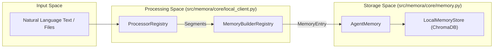
**Sources:** [src/memora/core/local_client.py:70-81](), [src/memora/core/local_client.py:156-173](), [src/memora/core/memory.py:93-94]()

---

# Page: Memory Data Model

# Memory Data Model

<details>
<summary>Relevant source files</summary>

The following files were used as context for generating this wiki page:

- [src/memora/core/local_client.py](src/memora/core/local_client.py)
- [src/memora/core/memory.py](src/memora/core/memory.py)
- [src/memora/core/memory_entry.py](src/memora/core/memory_entry.py)
- [src/memora/core/segment.py](src/memora/core/segment.py)

</details>


The Memory Data Model defines the core structures used to represent, store, and retrieve information within Memora. It bridges the gap between raw unstructured data (e.g., chat logs, documents) and the structured, vector-indexed representation used for retrieval-augmented generation.

## MemoryEntry

The `MemoryEntry` class is the central Data Transfer Object (DTO) in Memora. It provides a unified interface for memories regardless of whether they are being extracted from new content or retrieved from the vector database [src/memora/core/memory_entry.py:28-36]().

### Core Fields
A `MemoryEntry` contains the following primary fields:

| Field | Type | Description |
| :--- | :--- | :--- |
| `value` | `str` | The main processed content/text of the memory [src/memora/core/memory_entry.py:53-55](). |
| `index` | `str` | Unique key for retrieval and identification within the store [src/memora/core/memory_entry.py:62-65](). |
| `memory_type` | `str` | Categorization: `factual`, `procedural`, or `episodic` [src/memora/core/memory_entry.py:74-77](). |
| `history` | `List[Dict]` | Historical versions of the memory for tracking updates over time [src/memora/core/memory_entry.py:68-71](). |
| `cue_indices` | `str` | A string of multiple anchors (separated by `||`) used for multi-vector retrieval [src/memora/core/memory_entry.py:116-118](). |
| `linked_memory` | `str` | For cue entries, this points back to the primary memory index [src/memora/core/memory_entry.py:110-113](). |
| `score` | `float` | The similarity score assigned during retrieval [src/memora/core/memory_entry.py:86-89](). |

### Primary vs. Cue Indices
Memora distinguishes between "Primary" memories and "Cue" indices to improve retrieval recall.
*   **Primary Index**: The main entry containing the full memory value and history [src/memora/core/memory_entry.py:145-147]().
*   **Cue Index**: A lightweight entry that acts as a "search anchor." It contains a specific phrase or keyword in its `value` but points to a Primary Index via the `linked_memory` field [src/memora/core/memory_entry.py:141-143]().

### Serialization
Because vector databases like ChromaDB often only support flat metadata types, `MemoryEntry` handles serialization of complex types (lists and dicts) to JSON strings [src/memora/core/memory_entry.py:190-203]().

**Data Flow: Entity Mapping**
"Natural Language Space" to "Code Entity Space" mapping:

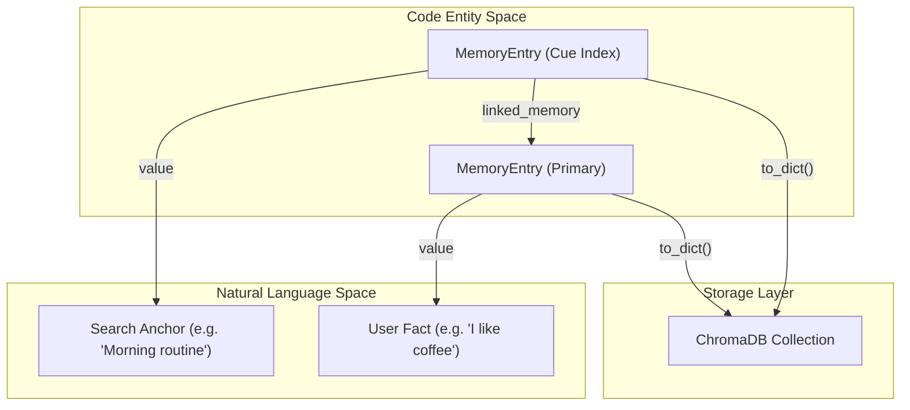
**Sources:** [src/memora/core/memory_entry.py:52-160](), [src/memora/core/memory_entry.py:190-217]()

---

## Segment

The `Segment` is an intermediate object used during the ingestion pipeline. Before text becomes a `MemoryEntry`, it is parsed and partitioned into `Segment` objects by a `Processor` [src/memora/core/segment.py:13-19]().

### Fields
*   **content**: The raw text extracted from a specific part of a file or conversation [src/memora/core/segment.py:17]().
*   **segment_type**: Identifies the origin (e.g., `chat`, `markdown`, `pdf`) [src/memora/core/segment.py:18]().
*   **metadata**: Contextual information such as `file_path`, `page_number`, or `speaker_id` [src/memora/core/segment.py:19]().

**Data Flow: Ingestion to Memory**
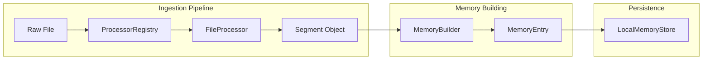
**Sources:** [src/memora/core/segment.py:1-28](), [src/memora/core/local_client.py:156-174](), [src/memora/core/local_client.py:114-154]()

---

## Memory Retrieval Logic

When querying, the `AgentMemory` coordinator interacts with the `MemoryEntry` objects to resolve links between cues and primary memories.

1.  **Search**: The system queries the `LocalMemoryStore`, which returns a list of `MemoryEntry` objects [src/memora/core/memory.py:137-139]().
2.  **Resolution**: 
    *   If a returned entry is a **Primary Index**, it is added to the result set [src/memora/core/memory.py:174-181]().
    *   If a returned entry is a **Cue Index**, the system uses the `linked_memory` field to fetch the corresponding Primary Index from storage [src/memora/core/memory.py:155-172]().
3.  **Deduplication**: The system ensures that if multiple cues point to the same primary memory, the primary memory is only returned once [src/memora/core/memory.py:168-172]().

### Query Modes
The `QueryMode` enum defines how the system filters the search space [src/memora/core/memory.py:36-40]():
*   `PRIMARY_ONLY`: Filters where `linked_memory` is empty [src/memora/core/memory.py:131-134]().
*   `CUE_ONLY`: Filters where `linked_memory` is not empty [src/memora/core/memory.py:125-130]().
*   `BOTH`: Searches the entire index.

**Sources:** [src/memora/core/memory.py:36-40](), [src/memora/core/memory.py:111-183](), [src/memora/core/memory_entry.py:141-166]()

---

# Page: AgentMemory & Storage Backends

# AgentMemory & Storage Backends

<details>
<summary>Relevant source files</summary>

The following files were used as context for generating this wiki page:

- [src/memora/core/http_memory_store.py](src/memora/core/http_memory_store.py)
- [src/memora/core/local_client.py](src/memora/core/local_client.py)
- [src/memora/core/local_memory_store.py](src/memora/core/local_memory_store.py)
- [src/memora/core/memory.py](src/memora/core/memory.py)
- [src/memora/core/memory_entry.py](src/memora/core/memory_entry.py)
- [src/memora/db_clients/__init__.py](src/memora/db_clients/__init__.py)
- [src/memora/db_clients/base.py](src/memora/db_clients/base.py)
- [src/memora/db_clients/chromadb_client.py](src/memora/db_clients/chromadb_client.py)
- [src/memora/db_clients/factory.py](src/memora/db_clients/factory.py)
- [src/memora/db_clients/redis_client.py](src/memora/db_clients/redis_client.py)

</details>


The `AgentMemory` coordinator serves as the central orchestration layer for all memory operations in Memora. It bridges the high-level client requests (add, query) with the low-level persistence mechanisms, managing the retrieval pipeline, cue index resolution, and metadata filtering.

## AgentMemory Coordinator

`AgentMemory` is a facade class that implements the `MemoryBase` interface [src/memora/core/memory.py:43-53](). It is responsible for initializing the storage backend and coordinating between the `QueryGenerator`, `MemoryFilter`, and the underlying `LocalMemoryStore` [src/memora/core/memory.py:84-94]().

### Retrieval Pipeline
The retrieval process in `AgentMemory` follows a multi-stage pipeline designed to maximize recall while maintaining high precision through LLM-based filtering.

1.  **Query Generation**: The system uses `QueryGenerator` to expand a single natural language input into multiple query variants [src/memora/core/memory.py:85]().
2.  **Parallel Search**: The coordinator executes searches across these variants using the storage backend [src/memora/core/memory.py:137-139]().
3.  **Cue Index Resolution**: If a retrieved entry is a "cue index" (indicated by a non-empty `linked_memory` field), the system automatically fetches the associated primary memory entries [src/memora/core/memory.py:155-172]().
4.  **RRF Merging & Deduplication**: Results are merged, sorted by relevance score, and deduplicated based on their content value [src/memora/core/memory.py:144-181]().
5.  **LLM Filtering**: Finally, the `MemoryFilter` uses an LLM to prune irrelevant results that passed the vector similarity threshold [src/memora/core/memory.py:86]().

### Data Flow: Query to Code Entity
The following diagram maps the logical retrieval flow to specific code entities and functions.

**Retrieval Pipeline Mapping**
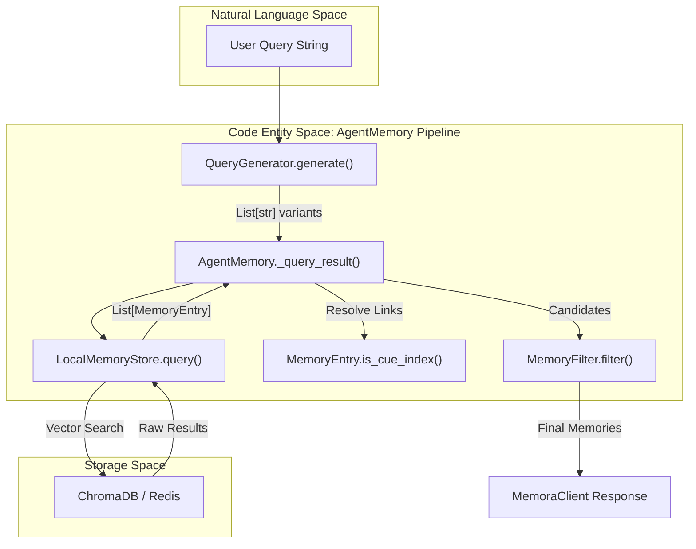
**Sources:** [src/memora/core/memory.py:111-183](), [src/memora/core/local_memory_store.py:170-200](), [src/memora/core/memory_entry.py:141-147]()

---

## Cue Index Lifecycle

Cue indices are specialized `MemoryEntry` objects used for enhanced retrieval. Unlike primary memories, which store actual knowledge, cue indices act as alternative "anchors" pointing to primary memories [src/memora/core/memory_entry.py:109-118]().

| Action | Implementation Detail |
| :--- | :--- |
| **Creation** | Created during the build phase when `linked_memory` is populated with a primary index [src/memora/core/memory_entry.py:110-113](). |
| **Resolution** | In `_query_result`, if `entry.is_cue_index()` is true, the system calls `_store.get(primary_index)` to retrieve the actual content [src/memora/core/memory.py:155-162](). |
| **Deletion** | The `delete_cue_index` method removes specific anchors from a memory's `cue_indices` metadata string [src/memora/core/memory_entry.py:155-159](). |

**Sources:** [src/memora/core/memory_entry.py:141-166](), [src/memora/core/memory.py:155-172]()

---

## Storage Backends

Memora supports multiple persistence layers through the `VectorDBClient` abstraction [src/memora/db_clients/base.py:11-70](). The `LocalMemoryStore` is the default implementation, providing a thread-safe interface to vector databases [src/memora/core/local_memory_store.py:32-42]().

### LocalMemoryStore
`LocalMemoryStore` manages user-specific collections and provides an LRU cache for embeddings to minimize redundant API calls [src/memora/core/local_memory_store.py:76-118](). It uses a per-user locking mechanism (`_user_locks`) to ensure thread safety during concurrent writes to the same user's memory [src/memora/core/local_memory_store.py:44-53]().

### Vector DB Implementations
The system dispatches to specific database clients via `create_vector_db_client` [src/memora/db_clients/factory.py:14-37]():

1.  **ChromaDBClient**: The primary backend. It uses a `PersistentClient` and a custom `ChromaDBEmbeddingFunction` to handle local file-based storage [src/memora/db_clients/chromadb_client.py:31-59]().
2.  **RedisVectorDBClient**: An alternative backend using Redis Stack. It maps metadata to `TAG` fields for efficient exact filtering and `VectorField` for HNSW similarity search [src/memora/db_clients/redis_client.py:30-85]().
3.  **HttpMemoryStore**: A remote storage implementation that communicates with a memory service via REST API endpoints like `/api/memory/upsert` and `/api/memory/query` [src/memora/core/http_memory_store.py:21-54]().

**Storage Backend Architecture**
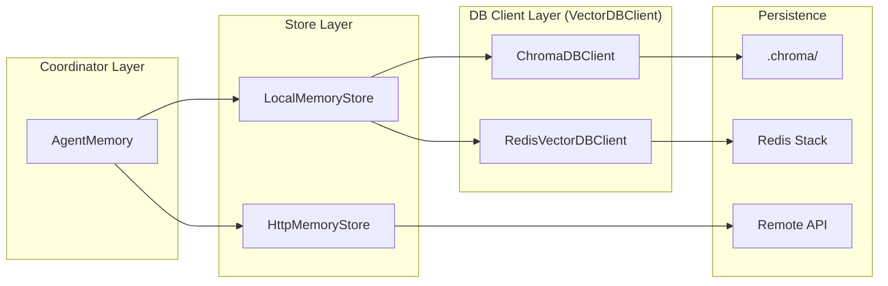
**Sources:** [src/memora/core/local_memory_store.py:71-86](), [src/memora/db_clients/factory.py:27-37](), [src/memora/db_clients/chromadb_client.py:31-59](), [src/memora/db_clients/redis_client.py:129-167]()

---

# Page: Cue Index & Query Generation

# Cue Index & Query Generation

<details>
<summary>Relevant source files</summary>

The following files were used as context for generating this wiki page:

- [src/memora/core/cue_index_generator.py](src/memora/core/cue_index_generator.py)
- [src/memora/core/memory_filter.py](src/memora/core/memory_filter.py)
- [src/memora/core/query_generator.py](src/memora/core/query_generator.py)

</details>


This section details the specialized components responsible for expanding the semantic reach of memories and optimizing the retrieval process. Memora employs a dual-indexing strategy where each memory is associated with a primary index (the main summary) and multiple **Cue Anchors** (secondary semantic keys).

The retrieval pipeline leverages LLM-driven **Query Generation** to expand a single user request into multiple search variants and uses a **Memory Filter** to prune irrelevant results after retrieval.

## CueIndexGenerator

The `CueIndexGenerator` class is responsible for generating 0-3 short, meaningful "Cue Indices" for a given memory. While the primary index usually captures the core summary, cue indices provide additional semantic anchors that focus on different perspectives, such as specific actors, actions, concepts, or causal relations [src/memora/core/cue_index_generator.py:11-37]().

### Generation Logic
The generator uses structured prompting to ensure cues follow a `[Main Entity] + [Key Aspect]` pattern (e.g., "Project Phoenix kickoff", "Sarah hiking trip") [src/memora/core/cue_index_generator.py:116-125](). Cues are designed to be:
*   **Compact**: 2-5 words [src/memora/core/cue_index_generator.py:20-20]().
*   **Contextually Anchored**: They must specify the "who" or "what domain" the memory belongs to [src/memora/core/cue_index_generator.py:22-22]().
*   **Distinct**: Each cue covers a different aspect (factual vs. relational) [src/memora/core/cue_index_generator.py:24-27]().

### Implementation Detail
The generator operates in batches to improve efficiency. It maps raw `MemoryEntry` objects into a text format for the LLM and parses the results back into a structured dictionary where keys are the primary indices and values are lists of generated cue strings [src/memora/core/cue_index_generator.py:146-175]().

**Data Flow: From Memory Value to Cue Anchors**

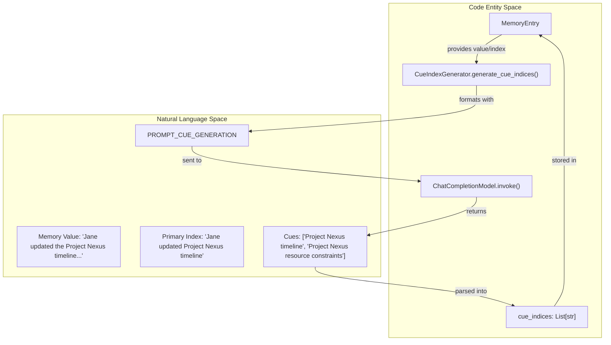
Sources: [src/memora/core/cue_index_generator.py:110-144](), [src/memora/core/cue_index_generator.py:146-175]()

---

## QueryGenerator

The `QueryGenerator` class handles the transformation of a user context into optimized search queries. It supports two primary modes: semantic query expansion and keyword extraction [src/memora/core/query_generator.py:60-65]().

### Functions
*   **`generate_queries(context)`**: Infers the user's intent and generates 1-3 concise (6-14 words) queries targeting different memory types (factual, procedural, episodic) [src/memora/core/query_generator.py:67-83]().
*   **`extract_keywords(context)`**: Identifies 1-4 important entities or short phrases (2-4 words) for exact-match or keyword-based searches [src/memora/core/query_generator.py:85-108]().

### Prompts and Schemas
The class uses Pydantic models (`MemoryQueries`, `Keywords`) to enforce structured output from the LLM, ensuring that the retrieval pipeline receives clean lists of strings [src/memora/core/query_generator.py:40-58]().

| Feature | Prompt Symbol | Output Type | Word Count |
| :--- | :--- | :--- | :--- |
| Semantic Expansion | `PROMPT_GENERATE_QUERIES` | `MemoryQueries` | 6–14 words |
| Keyword Extraction | `PROMPT_EXTRACT_KEYWORDS` | `Keywords` | 2–4 words |

Sources: [src/memora/core/query_generator.py:8-37](), [src/memora/core/query_generator.py:67-108]()

---

## MemoryFilter

The `MemoryFilter` is a post-retrieval component that uses an LLM to evaluate the relevance of retrieved memories against the original query. This step is crucial for discarding "hallucinated" retrievals or outdated information that vector similarity might still rank highly [src/memora/core/memory_filter.py:95-99]().

### Scoring Mechanism
The filter assigns a relevance score from 1 to 3 to each retrieved memory [src/memora/core/memory_filter.py:52-57]():
*   **Score 3**: Highly relevant; directly answers the query.
*   **Score 2**: Somewhat relevant; provides context/background.
*   **Score 1**: Irrelevant or outdated.

### Pruning and Re-ranking
1.  **Filtering**: Only memories with a score of 2 or 3 are kept [src/memora/core/memory_filter.py:155-155]().
2.  **Sorting**: Results are re-sorted primarily by the LLM relevance score and secondarily by the original search engine score (e.g., vector similarity) [src/memora/core/memory_filter.py:159-160]().

**Retrieval Refinement Pipeline**

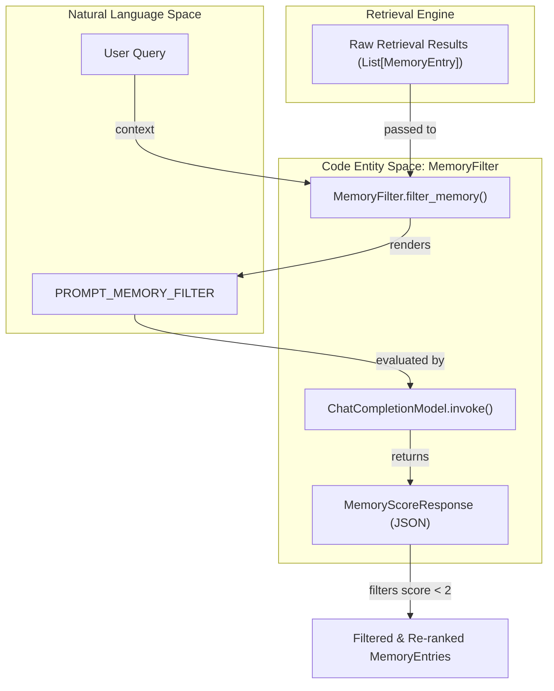
Sources: [src/memora/core/memory_filter.py:52-93](), [src/memora/core/memory_filter.py:101-169]()

---

## Technical Data Flow Summary

The following table summarizes how these components interact during the memory lifecycle:

| Component | Trigger | Input | Output |
| :--- | :--- | :--- | :--- |
| **CueIndexGenerator** | Memory Ingestion (Batch) | `MemoryEntry` (Value + Primary Index) | `cue_indices` metadata |
| **QueryGenerator** | Retrieval Start | User Context String | `List[str]` (Queries/Keywords) |
| **MemoryFilter** | Post-Search | `List[MemoryEntry]` + Query | `List[MemoryEntry]` (Pruned/Sorted) |

Sources: [src/memora/core/cue_index_generator.py:146-147](), [src/memora/core/query_generator.py:67-70](), [src/memora/core/memory_filter.py:101-105]()

---

# Page: Memory Ingestion & Building

# Memory Ingestion & Building

<details>
<summary>Relevant source files</summary>

The following files were used as context for generating this wiki page:

- [src/memora/builder/chat_memory_builder.py](src/memora/builder/chat_memory_builder.py)
- [src/memora/builder/document_memory_builder.py](src/memora/builder/document_memory_builder.py)
- [src/memora/builder/memory_builder.py](src/memora/builder/memory_builder.py)
- [src/memora/utils/memory.py](src/memora/utils/memory.py)

</details>


Memory ingestion is the process of transforming unstructured data—such as raw text, chat logs, and complex documents—into the structured `MemoryEntry` objects used by the Memora system. This subsystem bridges the gap between natural language inputs and the indexed, queryable "Code Entity Space."

The ingestion process is governed by the `MemoryBuilder` pipeline, which manages extraction, multimodal processing, and the logic for updating or deduplicating memories within the storage backend.

## Ingestion Overview

The ingestion flow starts with raw content and ends with a synchronized state in the `AgentMemory`. The system supports two primary builder implementations tailored for different data sources:

1.  **Chat Ingestion**: Optimized for dialogue, focusing on factual extraction and episodic summarization.
2.  **Document Ingestion**: Optimized for structured files, supporting both factual data and multi-step procedural workflows.

### From Natural Language to Memory Entities

The following diagram illustrates how natural language inputs are routed through specific code entities to become structured memories.

**Ingestion Path: Text to MemoryEntry**
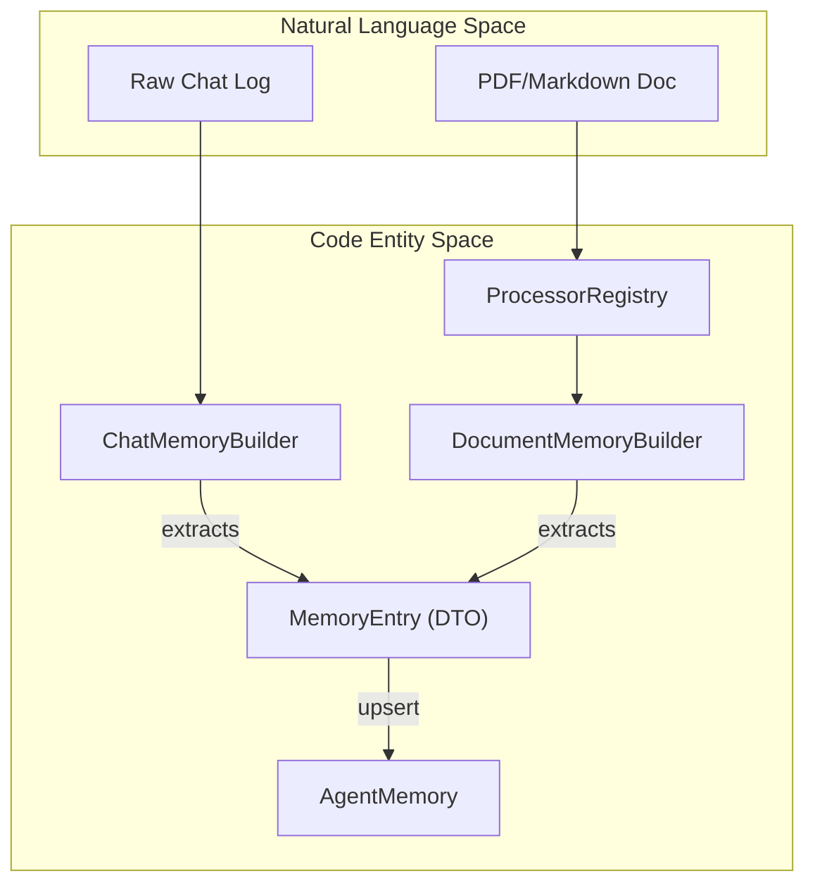
Sources: [src/memora/builder/memory_builder.py:127-151](), [src/memora/builder/chat_memory_builder.py:66-76](), [src/memora/builder/document_memory_builder.py:109-117]()

---

## Memory Builder Pipeline

The `MemoryBuilder` is an abstract base class that defines the three-phase lifecycle for creating memories:

1.  **Extraction**: Using LLM prompts like `PROMPT_BUILD_MEMORY` to identify key facts or procedures.
2.  **Processing**: Generating `CueIndex` anchors for efficient retrieval and handling multimodal elements (images/text).
3.  **Upsert/Deduplication**: Comparing new memories against existing ones using `MemoryUpdateDecision` to determine if a memory should be added as new or merged into an existing entry.

| Component | Responsibility |
| :--- | :--- |
| `MemoryBuilder` | Base logic for multimodal handling and LLM interaction. |
| `ChatMemoryBuilder` | Extracts factual memories and generates episodic summaries from conversations. |
| `DocumentMemoryBuilder` | Parses segments into factual and procedural (step-by-step) memories. |
| `MemoryUpdateDecision` | Pydantic model for LLM-based deduplication logic. |

For details, see [Memory Builder Pipeline](#3.1).

Sources: [src/memora/builder/memory_builder.py:38-76](), [src/memora/builder/memory_builder.py:127-149](), [src/memora/utils/memory.py:12-48]()

---

## Document Processors

Before a document can be turned into a memory, it must be parsed into manageable `Segment` objects. This is handled by a specialized processing infrastructure:

*   **ProcessorRegistry**: Detects file types and routes them to the appropriate `FileProcessor`.
*   **FileProcessors**: Specialized handlers for formats including Markdown, Word (`.docx`), Excel (`.xlsx`), PowerPoint (`.pptx`), PDF, and plain text.
*   **Segmentation**: Logic that breaks large documents into semantically coherent chunks while preserving hierarchical context (e.g., Section > Subsection).

The following diagram shows the relationship between file types and the processing classes.

**Document Processing Architecture**
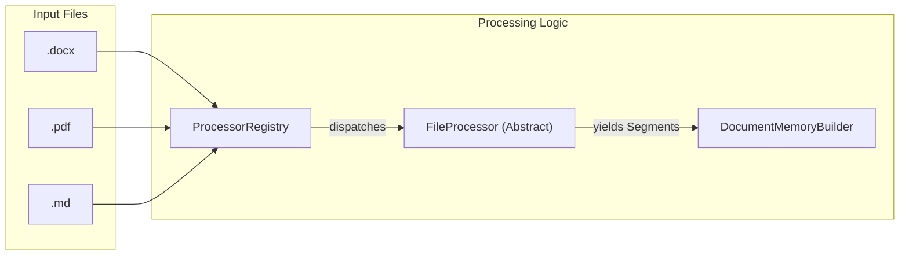

For details, see [Document Processors](#3.2).

Sources: [src/memora/builder/document_memory_builder.py:25-81](), [src/memora/builder/document_memory_builder.py:115-145]()

---

## Upsert & History Preservation

Memora does not simply overwrite data. When the `MemoryBuilder` identifies a conflict between a new memory and an existing one, it uses `generate_history` to preserve the evolution of that memory.

*   **Deduplication**: The system uses a similarity threshold (`UPDATE_SCORE_THRESHOLD`) to find candidate memories in the `AgentMemory` store.
*   **Merging**: If an update is decided, the `updated_value` combines the new information with the old, and the previous state is appended to the `history` field of the `MemoryEntry`.

Sources: [src/memora/builder/memory_builder.py:144-146](), [src/memora/utils/memory.py:139-164]()

---

# Page: Memory Builder Pipeline

# Memory Builder Pipeline

<details>
<summary>Relevant source files</summary>

The following files were used as context for generating this wiki page:

- [src/memora/builder/chat_memory_builder.py](src/memora/builder/chat_memory_builder.py)
- [src/memora/builder/document_memory_builder.py](src/memora/builder/document_memory_builder.py)
- [src/memora/builder/memory_builder.py](src/memora/builder/memory_builder.py)
- [src/memora/builder/memory_builder_registry.py](src/memora/builder/memory_builder_registry.py)
- [src/memora/utils/memory.py](src/memora/utils/memory.py)

</details>


The Memory Builder Pipeline is the core ingestion engine of Memora. It is responsible for transforming raw, unstructured data (such as chat transcripts, multimodal inputs, or documents) into structured, searchable `MemoryEntry` objects. The pipeline follows a standardized three-phase lifecycle: **Extraction**, **Processing**, and **Upsert/Deduplication**.

## Architecture Overview

The pipeline is anchored by the `MemoryBuilder` abstract base class, which defines the template for memory construction. Concrete implementations specialize in different content types, such as `ChatMemoryBuilder` for conversational flows and `DocumentMemoryBuilder` for structured knowledge.

### Pipeline Lifecycle
The `MemoryBuilder.build()` method coordinates the following flow:
1.  **Normalization**: Raw content is converted into a standard format (text or multimodal dictionary) [src/memora/builder/memory_builder.py:31]().
2.  **Extraction**: LLM-based prompts identify factual or procedural segments [src/memora/builder/memory_builder.py:171-177]().
3.  **Cue Generation**: If enabled, specific "cue anchors" are generated to improve retrieval [src/memora/builder/memory_builder.py:180-198]().
4.  **Deduplication & Update**: New memories are compared against existing ones to decide whether to add a new entry or update an existing one [src/memora/builder/memory_builder.py:202-210]().

### Class Relationship Diagram
This diagram maps the high-level builder concepts to their specific code entities.

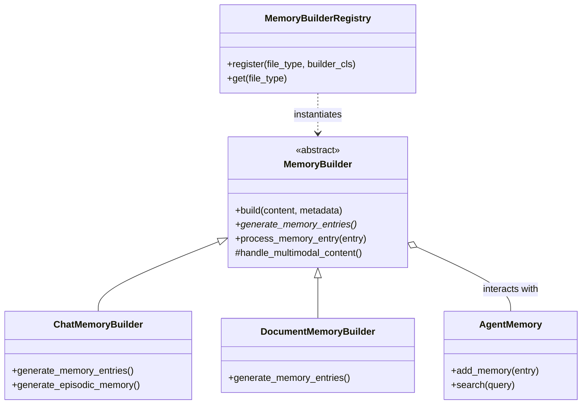
**Sources:** [src/memora/builder/memory_builder.py:127-150](), [src/memora/builder/chat_memory_builder.py:66-70](), [src/memora/builder/document_memory_builder.py:109-112](), [src/memora/builder/memory_builder_registry.py:10-23]()

---

## The Three-Phase Lifecycle

### 1. Extraction Phase
During extraction, the pipeline uses specialized prompts to identify memories.
*   **Factual Memories**: Extracted using `PROMPT_BUILD_MEMORY` [src/memora/builder/memory_builder.py:38-76](). It focuses on neutral, self-contained sentences where pronouns are replaced with specific entities.
*   **Procedural Memories**: Supported by `DocumentMemoryBuilder` via `PROMPT_BUILD_DOCUMENT_MEMORY` [src/memora/builder/document_memory_builder.py:25-107](). These include ordered steps and summary logic.
*   **Episodic Memories**: Generated by `ChatMemoryBuilder` to summarize "what happened" in a conversation segment [src/memora/builder/chat_memory_builder.py:25-55]().

### 2. Processing & Cue Generation
Once extracted, entries are converted into `MemoryEntry` DTOs. If `enable_cue_index` is active, the `CueIndexGenerator` performs a batch LLM call to generate search-optimized keywords for each memory [src/memora/builder/chat_memory_builder.py:119-136]().

### 3. Upsert and Deduplication
The pipeline prevents memory bloat by checking for semantic redundancy before saving.

1.  **Similarity Search**: The `AgentMemory` searches for existing memories similar to the new entry using a similarity threshold (`UPDATE_SCORE_THRESHOLD`) [src/memora/builder/memory_builder.py:255-263]().
2.  **Decision Logic**: If similar memories are found, the LLM uses `PROMPT_MEMORY_UPDATE_DECISION` to determine if the new info is a duplicate, an update, or a distinct fact [src/memora/builder/memory_builder.py:79-94]().
3.  **Update Execution**: If an update is chosen, the system:
    *   Generates a combined value.
    *   Preserves history by appending the old entry to the `history` field of the new one [src/memora/utils/memory.py:139-164]().
    *   Deletes the old candidate and its associated cue indices [src/memora/utils/memory.py:116-138]().

### Data Flow: Ingestion to Storage
This diagram shows how a raw input string moves through the system components.

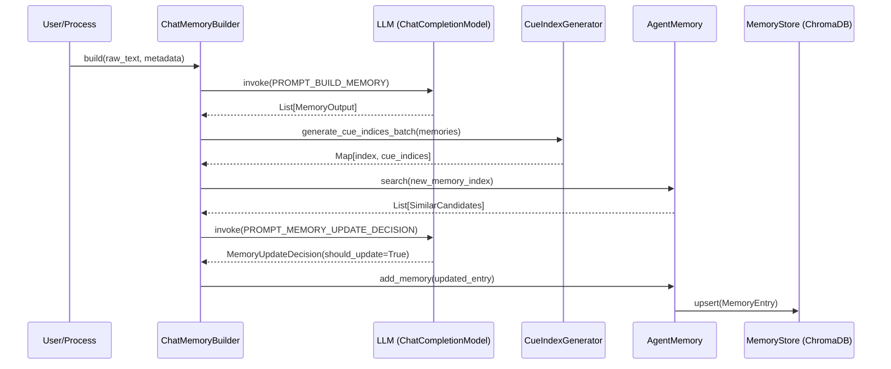
**Sources:** [src/memora/builder/memory_builder.py:151-226](), [src/memora/builder/chat_memory_builder.py:71-143](), [src/memora/core/memory.py:26](), [src/memora/utils/memory.py:12-47]()

---

## Key Components

### MemoryUpdateDecision
A Pydantic model that structures the LLM's choice during deduplication.
| Field | Description |
| :--- | :--- |
| `should_update` | Boolean indicating if an existing entry should be merged. |
| `best_candidate_index` | The integer index of the candidate selected for merging. |
| `updated_value` | The new string combining old and new information. |
| `updated_index` | A refined title for the memory entry. |
| `updated_cues` | A refreshed list of cue anchors for retrieval. |

**Sources:** [src/memora/utils/memory.py:12-47]()

### Multimodal Handling
The pipeline supports multimodal content by checking for `image` keys in the input dictionary. If present, `handle_multimodal_content` processes both text and image URLs, instructing the LLM to merge visual facts (e.g., "cake with candles") into the factual memory values [src/memora/builder/memory_builder.py:228-253]().

### History Preservation
Memora maintains a provenance trail for every memory. When a memory is updated, the `generate_history` function captures the `index`, `value`, `creation_time`, and `timestamp` of the previous version and stores it within the new `MemoryEntry.history` list [src/memora/utils/memory.py:139-164]().

**Sources:** [src/memora/builder/memory_builder.py:38-76](), [src/memora/builder/chat_memory_builder.py:88-110](), [src/memora/builder/document_memory_builder.py:130-145](), [src/memora/utils/memory.py:139-164]()

---

# Page: Document Processors

# Document Processors

<details>
<summary>Relevant source files</summary>

The following files were used as context for generating this wiki page:

- [src/memora/processors/__init__.py](src/memora/processors/__init__.py)
- [src/memora/processors/base_processor.py](src/memora/processors/base_processor.py)
- [src/memora/processors/excel_processor.py](src/memora/processors/excel_processor.py)
- [src/memora/processors/markdown_processor.py](src/memora/processors/markdown_processor.py)
- [src/memora/processors/pdf_processor.py](src/memora/processors/pdf_processor.py)
- [src/memora/processors/powerpoint_processor.py](src/memora/processors/powerpoint_processor.py)
- [src/memora/processors/processor_registry.py](src/memora/processors/processor_registry.py)
- [src/memora/processors/simple_text_processor.py](src/memora/processors/simple_text_processor.py)
- [src/memora/processors/text_processor.py](src/memora/processors/text_processor.py)
- [src/memora/processors/word_processor.py](src/memora/processors/word_processor.py)

</details>


The Document Processor system is responsible for transforming raw files into structured `Segment` objects. This subsystem handles file type detection, structural parsing (headings, tables, slides, rows), and metadata enrichment. It provides a unified interface for the `DocumentMemoryBuilder` to ingest diverse data formats into the Memora memory store.

## Architecture Overview

The architecture follows a registry-based strategy pattern. The `ProcessorRegistry` acts as a central dispatcher that identifies the correct `FileProcessor` for a given file extension. Each processor is specialized in a specific file format and implements the logic required to preserve the document's semantic structure (e.g., keeping a heading with its following paragraph).

### Data Flow: File to Segment

The following diagram illustrates how a file is routed through the system and converted into segments.

**Document Processing Flow**
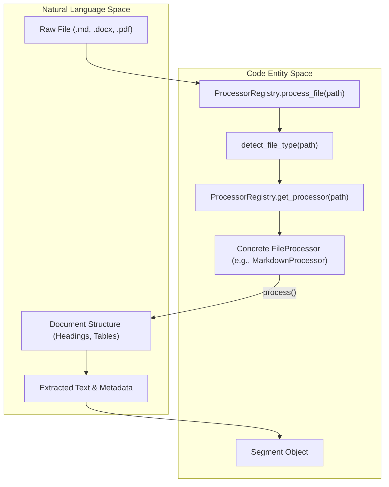
Sources: [src/memora/processors/processor_registry.py:61-78](), [src/memora/processors/base_processor.py:51-62]()

## Processor Registry

The `ProcessorRegistry` maintains a list of available processors and provides the primary entry point for the rest of the system.

- **Initialization**: Upon instantiation, it registers default processors for Markdown, Text, Word, Excel, PowerPoint, and PDF [src/memora/processors/processor_registry.py:28-35]().
- **Routing**: The `get_processor` method iterates through registered processors and calls `can_process(file_path)` on each until a match is found [src/memora/processors/processor_registry.py:56-59]().
- **Extension Support**: It provides `get_supported_extensions()` to help external callers determine which files can be ingested [src/memora/processors/processor_registry.py:80-100]().

Sources: [src/memora/processors/processor_registry.py:20-101]()

## Base Processor & File Detection

All processors inherit from `FileProcessor` (which extends the abstract `BaseProcessor`). This base class provides utility methods for common tasks.

### File Type Mapping
The system uses a centralized mapping of extensions to categories:

| Category | Extensions |
| :--- | :--- |
| `markdown` | .md, .markdown, .mdown, .mdx |
| `word` | .doc, .docx, .docm, .dotx, .dotm |
| `excel` | .xls, .xlsx, .xlsm, .csv |
| `powerpoint` | .ppt, .pptx, .potx |
| `pdf` | .pdf |
| `text` | .txt, .text, .log, .readme |

Sources: [src/memora/processors/base_processor.py:15-42]()

### Core Methods
- `_read_file_content(file_path)`: Reads text files with a fallback from UTF-8 to Latin-1 encoding to handle legacy files [src/memora/processors/base_processor.py:124-141]().
- `_create_base_metadata(file_path, file_type)`: Generates standard metadata including `source_file`, `file_name`, and `file_size` [src/memora/processors/base_processor.py:142-158]().

## Specialized Processors

### MarkdownProcessor
The `MarkdownProcessor` preserves the hierarchical structure of markdown files. It uses regex to detect ATX headings (`#`) and tracks a `heading_hierarchy` to ensure every segment knows its position within the document [src/memora/processors/markdown_processor.py:60-108]().

- **HTML Cleaning**: It uses the `markdownify` library to convert embedded HTML tags back into markdown format [src/memora/processors/markdown_processor.py:149-155]().
- **Metadata**: Every segment includes a `heading_path` (e.g., "Introduction > Methods") and the specific `heading` it belongs to [src/memora/processors/markdown_processor.py:177-190]().

Sources: [src/memora/processors/markdown_processor.py:16-137]()

### WordProcessor
The `WordProcessor` utilizes `python-docx` to parse Word documents. It implements a logic similar to the Markdown processor where it combines headings with their subsequent paragraphs into a single `Segment` until a `max_segment_size` is reached [src/memora/processors/word_processor.py:64-128]().

Sources: [src/memora/processors/word_processor.py:14-156]()

### Excel & CSV Processor
The `ExcelProcessor` handles both tabular CSV data and multi-sheet Workbooks.
- **CSV**: Detects dialects using `csv.Sniffer` and treats the first row as a `table_header` segment, while subsequent rows are `table_row` segments [src/memora/processors/excel_processor.py:41-88]().
- **Excel**: Uses `openpyxl` to iterate through sheets. Each sheet name is captured as a `worksheet` segment, and rows are converted to comma-separated strings within `table_row` segments [src/memora/processors/excel_processor.py:90-141]().

Sources: [src/memora/processors/excel_processor.py:14-141]()

### PDF Processor
The `PDFProcessor` uses `pdfplumber` to extract both text and tables.
- **Text**: Split into paragraphs based on double newlines [src/memora/processors/pdf_processor.py:50-53]().
- **Tables**: Extracted as separate `table` segments with `row_count` and `column_count` metadata [src/memora/processors/pdf_processor.py:68-93]().

Sources: [src/memora/processors/pdf_processor.py:14-94]()

## Implementation Details

### Segment Creation
Each processor eventually outputs a list of `Segment` objects. The `Segment` is an intermediate DTO used before the data is finalized into a `MemoryEntry`.

**Entity Relationship: Processors to Segments**
```mermaid
classDiagram
    class ProcessorRegistry {
        +_processors: List
        +process_file(file_path) List~Segment~
    }
    class FileProcessor {
        <<abstract>>
        +can_process(file_path) bool
        +process(file_path) List~Segment~
        #_create_base_metadata()
    }
    class Segment {
        +content: str
        +segment_type: str
        +metadata: dict
    }
    ProcessorRegistry o-- FileProcessor
    FileProcessor ..> Segment : creates
```
Sources: [src/memora/processors/processor_registry.py:20-60](), [src/memora/processors/base_processor.py:95-122]()

### Extensibility Model
To add a new file format:
1.  Create a new class inheriting from `FileProcessor`.
2.  Implement `can_process` to return `True` for the target extension.
3.  Implement `process` to return a list of `Segment` objects.
4.  Register the instance with `processor_registry.register(MyNewProcessor())` [src/memora/processors/processor_registry.py:37-44]().

---

# Page: Retrieval Strategies

# Retrieval Strategies

<details>
<summary>Relevant source files</summary>

The following files were used as context for generating this wiki page:

- [src/memora/core/base.py](src/memora/core/base.py)
- [src/memora/core/remote_client.py](src/memora/core/remote_client.py)
- [src/memora/memora_client.py](src/memora/memora_client.py)
- [src/memora/retriever/__init__.py](src/memora/retriever/__init__.py)
- [src/memora/retriever/base_retriever.py](src/memora/retriever/base_retriever.py)
- [src/memora/retriever/semantic_retriever.py](src/memora/retriever/semantic_retriever.py)
- [src/memora/rl/__init__.py](src/memora/rl/__init__.py)

</details>


The retrieval system in Memora is designed to navigate complex memory structures—including hierarchical links between factual, episodic, and procedural memories—using a variety of strategies. All retrieval logic is governed by the `BaseMemoryRetriever` contract, which ensures a consistent interface for the `MemoraClient` regardless of whether the underlying mechanism is a simple vector search or an iterative RL-based policy.

### Retrieval Architecture Overview

The `MemoraClient` serves as the primary entry point for retrieval, offering two main methods: `query` for standard semantic search and `advance_query` for sophisticated strategies [src/memora/memora_client.py:102-185](). The architecture separates the "Search Mechanism" (how candidates are found in the vector store) from the "Retrieval Strategy" (how those candidates are selected, filtered, and expanded).

#### Retrieval Component Mapping
The following diagram illustrates how natural language queries transition into code entities within the retrieval subsystem.

**Diagram: Query Execution Flow**
```mermaid
graph TD
    subgraph "Natural Language Space"
        UserQuery["'What did the user say about project Apollo?'"]
    end

    subgraph "Code Entity Space (Retriever Subsystem)"
        MC["MemoraClient.advance_query()"]
        BMR["BaseMemoryRetriever (Abstract Interface)"]
        SR["SemanticRetriever"]
        PPR["PromptedPolicyRetriever"]
        LPR["LocalPolicyRetriever"]
        
        AM["AgentMemory.query()"]
        MS["MemoryStoreBase (Storage)"]
    end

    UserQuery --> MC
    MC -- "query_type='semantic'" --> SR
    MC -- "query_type='prompt'" --> PPR
    MC -- "query_type='grpo'" --> LPR

    SR & PPR & LPR -- "Implements" --> BMR
    SR & PPR & LPR -- "Calls" --> AM
    AM -- "Fetches from" --> MS
```
**Sources:** [src/memora/memora_client.py:145-185](), [src/memora/retriever/base_retriever.py:20-45](), [src/memora/core/base.py:73-85]()

---

### The BaseMemoryRetriever Contract

Every retrieval strategy in Memora must implement the `BaseMemoryRetriever` abstract base class [src/memora/retriever/base_retriever.py:20-81](). This contract ensures that the system can execute queries, apply ranking, and return a standardized list of `MemoryEntry` objects.

| Method | Description |
| :--- | :--- |
| `retrieve(query, top_k, ...)` | The core execution method. It handles the complete pipeline: query processing, search, filtering, and ranking [src/memora/retriever/base_retriever.py:57-81](). |
| `__init__(cfg)` | Initializes the retriever with a `DictConfig` containing hyperparameters like `top_k` and `enable_llm_filter` [src/memora/retriever/base_retriever.py:47-55](). |

**Sources:** [src/memora/retriever/base_retriever.py:1-81]()

---

### Strategy 1: Semantic Retriever

The `SemanticRetriever` is the baseline strategy. It performs a single-step vector similarity search using the `AgentMemory` interface [src/memora/retriever/semantic_retriever.py:20-39]().

*   **Hybrid Search:** Can combine BM25 keyword matching with dense vector embeddings [src/memora/retriever/semantic_retriever.py:59]().
*   **Query Modes:** Supports `PRIMARY_ONLY` (searching only main memory values) or `BOTH` (searching both primary values and the cue index) [src/memora/retriever/semantic_retriever.py:62-65]().
*   **Factual Filtering:** By default, it filters for `memory_type == "factual"`, relying on the memory system's internal links to pull in related episodic context [src/memora/retriever/semantic_retriever.py:107]().

For details, see [Semantic Retriever](#4.1).

**Sources:** [src/memora/retriever/semantic_retriever.py:41-111]()

---

### Strategy 2: Prompted Policy Retriever

The `PromptedPolicyRetriever` implements an iterative, agentic retrieval loop. Instead of a single search, it treats retrieval as a multi-step decision process [src/memora/retriever/prompted_policy_retriever.py:8-19]().

*   **Memora-Control:** An LLM persona that manages the "Working Set" (currently retrieved memories) and the "Frontier" (potential links to explore).
*   **Iterative Actions:** The policy can choose to `EXPAND` (follow links), `RE_QUERY` (generate new search terms), or `STOP` (finalize results).
*   **Local vs. Hosted:** `PromptedPolicyRetriever` uses hosted LLMs, while `LocalPolicyRetriever` is optimized for local models [src/memora/retriever/__init__.py:8-13]().

For details, see [Prompted Policy Retriever](#4.2).

**Sources:** [src/memora/memora_client.py:174-175](), [src/memora/retriever/__init__.py:8-19]()

---

### Strategy 3: GRPO-Trained Retrieval Policy

The most advanced strategy utilizes Reinforcement Learning (RL) to optimize the retrieval trajectory. This strategy is invoked via `advance_query(query_type="grpo")` [src/memora/memora_client.py:176-179]().

*   **QwenPolicy:** A specialized policy based on the Qwen model architecture [src/memora/rl/policy_qwen.py:10]().
*   **GRPO Training:** The model is fine-tuned using Group Relative Policy Optimization (GRPO) to minimize retrieval steps while maximizing the relevance of the "Working Set".
*   **Checkpoint Loading:** Uses `LocalPolicyRetriever` to load specific LoRA checkpoints that have been trained for efficient memory navigation [src/memora/memora_client.py:179]().

For details, see [GRPO-Trained Retrieval Policy](#4.3).

**Sources:** [src/memora/memora_client.py:162-180](), [src/memora/rl/__init__.py:4-10]()

---

### Strategy Comparison

The following table summarizes the trade-offs between the three primary strategies.

| Strategy | Type | Complexity | Latency | Best Use Case |
| :--- | :--- | :--- | :--- | :--- |
| **Semantic** | Single-step | Low | Low | Simple factual lookups. |
| **Prompted Policy** | Multi-step (LLM) | High | High | Complex reasoning across disparate memory segments. |
| **GRPO Policy** | Multi-step (RL) | High | Medium | High-performance, specialized memory navigation. |

**Sources:** [src/memora/memora_client.py:170-185](), [src/memora/retriever/semantic_retriever.py:28-32]()

---

# Page: Semantic Retriever

# Semantic Retriever

<details>
<summary>Relevant source files</summary>

The following files were used as context for generating this wiki page:

- [src/memora/core/http_memory_store.py](src/memora/core/http_memory_store.py)
- [src/memora/core/local_memory_store.py](src/memora/core/local_memory_store.py)
- [src/memora/retriever/__init__.py](src/memora/retriever/__init__.py)
- [src/memora/retriever/base_retriever.py](src/memora/retriever/base_retriever.py)
- [src/memora/retriever/semantic_retriever.py](src/memora/retriever/semantic_retriever.py)
- [src/memora/rl/__init__.py](src/memora/rl/__init__.py)

</details>


The `SemanticRetriever` is the foundational retrieval implementation in Memora. It provides a single-turn retrieval interface that leverages vector similarity search, optional keyword-based hybrid search, and LLM-based post-filtering to surface relevant memories. Unlike iterative policies, the `SemanticRetriever` is designed for low-latency, high-precision retrieval of factual data.

## Overview and Purpose

The `SemanticRetriever` implements the `BaseMemoryRetriever` abstract interface [src/memora/retriever/base_retriever.py:20-45](). Its primary role is to bridge the gap between a natural language query and the structured `MemoryEntry` objects stored in the underlying vector database. It delegates the heavy lifting of vector search and hybrid merging to the `AgentMemory` coordinator [src/memora/retriever/semantic_retriever.py:101-109]().

### Key Features
*   **Vector Similarity Search**: Uses embeddings to find semantically related memories [src/memora/retriever/semantic_retriever.py:24-26]().
*   **Hybrid Search (BM25 + Semantic)**: Optionally combines dense vector results with sparse keyword results [src/memora/retriever/semantic_retriever.py:59]().
*   **QueryMode Control**: Supports searching only the primary index or both the primary and cue anchor indices [src/memora/retriever/semantic_retriever.py:62-65]().
*   **Factual-Only Filtering**: By design, it filters for `memory_type == "factual"` to ensure retrieved memories are grounded, while relying on memory links to pull in associated episodic context [src/memora/retriever/semantic_retriever.py:107]().

---

## Architecture and Data Flow

The following diagram illustrates how the `SemanticRetriever` interacts with the core memory components to transform a query into a set of filtered results.

### Semantic Retrieval Pipeline
```mermaid
graph TD
    subgraph "Retriever Layer"
        SR["SemanticRetriever.retrieve()"]
    end

    subgraph "Core Memory Space"
        AM["AgentMemory.query()"]
        LMS["LocalMemoryStore.query()"]
        BM25["BM25Okapi Index"]
        CDB["ChromaDB (Vector Index)"]
        MF["MemoryFilter (LLM)"]
    end

    SR -->|"1. Dispatch Query"| AM
    AM -->|"2a. Vector Search"| LMS
    LMS -->|"3a. Similarity"| CDB
    AM -->|"2b. Hybrid (Optional)"| BM25
    
    AM -->|"4. RRF Merging"| AM
    AM -->|"5. LLM Filter (Optional)"| MF
    MF -->|"6. Return Filtered List[MemoryEntry]"| SR
```
Sources: [src/memora/retriever/semantic_retriever.py:101-109](), [src/memora/core/local_memory_store.py:170-192]()

---

## Implementation Details

### Query Modes
The retriever operates in two primary modes based on the `enable_cue_index` configuration:
1.  **`PRIMARY_ONLY`**: Searches only the main memory index containing the actual memory values [src/memora/retriever/semantic_retriever.py:65]().
2.  **`BOTH`**: Searches both the primary index and the `CueIndex`, which contains generated "cue anchors" (alternative phrasing or hypothetical questions) that point back to the primary memories [src/memora/retriever/semantic_retriever.py:63]().

### Hybrid Search and RRF
When `enable_hybrid_search` is enabled, the system performs both a vector search and a BM25 keyword search. The results are merged using **Reciprocal Rank Fusion (RRF)** within the `AgentMemory` layer. This ensures that memories containing specific rare keywords are surfaced even if their semantic embedding distance is relatively high [src/memora/retriever/semantic_retriever.py:59]().

### LLM Filtering
If `enable_llm_filter` is true, the retrieved candidates are passed to a `MemoryFilter`. This component uses an LLM to evaluate the relevance of each candidate memory against the original query, pruning "hallucinated" or irrelevant matches that the vector search might have picked up due to high-dimensional proximity [src/memora/retriever/semantic_retriever.py:60]().

---

## Configuration Parameters

The `SemanticRetriever` behavior is governed by the `memory` and `retrieval` sections of the configuration object (`cfg`).

| Parameter | Type | Default | Description |
| :--- | :--- | :--- | :--- |
| `top_k` | `int` | `30` | Number of memories to retrieve from the database [src/memora/retriever/semantic_retriever.py:58](). |
| `enable_hybrid_search` | `bool` | `False` | Enables BM25 keyword search alongside vector search [src/memora/retriever/semantic_retriever.py:59](). |
| `enable_llm_filter` | `bool` | `False` | Uses an LLM to post-process and prune retrieved results [src/memora/retriever/semantic_retriever.py:60](). |
| `enable_cue_index` | `bool` | `False` | If true, sets `QueryMode.BOTH` to search cue anchors [src/memora/retriever/semantic_retriever.py:62-65](). |

Sources: [src/memora/retriever/semantic_retriever.py:57-65]()

---

## Factual-Only Filter Design Choice

A critical implementation detail in `SemanticRetriever.retrieve` is the hardcoded metadata filter:
`where={"memory_type": {"$eq": "factual"}}` [src/memora/retriever/semantic_retriever.py:107]().

This design choice reflects Memora's "Harmonic Memory Representation":
1.  **Factual Memories** act as the primary retrieval targets because they contain the most concise information.
2.  **Episodic/Procedural Memories** are linked to factual memories.
3.  By retrieving the factual "anchor," the system can later traverse links to provide the user with the original conversation context (episodic) if required, without cluttering the initial vector search space with redundant or noisy conversational segments [src/memora/retriever/semantic_retriever.py:107]().

---

## Code-to-System Mapping

This diagram maps the logical retrieval concepts to specific classes and methods within the codebase.

### Retrieval Class Relationships
```mermaid
classDiagram
    class BaseMemoryRetriever {
        <<abstract>>
        +retrieve(query, top_k, filters)
    }
    class SemanticRetriever {
        +memory_client: AgentMemory
        +top_k: int
        +query_mode: QueryMode
        +retrieve(query)
    }
    class AgentMemory {
        +query(query, top_k, enable_hybrid_search, enable_llm_filter)
    }
    class LocalMemoryStore {
        +query(query, top_k, where)
        +db_client: VectorDBClient
    }

    BaseMemoryRetriever <|-- SemanticRetriever
    SemanticRetriever --> AgentMemory : uses
    AgentMemory --> LocalMemoryStore : queries
```
Sources: [src/memora/retriever/base_retriever.py:20-45](), [src/memora/retriever/semantic_retriever.py:20-40](), [src/memora/core/local_memory_store.py:32-55]()

---

# Page: Prompted Policy Retriever

# Prompted Policy Retriever

<details>
<summary>Relevant source files</summary>

The following files were used as context for generating this wiki page:

- [src/memora/core/memory_expander.py](src/memora/core/memory_expander.py)
- [src/memora/retriever/local_policy_retriever.py](src/memora/retriever/local_policy_retriever.py)
- [src/memora/retriever/policy_utils.py](src/memora/retriever/policy_utils.py)
- [src/memora/retriever/prompted_policy_retriever.py](src/memora/retriever/prompted_policy_retriever.py)

</details>


The **Prompted Policy Retriever** implements an iterative, LLM-guided retrieval loop designed to navigate complex memory structures. Unlike standard semantic search, which performs a single-shot retrieval, this system uses a decision policy (the **Memora-Control** persona) to interactively manage a **Working Set** of retrieved information and a **Frontier** of potential expansion candidates [src/memora/retriever/prompted_policy_retriever.py:28-35]().

This module provides two primary implementations:
1.  `PromptedPolicyRetriever`: Uses hosted LLMs (e.g., GPT-4) via `ChatCompletionModel` [src/memora/retriever/prompted_policy_retriever.py:96-115]().
2.  `LocalPolicyRetriever`: Uses local open-source models (e.g., Qwen2.5) and supports loading GRPO-trained LoRA checkpoints [src/memora/retriever/local_policy_retriever.py:112-133]().

## Iterative Retrieval State Machine

The retrieval process is modeled as a state machine where the LLM evaluates the current context at each step and selects one of three actions to reach the goal of answering a `UserQuestion`.

### The Retrieval Loop
The core logic resides in the `retrieve()` method, which executes up to `max_steps` (default: 5) [src/memora/retriever/prompted_policy_retriever.py:202-210]().

1.  **Initial Retrieval**: A semantic search is performed to populate the initial **Working Set (W)** [src/memora/retriever/prompted_policy_retriever.py:214-216]().
2.  **Frontier Building**: The `MemoryExpander` identifies linked memories (via cue anchors) reachable from **W** to form the **Frontier (F)** [src/memora/core/memory_expander.py:70-88]().
3.  **Policy Decision**: The LLM receives the `WorkingSetSummary` and `FrontierSummary` and chooses an action [src/memora/retriever/policy_utils.py:143-162]().
4.  **Action Execution**:
    *   `EXPAND`: Moves specific IDs from the Frontier into the Working Set [src/memora/retriever/prompted_policy_retriever.py:160-183]().
    *   `RE_QUERY`: Generates a new search query and performs a fresh retrieval against the corpus [src/memora/retriever/prompted_policy_retriever.py:255-265]().
    *   `STOP`: Terminates the loop and returns the current Working Set [src/memora/retriever/prompted_policy_retriever.py:268-270]().

### Action Policy Definitions
| Action | Description | When to use |
| :--- | :--- | :--- |
| `EXPAND` | Grow memory from expansion candidates in Frontier. | When F contains high-novelty items likely to fill gaps. |
| `RE_QUERY` | Regenerate a query and retrieve from the full corpus. | When facts are missing and expansion is unlikely to find them (e.g., relative pointers). |
| `STOP` | Terminate the retrieval loop. | When W is sufficient to answer the question with high confidence. |

**Sources:** [src/memora/retriever/prompted_policy_retriever.py:27-59](), [src/memora/retriever/policy_utils.py:90-120]()

## Code Entity Map: Retrieval Flow

The following diagram bridges the natural language concepts to the specific code entities that manage them.

```mermaid
graph TD
    subgraph "Natural Language Space"
        Question["User Question"]
        Decision["Policy Decision"]
    end

    subgraph "Code Entity Space (src/memora/retriever/)"
        PR["PromptedPolicyRetriever"]
        LPR["LocalPolicyRetriever"]
        ME["MemoryExpander"]
        PIT["PolicyIssueTracker"]
    end

    subgraph "Memory Structures"
        WS["Working Set (List[MemoryEntry])"]
        FT["Frontier (Dict[str, MemoryEntry])"]
    end

    Question --> PR
    PR --> WS
    WS --> ME
    ME --> FT
    FT --> Decision
    Decision --> PIT
    PIT -.->|"Logs Issues"| PR
    
    PR --"Action: EXPAND"--> WS
    PR --"Action: RE_QUERY"--> WS
    PR --"Action: STOP"--> FinalMemories["Return List[MemoryEntry]"]
```
**Sources:** [src/memora/retriever/prompted_policy_retriever.py:96-280](), [src/memora/core/memory_expander.py:16-35](), [src/memora/retriever/policy_utils.py:25-45]()

## Memory Expansion & The Frontier

The `MemoryExpander` is responsible for traversing the "harmonic memory representation" by following links between primary memories and their associated cue anchors.

*   **Direct Expansion**: Collects all `cue_indices` from the current working set and fetches the primary memories they point to [src/memora/core/memory_expander.py:104-120]().
*   **Relaxed Frontier**: If `enable_relaxed_frontier` is true, the expander performs a semantic search for cues *similar* to the existing ones to find related but not explicitly linked content [src/memora/core/memory_expander.py:124-143]().
*   **Parallel Processing**: Uses `ThreadPoolExecutor` to handle multiple cue lookups simultaneously [src/memora/core/memory_expander.py:129-139]().

**Sources:** [src/memora/core/memory_expander.py:37-60](), [src/memora/core/memory_expander.py:70-166]()

## Local LLM & LoRA Support

The `LocalPolicyRetriever` allows Memora to run without external API dependencies and serves as the evaluation harness for RL-trained models.

*   **Model Caching**: Uses a global `_LOCAL_MODEL_CACHE` to ensure only one instance of a large model (e.g., Qwen) is loaded in memory at a time [src/memora/retriever/local_policy_retriever.py:43-59]().
*   **LoRA Loading**: If a `checkpoint_path` is provided, it uses the `peft` library to wrap the base model with a trained adapter [src/memora/retriever/local_policy_retriever.py:94-102]().
*   **Quantization**: Supports `load_in_8bit` via `BitsAndBytesConfig` for memory-efficient local execution [src/memora/retriever/local_policy_retriever.py:78-81]().

**Sources:** [src/memora/retriever/local_policy_retriever.py:135-195](), [src/memora/retriever/local_policy_retriever.py:228-255]()

## Prompting & Parsing Logic

The system uses strict JSON formatting to ensure policy decisions can be parsed programmatically.

### JSON Schema
The LLM must output a JSON object with the following fields:
*   `action`: The chosen action string.
*   `reason`: A short explanation for the choice.
*   `confidence`: A float between 0.0 and 1.0.
*   `frontier_ids`: A list of exact memory index strings (required for `EXPAND`).
*   `new_query`: A string for the next search (required for `RE_QUERY`).

**Sources:** [src/memora/retriever/policy_utils.py:123-141]()

### PolicyIssueTracker
The `PolicyIssueTracker` (a singleton) monitors the health of the retrieval loop [src/memora/retriever/policy_utils.py:25-34](). It logs specific failures such as:
*   `expand_no_valid_ids`: LLM chose EXPAND but provided invalid or missing IDs.
*   `requery_no_new_query`: LLM chose RE_QUERY but did not provide a new string.
*   `json_parse_error`: The LLM failed to output valid JSON.

**Sources:** [src/memora/retriever/policy_utils.py:39-56]()

## Data Flow: Iterative Step

This diagram details the internal data flow during a single step of the `LocalPolicyRetriever`.

```mermaid
sequenceDiagram
    participant R as LocalPolicyRetriever
    participant M as Qwen Model (Local)
    participant E as MemoryExpander
    participant AM as AgentMemory
    participant PIT as PolicyIssueTracker

    R->>E: build_frontier(working_set)
    E->>AM: get(cue_id)
    AM-->>E: MemoryEntry
    E-->>R: Frontier Dictionary
    R->>R: format_user_message()
    R->>M: generate(prompt)
    M-->>R: JSON Response String
    R->>R: parse_json_response()
    alt Invalid JSON
        R->>PIT: log_issue("json_parse_error")
    else Valid Action
        R->>R: validate_policy_decision()
        alt Action == EXPAND
            R->>R: select_from_frontier(frontier_ids)
        else Action == RE_QUERY
            R->>AM: query(new_query)
        end
    end
```
**Sources:** [src/memora/retriever/local_policy_retriever.py:228-300](), [src/memora/retriever/policy_utils.py:228-265](), [src/memora/core/memory_expander.py:70-90]()

---

# Page: GRPO-Trained Retrieval Policy

# GRPO-Trained Retrieval Policy

<details>
<summary>Relevant source files</summary>

The following files were used as context for generating this wiki page:

- [src/memora/retriever/preference_optimized_retriever.py](src/memora/retriever/preference_optimized_retriever.py)
- [src/memora/rl/llm_policy.py](src/memora/rl/llm_policy.py)
- [src/memora/rl/policy.py](src/memora/rl/policy.py)
- [src/memora/rl/policy_qwen.py](src/memora/rl/policy_qwen.py)

</details>


The **GRPO-Trained Retrieval Policy** is a reinforcement learning-based strategy designed to optimize the iterative retrieval process in Memora. Unlike the standard `PromptedPolicyRetriever` which relies on zero-shot prompting of hosted LLMs, this policy utilizes a local **Qwen-based** model fine-tuned using **Group Relative Policy Optimization (GRPO)**. It is specifically optimized to navigate the memory space by making sequential decisions: expanding the "Working Set," re-querying with new terms, or stopping once sufficient information is gathered.

## Architecture Overview

The GRPO-trained policy is implemented via the `QwenPolicy` class, which serves as the brain for the `LocalPolicyRetriever`. During inference, this policy processes the current retrieval state and outputs a JSON-formatted action.

### Code-to-Entity Mapping: Inference Pipeline

The following diagram illustrates how natural language queries are transformed into code-level state objects and processed by the GRPO-trained model.

**Retrieval Dispatch and Policy Execution**
```mermaid
graph TD
    subgraph "Natural Language Space"
        UserQuery["User Query (str)"]
    end

    subgraph "Code Entity Space"
        MemoraClient["MemoraClient.advance_query()"]
        LocalPolicyRetriever["LocalPolicyRetriever"]
        QwenPolicy["QwenPolicy (src/memora/rl/policy_qwen.py)"]
        PolicyState["PolicyState (src/memora/rl/policy.py)"]
        PolicyOutput["PolicyOutput (src/memora/rl/policy.py)"]
    end

    UserQuery --> MemoraClient
    MemoraClient -->|"dispatch with checkpoint_path"| LocalPolicyRetriever
    LocalPolicyRetriever -->|"wraps"| QwenPolicy
    LocalPolicyRetriever -->|"constructs"| PolicyState
    PolicyState -->|"input to"| QwenPolicy
    QwenPolicy -->|"generates JSON"| PolicyOutput
    PolicyOutput -->|"parsed by"| LocalPolicyRetriever
```
Sources: [src/memora/rl/policy_qwen.py:19-23](), [src/memora/rl/policy.py:28-36](), [src/memora/rl/policy.py:39-48]()

## The QwenPolicy Implementation

The `QwenPolicy` class inherits from `BasePolicy` and manages the lifecycle of the local decoder model (typically `Qwen2.5-7B-Instruct`). It supports Parameter-Efficient Fine-Tuning (PEFT) via LoRA checkpoints generated during the GRPO training phase.

### Key Features
*   **Lazy Loading**: The model and tokenizer are initialized only upon the first call to `_load_model` [src/memora/rl/policy_qwen.py:47-50]().
*   **Quantization Support**: Supports 8-bit loading via `BitsAndBytesConfig` to reduce VRAM usage on consumer hardware [src/memora/rl/policy_qwen.py:70-74]().
*   **LoRA Integration**: Loads fine-tuned weights targeting specific modules (`q_proj`, `v_proj`, `k_proj`, `o_proj`, etc.) [src/memora/rl/policy_qwen.py:86-98]().
*   **Differentiable Log-Probs**: Provides `get_action_logprobs` to compute the log probabilities of generated action tokens, which is essential for the GRPO advantage calculation [src/memora/rl/policy_qwen.py:149-161]().

### Data Flow: State to Action

The policy converts the `PolicyState` into a structured prompt using a chat template.

| Step | Component | Action |
| :--- | :--- | :--- |
| 1 | `build_messages` | Combines `POLICY_SYSTEM_MESSAGE` with formatted state [src/memora/rl/policy.py:68-73](). |
| 2 | `apply_chat_template` | Converts messages into model-specific tokens with a generation prompt [src/memora/rl/policy_qwen.py:126-131](). |
| 3 | `model.generate` | Autoregressively predicts the JSON action string. |
| 4 | `_parse_action` | Validates the JSON and maps it to `PolicyOutput` [src/memora/rl/policy.py:85-94](). |

Sources: [src/memora/rl/policy_qwen.py:113-146](), [src/memora/rl/policy.py:53-62]()

## State and Action Representation

The policy operates within a Markov Decision Process (MDP) where the state includes the current query and the state of the memory indices.

### PolicyState
The `PolicyState` [src/memora/rl/policy.py:28-36]() encapsulates:
*   `query`: The original user question.
*   `current_query`: The most recent re-query string.
*   `working_set`: List of `MemoryEntry` objects already retrieved.
*   `frontier`: A dictionary of potential `MemoryEntry` candidates discovered but not yet fully retrieved.
*   `step` / `max_steps`: Current iteration in the retrieval loop.

### PolicyOutput
The `PolicyOutput` [src/memora/rl/policy.py:39-48]() contains the model's decision:
*   `action`: One of `EXPAND`, `RE_QUERY`, or `STOP`.
*   `frontier_ids`: Indices of memories from the frontier to move into the working set.
*   `new_query`: The string for the next retrieval pass (if `RE_QUERY`).

## Training Integration (GRPO)

The `QwenPolicy` is the primary artifact trained by the `RetrievalGRPOTrainer`. During training, the policy must compute log probabilities for entire sequences to update the weights based on the relative reward of a group of trajectories.

**GRPO Training Data Flow**
```mermaid
graph LR
    subgraph "Training Pipeline"
        GRPOTrainer["RetrievalGRPOTrainer"]
        Trajectories["Trajectory Samples"]
    end

    subgraph "Policy Logic"
        QwenPolicy_Train["QwenPolicy (Training Mode)"]
        LogProbs["compute_log_prob()"]
    end

    Trajectories --> GRPOTrainer
    GRPOTrainer -->|"Batch of (State, Action)"| QwenPolicy_Train
    QwenPolicy_Train -->|"Forward Pass"| LogProbs
    LogProbs -->|"Log-Likelihood"| GRPOTrainer
    GRPOTrainer -->|"Loss / Backprop"| QwenPolicy_Train
```
Sources: [src/memora/rl/policy_qwen.py:149-198](), [src/memora/rl/policy_qwen.py:200-204]()

### Log Probability Computation
The `get_action_logprobs` function extracts logits only for the tokens corresponding to the "assistant" response (the action). It uses `torch.gather` to align the logits with the actual `action_ids` provided in the training trajectory [src/memora/rl/policy_qwen.py:180-196](). This allows the trainer to penalize or reward specific actions taken during the iterative retrieval process.

Sources: [src/memora/rl/policy_qwen.py:172-198]()

---

# Page: Reinforcement Learning Training (GRPO)

# Reinforcement Learning Training (GRPO)

<details>
<summary>Relevant source files</summary>

The following files were used as context for generating this wiki page:

- [src/memora/rl/grpo_trainer.py](src/memora/rl/grpo_trainer.py)
- [src/memora/rl/trajectory_collector.py](src/memora/rl/trajectory_collector.py)
- [src/memora/rl/trajectory_utils.py](src/memora/rl/trajectory_utils.py)

</details>


The reinforcement learning (RL) pipeline in Memora is designed to optimize the retrieval policy using **Group Relative Policy Optimization (GRPO)**. This pipeline fine-tunes a local language model (typically a Qwen-based model) to make sequential decisions about which memories to retrieve, when to expand the search via cue indices, and when to terminate the retrieval process.

By framing retrieval as a Markov Decision Process (MDP), the system learns to balance retrieval precision (groundedness) against search efficiency (cost and redundancy).

## Retrieval MDP Overview

The retrieval process is modeled as a sequence of actions taken by the `QwenPolicy` [src/memora/rl/policy_qwen.py:19-20](). At each step, the policy observes the `RetrievalState` [src/memora/rl/trajectory_utils.py:61-68]() and selects an action to modify the `Working Set` or explore the `Frontier`.

### Action Space
The policy can select from several `ActionType` values [src/memora/rl/trajectory_utils.py:37-46]():
*   **QUERY_PRIMARY_INDEX**: Performs a semantic search against the primary memory store.
*   **EXPAND**: Follows links from a memory in the frontier to its associated cue anchors.
*   **RE_QUERY**: Reformulates the search string based on currently retrieved information.
*   **STOP**: Terminates the loop and returns the current `Working Set`.

### System Mapping: Code to MDP
The following diagram bridges the natural language concepts of RL training to the specific code entities in the `memora.rl` package.

**Retrieval RL Architecture**
```mermaid
graph TD
    subgraph "Code Entity Space"
        Trainer["RetrievalGRPOTrainer"]
        Collector["TrajectoryCollector"]
        Policy["QwenPolicy (LoRA)"]
        Scorer["TrajectoryScorer"]
        State["PolicyState / RetrievalState"]
    end

    subgraph "MDP Space"
        Action["ActionType (QUERY, EXPAND, STOP)"]
        Reward["Reward (Groundedness, Cost, Redundancy)"]
        Env["AgentMemory / ChromaDB"]
    end

    Trainer -->|orchestrates| Collector
    Collector -->|samples| Policy
    Policy -->|outputs| Action
    Action -->|executes on| Env
    Env -->|returns| State
    State -->|input to| Policy
    Collector -->|returns Trajectories| Trainer
    Trainer -->|calls| Scorer
    Scorer -->|computes| Reward
    Reward -->|updates| Policy
```
**Sources:** [src/memora/rl/grpo_trainer.py:75-84](), [src/memora/rl/trajectory_collector.py:169-180](), [src/memora/rl/trajectory_utils.py:37-46](), [src/memora/rl/policy_qwen.py:19-20]()

---

## Trajectory Collection & Scoring

Before a training update occurs, the system must collect "rollouts" or trajectories. A `Trajectory` consists of a sequence of `TrajectoryStep` objects, documenting every action, log probability, and state transition [src/memora/rl/trajectory_collector.py:26-41]().

*   **Collection**: The `TrajectoryCollector` uses either the current model (for on-policy exploration) or a heuristic behavior policy to gather data [src/memora/rl/trajectory_collector.py:169-180]().
*   **Scoring**: The `TrajectoryScorer` evaluates the final `Working Set` against ground truth evidence. It calculates a composite reward based on:
    *   **Groundedness**: How much of the required evidence was retrieved [src/memora/rl/grpo_trainer.py:61]().
    *   **Redundancy**: Penalties for retrieving overlapping or irrelevant information [src/memora/rl/grpo_trainer.py:62]().
    *   **Cost**: Penalties for excessive API calls or retrieval steps [src/memora/rl/grpo_trainer.py:63]().

For details, see [Trajectory Collection & Scoring](#5.1).

**Sources:** [src/memora/rl/trajectory_collector.py:26-81](), [src/memora/rl/grpo_trainer.py:113-121]()

---

## GRPO Trainer

The `RetrievalGRPOTrainer` implements the Group Relative Policy Optimization algorithm. Unlike standard PPO, which requires a separate value function (critic), GRPO estimates the baseline by averaging rewards across a group of trajectories sampled from the same prompt [src/memora/rl/grpo_trainer.py:75-84]().

### Key Training Features
*   **Group Advantage**: Advantages are computed by mean-centering rewards within a group of $K$ rollouts (defined by `group_size`) [src/memora/rl/grpo_trainer.py:51](), [src/memora/rl/grpo_trainer.py:188-193]().
*   **KL Divergence**: A penalty is applied to prevent the policy from drifting too far from the reference model [src/memora/rl/grpo_trainer.py:57-59]().
*   **LoRA Fine-tuning**: Training typically targets a low-rank adaptation (LoRA) of the base Qwen model to maintain efficiency [src/memora/rl/grpo_trainer.py:127-131]().

**Training Data Flow**
```mermaid
graph LR
    Queries["query_data (JSON)"] -->|Batch| Collector["TrajectoryCollector"]
    Collector -->|K Rollouts| Groups["Grouped Trajectories"]
    Groups -->|Scoring| Scorer["TrajectoryScorer"]
    Scorer -->|Rewards| AdvCalc["Advantage Calculation"]
    AdvCalc -->|Loss| Optimizer["AdamW / LoRA Update"]
    Optimizer -->|Updated Weights| Policy["QwenPolicy"]
```
**Sources:** [src/memora/rl/grpo_trainer.py:45-72](), [src/memora/rl/grpo_trainer.py:187-195]()

For details, see [GRPO Trainer](#5.2).

---

## Diagnostic Outputs

Training progress is monitored through several artifacts generated in the `output_dir` [src/memora/rl/grpo_trainer.py:48]():
*   **TensorBoard**: Logs scalars like `loss/total`, `reward/groundedness`, and `policy/kl_divergence` [src/memora/rl/grpo_trainer.py:145]().
*   **Groundedness Log**: A JSONL file (`groundedness_log.jsonl`) containing the detailed text of retrieved memories and their scores for manual inspection.
*   **Checkpoints**: Periodic saves of the LoRA adapter weights [src/memora/rl/grpo_trainer.py:69]().

**Sources:** [src/memora/rl/grpo_trainer.py:141-146]()

---

# Page: Trajectory Collection & Scoring

# Trajectory Collection & Scoring

<details>
<summary>Relevant source files</summary>

The following files were used as context for generating this wiki page:

- [src/memora/rl/collect_trajectories.py](src/memora/rl/collect_trajectories.py)
- [src/memora/rl/data_utils.py](src/memora/rl/data_utils.py)
- [src/memora/rl/trajectory_collector.py](src/memora/rl/trajectory_collector.py)
- [src/memora/rl/trajectory_scorer.py](src/memora/rl/trajectory_scorer.py)
- [src/memora/rl/trajectory_utils.py](src/memora/rl/trajectory_utils.py)

</details>


In the context of reinforcement learning for memory retrieval, a **trajectory** represents a sequence of decision-making steps taken by a retrieval policy to answer a specific user query. This page details the Markov Decision Process (MDP) formulation, the collection mechanisms for both heuristic and RL-based behaviors, and the multi-faceted scoring system used to calculate rewards for Group Relative Policy Optimization (GRPO).

## MDP Formulation for Retrieval

The retrieval process is modeled as a sequential decision task where an agent interacts with the memory index to assemble a "Working Set" of relevant information.

### State Space
The state $s_t$ at step $t$ is defined by the `RetrievalState` class:
*   **Current Query ($q_t$):** The original or reformulated search string.
*   **Working Set ($W_t$):** The set of `MemoryEntry` objects already retrieved.
*   **Frontier ($F_t$):** A list of candidate memory indices (cues or primary links) discovered but not yet fetched.
*   **Budget ($b_t$):** Remaining computational or token resources.

Sources: `[src/memora/rl/trajectory_utils.py:61-68]()`

### Action Space
The policy selects from several `ActionType` options at each step:
*   `QUERY_PRIMARY_INDEX`: Perform a vector search against the main factual/episodic memory store.
*   `QUERY_CUE_INDEX`: Search against the cue anchor index to find entry points into memory clusters.
*   `EXPAND`: (Implicit in policy) Follow links from a retrieved memory to its associated cue indices.
*   `STOP`: Terminate the retrieval loop and proceed to answer generation.

Sources: `[src/memora/rl/trajectory_utils.py:37-46]()`, `[src/memora/rl/trajectory_collector.py:178-193]()`

### Cost Model
Each action (except `STOP`) incurs a cost defined in `ACTION_COSTS`, which is subtracted from the trajectory's budget to discourage excessive or redundant retrieval.

Sources: `[src/memora/rl/trajectory_utils.py:50-58]()`

## Trajectory Data Structures

Memora uses a hierarchical data model to track rollouts for training and evaluation.

| Class | Description | Key Fields |
| :--- | :--- | :--- |
| `TrajectoryStep` | A single transition in the MDP. | `action`, `log_prob`, `state_text`, `new_query` |
| `Trajectory` | A full sequence of steps for one rollout. | `steps`, `retrieved_memories`, `trajectory_score`, `cost` |
| `QueryTrajectories` | A group of $G$ trajectories for the same query. | `query`, `trajectories`, `rewards`, `advantages` |

Sources: `[src/memora/rl/trajectory_collector.py:26-154]()`

## Trajectory Collection

The `TrajectoryCollector` is responsible for executing "rollouts." It supports two primary modes:
1.  **Heuristic/Behavioral:** Uses existing logic (e.g., `PromptedPolicyRetriever`) to generate baseline trajectories.
2.  **RL Policy:** Uses a model (like `QwenPolicy`) to sample actions based on log probabilities.

### Collection Flow
The `collect_trajectories_for_query` method generates $G$ independent trajectories (groups) for a single query to facilitate the relative advantage calculation required by GRPO.

### Code-to-Entity Mapping: Collection Pipeline
The following diagram illustrates how the `TrajectoryCollector` interacts with core memory components to generate a rollout.

```mermaid
graph TD
    subgraph "Natural Language Space"
        UserQuery["User Query (q_0)"]
        GenAnswer["Generated Answer"]
    end

    subgraph "Code Entity Space: src/memora/rl/"
        TC["TrajectoryCollector"]
        Step["TrajectoryStep"]
        Policy["BasePolicy / QwenPolicy"]
    end

    subgraph "Code Entity Space: src/memora/core/"
        AM["AgentMemory"]
        ME["MemoryExpander"]
    end

    UserQuery --> TC
    TC -- "select_action()" --> Policy
    Policy -- "ActionType" --> TC
    TC -- "query() / expand()" --> AM
    AM -- "MemoryEntry" --> ME
    ME -- "Linked Cues" --> TC
    TC -- "finalize" --> GenAnswer
    TC -- "append" --> Step
```
Sources: `[src/memora/rl/trajectory_collector.py:169-201]()`, `[src/memora/rl/trajectory_collector.py:255-300]()`

## Scoring and Rewards

The `TrajectoryScorer` computes a scalar reward $J(\tau)$ for a completed trajectory. The goal is to maximize information retrieval while minimizing redundancy and cost.

### Scoring Components
The total score is a weighted sum:
$$J(\tau) = w_g \cdot \text{Groundedness} - w_r \cdot \text{Redundancy} - w_c \cdot \text{Cost}$$

1.  **Groundedness ($w_g$):** Calculated by an LLM Judge (`ACCURACY_PROMPT_SCALED`). It compares the `generated_answer` (produced from `retrieved_memories`) against the `ground_truth`. It uses a 1-5 scale to provide a dense signal.
2.  **Redundancy ($w_r$):** Penalizes trajectories that retrieve the same or highly similar `MemoryEntry` objects multiple times.
3.  **Cost ($w_c$):** Penalizes the number of steps taken and the tokens consumed, encouraging efficiency.

Sources: `[src/memora/rl/trajectory_scorer.py:7-15]()`, `[src/memora/rl/trajectory_scorer.py:99-131]()`, `[src/memora/rl/trajectory_scorer.py:246-270]()`

### Group Relative Advantage
In `collect_trajectories.py`, the rewards within a group (trajectories for the same query) are normalized to compute the advantage $A_i$:
$$A_i = R_i - \text{mean}(R_{group})$$
This ensures that the policy learns from the relative quality of different retrieval paths for the same problem.

Sources: `[src/memora/rl/collect_trajectories.py:21-26]()`, `[src/memora/rl/collect_trajectories.py:153-164]()`

## Data Flow: Collection to Scoring

The following diagram tracks a single query through the collection and scoring lifecycle.

```mermaid
sequenceDiagram
    participant D as Data (locomo10.json)
    participant C as TrajectoryCollector
    participant P as QwenPolicy
    participant M as AgentMemory
    participant S as TrajectoryScorer
    participant J as LLM Judge (GPT-4)

    D->>C: Query + UserID
    loop Max Steps
        C->>P: Get Action (State_t)
        P-->>C: Action + LogProb
        C->>M: Execute (Search/Expand)
        M-->>C: MemoryEntries
    end
    C->>S: Trajectory (Full)
    S->>J: AnswerGen(Memories, Query)
    J-->>S: Generated Answer
    S->>J: Score(Answer, GroundTruth)
    J-->>S: Groundedness (1-5)
    S-->>C: Total Score (J)
```
Sources: `[src/memora/rl/collect_trajectories.py:103-151]()`, `[src/memora/rl/trajectory_scorer.py:215-244]()`

---

# Page: GRPO Trainer

# GRPO Trainer

<details>
<summary>Relevant source files</summary>

The following files were used as context for generating this wiki page:

- [src/memora/rl/grpo_trainer.py](src/memora/rl/grpo_trainer.py)
- [src/memora/rl/policy_qwen.py](src/memora/rl/policy_qwen.py)

</details>


The `RetrievalGRPOTrainer` is the central component of Memora's reinforcement learning pipeline, designed to optimize the retrieval policy through **Group Relative Policy Optimization (GRPO)**. It fine-tunes a local `QwenPolicy` (typically Qwen2.5-7B) to make better decisions during iterative memory retrieval by maximizing rewards derived from groundedness, redundancy, and retrieval cost [src/memora/rl/grpo_trainer.py:75-84]().

## Training Architecture

The trainer implements an iterative loop that alternates between trajectory collection and policy updates. It utilizes a group-based advantage estimation strategy where multiple rollouts are sampled for the same query to establish a baseline for reward normalization [src/memora/rl/grpo_trainer.py:51-51]().

### Core Data Flow
The following diagram illustrates the interaction between the trainer, the policy, and the environment (Memory Store).

**GRPO Training Loop and Entity Association**
```mermaid
graph TD
    subgraph "Training Environment"
        Trainer["RetrievalGRPOTrainer"]
        Collector["TrajectoryCollector"]
        Scorer["TrajectoryScorer"]
    end

    subgraph "Model Space (Code Entities)"
        Policy["QwenPolicy"]
        Model["AutoModelForCausalLM (PEFT/LoRA)"]
        Tokenizer["AutoTokenizer"]
    end

    subgraph "Memory Space"
        AgentMem["AgentMemory"]
        Store["LocalMemoryStore"]
    end

    Trainer -- "init" --> Policy
    Trainer -- "calls" --> Collector
    Collector -- "step(action)" --> AgentMem
    AgentMem -- "query" --> Store
    Collector -- "returns QueryTrajectories" --> Trainer
    Trainer -- "scores" --> Scorer
    Scorer -- "reward" --> Trainer
    Trainer -- "compute_grpo_loss" --> Policy
    Policy -- "forward/backward" --> Model
```
Sources: [src/memora/rl/grpo_trainer.py:86-110](), [src/memora/rl/policy_qwen.py:19-45](), [src/memora/rl/trajectory_collector.py:21-25]()

## GRPO Configuration (`GRPOConfig`)

The trainer is parameterized by `GRPOConfig`, which defines the hyperparameters for the RL optimization and reward weighting [src/memora/rl/grpo_trainer.py:45-73]().

| Parameter | Description | Default |
| :--- | :--- | :--- |
| `group_size` | Number of rollouts (K) per query for relative advantage. | 4 |
| `clip_range` | PPO-style clipping parameter for the policy ratio. | 0.2 |
| `kl_coef` | Coefficient for the KL divergence penalty. | 0.05 |
| `w_groundedness` | Weight for the groundedness reward component. | 1.0 |
| `w_redundancy` | Penalty weight for retrieving redundant information. | 0.4 |
| `w_cost` | Penalty weight for retrieval steps/budget usage. | 0.4 |
| `reward_scale_strategy` | Strategy for advantage normalization (`group` or `batch`). | "batch" |

Sources: [src/memora/rl/grpo_trainer.py:45-73]()

## Advantage and Loss Calculation

### Group-Relative Advantages
Instead of a learned value function (critic), GRPO uses the mean reward of a group of rollouts for the same query as a baseline. The advantage $A_i$ for rollout $i$ in a group is calculated as:
$$A_i = \frac{R_i - \text{mean}(R)}{\text{std}(R)}$$

The trainer implements this in `compute_advantages` [src/memora/rl/grpo_trainer.py:172-205](). If `reward_scale_strategy` is set to `"batch"`, it normalizes advantages using the global standard deviation across the entire training batch [src/memora/rl/grpo_trainer.py:199-205]().

### GRPO Loss Function
The loss function combines the clipped surrogate objective with a KL divergence penalty to prevent the policy from drifting too far from the reference model [src/memora/rl/grpo_trainer.py:207-257]().

1.  **Policy Ratio**: $r_t(\theta) = \exp(\log \pi_\theta(a|s) - \log \pi_{old}(a|s))$ [src/memora/rl/grpo_trainer.py:241-241]().
2.  **Clipped Objective**: $\min(r_t(\theta)A, \text{clip}(r_t(\theta), 1-\epsilon, 1+\epsilon)A)$ [src/memora/rl/grpo_trainer.py:244-248]().
3.  **KL Penalty**: Calculated between the current policy and the initial reference policy [src/memora/rl/grpo_trainer.py:251-252]().

Sources: [src/memora/rl/grpo_trainer.py:172-257]()

## Model Implementation: `QwenPolicy`

The `QwenPolicy` class wraps a Qwen-series model (e.g., `Qwen/Qwen2.5-7B-Instruct`) and adds LoRA adapters for efficient fine-tuning [src/memora/rl/policy_qwen.py:19-45]().

### LoRA Configuration
The policy targets the following modules for adaptation:
*   Attention: `q_proj`, `v_proj`, `k_proj`, `o_proj` [src/memora/rl/policy_qwen.py:93-93]().
*   MLP: `gate_proj`, `up_proj`, `down_proj` [src/memora/rl/policy_qwen.py:94-94]().

### Token-Level Log Probabilities
The trainer requires log probabilities for the generated JSON actions. The `get_action_logprobs` function:
1.  Performs a forward pass on the complete sequence (Prompt + Action) [src/memora/rl/policy_qwen.py:163-167]().
2.  Extracts logits specifically for the action tokens [src/memora/rl/policy_qwen.py:180-183]().
3.  Computes the sum of log probabilities for the action sequence [src/memora/rl/policy_qwen.py:190-196]().

Sources: [src/memora/rl/policy_qwen.py:19-110](), [src/memora/rl/policy_qwen.py:149-198]()

## Checkpoint and Diagnostic Management

The trainer provides extensive logging and persistence features to monitor the RL process:

*   **Checkpointing**: Saves LoRA adapters and trainer state every `checkpoint_every` epochs [src/memora/rl/grpo_trainer.py:69-69](), [src/memora/rl/grpo_trainer.py:355-365]().
*   **Groundedness Log**: A JSONL file (`groundedness_log.jsonl`) recording the specific rewards and trajectories for every rollout, used for offline analysis of policy behavior [src/memora/rl/grpo_trainer.py:141-142]().
*   **Training Metrics**: Real-time logging to TensorBoard (Loss, Rewards, KL Divergence, Advantage Std) [src/memora/rl/grpo_trainer.py:145-145](), [src/memora/rl/grpo_trainer.py:317-330]().
*   **Visualizations**: Automatically generates `training_metrics.png` summarizing reward trends across epochs [src/memora/rl/grpo_trainer.py:382-385]().

**Training Step Data Flow**
```mermaid
sequenceDiagram
    participant T as RetrievalGRPOTrainer
    participant C as TrajectoryCollector
    participant S as TrajectoryScorer
    participant P as QwenPolicy

    T->>C: collect_training_batch(queries, group_size)
    C->>P: act(state)
    P-->>C: action (JSON)
    C-->>T: QueryTrajectories
    T->>S: score_trajectories(trajectories)
    S-->>T: Rewards
    T->>T: compute_advantages(Rewards)
    T->>P: compute_log_prob(states, actions)
    P-->>T: log_probs
    T->>T: compute_grpo_loss()
    T->>T: optimizer.step()
```
Sources: [src/memora/rl/grpo_trainer.py:263-314](), [src/memora/rl/grpo_trainer.py:332-353]()

---

# Page: Benchmark Evaluation Framework

# Benchmark Evaluation Framework

<details>
<summary>Relevant source files</summary>

The following files were used as context for generating this wiki page:

- [app/locomo/README.md](app/locomo/README.md)
- [app/locomo/conf/config.yaml](app/locomo/conf/config.yaml)
- [app/locomo/conf/mem0_config.yaml](app/locomo/conf/mem0_config.yaml)
- [app/locomo/evals.py](app/locomo/evals.py)
- [app/locomo/run.sh](app/locomo/run.sh)
- [app/locomo/run_experiments.py](app/locomo/run_experiments.py)
- [app/locomo/run_memora.py](app/locomo/run_memora.py)
- [app/longmemeval/README.md](app/longmemeval/README.md)
- [app/longmemeval/conf/config.yaml](app/longmemeval/conf/config.yaml)
- [app/longmemeval/evals.py](app/longmemeval/evals.py)
- [app/longmemeval/run.sh](app/longmemeval/run.sh)
- [app/longmemeval/run_memora.py](app/longmemeval/run_memora.py)
- [app/longmemeval/run_parallel_splits.sh](app/longmemeval/run_parallel_splits.sh)

</details>


The Benchmark Evaluation Framework provides a standardized environment for assessing Memora's performance against long-term memory datasets. It currently supports two primary benchmark applications: **LoCoMo** (Long-term Conversations as Memory) and **LongMemEval**. 

The framework is designed as a three-stage pipeline that ensures reproducibility through **Hydra** configuration management [app/locomo/run_memora.py:122-123]().

### Experiment Pipeline Overview

Every benchmark experiment follows a consistent lifecycle managed by an experiment runner (e.g., `run_memora.py`).

1.  **Build Stage**: Raw conversation data is processed into structured memories. If a memory store already exists at `memory.persist_path`, this stage is skipped unless `memory.force_rebuild` is set to `True` [app/longmemeval/run_memora.py:54-68]().
2.  **Retrieve & Answer Stage**: The system iterates through benchmark questions. For each question, it uses the configured `retrieval.strategy` (semantic, prompt, or grpo) to fetch context and generate a response [app/locomo/run_memora.py:101-106]().
3.  **Evaluate Stage**: Model responses are scored against ground truth using automated metrics (BLEU, F1) and an LLM-as-judge [app/locomo/run_memora.py:111-119]().

#### Benchmark Execution Flow
This diagram illustrates the relationship between the configuration, the runner, and the memory providers.

```mermaid
graph TD
    subgraph "Configuration Space"
        CONFIG["Hydra Config (config.yaml)"]
    end

    subgraph "Execution Space (Code Entity)"
        RUNNER["run_memora.py"]
        ADDER["MemoraADD"]
        SEARCHER["MemoraSearch"]
        EVAL["evals.py:evaluate()"]
    end

    subgraph "Storage & Data"
        DATA["Dataset (JSON)"]
        STORE["ChromaDB (persist_path)"]
    end

    CONFIG --> RUNNER
    RUNNER --> ADDER
    ADDER --> DATA
    ADDER --> STORE
    RUNNER --> SEARCHER
    SEARCHER --> STORE
    SEARCHER --> EVAL
```
**Sources:** [app/locomo/run_memora.py:22-24](), [app/longmemeval/run_memora.py:20-22](), [app/longmemeval/conf/config.yaml:63-75]()

---

### Supported Benchmarks

The framework includes specialized runners and configurations for different memory evaluation datasets.

#### LoCoMo Benchmark
LoCoMo focuses on long-term conversation history. It includes specific logic for handling multi-speaker dialogues and can optionally use a `use_combined_user` mode to merge speakers into a single identity [app/locomo/conf/config.yaml:125-127](). It supports various baselines including Mem0, RAG, and Full Context [app/locomo/run_experiments.py:8-10]().

For details, see [LoCoMo Benchmark](#6.1).

#### LongMemEval Benchmark
LongMemEval tests a wider range of memory capabilities across different question types (e.g., temporal reasoning, knowledge update). To handle the larger scale of this dataset, the framework supports multi-process parallel execution using `tmux` splits [app/longmemeval/run_parallel_splits.sh:139-152]().

For details, see [LongMemEval Benchmark](#6.2).

---

### Configuration and Execution

Experiments are configured via `config.yaml` and executed using Python entry points.

| Component | Code Entity | Purpose |
| :--- | :--- | :--- |
| **Main Runner** | `run_memora.py` | Orchestrates the build-retrieve-evaluate loop [app/locomo/run_memora.py:30-42](). |
| **Config Manager** | `Hydra` | Handles parameter overrides and directory management [app/locomo/run_memora.py:7-8](). |
| **Memory Builder** | `MemoraADD` | Handles ingestion of raw data into the vector store [app/locomo/run_experiments.py:55](). |
| **Search Provider** | `MemoraSearch` | Interfaces with the `MemoraClient` to perform retrieval [app/locomo/run_memora.py:105](). |

#### Evaluation Components and Data Flow
This diagram bridges the high-level evaluation concepts to the specific scripts and classes that implement them.

```mermaid
graph LR
    subgraph "Natural Language Space"
        USER_Q["User Question"]
        GOLD_A["Ground Truth"]
        PRED_A["Model Prediction"]
    end

    subgraph "Code Entity Space"
        MS["MemoraSearch class"]
        EVAL_FUNC["evals.py:process_item()"]
        JUDGE["metrics/llm_judge.py"]
        SCORES["generate_scores()"]
    end

    USER_Q --> MS
    MS --> PRED_A
    PRED_A --> EVAL_FUNC
    GOLD_A --> EVAL_FUNC
    EVAL_FUNC --> JUDGE
    JUDGE --> SCORES
```
**Sources:** [app/locomo/evals.py:23-59](), [app/longmemeval/evals.py:141-189](), [app/locomo/run_memora.py:105-119]()

---

### Evaluation Metrics

The framework calculates three primary metrics to determine performance:
1.  **BLEU Score**: Measures N-gram overlap between generated and ground truth answers [app/locomo/evals.py:42]().
2.  **F1 Score**: Measures token-level precision and recall [app/locomo/evals.py:41]().
3.  **LLM Score**: A binary (0/1) correctness score determined by an LLM judge using specific rubrics for different question types [app/longmemeval/evals.py:165-176]().

For details, see [Evaluation Metrics & LLM Judge](#6.3).

---

### Running Experiments

To run a standard experiment, use the `run_memora.py` script within the respective benchmark directory:

```bash
# Example: Running LoCoMo with prompted retrieval
python run_memora.py \
    llm.model="gpt-4.1-mini" \
    memory.memory_store="locomo-prompt-v1" \
    retrieval.strategy="prompt"
```

For large-scale evaluations in LongMemEval, use the parallel split script:
```bash
# Example: Launching 5 parallel splits via tmux
./run_parallel_splits.sh --output-dir my_experiment_results
```
**Sources:** [app/longmemeval/README.md:39-50](), [app/longmemeval/run_parallel_splits.sh:5-9]()

---

# Page: LoCoMo Benchmark

# LoCoMo Benchmark

<details>
<summary>Relevant source files</summary>

The following files were used as context for generating this wiki page:

- [app/locomo/evals.py](app/locomo/evals.py)
- [app/locomo/providers/full_context.py](app/locomo/providers/full_context.py)
- [app/locomo/providers/memora/add.py](app/locomo/providers/memora/add.py)
- [app/locomo/providers/memora/search.py](app/locomo/providers/memora/search.py)
- [app/locomo/providers/memora/segmentation.py](app/locomo/providers/memora/segmentation.py)
- [app/locomo/providers/memzero/add.py](app/locomo/providers/memzero/add.py)
- [app/locomo/providers/memzero/search.py](app/locomo/providers/memzero/search.py)
- [app/locomo/providers/rag.py](app/locomo/providers/rag.py)
- [app/locomo/run_experiments.py](app/locomo/run_experiments.py)
- [app/locomo/run_memora.py](app/locomo/run_memora.py)
- [app/locomo/utils.py](app/locomo/utils.py)
- [app/longmemeval/evals.py](app/longmemeval/evals.py)
- [app/longmemeval/providers/memora/add.py](app/longmemeval/providers/memora/add.py)
- [app/longmemeval/providers/memora/search.py](app/longmemeval/providers/memora/search.py)
- [app/longmemeval/providers/memora/segmentation.py](app/longmemeval/providers/memora/segmentation.py)
- [app/longmemeval/run_memora.py](app/longmemeval/run_memora.py)
- [app/longmemeval/utils.py](app/longmemeval/utils.py)

</details>


The **LoCoMo (Long-term Conversations with Multimodal context)** benchmark serves as the primary evaluation framework for Memora. It tests a memory system's ability to handle long-term dialogue, multi-session topical shifts, and multimodal inputs (images and text). The benchmark pipeline automates memory construction, question answering (inference), and scoring against gold-standard answers.

### System Architecture & Data Flow

The benchmark operates through two primary entry points: `run_memora.py` for targeted Memora experiments and `run_experiments.py` for comparative analysis against baselines like Mem0, RAG, and Full Context.

#### LoCoMo Experiment Pipeline
1.  **Ingestion**: The `MemoraADD` class loads the `locomo10.json` dataset and processes conversations session-by-session.
2.  **Segmentation**: Conversations are partitioned into topical episodes using the `ConversationSegmenter`.
3.  **Storage**: Segments are passed to `MemoraClient.add()`, which invokes the core memory building logic (extraction, deduplication, and indexing).
4.  **Inference**: `MemoraSearch` executes queries against the memory store using specified strategies (Semantic, Prompted, or GRPO).
5.  **Evaluation**: Results are scored using BLEU, F1, and an LLM-based judge.

**LoCoMo Execution Logic**
```mermaid
graph TD
    subgraph "Entry Points"
        RUN_MEMORA["run_memora.py"]
        RUN_EXP["run_experiments.py"]
    end

    subgraph "Memory Construction (Build Phase)"
        M_ADD["MemoraADD"]
        SEG["ConversationSegmenter"]
        CLIENT_ADD["MemoraClient.add()"]
    end

    subgraph "Retrieval & QA (Search Phase)"
        M_SEARCH["MemoraSearch"]
        ADV_QUERY["MemoraClient.advance_query()"]
        LLM_ANS["LLM Answer Generation"]
    end

    RUN_MEMORA --> M_ADD
    RUN_EXP --> M_ADD
    M_ADD --> SEG
    SEG --> CLIENT_ADD
    
    RUN_MEMORA --> M_SEARCH
    M_SEARCH --> ADV_QUERY
    ADV_QUERY --> LLM_ANS
```
**Sources:** [app/locomo/run_memora.py:30-120](), [app/locomo/run_experiments.py:42-90](), [app/locomo/providers/memora/add.py:115-200]()

---

### Memory Construction & Segmentation

Memory building in LoCoMo is handled by `MemoraADD`. It supports two modes: **Split User** (default), where speakers have isolated memory stores, and **Combined User**, where a single memory store represents the shared context of both speakers [app/locomo/providers/memora/add.py:124-139]().

#### ConversationSegmenter
To maintain topical coherence, the `ConversationSegmenter` groups messages into "Episodes" before they are committed to memory.
- **LLM-based Segmentation**: Uses a specialized prompt (`SEGMENTATION_PROMPT_TEMPLATE`) to identify topical shifts, transitions, and time gaps [app/locomo/providers/memora/segmentation.py:33-107]().
- **Batch-based Segmentation**: A fallback mode that groups messages by a fixed `batch_size` (default 2) if LLM segmentation is disabled [app/locomo/providers/memora/segmentation.py:120-130]().

#### Multimodal Handling
LoCoMo includes image descriptions (BLIP captions) and raw image URLs. `MemoraADD` validates these URLs via `is_valid_image_url` and constructs multimodal message payloads for the `MemoraClient` [app/locomo/providers/memora/add.py:159-183]().

**Sources:** [app/locomo/providers/memora/add.py:19-200](), [app/locomo/providers/memora/segmentation.py:110-200](), [app/locomo/utils.py:172-208]()

---

### Search Providers & Retrieval Strategies

The benchmark supports various search providers to compare Memora against industry standards.

| Provider | Implementation Class | Key Characteristics |
| :--- | :--- | :--- |
| **Memora** | `MemoraSearch` | Supports `semantic`, `prompt`, and `grpo` strategies via `advance_query` [app/locomo/providers/memora/search.py:82-102](). |
| **Mem0** | `MemorySearch` | Interfaces with the Mem0 library; supports optional Graph-based retrieval [app/locomo/providers/memzero/search.py:23-47](). |
| **RAG** | `RAGManager` | Standard chunk-based retrieval using fixed sizes [app/locomo/run_experiments.py:179-184](). |
| **Full Context** | `FullContextManager` | Passes the entire conversation history to the LLM (no retrieval) [app/locomo/run_experiments.py:201-210](). |

#### Memora Retrieval Pipeline
`MemoraSearch` encapsulates the logic for querying the `MemoraClient` and formatting the retrieved memories for the answering LLM. It includes a specialized method `_retrieve_and_cluster_episodic_memories` which groups factual memories by their linked conversation episodes to provide the LLM with richer context [app/locomo/providers/memora/search.py:132-170]().

**Search Implementation Mapping**
```mermaid
classDiagram
    class MemoraSearch {
        +search_memory(user_id, query)
        +get_memory_client(user_id)
        -_retrieve_and_cluster_episodic_memories()
    }
    class MemoraClient {
        +query()
        +advance_query()
    }
    class MemorySearch {
        +search_memory(user_id, query)
        +answer_question()
    }
    class Mem0_Memory {
        +search(query, enable_graph)
    }

    MemoraSearch --> MemoraClient : calls advance_query()
    MemorySearch --> Mem0_Memory : calls search()
```
**Sources:** [app/locomo/providers/memora/search.py:25-130](), [app/locomo/providers/memzero/search.py:23-102](), [app/locomo/run_experiments.py:7-36]()

---

### Dataset Format: locomo10.json

The LoCoMo dataset is structured to represent long-term interactions. The benchmark primarily uses `locomo10.json`, which contains:
- **Conversation Metadata**: `speaker_a`, `speaker_b`, and session counts [app/locomo/providers/memora/add.py:117-120]().
- **Sessions**: Individual chat blocks indexed as `session_1`, `session_2`, etc., each with a `date_time` timestamp [app/locomo/providers/memora/add.py:142-152]().
- **QA Pairs**: Questions (`question`), gold-standard answers (`answer`), and `evidence` pointers to specific sessions/messages [app/locomo/providers/memzero/search.py:146-152]().

**Sources:** [app/locomo/providers/memora/add.py:142-160](), [app/locomo/providers/memzero/search.py:146-180](), [app/locomo/utils.py:76-84]()

---

### Evaluation Metrics

The evaluation phase is triggered after the inference runner generates an `output.json` file. The `evals.py` module (shared across benchmarks) calculates:
1.  **Lexical Metrics**: BLEU and F1 scores comparing generated answers to gold-standard text [app/longmemeval/evals.py:161-162]().
2.  **LLM Judge**: A GPT-4 based evaluator that determines if the response is semantically correct. It uses specific rubrics for:
    - **Temporal Reasoning**: Validates dates and durations [app/longmemeval/evals.py:25-38]().
    - **Knowledge Update**: Checks if the model correctly identified the most recent information [app/longmemeval/evals.py:40-53]().
    - **Single Session Preference**: Evaluates personalization based on user-specific info [app/longmemeval/evals.py:55-68]().

**Sources:** [app/longmemeval/evals.py:24-83](), [app/longmemeval/evals.py:141-189](), [app/locomo/run_memora.py:112-120]()

---

# Page: LongMemEval Benchmark

# LongMemEval Benchmark

<details>
<summary>Relevant source files</summary>

The following files were used as context for generating this wiki page:

- [app/locomo/README.md](app/locomo/README.md)
- [app/locomo/providers/memora/add.py](app/locomo/providers/memora/add.py)
- [app/locomo/providers/memora/search.py](app/locomo/providers/memora/search.py)
- [app/locomo/providers/memzero/add.py](app/locomo/providers/memzero/add.py)
- [app/locomo/providers/memzero/search.py](app/locomo/providers/memzero/search.py)
- [app/locomo/run.sh](app/locomo/run.sh)
- [app/longmemeval/README.md](app/longmemeval/README.md)
- [app/longmemeval/aggregate_scores.py](app/longmemeval/aggregate_scores.py)
- [app/longmemeval/check_status.sh](app/longmemeval/check_status.sh)
- [app/longmemeval/gather_results.sh](app/longmemeval/gather_results.sh)
- [app/longmemeval/providers/memora/add.py](app/longmemeval/providers/memora/add.py)
- [app/longmemeval/providers/memora/search.py](app/longmemeval/providers/memora/search.py)
- [app/longmemeval/run.sh](app/longmemeval/run.sh)
- [app/longmemeval/run_parallel_splits.sh](app/longmemeval/run_parallel_splits.sh)

</details>


The **LongMemEval** benchmark is a specialized experiment runner within the Memora ecosystem designed to evaluate the long-term memory capabilities of conversational agents across diverse question types (e.g., temporal reasoning, knowledge updates, and session-specific preferences) [app/longmemeval/README.md:1-3](). This framework supports high-throughput evaluation via parallel split execution, robust resource management for large-scale ChromaDB operations, and automated result aggregation.

## System Architecture & Data Flow

The LongMemEval runner follows a three-stage pipeline: **Memory Construction**, **Retrieval/Answering**, and **Evaluation** [app/longmemeval/README.md:174-184](). 

### Natural Language to Code Entity Mapping

The following diagram bridges the conceptual benchmark requirements to the specific implementation entities in the codebase.

**LongMemEval Execution Pipeline**
```mermaid
graph TD
    subgraph "Natural Language Space"
        A["Dataset (LongMemEval JSON)"]
        B["Conversational History"]
        C["Memory Retrieval"]
        D["LLM Response"]
        E["Metrics Calculation"]
    end

    subgraph "Code Entity Space"
        A --> F["run_memora.py"]
        F --> G["MemoraADD"]
        G --> H["MemoraClient.add()"]
        F --> I["MemoraSearch"]
        I --> J["MemoraClient.advance_query()"]
        J --> K["ChatCompletionModel"]
        K --> L["LLM Judge / Metrics"]
        L --> M["aggregate_scores.py"]
    end

    style F font-weight:bold
    style G font-weight:bold
    style I font-weight:bold
```
**Sources:** [app/longmemeval/run_memora.py](), [app/longmemeval/providers/memora/add.py:22-31](), [app/longmemeval/providers/memora/search.py:24-32](), [app/longmemeval/aggregate_scores.py:5-11]()

## Experiment Runner: run_memora.py

The main entry point, `run_memora.py`, utilizes Hydra for configuration management [app/longmemeval/README.md:155-157](). It orchestrates the lifecycle of an experiment, from building the memory store to generating final scores.

### Memory Ingestion (MemoraADD)
The `MemoraADD` class in the LongMemEval context is tailored for session-based segmentation [app/longmemeval/providers/memora/add.py:165-166]().
- **Subset Parsing**: Supports complex range strings (e.g., `"1:100"`) or comma-separated lists to target specific questions [app/longmemeval/providers/memora/add.py:90-108]().
- **Skip Logic**: The `check_question_has_memories` function queries the underlying `chromadb.PersistentClient` to determine if a question-specific collection already contains data, enabling efficient retries [app/longmemeval/providers/memora/add.py:61-81]().
- **Parallel Building**: Uses `ThreadPoolExecutor` to process multiple conversations concurrently [app/longmemeval/providers/memora/add.py:10-11]().

### Retrieval and Answering (MemoraSearch)
The `MemoraSearch` class manages the retrieval process and LLM interaction.
- **LRU Client Cache**: To prevent file descriptor exhaustion (a common issue with many ChromaDB tenants), `MemoraSearch` implements an `OrderedDict` as an LRU cache for `MemoraClient` instances [app/longmemeval/providers/memora/search.py:49-53]().
- **Eviction Mechanism**: The `_evict_oldest_client` function manually triggers garbage collection (`gc.collect()`) after popping the oldest client to ensure resources are freed [app/longmemeval/providers/memora/search.py:58-64]().
- **Retrieval Dispatch**: Supports `semantic`, `prompt`, and `grpo` strategies via `client.advance_query` or standard `client.query` [app/longmemeval/providers/memora/search.py:111-123]().

**Sources:** [app/longmemeval/providers/memora/add.py:61-108](), [app/longmemeval/providers/memora/search.py:49-64](), [app/longmemeval/providers/memora/search.py:111-123]()

## Parallel Split Execution

For full-dataset runs (500 questions), Memora provides a multi-process execution model using `tmux` and `run_parallel_splits.sh`.

### Architecture of Parallel Splits
To avoid ChromaDB write-lock contention, the benchmark splits the dataset into 5 isolated chunks, each assigned to a dedicated tmux session and a unique memory store directory [app/longmemeval/run_parallel_splits.sh:41-43, 81-84]().

**Parallel Execution Flow**
```mermaid
sequenceDiagram
    participant S as run_parallel_splits.sh
    participant T as Tmux Sessions (0-4)
    participant P as run_memora.py
    participant C as ChromaDB Stores (split_0..4)

    S->>S: ulimit -n 65536
    S->>T: Create session longmemeval_split_i
    T->>P: Exec with subset_idx="1:100"
    P->>C: Create isolated PersistentClient
    P->>P: ThreadPoolExecutor (max_workers=4)
    P-->>P: Append to JSONL output
    T-->>S: Signal Completion
```

### Key Components
| Component | Responsibility |
| :--- | :--- |
| `run_parallel_splits.sh` | Orchestrates 5 tmux sessions, configures environment (e.g., `ulimit`), and assigns Azure endpoints [app/longmemeval/run_parallel_splits.sh:41-66](). |
| `check_status.sh` | Monitors tmux sessions, checks `chroma.sqlite3` file sizes, and counts processed lines in JSONL outputs [app/longmemeval/check_status.sh:18-78](). |
| **JSONL Output** | In parallel mode, results are written to JSONL files to ensure thread-safe/process-safe line appending [app/longmemeval/README.md:70-71](). |

**Sources:** [app/longmemeval/run_parallel_splits.sh:41-84](), [app/longmemeval/check_status.sh:18-78](), [app/longmemeval/README.md:70-71]()

## Result Aggregation

Once all splits are complete, `aggregate_scores.py` is used to merge the fragmented results into a unified performance report.

### aggregation_scores.py Implementation
- **Dynamic Discovery**: The script searches for `memora_*_scores.json` files across all split directories [app/longmemeval/aggregate_scores.py:20-35]().
- **Weighted Averaging**: It calculates averages for metrics (BLEU, F1, LLM-as-judge) weighted by the question count per category to ensure statistical accuracy across uneven splits [app/longmemeval/aggregate_scores.py:38-42, 84-91]().
- **Categorization**: Scores are grouped by `mean_scores_per_question_type` to provide insights into specific memory challenges like temporal reasoning [app/longmemeval/aggregate_scores.py:100-108]().

**Sources:** [app/longmemeval/aggregate_scores.py:20-42](), [app/longmemeval/aggregate_scores.py:84-108]()

## Summary of Configuration Parameters

The benchmark behavior is controlled via `conf/config.yaml`.

| Parameter | Impact | File Reference |
| :--- | :--- | :--- |
| `eval.parallel_search` | Enables multi-threading within a single process. | [app/longmemeval/providers/memora/search.py:56]() |
| `eval.max_cached_clients` | Sets the LRU limit for file descriptor management. | [app/longmemeval/providers/memora/search.py:50]() |
| `memory.force_rebuild` | Deletes existing collections before ingestion. | [app/longmemeval/providers/memora/add.py:183]() |
| `eval.answer_template` | Switches between `nemori`, `evermemos`, or `longmemeval` prompt styles. | [app/longmemeval/providers/memora/search.py:35-41]() |

**Sources:** [app/longmemeval/providers/memora/search.py:35-56](), [app/longmemeval/providers/memora/add.py:183]()

---

# Page: Evaluation Metrics & LLM Judge

# Evaluation Metrics & LLM Judge

<details>
<summary>Relevant source files</summary>

The following files were used as context for generating this wiki page:

- [app/locomo/metrics/llm_judge.py](app/locomo/metrics/llm_judge.py)
- [app/locomo/metrics/utils.py](app/locomo/metrics/utils.py)
- [app/locomo/prompts.py](app/locomo/prompts.py)
- [app/longmemeval/metrics/llm_judge.py](app/longmemeval/metrics/llm_judge.py)
- [app/longmemeval/metrics/utils.py](app/longmemeval/metrics/utils.py)
- [app/longmemeval/prompts.py](app/longmemeval/prompts.py)
- [app/longmemeval/test_endpoints.py](app/longmemeval/test_endpoints.py)

</details>


The Memora evaluation framework provides a standardized pipeline for measuring the accuracy and quality of memory-based retrieval and generation. It combines traditional lexical metrics with a sophisticated "LLM-as-a-judge" approach to handle the nuances of long-term memory, such as temporal reasoning and semantic equivalence across multi-hop queries.

## Evaluation Pipeline Overview

The evaluation process follows a structured flow from raw model output to aggregated performance reports. This pipeline is shared across both the LoCoMo and LongMemEval benchmarks, ensuring consistency in how different retrieval strategies (Semantic vs. Prompted Policy vs. GRPO) are compared.

### Data Flow

1.  **Response Generation**: The `AgentMemory` system generates a response using specific answer prompts that enforce concise, fact-dense outputs [app/locomo/prompts.py:68-107](), [app/longmemeval/prompts.py:46-112]().
2.  **Lexical Scoring**: The generated answer is compared against the "gold" ground truth using token-based metrics (F1, BLEU) [app/locomo/metrics/utils.py:120-168]().
3.  **LLM Judge Scoring**: An LLM (typically `gpt-4o-mini`) evaluates the answer based on a specific rubric, focusing on semantic correctness rather than exact string matching [app/locomo/metrics/llm_judge.py:12-36]().
4.  **Aggregation**: Scores are grouped by category (e.g., temporal reasoning, knowledge update) to identify specific system weaknesses [app/locomo/metrics/utils.py:171-202]().

### System Architecture: Evaluation Components

The following diagram illustrates the relationship between the evaluation utilities and the benchmark applications.

**Evaluation Entity Map**
```mermaid
graph TD
    subgraph "Benchmark Applications"
        A["LoCoMo Runner"]
        B["LongMemEval Runner"]
    end

    subgraph "Evaluation Pipeline (Code Entities)"
        C["calculate_metrics"]
        D["evaluate_llm_judge"]
        E["aggregate_metrics"]
    end

    subgraph "External Dependencies"
        F["NLTK (BLEU/Tokenization)"]
        G["LLM (Judge Model)"]
        H["SentenceTransformers"]
    end

    A --> C
    B --> C
    C --> D
    D --> G
    C --> F
    C --> H
    E -- "Processes results from" --> C
```
**Sources:** [app/locomo/metrics/utils.py:120-168](), [app/locomo/metrics/llm_judge.py:39-69](), [app/longmemeval/metrics/utils.py:140-188]().

---

## Lexical & Semantic Metrics

Memora utilizes `app/locomo/metrics/utils.py` and `app/longmemeval/metrics/utils.py` to compute a suite of standard NLP metrics. These are useful for detecting large regressions in model performance.

| Metric | Implementation Detail | Purpose |
| :--- | :--- | :--- |
| **F1 Score** | `simple_tokenize` based on set intersection of tokens [app/locomo/metrics/utils.py:146-157]() | Measures overlap between prediction and gold answer. |
| **BLEU (1-4)** | `nltk.translate.bleu_score` with `SmoothingFunction.method1` [app/locomo/metrics/utils.py:64-81]() | Measures n-gram precision for different lengths. |
| **Exact Match** | Case-insensitive string comparison [app/locomo/metrics/utils.py:144-144]() | Strict verification of identity. |
| **SBERT Similarity** | `SentenceTransformer("all-MiniLM-L6-v2")` cosine similarity [app/locomo/metrics/utils.py:103-117]() | Measures semantic proximity in embedding space. |
| **BERTScore** | `bert_score` library for contextual embeddings [app/locomo/metrics/utils.py:84-91]() | Captures semantic similarity using deep LLM embeddings. |

**Sources:** [app/locomo/metrics/utils.py:46-117](), [app/longmemeval/metrics/utils.py:50-137]().

---

## LLM-as-a-Judge

Because memory tasks often involve complex temporal calculations (e.g., "last year" relative to a memory timestamp) or multi-hop reasoning, lexical metrics often fail to capture correctness. The `evaluate_llm_judge` function addresses this by using a high-capability model to verify answers against a rubric [app/locomo/metrics/llm_judge.py:39-60]().

### The Accuracy Rubric (`ACCURACY_PROMPT`)
The judge is instructed to be "generous" but accurate regarding specific entities and dates:
*   **Topic Coverage**: As long as the answer touches the same topic as the gold answer, it is `CORRECT` [app/locomo/metrics/llm_judge.py:23-23]().
*   **Temporal Generosity**: Different date formats (e.g., "May 7th" vs "7 May") or relative references that resolve to the same period are marked `CORRECT` [app/locomo/metrics/llm_judge.py:25-25]().
*   **Constraint**: The judge must return a JSON object with a single `"label"` key (`CORRECT` or `WRONG`) to facilitate automated parsing [app/locomo/metrics/llm_judge.py:32-35]().

### Category-Specific Evaluation
Results are aggregated by question category to provide insights into memory capabilities:
1.  **Temporal Reasoning**: Questions requiring date calculations.
2.  **Knowledge Update**: Questions where memories contain conflicting info and the most recent must be prioritized.
3.  **Single Session Preference**: Questions involving specific speaker preferences within one session.
4.  **Multi-hop Reasoning**: (Specific to LongMemEval) Connecting facts across disparate time periods.

**Sources:** [app/locomo/metrics/llm_judge.py:12-36](), [app/locomo/metrics/llm_judge.py:93-106]().

---

## Implementation Details

### Parallel Evaluation
To handle large datasets like LongMemEval efficiently, the evaluation pipeline supports parallel execution. The `LongMemEval` runner utilizes split execution (via `run_parallel_splits.sh`) and thread-safe logging to process thousands of queries across multiple LLM endpoints [app/longmemeval/test_endpoints.py:36-62]().

### Data Flow: From Code to Metric
The following sequence diagram tracks how a generated response is processed by the evaluation utilities.

**Metric Calculation Sequence**
```mermaid
sequenceDiagram
    participant R as Runner (run_memora.py)
    participant U as metrics.utils.calculate_metrics
    participant J as metrics.llm_judge.evaluate_llm_judge
    participant L as LLM (gpt-4o-mini)

    R->>U: calculate_metrics(prediction, gold)
    U->>U: simple_tokenize()
    U->>U: calculate_bleu_scores()
    U-->>R: return Dict[str, float] (F1, BLEU)

    R->>J: evaluate_llm_judge(client, q, gold, prediction)
    J->>L: ChatCompletion(ACCURACY_PROMPT)
    L-->>J: JSON {"label": "CORRECT"}
    J-->>R: return 1 (CORRECT)
```
**Sources:** [app/locomo/metrics/utils.py:120-168](), [app/locomo/metrics/llm_judge.py:39-60]().

### Aggregation Logic
The `aggregate_metrics` function in `utils.py` computes mean, standard deviation, and median for every metric across the entire dataset and per category [app/locomo/metrics/utils.py:171-202](). This is critical for generating the final performance tables used in Memora's benchmark reports.

**Sources:** [app/locomo/metrics/utils.py:171-202](), [app/longmemeval/metrics/utils.py:191-203]().

---

# Page: Memory Browser & CLI

# Memory Browser & CLI

<details>
<summary>Relevant source files</summary>

The following files were used as context for generating this wiki page:

- [src/memora/browser/README.md](src/memora/browser/README.md)
- [src/memora/browser/__main__.py](src/memora/browser/__main__.py)
- [src/memora/browser/chroma_browser.py](src/memora/browser/chroma_browser.py)
- [src/memora/browser/interactive_browser.py](src/memora/browser/interactive_browser.py)
- [src/memora/browser/memory_viewer.py](src/memora/browser/memory_viewer.py)
- [src/memora/cli.py](src/memora/cli.py)

</details>


The **Memora Browser** utility is a suite of tools designed for inspecting, analyzing, and managing memory stores persisted in ChromaDB [src/memora/browser/README.md:1-7](). It provides both a high-level Command Line Interface (CLI) for rapid inspection and a professional interactive REPL for deep exploration of memory collections [src/memora/browser/interactive_browser.py:23-29]().

### System Architecture Overview

The browser subsystem bridges the gap between raw vector storage and human-readable memory analysis. It operates by interfacing directly with ChromaDB collections without requiring the full Memora agent stack to be active [src/memora/browser/README.md:26-31]().

**Browser Component Relationships**

```mermaid
graph TD
    subgraph "CLI Entry Points"
        CLI["src/memora/cli.py"] -->|dispatches| BMain["src/memora/browser/__main__.py"]
    end

    subgraph "Logic Layer"
        BMain -->|interactive mode| IMB["InteractiveMemoryBrowser"]
        BMain -->|batch/script mode| MV["MemoryViewer"]
        IMB --> CB["ChromaBrowser"]
        MV --> CB["ChromaBrowser"]
    end

    subgraph "Data Access Layer"
        CB -->|PersistentClient| CDB[("ChromaDB Store")]
        CB -->|maps to| CDoc["ChromaDocument (Data Class)"]
    end

    classDef code font-family:monospace;
    class CLI,BMain,IMB,MV,CB,CDoc code;
```
Sources: [src/memora/cli.py:21-52](), [src/memora/browser/__main__.py:23-45](), [src/memora/browser/interactive_browser.py:43-51](), [src/memora/browser/memory_viewer.py:43-51](), [src/memora/browser/chroma_browser.py:31-40]()

---

## Operational Modes

The utility supports four primary operational modes, selectable via CLI flags [src/memora/browser/__main__.py:64-103]():

| Mode | Flag | Description |
|:---|:---|:---|
| **Stats** | `--stats` | Displays high-level collection metrics: document counts, character totals, and metadata field density [src/memora/browser/__main__.py:125-127](). |
| **Search** | `--search` | Executes a semantic similarity search against the memory store and prints ranked results with distance scores [src/memora/browser/__main__.py:129-158](). |
| **Analyze** | `--analyze` | Generates a comprehensive JSON report covering metadata patterns and content distribution [src/memora/browser/__main__.py:160-169](). |
| **Interactive** | (Default) | Launches a REPL for real-time exploration, collection switching, and document inspection [src/memora/browser/__main__.py:171-177](). |

Sources: [src/memora/browser/__main__.py:107-196](), [src/memora/browser/README.md:42-75]()

---

## Core Components

### CLI & MemoryViewer
The `MemoryViewer` class provides the programmatic backbone for non-interactive analysis [src/memora/browser/memory_viewer.py:23-29](). It is responsible for generating summaries via `get_memory_summary()` and exporting structured reports [src/memora/browser/memory_viewer.py:53-57](). It utilizes `ChromaStats` to encapsulate metadata distribution and content length statistics [src/memora/browser/chroma_browser.py:43-52]().

For details, see [CLI & MemoryViewer](#7.1).

### Interactive Browser
The `InteractiveMemoryBrowser` provides a professional command-line interface with a dedicated command loop [src/memora/browser/interactive_browser.py:57-83](). It supports advanced features like metadata filtering (`filter key=value`), collection switching, and real-time result pagination [src/memora/browser/interactive_browser.py:120-148]().

For details, see [Interactive Browser](#7.2).

### Data Mapping: Vector Space to Code Entities

The browser translates low-level ChromaDB results into structured Python objects for analysis.

```mermaid
graph LR
    subgraph "ChromaDB Vector Space"
        ID["IDs"]
        DOC["Documents (Text)"]
        META["Metadatas (Dict)"]
        DIST["Distances (float)"]
    end

    subgraph "Code Entity Space"
        direction TB
        CDoc["ChromaDocument"]
        CStats["ChromaStats"]
        
        CDoc --- id_attr["id: str"]
        CDoc --- content_attr["content: str"]
        CDoc --- meta_attr["metadata: Dict"]
        
        CStats --- total["total_documents: int"]
        CStats --- fields["metadata_keys: List[str]"]
    end

    ID -->|mapped by ChromaBrowser| CDoc
    DOC -->|mapped by ChromaBrowser| CDoc
    META -->|mapped by ChromaBrowser| CDoc
    DIST -->|mapped by ChromaBrowser| CDoc
    
    META -->|aggregated by| CStats

    classDef code font-family:monospace;
    class CDoc,CStats,id_attr,content_attr,meta_attr,total,fields code;
```
Sources: [src/memora/browser/chroma_browser.py:31-52](), [src/memora/browser/chroma_browser.py:178-196]()

---

## Export Pipeline

The browser supports exporting memory data into various formats for external analysis [src/memora/browser/README.md:141-144](). The `ChromaBrowser.export_documents` method handles the transformation of `ChromaDocument` lists into the following formats [src/memora/browser/chroma_browser.py:152-153]():

1.  **JSON**: A full fidelity export including all metadata and content [src/memora/browser/README.md:190-207]().
2.  **CSV**: A flattened representation suitable for spreadsheet analysis.
3.  **TXT**: A raw text dump of document contents.

The export process includes directory validation and error handling for large-scale data writes [src/memora/browser/README.md:260-267]().

Sources: [src/memora/browser/interactive_browser.py:102-103](), [src/memora/browser/README.md:188-234]()

---

# Page: CLI & MemoryViewer

# CLI & MemoryViewer

<details>
<summary>Relevant source files</summary>

The following files were used as context for generating this wiki page:

- [src/memora/browser/README.md](src/memora/browser/README.md)
- [src/memora/browser/__main__.py](src/memora/browser/__main__.py)
- [src/memora/browser/memory_viewer.py](src/memora/browser/memory_viewer.py)
- [src/memora/cli.py](src/memora/cli.py)

</details>


The Memora CLI and `MemoryViewer` provide a suite of tools for inspecting, analyzing, and managing memory data persisted in ChromaDB. These tools allow developers to bypass high-level agent abstractions and interact directly with the underlying vector store for debugging and reporting purposes.

## Memora CLI Entry Point

The primary entry point for the Memora framework is `src/memora/cli.py` [[src/memora/cli.py:1-8]](). It uses `argparse` to route commands to specific subsystems, primarily the `browser` subcommand which handles memory inspection [[src/memora/cli.py:91-112]]().

### Mode Selection and Argument Parsing
The CLI supports several operational modes defined by the flags passed to the `browser` command:

| Mode | Flag | Description |
| :--- | :--- | :--- |
| **Interactive** | (Default) | Launches a REPL for real-time exploration of collections [[src/memora/browser/__main__.py:58-62]](). |
| **Quick Stats** | `--stats` | Prints a summary of document counts and metadata keys then exits [[src/memora/browser/__main__.py:65-68]](). |
| **Search & Analyze**| `--search <query>` | Performs semantic search and returns distance statistics for the results [[src/memora/browser/__main__.py:77-79]](). |
| **Comprehensive** | `--analyze` | Generates a full JSON report of metadata patterns and content distributions [[src/memora/browser/__main__.py:71-74]](). |

When the `browser` command is invoked, the CLI delegates execution to `src/memora/browser/__main__.py` by dynamically updating `sys.argv` and calling its `main()` function [[src/memora/cli.py:21-51]]().

### CLI Data Flow
The following diagram illustrates how the CLI bridges the user's natural language requests to the underlying code entities.

**CLI to Memory Space Mapping**
```mermaid
graph TD
    User["User (Terminal)"] -- "memora browser --search 'query'" --> CLI["cli.py:main()"]
    CLI -- "browser_command()" --> BMain["browser/__main__.py:main()"]
    BMain -- "Initialize" --> MV["MemoryViewer"]
    MV -- "Calls" --> CB["ChromaBrowser"]
    CB -- "Direct Access" --> ChromaDB[("ChromaDB Collection")]
    
    subgraph "Natural Language Space"
        User
    end
    
    subgraph "Code Entity Space"
        CLI
        BMain
        MV
        CB
    end
```
Sources: [[src/memora/cli.py:21-51]](), [[src/memora/browser/__main__.py:23-105]](), [[src/memora/browser/memory_viewer.py:23-51]]()

## MemoryViewer

The `MemoryViewer` class in `src/memora/browser/memory_viewer.py` provides a programmatic, non-interactive interface for memory analysis [[src/memora/browser/memory_viewer.py:23-29]](). It acts as a wrapper around `ChromaBrowser`, adding analytical logic on top of raw document retrieval.

### Key Functions

#### quick_stats()
Returns a formatted string containing basic information about the current collection, including the total document count and available metadata keys [[src/memora/browser/memory_viewer.py:254-275]]().

#### get_memory_summary()
Generates a dictionary containing comprehensive statistics, including `content_stats` (average length, total characters) and optionally a list of sample documents [[src/memora/browser/memory_viewer.py:53-92]]().

#### search_and_analyze()
Executes a semantic search using the `ChromaBrowser.search_documents()` method [[src/memora/browser/memory_viewer.py:119-122]](). It calculates:
* **Distance Stats**: Minimum, maximum, and average cosine distance of results [[src/memora/browser/memory_viewer.py:138-142]]().
* **Content Stats**: Length distribution of the retrieved snippets [[src/memora/browser/memory_viewer.py:144-148]]().

#### export_analysis_report()
Compiles the results of `get_memory_summary()`, `analyze_metadata_patterns()`, and search examples into a single JSON file for external reporting [[src/memora/browser/memory_viewer.py:220-252]]().

Sources: [[src/memora/browser/memory_viewer.py:53-161]](), [[src/memora/browser/memory_viewer.py:220-275]]()

## Data Structures

The browser module uses specialized dataclasses to represent ChromaDB entities consistently.

### ChromaDocument
Represents a single entry retrieved from the vector store.
* `id`: Unique identifier (string).
* `content`: The raw text of the memory.
* `metadata`: A dictionary of key-value pairs (e.g., `source_file`, `memory_type`).
* `distance`: The similarity score (only present during search operations).
[[src/memora/browser/README.md:166-175]]()

### ChromaStats
A container for collection-level metrics.
* `total_documents`: Integer count.
* `collection_name`: Name of the active collection.
* `metadata_keys`: List of all keys found across documents.
* `unique_metadata_values`: Dictionary mapping keys to the count of unique values.
* `content_stats`: Dictionary containing character counts and average lengths.
[[src/memora/browser/README.md:177-186]]()

## Implementation Details

The `MemoryViewer` relies on the `ChromaBrowser` to interface with the database. The initialization sequence ensures that a valid database path is provided before attempting to list or switch collections [[src/memora/browser/memory_viewer.py:31-51]]().

**Data Retrieval and Processing Flow**
```mermaid
sequenceDiagram
    participant CLI as cli.py
    participant MV as MemoryViewer
    participant CB as ChromaBrowser
    participant DB as ChromaDB
    
    CLI->>MV: search_and_analyze(query)
    MV->>CB: search_documents(query, n_results)
    CB->>DB: collection.query(query_texts)
    DB-->>CB: raw_results (ids, documents, metadatas, distances)
    CB-->>MV: List[ChromaDocument]
    Note over MV: Calculate distance_stats<br/>Calculate content_stats
    MV-->>CLI: Dict[AnalysisResults]
```
Sources: [[src/memora/browser/memory_viewer.py:102-161]](), [[src/memora/browser/README.md:132-153]]()

### Error Handling
The CLI includes a global try-except block to catch `KeyboardInterrupt` (graceful exit) and logging of any `Exception` that occurs during database initialization or report generation [[src/memora/browser/__main__.py:197-203]](). If a database path does not exist, the CLI exits with a clear error message [[src/memora/browser/__main__.py:113-115]]().

Sources: [[src/memora/browser/__main__.py:113-203]](), [[src/memora/cli.py:170-179]]()

---

# Page: Interactive Browser

# Interactive Browser

<details>
<summary>Relevant source files</summary>

The following files were used as context for generating this wiki page:

- [src/memora/browser/README.md](src/memora/browser/README.md)
- [src/memora/browser/__main__.py](src/memora/browser/__main__.py)
- [src/memora/browser/chroma_browser.py](src/memora/browser/chroma_browser.py)
- [src/memora/browser/interactive_browser.py](src/memora/browser/interactive_browser.py)
- [src/memora/cli.py](src/memora/cli.py)

</details>


The Interactive Browser provides a professional REPL (Read-Eval-Print Loop) and programmatic interface for exploring, analyzing, and managing memory data stored within ChromaDB collections. It serves as a diagnostic and administrative tool for developers to inspect the state of the memory store without writing custom scripts.

## System Architecture

The browser subsystem is built on a layered architecture that separates the low-level database interaction from the high-level interactive user experience.

### Data Flow and Component Interaction

The `InteractiveMemoryBrowser` acts as the primary orchestrator, receiving user input and delegating data retrieval to the `ChromaBrowser`. The `ChromaBrowser` interacts directly with the `chromadb.PersistentClient` to execute queries and fetch metadata.

**Browser Architecture and Entity Mapping**

```mermaid
graph TD
    subgraph "User Interface Space"
        CLI["memora browser CLI"]
        REPL["InteractiveMemoryBrowser.run()"]
    end

    subgraph "Code Entity Space"
        IMB["InteractiveMemoryBrowser"]
        CB["ChromaBrowser"]
        MV["MemoryViewer"]
        CD["ChromaDocument (dataclass)"]
        CS["ChromaStats (dataclass)"]
    end

    subgraph "Persistence Space"
        CDB[("ChromaDB Persistent Store")]
    end

    CLI -->|initializes| IMB
    CLI -->|initializes| MV
    REPL -->|calls commands| IMB
    IMB -->|delegates to| CB
    MV -->|delegates to| CB
    CB -->|queries| CDB
    CB -->|maps to| CD
    CB -->|calculates| CS
```
Sources: [src/memora/browser/interactive_browser.py:23-56](), [src/memora/browser/chroma_browser.py:54-80](), [src/memora/browser/memory_viewer.py:23-45](), [src/memora/browser/__main__.py:23-105]()

## InteractiveMemoryBrowser REPL

The `InteractiveMemoryBrowser` class [src/memora/browser/interactive_browser.py:23-29]() provides a command-line interface for real-time exploration. It maintains internal state regarding the currently loaded documents (`self.current_documents`) and active filters (`self.current_filter`) [src/memora/browser/interactive_browser.py:53-55]().

### Supported Commands

The REPL loop in `run()` [src/memora/browser/interactive_browser.py:57-113]() processes the following primary command categories:

| Command | Function | Description |
| :--- | :--- | :--- |
| `collections` | `_list_collections()` | Lists all available collections in the current database path. |
| `switch <name>` | `_switch_collection(args)` | Switches the active ChromaDB collection and invalidates local caches. |
| `list [limit]` | `_list_documents(args)` | Retrieves a paginated list of documents (default limit: 10). |
| `show <id\|index>` | `_show_document_detail(args)` | Displays the full content and metadata for a specific memory. |
| `search <query>` | `_search_documents(args)` | Performs semantic similarity search using the collection's embedding function. |
| `metadata [key]` | `_show_metadata_info(args)` | Analyzes and displays distribution statistics for metadata fields. |
| `export <fmt> <path>`| `_export_documents(args)` | Exports the current result set to JSON, CSV, or TXT formats. |

Sources: [src/memora/browser/interactive_browser.py:84-108](), [src/memora/browser/README.md:79-107]()

## ChromaBrowser: Low-Level Interface

The `ChromaBrowser` class [src/memora/browser/chroma_browser.py:54-60]() handles direct integration with ChromaDB. It bypasses the standard `MemoraClient` abstractions to allow for raw inspection of stored vectors and metadata.

### Implementation Details
*   **Initialization**: It establishes a `chromadb.PersistentClient` with `anonymized_telemetry=False` [src/memora/browser/chroma_browser.py:86-93]().
*   **Data Mapping**: Database results are mapped into `ChromaDocument` dataclasses [src/memora/browser/chroma_browser.py:30-39](), which include the document ID, content, metadata, and optional distance/embeddings.
*   **Statistics Generation**: The `get_collection_stats()` method [src/memora/browser/chroma_browser.py:230-280]() calculates character counts, average lengths, and unique metadata value distributions, returning a `ChromaStats` object [src/memora/browser/chroma_browser.py:42-51]().

**ChromaDB Interaction Flow**

```mermaid
sequenceDiagram
    participant IMB as InteractiveMemoryBrowser
    participant CB as ChromaBrowser
    participant C as chromadb.Collection
    
    IMB->>CB: search_documents("query", n_results=10)
    CB->>C: query(query_texts=["query"], n_results=10)
    C-->>CB: returns Dict[ids, documents, metadatas, distances]
    CB->>CB: _map_to_chroma_documents(results)
    CB-->>IMB: List[ChromaDocument]
```
Sources: [src/memora/browser/chroma_browser.py:208-228](), [src/memora/browser/interactive_browser.py:43-48]()

## Resource Management and Robustness

The browser implementation focuses on efficiency and graceful failure to handle large-scale memory stores.

### Key Strategies
1.  **Lazy Loading**: Documents are not loaded into memory until a `list`, `search`, or `show` command is issued [src/memora/browser/chroma_browser.py:152-166]().
2.  **Graceful Interrupts**: The REPL catches `KeyboardInterrupt` to ensure the session exits cleanly without leaving the terminal in a broken state [src/memora/browser/interactive_browser.py:111-113]().
3.  **Collection Fallback**: If no collection name is provided during initialization, the browser automatically connects to the first available collection in the database [src/memora/browser/chroma_browser.py:108-110]().
4.  **Cache Management**: The `ChromaBrowser` maintains a `_document_cache` which is explicitly invalidated via `_cache_valid = False` whenever the collection is switched [src/memora/browser/chroma_browser.py:145-146]().

Sources: [src/memora/browser/chroma_browser.py:82-84](), [src/memora/browser/interactive_browser.py:69-117](), [src/memora/browser/README.md:268-274]()

---

# Page: Utilities & Infrastructure

# Utilities & Infrastructure

<details>
<summary>Relevant source files</summary>

The following files were used as context for generating this wiki page:

- [src/memora/utils/embedding.py](src/memora/utils/embedding.py)
- [src/memora/utils/latency.py](src/memora/utils/latency.py)
- [src/memora/utils/llm.py](src/memora/utils/llm.py)
- [src/memora/utils/log.py](src/memora/utils/log.py)

</details>


The **Utilities & Infrastructure** layer provides the shared foundational components required for the Memora library to interact with external AI services and monitor internal performance. This subsystem centralizes the management of Large Language Model (LLM) clients, embedding generation, execution timing, and system-wide logging.

By abstracting these concerns, Memora ensures that core logic—such as memory retrieval or building—remains agnostic of specific API implementations (e.g., Azure OpenAI vs. standard OpenAI) and can be consistently instrumented for performance analysis.

### System Infrastructure Overview

The infrastructure layer bridges the gap between high-level memory operations and the underlying technical execution.

| Component | Code Entity | Responsibility |
| :--- | :--- | :--- |
| **LLM Client** | `ChatCompletionModel` | Unified interface for chat completions across Azure, OpenAI, and Hugging Face. |
| **Embedding Client** | `BaseEmbeddingModel` | Handles vector generation for memory indexing and retrieval. |
| **Latency Tracking** | `LatencyTracker` | Hierarchical measurement of search, retrieval steps, and generation time. |
| **Logging** | `configure_logging` | Standardizes output format and suppresses noisy third-party library logs. |

**Sources:** [src/memora/utils/llm.py:59-64](), [src/memora/utils/embedding.py:72-75](), [src/memora/utils/latency.py:20-44](), [src/memora/utils/log.py:26-38]()

---

### LLM & Embedding Clients

Memora utilizes a wrapper architecture to support multiple model providers. The `ChatCompletionModel` class dynamically determines the model type based on the configuration and routes requests to either the `AzureOpenAI` client, standard `OpenAI` client, or local Hugging Face models using `transformers`.

#### LLM Provider Routing Logic
The system uses a name-based heuristic to determine how to load a model.

```mermaid
graph TD
    subgraph "Natural Language Space"
        UserQuery["'Tell me about my meetings'"]
    end

    subgraph "Code Entity Space"
        CFG["DictConfig"] --> CCM["ChatCompletionModel.__init__"]
        CCM --> DET["_determine_model_type()"]
        
        DET -- "gpt-* / o1 / o3" --> AOAI["get_aoai_chat_completion_client"]
        DET -- "Qwen / Llama" --> HF["_load_hf_model"]
        
        AOAI --> Client["openai.AzureOpenAI"]
        HF --> HFModel["transformers.AutoModelForCausalLM"]
    end

    UserQuery -.-> CCM
```
**Sources:** [src/memora/utils/llm.py:59-92](), [src/memora/utils/llm.py:93-110](), [src/memora/utils/llm.py:112-140]()

For more details on token usage tracking, Azure AD token providers, and local model loading, see **[LLM & Embedding Clients](#8.1)**.

---

### Latency Tracking & Logging

Performance monitoring is integrated directly into the retrieval and building pipelines. The `LatencyTracker` allows developers to wrap specific code blocks in context managers to record execution time, which is essential for evaluating the overhead of multi-step retrieval policies.

#### Performance Instrumentation
The following diagram illustrates how the `LatencyTracker` captures metrics during a retrieval operation.

```mermaid
sequenceDiagram
    participant RM as AgentMemory
    participant LT as LatencyTracker
    participant DB as LocalMemoryStore

    RM->>LT: track("search_primary")
    activate LT
    RM->>DB: query primary index
    DB-->>RM: results
    LT-->>LT: record elapsed
    deactivate LT

    RM->>LT: track("search_cue")
    activate LT
    RM->>DB: query cue index
    DB-->>RM: results
    LT-->>LT: record elapsed
    deactivate LT

    RM->>LT: get_summary()
    LT-->>RM: {"total_search_time": 0.45, ...}
```
**Sources:** [src/memora/utils/latency.py:61-82](), [src/memora/utils/latency.py:157-187]()

#### Logging Infrastructure
The `log.py` utility provides structured logging for memory operations, ensuring that additions and updates to the memory store are visible for debugging. It also configures global logging levels to silence verbose SDKs like `azure.identity` and `httpx`.

**Sources:** [src/memora/utils/log.py:42-54](), [src/memora/utils/log.py:65-101]()

For details on the specific operation categories and how to generate metadata for memory entries, see **[Latency Tracking & Logging](#8.2)**.

---

## Child Pages
- **[LLM & Embedding Clients](#8.1)**: Details on `ChatCompletionModel`, `BaseEmbeddingModel`, and API authentication.
- **[Latency Tracking & Logging](#8.2)**: Details on `LatencyTracker`, logging configurations, and miscellaneous token counting utilities.

---

# Page: LLM & Embedding Clients

# LLM & Embedding Clients

<details>
<summary>Relevant source files</summary>

The following files were used as context for generating this wiki page:

- [requirements.txt](requirements.txt)
- [src/memora/rl/requirements.txt](src/memora/rl/requirements.txt)
- [src/memora/utils/embedding.py](src/memora/utils/embedding.py)
- [src/memora/utils/llm.py](src/memora/utils/llm.py)
- [src/memora/utils/token_usage.py](src/memora/utils/token_usage.py)

</details>


This page details the utility wrappers and clients used by Memora to interact with Large Language Models (LLMs) and embedding services. The system supports both hosted providers (Azure OpenAI, standard OpenAI) and local models via Hugging Face, providing a unified interface for text generation, embedding, and token usage telemetry.

## ChatCompletionModel

The `ChatCompletionModel` class serves as the primary interface for all LLM interactions within the Memora library [src/memora/utils/llm.py:59-64](). It abstracts the underlying client implementation, allowing the system to switch between Azure OpenAI, standard OpenAI, and local Hugging Face models (like Qwen) based on configuration [src/memora/utils/llm.py:75-91]().

### Model Routing and Initialization
Upon initialization, the class determines the `model_type` by inspecting the model name in the configuration [src/memora/utils/llm.py:76-77]().
*   **Azure/OpenAI**: If the model name contains GPT-related prefixes (e.g., "gpt-4", "o1"), it initializes an OpenAI-compatible client [src/memora/utils/llm.py:103-107]().
*   **Hugging Face**: Otherwise, it assumes a local model and loads it using the `transformers` library with `bfloat16` precision and automatic device mapping [src/memora/utils/llm.py:112-137]().

### Unified Invocation Flow
The `invoke` method provides a consistent entry point regardless of the backend [src/memora/utils/llm.py:141-168](). It supports both raw string prompts with template arguments and structured message sequences [src/memora/utils/llm.py:170-190]().

LLM Client Architecture: Natural Language to Code Entity Space
```mermaid
graph TD
    subgraph "Natural Language Space"
        A["LLM Request"]
        B["Prompt Template"]
        C["Local Inference"]
        D["Cloud API Call"]
    end

    subgraph "Code Entity Space"
        E["ChatCompletionModel.invoke()"]
        F["_determine_model_type()"]
        G["_invoke_hf()"]
        H["_invoke_azure()"]
        I["AutoModelForCausalLM"]
        J["AzureOpenAI / OpenAI Client"]
    end

    A --> E
    B --> E
    E --> F
    F -- "huggingface" --> G
    F -- "azure/openai" --> H
    G --> I
    H --> J
    I --> C
    J --> D
```
**Sources:** [src/memora/utils/llm.py:59-206]()

---

## Embedding Generation

The embedding layer is managed by the `BaseEmbeddingModel` class [src/memora/utils/embedding.py:72-75](). Unlike the chat completion model, the embedding layer currently focuses on OpenAI-compatible providers (Azure or standard OpenAI) [src/memora/utils/embedding.py:57-70]().

### Key Functions
*   **`get_aoai_embedding_client`**: Configures an `AzureOpenAI` client using `ManagedIdentityCredential` for secure, keyless authentication in Azure environments [src/memora/utils/embedding.py:14-37]().
*   **`generate_embeddings`**: Accepts a list of strings and returns a list of vector embeddings (lists of floats) [src/memora/utils/embedding.py:93-108](). It defaults to the `text-embedding-3-small` model if not specified in the configuration [src/memora/utils/embedding.py:104]().

**Sources:** [src/memora/utils/embedding.py:1-109]()

---

## Token Usage Tracking

To monitor costs and performance, Memora utilizes a `TokenUsageCallback` [src/memora/utils/token_usage.py:4-8](). This utility tracks prompt, completion, and total tokens across different models and system sources (e.g., retrieval, summarization, building) [src/memora/utils/token_usage.py:9-13]().

### Telemetry and Cost Estimation
The callback maintains a `cost_per_token` mapping for common OpenAI models to provide real-time cost estimates [src/memora/utils/token_usage.py:16-24]().

| Feature | Implementation |
| :--- | :--- |
| **Update Mechanism** | `update(prompt_tokens, completion_tokens, model, source)` [src/memora/utils/token_usage.py:26-48]() |
| **Reporting** | `token_usage_report()` generates a formatted string breakdown by source and model [src/memora/utils/token_usage.py:49-114]() |
| **Integration** | Passed to `ChatCompletionModel` during init to capture metrics during `_invoke_azure` [src/memora/utils/llm.py:66-73]() |

**Sources:** [src/memora/utils/token_usage.py:4-114](), [src/memora/utils/llm.py:66-73]()

---

## Dependency Requirements

The LLM and Embedding clients rely on several key external libraries defined in the project's requirements files.

### Core Dependencies
*   **`openai`**: The primary SDK for Azure and standard OpenAI interactions [requirements.txt:2]().
*   **`azure-identity`**: Handles Managed Identity and token providers for Azure authentication [requirements.txt:3]().
*   **`transformers` & `torch`**: Required for local Hugging Face model execution and `bfloat16` inference [requirements.txt:23-24]().
*   **`omegaconf`**: Used for the `DictConfig` objects that drive client initialization [requirements.txt:4]().

### RL-Specific Dependencies
For Reinforcement Learning tasks (e.g., GRPO retrieval policy), additional libraries are required to handle LoRA adapters and quantization:
*   **`peft`**: Parameter-Efficient Fine-Tuning for loading LoRA checkpoints [src/memora/rl/requirements.txt:3]().
*   **`bitsandbytes`**: Used for quantized model operations [src/memora/rl/requirements.txt:2]().
*   **`accelerate`**: Manages distributed execution and device placement [src/memora/rl/requirements.txt:1]().

**Sources:** [requirements.txt:1-34](), [src/memora/rl/requirements.txt:1-3]()

---

## Client Selection Logic

The following diagram illustrates how the system resolves which client to use based on the `api_type` and `model` configurations.

Client Selection and Data Flow
```mermaid
graph LR
    subgraph "Configuration (OmegaConf)"
        CFG_LLM["cfg.llm.model"]
        CFG_TYPE["cfg.openai.api_type"]
    end

    subgraph "Client Factory"
        FAC_LLM["ChatCompletionModel"]
        FAC_EMB["get_embedding_client"]
    end

    subgraph "Provider Clients"
        AZ["AzureOpenAI Client"]
        OAI["OpenAI Client"]
        HF["HuggingFace Pipeline"]
    end

    CFG_LLM --> FAC_LLM
    CFG_TYPE --> FAC_LLM
    CFG_TYPE --> FAC_EMB

    FAC_LLM -- "model matches GPT" --> AZ
    FAC_LLM -- "api_type: openai" --> OAI
    FAC_LLM -- "default / other" --> HF

    FAC_EMB -- "api_type: azure" --> AZ
    FAC_EMB -- "api_type: openai" --> OAI
```
**Sources:** [src/memora/utils/llm.py:75-91](), [src/memora/utils/embedding.py:57-70]()

---

# Page: Latency Tracking & Logging

# Latency Tracking & Logging

<details>
<summary>Relevant source files</summary>

The following files were used as context for generating this wiki page:

- [src/memora/utils/latency.py](src/memora/utils/latency.py)
- [src/memora/utils/log.py](src/memora/utils/log.py)
- [src/memora/utils/misc.py](src/memora/utils/misc.py)

</details>


This page describes the observability infrastructure of Memora, focusing on the `LatencyTracker` for performance profiling, the logging configuration for system monitoring, and various utility functions for metadata and token management. These components provide the diagnostic data necessary for evaluating retrieval policies and system efficiency.

## Latency Tracking

The `LatencyTracker` class in `src/memora/utils/latency.py` is the primary utility for measuring performance across the memory retrieval and answer generation pipeline [src/memora/utils/latency.py:7-9](). It provides a hierarchical structure to track timing for specific operations, such as primary index searches, cue resolution, and LLM-based filtering.

### Implementation Details
The tracker uses a context manager pattern to capture elapsed time for code blocks and maintains internal state for complex, multi-step retrieval processes.

*   **Operation Timing**: Captured via the `track` context manager [src/memora/utils/latency.py:61-81]().
*   **Hierarchical Retrieval Steps**: Specifically designed for policy-based retrievers (like the `PromptedPolicyRetriever`) to record iterations of the `EXPAND` or `RE_QUERY` loop [src/memora/utils/latency.py:105-118]().
*   **Prompt Statistics**: Tracks token counts and memory density in prompts to correlate latency with input size [src/memora/utils/latency.py:120-131]().

### Latency Data Flow

The following diagram illustrates how `LatencyTracker` captures data during a retrieval operation and generates a summary.

**Latency Tracking Sequence**
```mermaid
sequenceDiagram
    participant C as Client/Retriever
    participant LT as LatencyTracker
    participant LLM as LLM/VectorDB

    C->>LT: start_overall_search()
    C->>LT: track("search_primary")
    activate LT
    C->>LLM: Vector Search
    deactivate LT
    Note right of LT: Stores duration in _timings["search_primary"]

    C->>LT: add_retrieval_step(step_data)
    Note right of LT: Appends to _retrieval_steps list

    C->>LT: end_overall_search()
    C->>LT: get_summary()
    LT-->>C: Dict[total_search_time, breakdown, steps]
```
**Sources:** [src/memora/utils/latency.py:20-60](), [src/memora/utils/latency.py:213-260]()

### Summary Statistics
The `get_summary()` method produces a comprehensive report including:
*   `total_search_time`: The duration between `start_overall_search` and `end_overall_search` [src/memora/utils/latency.py:220]().
*   `search_breakdown`: Individual timings for `search_primary`, `search_cue`, `search_hybrid`, and `search_llm_filter` [src/memora/utils/latency.py:157-187]().
*   `retrieval_steps`: Detailed logs of policy actions and durations [src/memora/utils/latency.py:189-211]().

## Logging Configuration

Memora uses a centralized logging setup defined in `src/memora/utils/log.py` to ensure consistent formatting across the core library and its dependencies.

### configure_logging
The `configure_logging` function initializes the Python `logging` module with a specific format: `%(asctime)s - %(name)s - %(levelname)s - %(message)s` [src/memora/utils/log.py:34-38](). 

Crucially, it silences noisy third-party libraries that might clutter the console during high-frequency memory operations:
*   **Azure SDKs**: `azure.core`, `azure.identity` [src/memora/utils/log.py:43-46]().
*   **HTTP Clients**: `httpx`, `httpcore` [src/memora/utils/log.py:49-50]().
*   **ChromaDB**: `chromadb.telemetry` [src/memora/utils/log.py:53]().

### Memory Operation Logs
Specific helpers exist for logging the lifecycle of memory entries:
*   `log_memory_operation`: Formats a structured log entry for `Add`, `Update`, or `Delete` actions, including the `MemoryEntry.index`, `value`, and `cue_indices` [src/memora/utils/log.py:65-101]().
*   `log_segments`: Logs the `heading_path` of segments during the ingestion process to track document structure extraction [src/memora/utils/log.py:13-24]().

**Sources:** [src/memora/utils/log.py:26-55](), [src/memora/utils/log.py:88-101]()

## Miscellaneous Utilities

The `src/memora/utils/misc.py` module contains helper functions for data normalization and metadata handling.

### Token Counting
Token counting is performed using the `tiktoken` library, defaulting to the `cl100k_base` encoding (used by GPT-4 and GPT-3.5) [src/memora/utils/misc.py:15-24]().

| Function | Purpose |
| :--- | :--- |
| `count_tokens(content)` | Returns the integer token count for a string [src/memora/utils/misc.py:15-24](). |
| `count_memories_tokens(memories)` | Aggregates tokens across a list of `MemoryEntry` or `Segment` objects [src/memora/utils/latency.py:282-297](). |

### Content Normalization
The `normalize_content` function handles the transition from raw inputs (strings or message lists) to standardized internal formats [src/memora/utils/misc.py:27-109]().

*   **Text-only**: Joins lists of strings into a single newline-separated string [src/memora/utils/misc.py:107-109]().
*   **Multimodal**: Detects `image_url` types in message dictionaries and returns a structured dict containing both `text` and `image` parts [src/memora/utils/misc.py:101-105]().

### Metadata Management
*   **index_to_id**: Generates a deterministic `sha256` hash from a memory index string to be used as a primary key in storage [src/memora/utils/misc.py:10-12]().
*   **merge_metadata**: Combines system-generated segment metadata (like file paths) with user-provided metadata, giving precedence to the user [src/memora/utils/misc.py:172-190]().
*   **add_and_condition**: Helper for building ChromaDB `where` clauses by nesting conditions under a `$and` operator [src/memora/utils/misc.py:124-130]().

**Natural Language to Code Entity Mapping**
```mermaid
graph TD
    subgraph "Natural Language Concepts"
        A["Timing Code Blocks"]
        B["Counting Tokens"]
        C["Formatting Logs"]
        D["Unique Memory IDs"]
    end

    subgraph "Code Entity Space"
        A --> LT_track["LatencyTracker.track() in latency.py"]
        B --> CT_func["count_tokens() in misc.py"]
        C --> CL_func["configure_logging() in log.py"]
        D --> ITI_func["index_to_id() in misc.py"]
    end
```
**Sources:** [src/memora/utils/misc.py:10-24](), [src/memora/utils/log.py:26-38](), [src/memora/utils/latency.py:61-70]()

---

# Page: Glossary

# Glossary

<details>
<summary>Relevant source files</summary>

The following files were used as context for generating this wiki page:

- [app/locomo/README.md](app/locomo/README.md)
- [app/locomo/evals.py](app/locomo/evals.py)
- [app/locomo/run.sh](app/locomo/run.sh)
- [app/locomo/run_experiments.py](app/locomo/run_experiments.py)
- [app/locomo/run_memora.py](app/locomo/run_memora.py)
- [app/longmemeval/README.md](app/longmemeval/README.md)
- [app/longmemeval/evals.py](app/longmemeval/evals.py)
- [app/longmemeval/run.sh](app/longmemeval/run.sh)
- [app/longmemeval/run_memora.py](app/longmemeval/run_memora.py)
- [app/longmemeval/run_parallel_splits.sh](app/longmemeval/run_parallel_splits.sh)
- [src/memora/builder/chat_memory_builder.py](src/memora/builder/chat_memory_builder.py)
- [src/memora/builder/document_memory_builder.py](src/memora/builder/document_memory_builder.py)
- [src/memora/builder/memory_builder.py](src/memora/builder/memory_builder.py)
- [src/memora/core/local_client.py](src/memora/core/local_client.py)
- [src/memora/core/memory.py](src/memora/core/memory.py)
- [src/memora/core/memory_entry.py](src/memora/core/memory_entry.py)
- [src/memora/db_clients/chromadb_client.py](src/memora/db_clients/chromadb_client.py)
- [src/memora/db_clients/redis_client.py](src/memora/db_clients/redis_client.py)
- [src/memora/retriever/local_policy_retriever.py](src/memora/retriever/local_policy_retriever.py)
- [src/memora/retriever/policy_utils.py](src/memora/retriever/policy_utils.py)
- [src/memora/retriever/prompted_policy_retriever.py](src/memora/retriever/prompted_policy_retriever.py)
- [src/memora/rl/grpo_trainer.py](src/memora/rl/grpo_trainer.py)
- [src/memora/utils/memory.py](src/memora/utils/memory.py)

</details>


This page provides technical definitions for terms, abbreviations, and domain-specific concepts used throughout the Memora codebase. It serves as a reference for engineers to map conceptual architectural components to their implementation in the code.

## Core Memory Abstractions

### MemoryEntry
The fundamental Data Transfer Object (DTO) representing a single unit of stored information. It encapsulates content, relevance scores, and structural links.
*   **Implementation**: Defined in `MemoryEntry` class [src/memora/core/memory_entry.py:28-50]().
*   **Key Fields**:
    *   `value`: The factual statement [src/memora/core/memory_entry.py:53-55]().
    *   `index`: A short, human-readable phrase used for retrieval [src/memora/core/memory_entry.py:62-65]().
    *   `linked_memory`: A pointer used by **Cue Anchors** to refer to a **Primary Memory** [src/memora/core/memory_entry.py:109-113]().
    *   `history`: A list of previous versions of the memory, allowing for temporal updates [src/memora/core/memory_entry.py:68-71]().

### Primary Memory vs. Cue Anchor
Memora uses a dual-indexing strategy to improve retrieval recall.
*   **Primary Memory**: The main `MemoryEntry` containing the full factual content and history. Its `linked_memory` field is empty [src/memora/core/memory_entry.py:145-147]().
*   **Cue Anchor (Cue Index)**: A lightweight entry that acts as a "pointer" or "alias" to a primary memory. It contains a specific semantic "cue" in its `index` field and points to the primary memory via the `linked_memory` field [src/memora/core/memory_entry.py:141-143]().
*   **Logic**: During retrieval, if a Cue Anchor is matched, the system automatically fetches the associated Primary Memory [src/memora/core/memory.py:155-172]().

### Working Set (W) and Frontier (F)
Concepts used in iterative retrieval strategies (Prompted Policy and GRPO).
*   **Working Set (W)**: The collection of memories already retrieved and deemed relevant to the user's question [src/memora/retriever/prompted_policy_retriever.py:38-38]().
*   **Frontier (F)**: A set of "expansion candidates"—memories that are logically or semantically linked to the current Working Set but have not been fully retrieved yet [src/memora/retriever/prompted_policy_retriever.py:39-39]().

## Retrieval Concepts

### Retrieval Policy
A decision-making component (either a prompted LLM or a GRPO-trained model) that manages the retrieval lifecycle.
*   **Actions**:
    *   `EXPAND`: Move candidates from the Frontier to the Working Set [src/memora/retriever/prompted_policy_retriever.py:33-33]().
    *   `RE_QUERY`: Generate a new search string to find missing information [src/memora/retriever/prompted_policy_retriever.py:34-34]().
    *   `STOP`: Terminate retrieval when the Working Set is sufficient [src/memora/retriever/prompted_policy_retriever.py:35-35]().

### GRPO (Group Relative Policy Optimization)
A reinforcement learning algorithm used to train the retrieval policy to maximize retrieval accuracy while minimizing cost (number of steps).
*   **Trainer**: `RetrievalGRPOTrainer` [src/memora/rl/grpo_trainer.py:75-84]().
*   **Advantage Calculation**: Unlike standard PPO, GRPO computes advantages relative to a group of rollouts for the same query, eliminating the need for a separate value function [src/memora/rl/grpo_trainer.py:172-208]().

### RRF (Reciprocal Rank Fusion)
A technique used to merge results from multiple search modes (e.g., semantic search on primary indices vs. cue indices) by combining their rankings.
*   **Implementation**: Referenced in the retrieval pipeline coordinator [src/memora/core/memory.py:137-150]().

## System Architecture Mapping

The following diagrams bridge the gap between high-level concepts and the specific code entities that implement them.

### Memory Ingestion Data Flow
This diagram shows how raw content is transformed into structured `MemoryEntry` objects and persisted.

```mermaid
graph TD
    subgraph "Natural Language Space"
        A["Raw Conversation / Document"]
    end

    subgraph "Code Entity Space (Ingestion)"
        B["LocalMemoraClient.add()"] 
        C["ProcessorRegistry"]
        D["MemoryBuilder (Chat/Doc)"]
        E["CueIndexGenerator"]
        F["AgentMemory"]
        G["LocalMemoryStore"]
        H[("ChromaDB / Redis")]
    end

    A --> B
    B -- "Routes to" --> C
    C -- "Segments content" --> D
    D -- "Extracts facts" --> F
    D -- "Calls" --> E
    E -- "Generates Cues" --> F
    F -- "Manages Transaction" --> G
    G -- "Persists" --> H
```
**Sources**: [src/memora/core/local_client.py:175-198](), [src/memora/builder/memory_builder.py:127-154](), [src/memora/core/memory.py:93-94]().

### Iterative Retrieval State Machine
This diagram maps the logical retrieval loop to the policy classes and their state management.

```mermaid
graph LR
    subgraph "Natural Language Space"
        Q["User Question"]
        Ans["Final Answer"]
    end

    subgraph "Code Entity Space (Retrieval)"
        R["PromptedPolicyRetriever / LocalPolicyRetriever"]
        AG["AgentMemory._query_result()"]
        ME["MemoryExpander"]
        WS["Working Set (List[MemoryEntry])"]
        FT["Frontier (Dict[str, MemoryEntry])"]
    end

    Q --> R
    R -- "Initial Search" --> AG
    AG --> WS
    WS -- "Find Links" --> ME
    ME --> FT
    
    R -- "Action: EXPAND" --> WS
    R -- "Action: RE_QUERY" --> AG
    R -- "Action: STOP" --> Ans
```
**Sources**: [src/memora/retriever/prompted_policy_retriever.py:96-115](), [src/memora/retriever/local_policy_retriever.py:112-133](), [src/memora/core/memory.py:111-120]().

## Technical Terms Table

| Term | Implementation / Code Pointer | Description |
| :--- | :--- | :--- |
| **AgentMemory** | `src/memora/core/memory.py:43` | The central facade coordinating query generation, storage, and filtering. |
| **LocalMemoryStore** | `src/memora/core/local_memory_store.py` | The abstraction layer for local vector databases (ChromaDB or Redis). |
| **MemoryBuilder** | `src/memora/builder/memory_builder.py:127` | Base class for logic that extracts `MemoryEntry` objects from raw text. |
| **CueIndexGenerator** | `src/memora/core/cue_index_generator.py` | Generates semantic "cue" phrases to improve retrieval recall. |
| **QueryMode** | `src/memora/core/memory.py:36` | Enum defining search targets: `PRIMARY_ONLY`, `CUE_ONLY`, or `BOTH`. |
| **MemoryUpdateDecision** | `src/memora/utils/memory.py` | Logic determining if a new fact should update an existing entry or be added as a new one. |
| **TrajectoryCollector** | `src/memora/rl/trajectory_collector.py:21` | Records the steps taken during retrieval for RL training purposes. |
| **LoCoMo** | `app/locomo/run_experiments.py` | A benchmark dataset and runner for evaluating long-context memory. |
| **PersistentClient** | `src/memora/db_clients/chromadb_client.py:39` | A thread-safe singleton wrapper for the ChromaDB backend. |

**Sources**: [src/memora/core/memory.py:36-43](), [src/memora/builder/memory_builder.py:127-142](), [src/memora/core/memory_entry.py:28-30](), [src/memora/rl/grpo_trainer.py:75-84]().