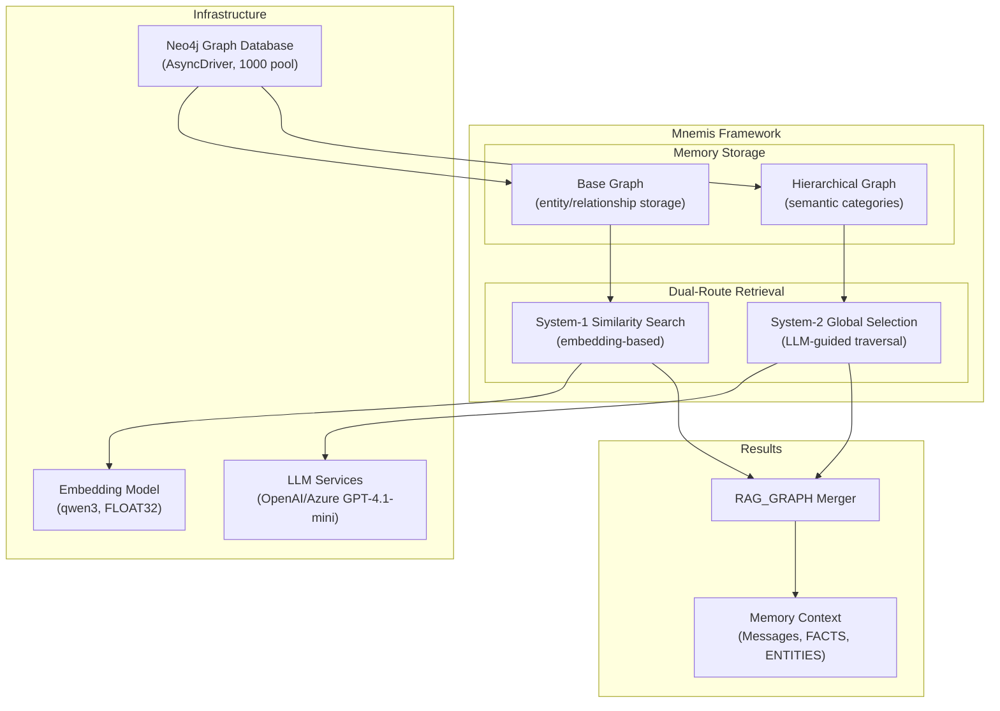
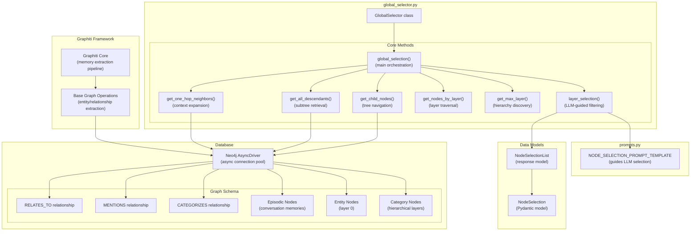

<!-- source: DeepWiki mcp.deepwiki.com · repo microsoft/Mnemis · page 1 Home · fetched 2026-10-26 -->

# Home

<details>
<summary>Relevant source files</summary>

The following files were used as context for generating this wiki page:

- [README.md](README.md)
- [figures/figure_intro.png](figures/figure_intro.png)

</details>


## Purpose and Scope

This wiki documents **Mnemis**, a dual-route retrieval system designed for long-term memory management in Large Language Models (LLMs). Mnemis combines fast similarity-based retrieval (System-1) with deliberate hierarchical reasoning (System-2) to retrieve memory items that are both semantically and structurally relevant.

This Home page provides an overview of Mnemis, its architecture, key features, and benchmark results. For detailed information:
- Architecture deep dive: see [Architecture Overview](#2)
- Implementation details: see [Implementation Guide](#3)
- Benchmark analysis: see [Evaluation & Results](#4)
- Step-by-step usage: see [Getting Started](#6)

**Sources:** [README.md:1-72]()

---

## What is Mnemis?

Mnemis is a memory framework that addresses limitations in existing retrieval-augmented generation (RAG) and Graph-RAG systems. Traditional memory systems rely primarily on similarity-based retrieval, which struggles with scenarios requiring global reasoning or comprehensive information coverage.

### Core Innovation

Mnemis introduces a **dual-route architecture** inspired by dual-process theory in cognitive science:

| Route | Type | Mechanism | Use Case |
|-------|------|-----------|----------|
| **System-1** | Similarity Search | Embedding-based vector search | Fast, intuitive retrieval of semantically similar content |
| **System-2** | Global Selection | LLM-guided hierarchical traversal | Deliberate, comprehensive retrieval requiring global reasoning |

The system organizes memory into two complementary graph structures:
- **Base Graph**: Flat entity/relationship storage for similarity retrieval
- **Hierarchical Graph**: Semantic category hierarchy enabling top-down traversal

Results from both routes are merged using the `RAG_GRAPH` method to produce comprehensive memory context.

**Sources:** [README.md:15-23]()

---

## Key Features

### 1. Dual-Route Retrieval
- **System-1**: Fast embedding-based similarity search using `qwen3` embeddings (FLOAT32 precision)
- **System-2**: LLM-guided hierarchical graph traversal via `GlobalSelector` class
- **Merge Strategy**: `RAG_GRAPH` combines results for comprehensive context

### 2. Hierarchical Graph Construction
Guided by three principles:
- **Minimum Concept Abstraction**: Maintains semantic clarity at each hierarchy level
- **Many-to-Many Mapping**: Allows entities to belong to multiple categories
- **Compression Efficiency Constraint**: Ensures manageable hierarchy depth

### 3. Production-Ready Performance
- **Caching**: `alru_cache` with 500 entries per query reduces database load
- **Batch Processing**: Supports `mp` (multiprocessing) and `batch` modes
- **Concurrency**: Neo4j `AsyncDriver` with 1000-connection pool
- **Type Safety**: Pydantic models for structured LLM responses

### 4. State-of-the-Art Results
| Benchmark | Questions | Mnemis Score | Achievement |
|-----------|-----------|--------------|-------------|
| **LoCoMo** | 1,986 questions (5 categories) | **93.9%** | SOTA (93.3% excluding category 5) |
| **LongMemEval-S** | 500 questions (6 types) | **91.6%** | SOTA across all question types |

**Sources:** [README.md:18-23](), [README.md:31-40]()

---

## Architecture Overview

### High-Level System Architecture



**Diagram: Mnemis High-Level Architecture**

This diagram shows how Mnemis organizes memory into two graph structures, each supporting a different retrieval mechanism. System-1 performs fast similarity search on the base graph, while System-2 conducts deliberate hierarchical reasoning on the hierarchical graph. Both routes leverage different AI services (embeddings vs. LLMs) and merge results to produce comprehensive memory context.

**Sources:** [README.md:25-29]()

---

## Core Components and Code Entities

### Implementation Architecture



**Diagram: Core Code Components and Relationships**

This diagram maps the primary code entities in the Mnemis implementation. The `GlobalSelector` class in `global_selector.py` orchestrates System-2's hierarchical traversal through methods like `global_selection()` and `layer_selection()`. The system uses `NODE_SELECTION_PROMPT_TEMPLATE` from `prompts.py` to guide LLM-based node filtering, with Pydantic models (`NodeSelection`, `NodeSelectionList`) ensuring type-safe responses. All operations interact with Neo4j through `AsyncDriver`, accessing a schema with `Category`, `Entity`, and `Episodic` nodes connected via `CATEGORIZES`, `MENTIONS`, and `RELATES_TO` relationships. The foundation is built on the Graphiti framework for base graph operations.

**Sources:** [README.md:54-56]()

---

## State-of-the-Art Benchmark Results

### LoCoMo Performance

Mnemis achieved **93.9%** accuracy on the LoCoMo benchmark (1,986 questions across 5 categories), with **93.3%** when excluding category 5. This represents state-of-the-art performance across all compared methods.

**Key Highlights:**
- Superior performance on complex multi-hop reasoning questions
- Effective handling of temporal and relational queries
- Robust across different question categories

Detailed results are available in the `results/` directory with multiple configuration variants tested.

### LongMemEval-S Performance

On LongMemEval-S (500 questions across 6 question types), Mnemis scored **91.6%** overall:
- **100%** accuracy on single-session-assistant and preference questions
- **86.5%** on challenging multi-session and temporal reasoning questions

This demonstrates Mnemis's strength in both simple preference tracking and complex temporal reasoning scenarios.

**Sources:** [README.md:31-40]()

---

## Retrieval Configurations

Mnemis supports configurable retrieval parameters for different use cases:

| Configuration | RAG top-k | Graph top-k | Use Case |
|---------------|-----------|-------------|----------|
| **ragtopk10_gtopk20** | 10 | 20 | Balanced retrieval with moderate context |
| **ragtopk30_gtopk60** | 30 | 60 | Comprehensive retrieval for complex queries |

Both configurations use:
- `merge_method`: `RAG_GRAPH`
- `graph_global_search`: `true`
- `organize_rag_content`: `true`
- Models: `gpt-4.1-mini` for all roles (graph, answer, grader)

**Sources:** [README.md:54-56]()

---

## Technology Stack

| Layer | Technology | Purpose |
|-------|------------|---------|
| **Framework** | Graphiti | Base graph operations and memory extraction |
| **Database** | Neo4j (AsyncDriver) | Graph storage with 1000-connection pool |
| **LLM Services** | OpenAI/Azure GPT-4.1-mini | System-2 reasoning and answer generation |
| **Embeddings** | qwen3 (FLOAT32) | System-1 similarity search |
| **Caching** | async-lru | 500-entry cache per query |
| **Validation** | Pydantic | Type-safe data models |
| **Concurrency** | asyncio | Asynchronous operations |

**Sources:** [README.md:54-56]()

---

## Quick Navigation

### For Implementation Details
- **System-2 Implementation**: See [System-2 Global Selection](#2.3) and [GlobalSelector Class Reference](#3.1)
- **Graph Schema**: See [Graph Database Schema](#3.2)
- **Prompt Engineering**: See [Prompt Engineering](#3.3)
- **Performance Optimization**: See [Performance Optimization](#3.5)

### For Understanding Results
- **Benchmark Details**: See [Benchmark Datasets](#4.1)
- **LoCoMo Analysis**: See [LoCoMo Results](#4.2)
- **LongMemEval-S Analysis**: See [LongMemEval-S Results](#4.3)
- **Case Studies**: See [Case Studies](#5)

### For Getting Started
- **Installation**: See [Installation & Setup](#6.1)
- **Usage Examples**: See [Usage Examples](#6.2)
- **Running Evaluations**: See [Running Evaluations](#6.3)

### For Research Context
- **Theoretical Foundation**: See [Theoretical Foundation](#7.1)
- **Comparisons**: See [Comparison with Existing Approaches](#7.2)
- **Paper & Citations**: See [Paper & Citations](#7.3)

**Sources:** [README.md:1-72]()

---

## Case Study Examples

The system includes detailed case studies demonstrating retrieval and reasoning:

### LoCoMo User 8 QA 11
Illustrates how Mnemis retrieves relevant conversation history and entities to answer complex user queries by combining System-1 similarity search with System-2 hierarchical traversal.

*Full analysis:* See [LoCoMo User 8 QA 11](#5.1)

### LongMemEval-S QA 262
Demonstrates temporal reasoning capabilities, showing how Mnemis extracts facts, summarizes entities, and organizes message chunks to handle multi-session queries requiring time-aware context.

*Full analysis:* See [LongMemEval-S QA 262](#5.2)

**Sources:** [README.md:42-51]()

---

## Repository Structure

```
Mnemis/
├── global_selector/          # System-2 implementation
│   ├── global_selector.py    # GlobalSelector class
│   ├── prompts.py            # NODE_SELECTION_PROMPT_TEMPLATE
│   └── ...                   # Supporting modules
├── results/                  # Benchmark results
│   ├── metrics_*.json        # Aggregated accuracy metrics
│   └── results_*.json        # Full QA context and evidence
├── figures/                  # Visualization assets
│   ├── figure_intro.png      # Architecture diagram
│   ├── results_locomo.png    # LoCoMo results visualization
│   └── results_lme_s.png     # LongMemEval-S results
└── README.md                 # This overview document
```

Evaluation datasets (LoCoMo and LongMemEval-S) are referenced in the evaluation code but not included in the repository.

**Sources:** [README.md:54-56]()

---

## Citation

If you use Mnemis in your research, please cite:

```bibtex
@misc{tang2026mnemisdualrouteretrievalhierarchical,
      title={Mnemis: Dual-Route Retrieval on Hierarchical Graphs for Long-Term LLM Memory}, 
      author={Zihao Tang and Xin Yu and Ziyu Xiao and Zengxuan Wen and Zelin Li and Jiaxi Zhou and Hualei Wang and Haohua Wang and Haizhen Huang and Weiwei Deng and Feng Sun and Qi Zhang},
      year={2026},
      eprint={2602.15313},
      archivePrefix={arXiv},
      primaryClass={cs.CL},
      url={https://arxiv.org/abs/2602.15313}
}
```

**Paper**: [arXiv:2602.15313](https://arxiv.org/abs/2602.15313)  
**Hugging Face**: [Papers page](https://huggingface.co/papers/2602.15313)

**Sources:** [README.md:58-71]()

---

## Community and Support

- **Code of Conduct**: See [Code of Conduct](#8.1)
- **Security Policy**: See [Security Policy](#8.2)
- **License**: MIT License - See [License](#8.3)
- **Contributing**: See [Contributing](#8)

**Sources:** [README.md:1-72]()

---

