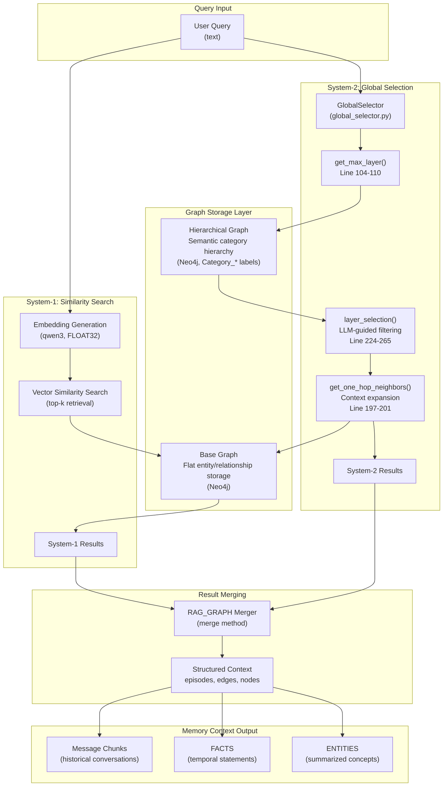
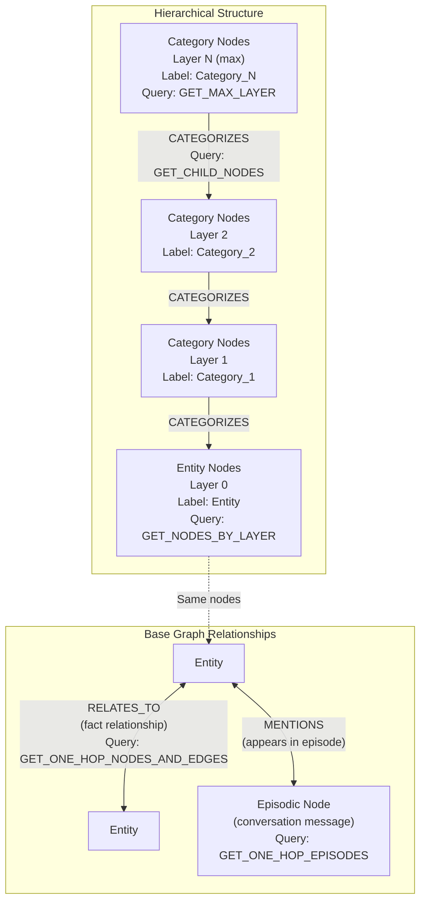
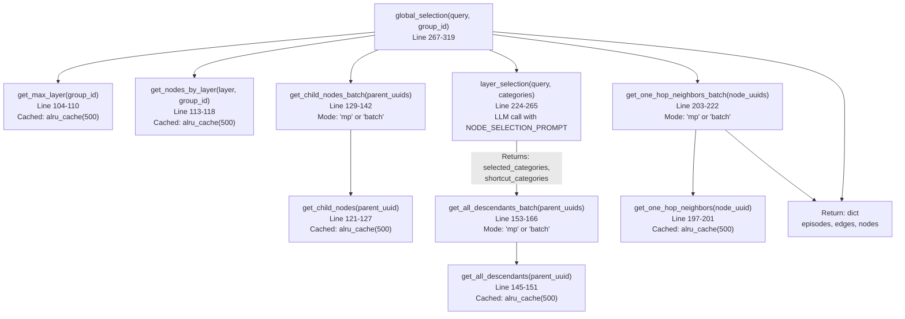

<!-- source: DeepWiki mcp.deepwiki.com · repo microsoft/Mnemis · page 2 Architecture Overview · fetched 2026-10-26 -->

# Architecture Overview

Relevant source files

The following files were used as context for generating this wiki page:

- [README.md](README.md)
- [global_selection/global_selector.py](global_selection/global_selector.py)

## Purpose and Scope

This document provides a high-level architectural overview of the Mnemis dual-route memory system. It explains how System-1 and System-2 retrieval mechanisms work together on base and hierarchical graph structures to provide comprehensive memory retrieval for long-term LLM conversations.

For detailed implementation specifics, see [Implementation Guide](#3). For in-depth explanations of individual components, see [Memory Components](#2.1), [System-1 Similarity Search](#2.2), [System-2 Global Selection](#2.3), and [RAG_GRAPH Merge Strategy](#2.4).

**Sources:** [README.md:15-29]()

## Dual-Route Memory System

Mnemis implements a cognitive science-inspired dual-route architecture that parallels human memory retrieval patterns:

| Route | Mechanism | Characteristics | Implementation |
|-------|-----------|-----------------|----------------|
| **System-1** | Similarity Search | Fast, intuitive, bottom-up | Embedding-based retrieval on base graph |
| **System-2** | Global Selection | Deliberate, analytical, top-down | LLM-guided hierarchical traversal |

System-1 provides rapid retrieval of semantically similar memories using vector embeddings, similar to how humans quickly recall related experiences. System-2 complements this with deliberate reasoning over a semantic hierarchy, enabling comprehensive coverage and global context awareness that pure similarity search cannot achieve.

The dual-route approach addresses a fundamental limitation in existing memory systems: similarity-based retrieval (RAG, Graph-RAG) struggles with queries requiring global reasoning or comprehensive information coverage. By combining both routes, Mnemis retrieves memory items that are both semantically and structurally relevant.

**Sources:** [README.md:18-23](), [README.md:26-26]()

## Dual-Route Architecture with Code Entities

This diagram shows how user queries are processed through both retrieval routes in parallel. System-1 operates directly on the base graph using embeddings, while System-2 traverses the hierarchical graph using the `GlobalSelector` class. The `global_selection()` method orchestrates layer-by-layer traversal starting from `get_max_layer()`, applying LLM-guided filtering via `layer_selection()`, and expanding context with `get_one_hop_neighbors()`. Results merge into structured context containing message chunks, facts, and entities.

**Sources:** [global_selector.py:90-319](), [README.md:26-29]()

## Graph Storage Architecture

Mnemis organizes memory into two complementary graph structures stored in a Neo4j database:

### Base Graph

The base graph provides flat storage of entities, relationships, and episodic memories. It serves as the foundation for both retrieval routes:

| Node Type | Label | Purpose | Key Properties |
|-----------|-------|---------|----------------|
| Entities | `Entity` | Represent concepts, people, objects | `uuid`, `name`, `tag`, `summary`, `group_id` |
| Episodes | `Episodic` | Store conversation messages | `uuid`, `content`, `valid_at`, `group_id` |

| Relationship Type | Direction | Purpose |
|-------------------|-----------|---------|
| `MENTIONS` | Entity ↔ Episodic | Links entities to conversation contexts |
| `RELATES_TO` | Entity ↔ Entity | Connects related entities with facts |

### Hierarchical Graph

The hierarchical graph organizes entities into a semantic taxonomy with multiple layers:

| Node Type | Label | Layer | Purpose |
|-----------|-------|-------|---------|
| Categories | `Category_{n}` | n > 0 | Abstract semantic groupings |
| Entities | `Entity` | 0 | Ground-level concepts (also in base graph) |

The hierarchy uses the `CATEGORIZES` relationship to connect parent categories to child categories or entities. Each category node includes a `layer` property indicating its hierarchical level, with higher layers representing more abstract concepts.

**Sources:** [global_selector.py:30-83](), [README.md:26-26]()

## Graph Schema with Neo4j Cypher Queries

The schema implements two distinct graph structures in a single Neo4j database. The hierarchical structure uses dynamically-labeled category nodes (`Category_1`, `Category_2`, etc.) connected by `CATEGORIZES` relationships. The base graph uses `RELATES_TO` and `MENTIONS` relationships to connect entities to each other and to episodic memories. Entity nodes exist in both structures simultaneously, serving as the bridge between hierarchical organization and flat relational storage.

The `Query` class in [global_selector.py:30-83]() defines Cypher queries for traversing these structures:
- `GET_MAX_LAYER`: Discovers hierarchy depth
- `GET_NODES_BY_LAYER`: Retrieves all nodes at a specific layer
- `GET_CHILD_NODES`: Navigates parent-child relationships
- `GET_ONE_HOP_EPISODES`: Retrieves conversation contexts
- `GET_ONE_HOP_NODES_AND_EDGES`: Retrieves related entities and facts

**Sources:** [global_selector.py:30-83]()

## Retrieval Process Flow

The complete memory retrieval process follows a coordinated pipeline:

### System-1 Retrieval

1. **Query Embedding**: Convert user query to vector representation using embedding model
2. **Similarity Search**: Execute vector similarity search against entity embeddings in base graph
3. **Top-K Selection**: Retrieve top-k most similar entities (configurable, typically k=10 or k=30)

### System-2 Retrieval

The `global_selection()` method in [global_selector.py:267-319]() orchestrates hierarchical traversal:

1. **Initialization**: Call `get_max_layer()` to discover hierarchy depth
2. **Layer-by-Layer Traversal**: Iterate from max layer down to layer 1:
   - At max layer: Call `get_nodes_by_layer()` to retrieve all categories
   - At lower layers: Call `get_child_nodes_batch()` to retrieve children of selected parents
   - At each layer: Invoke `layer_selection()` with LLM for intelligent filtering
3. **Shortcut Processing**: Call `get_all_descendants_batch()` for categories marked with `get_all_children=true`
4. **Context Expansion**: Call `get_one_hop_neighbors_batch()` to retrieve:
   - Episodic nodes (conversation messages) via `MENTIONS` relationships
   - Related entities and facts via `RELATES_TO` relationships

### Result Merging

Results from both routes merge using the RAG_GRAPH strategy to produce structured context containing:
- **episodes**: List of conversation message objects with `content` and `valid_at` timestamps
- **edges**: List of fact relationships with `fact`, `valid_at`, and `invalid_at` properties
- **nodes**: List of entity/category objects with `name`, `tag`, and `summary` properties

**Sources:** [global_selector.py:267-319]()

## System-2 Method Call Flow

This diagram maps the complete method call hierarchy within the `GlobalSelector` class. The `global_selection()` method serves as the orchestrator, calling cached helper methods for database queries. The caching layer uses `alru_cache` with 500 entries per query to minimize database load. Batch methods support two modes: `'mp'` (multiprocessing via asyncio.gather) and `'batch'` (single Cypher query with multiple UUIDs). The `layer_selection()` method is the only point where LLM intelligence is applied, using the `NODE_SELECTION_PROMPT_TEMPLATE` from [global_selection/prompts.py]().

**Sources:** [global_selector.py:90-319]()

## Component Integration

The architecture integrates multiple components into a cohesive system:

### Infrastructure Layer

| Component | Technology | Configuration | Purpose |
|-----------|-----------|---------------|---------|
| Graph Database | Neo4j AsyncDriver | 1000 connection pool | Stores base and hierarchical graphs |
| LLM Client | OpenAI/Azure GPT-4.1-mini | Via `LLMClient` interface | Powers System-2 node selection |
| Embedding Service | qwen3 (FLOAT32 precision) | Via embedder configuration | Powers System-1 similarity search |

### Data Processing Layer

The system uses Python's async primitives for concurrent execution:
- **asyncio**: Enables concurrent query processing
- **async-lru**: Provides `alru_cache` decorator for method-level caching ([global_selector.py:103](), [global_selector.py:112](), [global_selector.py:120](), [global_selector.py:144](), [global_selector.py:196]())
- **Pydantic**: Enforces type safety for LLM responses via `NodeSelection` and `NodeSelectionList` models ([global_selector.py:22-28]())

### Batch Processing

The `get_global_search_context()` function ([global_selector.py:366-385]()) coordinates batch retrieval:
- Semaphore-based concurrency control (configurable max_concurrent)
- asyncio.gather for parallel execution
- Typical batch sizes: 50 queries for LoCoMo, 30 for LongMemEval-S

### Foundation Framework

Mnemis builds on the [Graphiti framework](https://github.com/getzep/graphiti) for base graph operations and memory extraction. The `GlobalSelector` class extends this foundation with hierarchical graph support and System-2 retrieval capabilities.

**Sources:** [global_selector.py:1-19](), [global_selector.py:90-94](), [global_selector.py:366-385](), [README.md:54-54]()

## Performance Characteristics

The architecture achieves high performance through several design decisions:

| Optimization | Implementation | Impact |
|-------------|----------------|---------|
| Aggressive Caching | `alru_cache(500)` on 5 core methods | Reduces duplicate database queries within single retrieval |
| Connection Pooling | `max_connection_pool_size=1000` | Supports high concurrency (10+ parallel users) |
| Batch Query Modes | `'mp'` and `'batch'` options | Flexibility between parallelism and query efficiency |
| Structured LLM Responses | Pydantic `response_model` | Type-safe, parseable LLM outputs |

The `global_selection()` method includes timing instrumentation tracking three phases:
- **init**: Time to discover hierarchy depth via `get_max_layer()`
- **layer_selection**: Time for layer-by-layer traversal and LLM filtering
- **one_hop_neighbors**: Time for context expansion around selected nodes

**Sources:** [global_selector.py:20-20](), [global_selector.py:103](), [global_selector.py:268-319](), [global_selector.py:435-435]()

## Configuration and Extensibility

The system provides configuration through several mechanisms:

### GlobalSelectorConfig

The `GlobalSelectorConfig` class ([global_selector.py:85-87]()) controls selection behavior:
- `use_summary`: Include entity summaries in LLM prompts (default: False)
- `use_tag`: Include entity tags in LLM prompts (default: True)

These settings affect the information provided to the LLM during `layer_selection()`, allowing tuning of selection granularity versus prompt size.

### Retrieval Parameters

Configurable parameters for tuning retrieval behavior:
- **rag_top_k**: Number of results from System-1 similarity search (10 or 30 in experiments)
- **graph_top_k**: Implicit limit on System-2 results (20 or 60 in experiments)
- **merge_method**: Strategy for combining System-1 and System-2 results (RAG_GRAPH)

For complete configuration details, see [Configuration Options](#3.4).

**Sources:** [global_selector.py:85-87](), [global_selector.py:224-265]()

---

