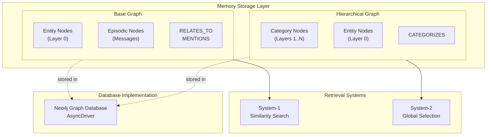
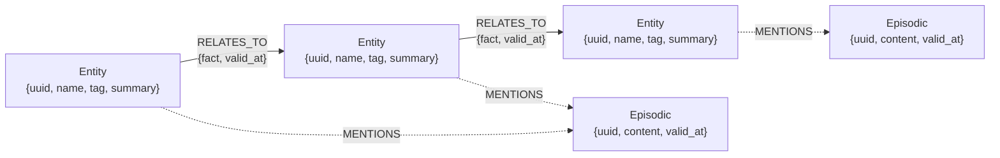
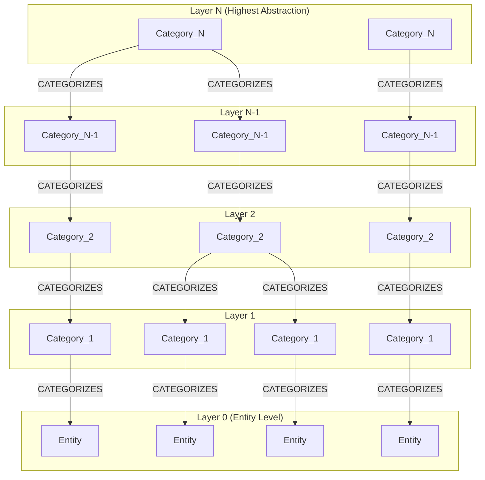
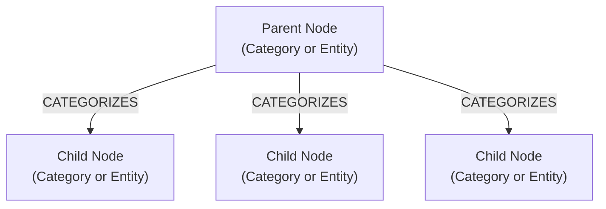
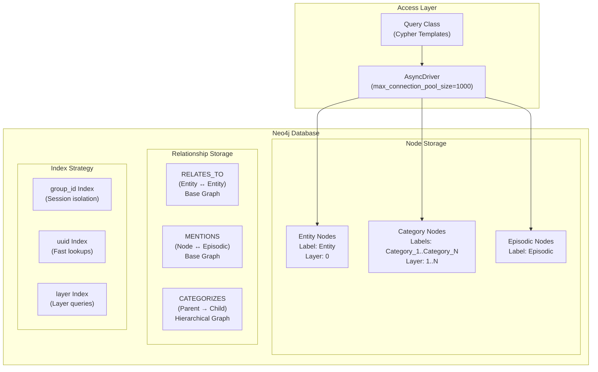
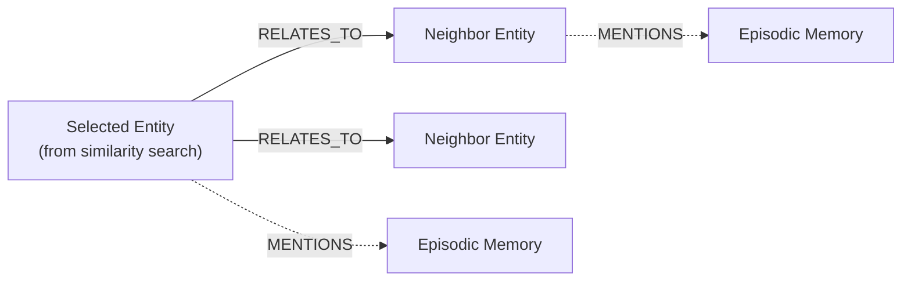
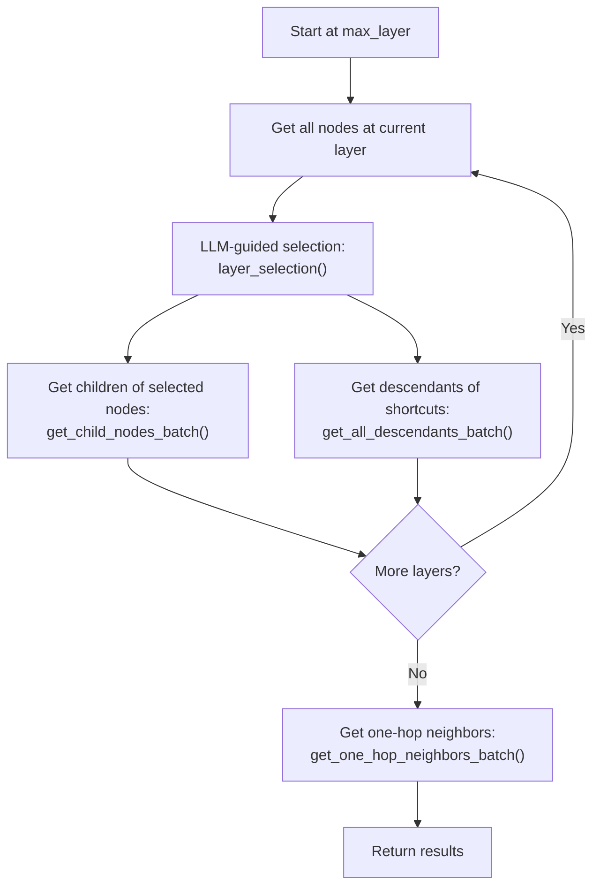

<!-- source: DeepWiki mcp.deepwiki.com · repo microsoft/Mnemis · page 2.1 Memory Components · fetched 2026-10-26 -->

# Memory Components

<details>
<summary>Relevant source files</summary>

The following files were used as context for generating this wiki page:

- [README.md](README.md)
- [global_selection/global_selector.py](global_selection/global_selector.py)

</details>


## Purpose and Scope

This document provides a detailed explanation of Mnemis's two core memory structures: the **Base Graph** and the **Hierarchical Graph**. These components form the foundation of Mnemis's dual-route memory system, with each graph optimized for different retrieval mechanisms. This page focuses on the structural organization, schema design, and guiding principles of both graphs.

For information about how these graphs are used during retrieval, see System-1 Similarity Search [#2.2](#2.2) and System-2 Global Selection [#2.3](#2.3). For database schema implementation details, see Graph Database Schema [#3.2](#3.2).

---

## Memory Architecture Overview

Mnemis organizes memory into two complementary graph structures that operate on the same underlying data but expose different organizational perspectives:



**Sources:** [README.md:15-29](), [global_selector.py:1-453]()

The Base Graph provides a **flat, relationship-dense** structure optimized for embedding-based similarity search, while the Hierarchical Graph provides a **layered, tree-like** structure optimized for top-down deliberate traversal.

---

## Base Graph

### Purpose and Design

The Base Graph stores memory in a flat structure where entities and their relationships exist at a single conceptual level (layer 0). This design enables efficient similarity-based retrieval through embedding search, as all entities are directly comparable without hierarchical filtering.

**Key Characteristics:**
- Flat structure with no hierarchical layers
- Dense relationship network between entities
- Direct connection to episodic memories
- Optimized for fast similarity search

### Node Types

The Base Graph contains three primary node types:

| Node Type | Label | Purpose | Key Properties |
|-----------|-------|---------|----------------|
| Entity | `Entity` | Core concepts, people, objects | `uuid`, `name`, `tag`, `summary`, `group_id` |
| Episodic | `Episodic` | Historical messages/conversations | `uuid`, `content`, `valid_at`, `group_id` |
| Fact Edge | `RELATES_TO` | Relationships between entities | `uuid`, `fact`, `valid_at`, `invalid_at` |

**Sources:** [global_selector.py:30-83]()

### Base Graph Schema



**Sources:** [global_selector.py:73-83]()

### Relationship Types

#### RELATES_TO Relationships

Connects two `Entity` nodes with factual information about their relationship. These edges are first-class objects in the graph with their own properties:

```
Properties:
- uuid: Unique identifier for the fact
- fact: Text description of the relationship
- valid_at: Timestamp when relationship became valid
- invalid_at: Timestamp when relationship became invalid (nullable)
```

Query implementation: [global_selector.py:73-83]()

#### MENTIONS Relationships

Connects `Entity` or `Category` nodes to `Episodic` nodes, indicating which entities were mentioned in which historical messages:

```
Purpose: Link entities to source conversations
Direction: Bidirectional (either direction valid)
Properties: Relationship is unweighted
```

Query implementation: [global_selector.py:61-71]()

**Sources:** [global_selector.py:61-83]()

---

## Hierarchical Graph

### Purpose and Design

The Hierarchical Graph organizes the same entities into a semantic taxonomy with multiple abstraction layers. This structure enables System-2 to perform deliberate, top-down reasoning by traversing from general concepts to specific entities.

**Key Characteristics:**
- Multi-layer hierarchical structure (layers 1 through N)
- Tree-like organization with parent-child relationships
- Categories at higher layers subsume entities at lower layers
- Optimized for global reasoning and comprehensive retrieval

### Layer Structure



**Sources:** [global_selector.py:31-59](), [README.md:22]()

The hierarchical structure allows System-2 to start at the highest layer (most abstract categories) and progressively descend to more specific concepts, filtering at each level based on relevance to the query.

### Guiding Principles

The hierarchical graph construction is guided by three key principles mentioned in the paper:

| Principle | Purpose | Impact |
|-----------|---------|--------|
| **Minimum Concept Abstraction** | Ensure categories represent meaningful semantic groupings | Prevents over-generalization; maintains semantic coherence |
| **Many-to-Many Mapping** | Allow entities to belong to multiple categories | Captures multi-faceted nature of concepts |
| **Compression Efficiency Constraint** | Balance hierarchy depth vs. breadth | Optimizes traversal efficiency |

**Sources:** [README.md:22]()

### Node Types and Properties

#### Category Nodes

Categories exist at layers 1 through N (where N is the maximum abstraction level). Each category is labeled with its specific layer:

```
Node Labels: Category_1, Category_2, ..., Category_N
Properties:
- uuid: Unique identifier
- name: Human-readable category name
- tag: Category classification/type
- summary: Description of category contents
- layer: Integer indicating abstraction level
- group_id: User/session identifier
```

Query implementation: [global_selector.py:36-39]()

#### Entity Nodes (Layer 0)

The same `Entity` nodes from the Base Graph serve as the foundation (layer 0) of the hierarchical graph:

```
Node Label: Entity
Properties:
- uuid: Unique identifier
- name: Entity name
- tag: Entity type/classification
- summary: Entity description
- group_id: User/session identifier
- layer: Always 0
```

**Sources:** [global_selector.py:30-59]()

### CATEGORIZES Relationship

The `CATEGORIZES` relationship forms the hierarchical structure by connecting parent nodes to child nodes:



**Properties:**
- Direction: Parent → Child (downward in hierarchy)
- Cardinality: One-to-many (one parent, multiple children)
- Levels: Connects adjacent layers (Layer N → Layer N-1)

Query implementations:
- Single parent: [global_selector.py:41-44]()
- Batch parents: [global_selector.py:46-49]()
- All descendants (recursive): [global_selector.py:51-59]()

**Sources:** [global_selector.py:41-59]()

---

## Data Storage Model

### Neo4j Implementation

Both the Base Graph and Hierarchical Graph are stored in a single Neo4j graph database, with different node labels and relationship types distinguishing their logical structures:



**Sources:** [global_selector.py:30-84](), [global_selector.py:431-435]()

### Query Templates

The `Query` class defines Cypher query templates for accessing both graph structures:

#### Hierarchical Graph Queries

| Method | Query Template | Purpose |
|--------|----------------|---------|
| `GET_MAX_LAYER` | [global_selector.py:31-34]() | Find highest layer number |
| `GET_NODES_BY_LAYER` | [global_selector.py:36-39]() | Retrieve all nodes at specific layer |
| `GET_CHILD_NODES` | [global_selector.py:41-44]() | Get direct children of parent |
| `GET_ALL_DESCENDANTS` | [global_selector.py:51-54]() | Get entire subtree recursively |

#### Base Graph Queries

| Method | Query Template | Purpose |
|--------|----------------|---------|
| `GET_ONE_HOP_EPISODES` | [global_selector.py:61-65]() | Retrieve episodic memories |
| `GET_ONE_HOP_NODES_AND_EDGES` | [global_selector.py:73-77]() | Retrieve relationships and neighbors |

**Sources:** [global_selector.py:30-84]()

### Group Isolation

Both graphs use `group_id` to isolate memory contexts across different users or sessions:

```
group_id Format: {prefix}_{user_id}
Examples:
- locomo_mnemis_coreAI_tel_b20_nec_full_0
- lme_s_mnemis_coreAI_tel_b20_nec_full_42

Purpose: Enable multi-tenancy within single database
Implementation: All queries filter by group_id parameter
```

This design allows concurrent access by multiple users while maintaining memory isolation.

**Sources:** [global_selector.py:321-364]()

---

## Graph Traversal Patterns

### Base Graph: One-Hop Expansion

System-1 retrieval uses the Base Graph by performing one-hop neighbor expansion from selected entities:



Implementation: [global_selector.py:196-222]()

**Sources:** [global_selector.py:196-222]()

### Hierarchical Graph: Top-Down Traversal

System-2 retrieval uses the Hierarchical Graph by traversing from the highest layer downward:



Implementation: [global_selector.py:267-319]()

**Sources:** [global_selector.py:267-319]()

---

## Summary

Mnemis's dual memory architecture leverages the complementary strengths of flat and hierarchical organization:

- **Base Graph**: Enables fast, similarity-based retrieval through a flat entity-relationship network with direct access to episodic memories
- **Hierarchical Graph**: Enables deliberate, comprehensive retrieval through multi-layer semantic taxonomy with top-down traversal

Both graphs share the same underlying entities and episodic memories but organize them differently to support their respective retrieval mechanisms. The Neo4j implementation efficiently stores both structures using node labels, relationship types, and the `group_id` isolation pattern.

**Sources:** [README.md:15-29](), [global_selector.py:1-453]()

---

