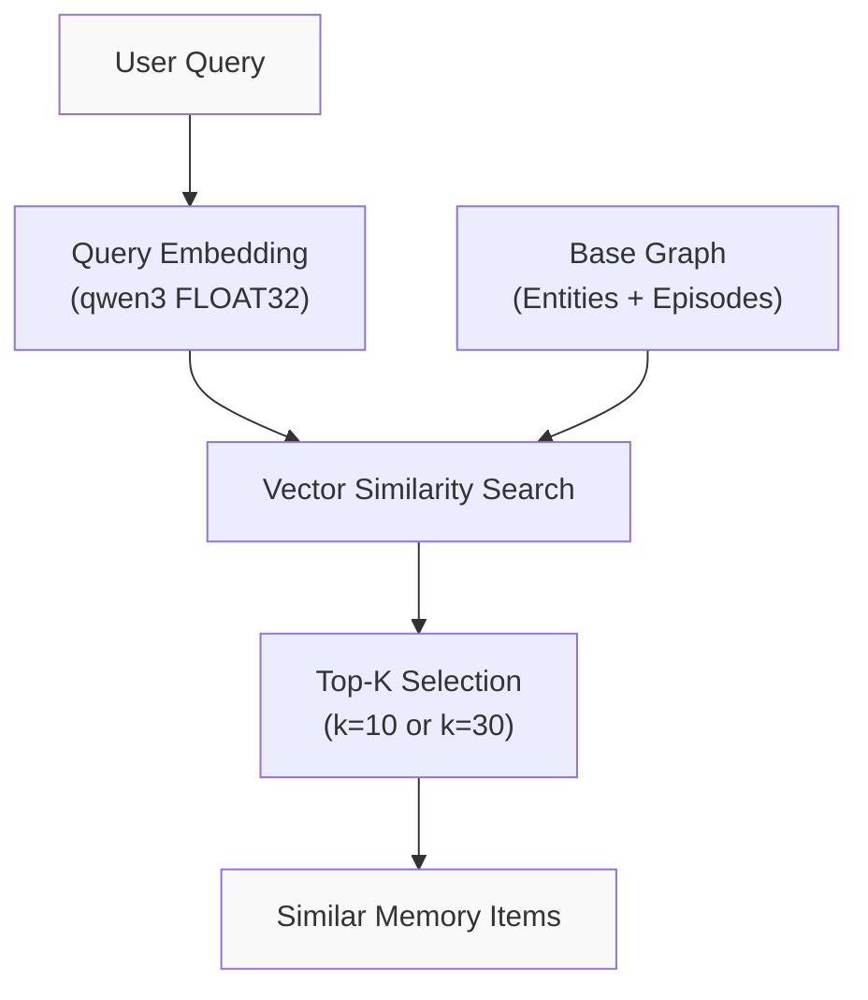
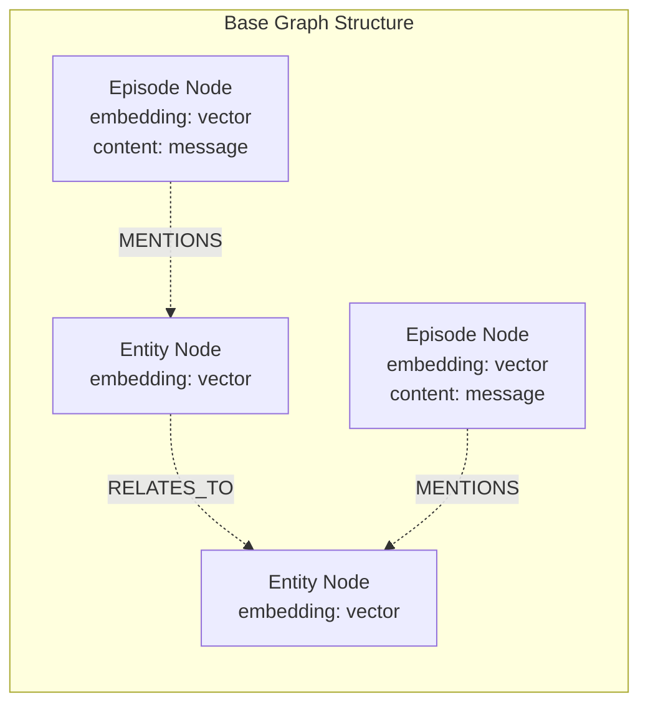
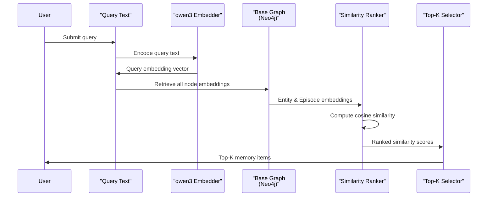
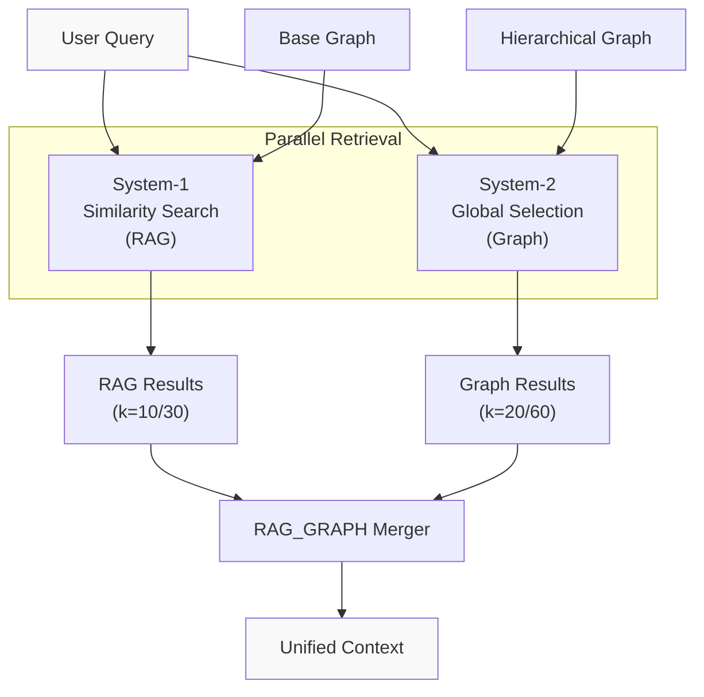

<!-- source: DeepWiki mcp.deepwiki.com · repo microsoft/Mnemis · page 2.2 System-1 Similarity Search · fetched 2026-10-26 -->

# System-1 Similarity Search

<details>
<summary>Relevant source files</summary>

The following files were used as context for generating this wiki page:

- [README.md](README.md)
- [results/lme-s/results_graphiti_gpt-41-mini-shortco-2025-04-14-Bing_gpt-41-mini-shortco-2025-04-14-Bing_ragtopk10_gtopk20_RAG_GRAPH.json](results/lme-s/results_graphiti_gpt-41-mini-shortco-2025-04-14-Bing_gpt-41-mini-shortco-2025-04-14-Bing_ragtopk10_gtopk20_RAG_GRAPH.json)

</details>


## Purpose and Scope

This page describes System-1, the fast, intuitive similarity-based retrieval mechanism in Mnemis. System-1 operates on the Base Graph to retrieve memory items based on embedding similarity to a query. For information about the complementary deliberate retrieval mechanism, see [System-2 Global Selection](#2.3). For details on how System-1 and System-2 results are combined, see [RAG_GRAPH Merge Strategy](#2.4).

## Overview

System-1 implements a classical embedding-based similarity search approach inspired by the fast, automatic processing of human cognition (dual-process theory's "System 1"). It provides rapid retrieval of semantically similar memory items without requiring complex reasoning or graph traversal.

**Key Characteristics:**
- **Speed**: Fast vector similarity computation
- **Simplicity**: Direct embedding-to-embedding comparison
- **Local Focus**: Retrieves items similar to the query, but may miss globally relevant context
- **Scalability**: Efficient for large memory stores

Sources: [README.md:1-72]()



**Diagram: System-1 Retrieval Pipeline**

Sources: [README.md:15-40]()

## Base Graph Storage Layer

System-1 operates on the **Base Graph**, a flat storage structure containing entities and episodic memories. Unlike the Hierarchical Graph used by System-2, the Base Graph does not impose categorical organization, allowing for flexible similarity-based retrieval.

**Base Graph Contents:**
- **Entity Nodes**: Represent concepts, people, places, objects extracted from conversations
- **Episode Nodes**: Represent individual messages or conversation turns
- **Relationships**: Direct connections between entities (e.g., MENTIONS, RELATES_TO)
- **Embeddings**: Each node has an associated embedding vector for similarity search

The Base Graph is built using the Graphiti framework, which Mnemis extends with dual-route retrieval capabilities.

Sources: [README.md:25-29](), [README.md:54-57]()



**Diagram: Base Graph Schema for System-1**

Sources: [README.md:25-29]()

## Embedding Model

System-1 uses the **qwen3** embedding model with **FLOAT32** precision to generate vector representations of queries and memory items.

**Embedding Specifications:**

| Attribute | Value |
|-----------|-------|
| Model | qwen3 |
| Precision | FLOAT32 |
| Purpose | Semantic similarity computation |
| Applies To | Queries, Entity nodes, Episode nodes |

**Embedding Generation Process:**
1. Input text (query or memory content) is tokenized
2. Text passes through qwen3 encoder
3. Output is a dense vector in FLOAT32 format
4. Vector is normalized for cosine similarity computation

The choice of qwen3 balances semantic quality with computational efficiency, enabling fast similarity searches over large memory stores.

Sources: [results/lme-s/results_graphiti_gpt-41-mini-shortco-2025-04-14-Bing_gpt-41-mini-shortco-2025-04-14-Bing_ragtopk10_gtopk20_RAG_GRAPH.json:1-10]()

## Retrieval Process

System-1 retrieval follows a straightforward pipeline from query to results:



**Diagram: System-1 Retrieval Sequence**

Sources: [README.md:15-40]()

### Step-by-Step Retrieval

**Step 1: Query Embedding**
- User query is converted to embedding vector using qwen3
- Results in a dense FLOAT32 vector representation

**Step 2: Candidate Retrieval**
- All entity and episode embeddings are retrieved from Base Graph
- In practice, this may use vector index for efficiency

**Step 3: Similarity Computation**
- Cosine similarity computed between query embedding and all candidate embeddings
- Formula: `similarity = (query_vec · candidate_vec) / (||query_vec|| × ||candidate_vec||)`

**Step 4: Ranking**
- All candidates sorted by similarity score (descending)

**Step 5: Top-K Selection**
- Top `rag_top_k` items selected (typically k=10 or k=30)
- These become the System-1 retrieval results

Sources: [results/lme-s/results_graphiti_gpt-41-mini-shortco-2025-04-14-Bing_gpt-41-mini-shortco-2025-04-14-Bing_ragtopk10_gtopk20_RAG_GRAPH.json:1-10]()

## Configuration Parameters

System-1 behavior is controlled by several configuration parameters:

| Parameter | Type | Default | Description |
|-----------|------|---------|-------------|
| `rag_top_k` | int | 10 or 30 | Number of top similar items to retrieve |
| `embedder` | string | "qwen3" | Embedding model identifier |
| `precision` | string | "FLOAT32" | Embedding vector precision |
| `similarity_metric` | string | "cosine" | Distance metric for similarity |

### RAG Top-K Values

Experiments show two common configurations:

**Configuration 1: `ragtopk10_gtopk20`**
- System-1 retrieves top 10 items
- System-2 retrieves top 20 items
- Balanced retrieval across both routes

**Configuration 2: `ragtopk30_gtopk60`**
- System-1 retrieves top 30 items
- System-2 retrieves top 60 items
- Higher recall, more comprehensive context

The choice depends on the application's need for precision vs. recall and the acceptable context length for the answer generation model.

Sources: [results/lme-s/results_graphiti_gpt-41-mini-shortco-2025-04-14-Bing_gpt-41-mini-shortco-2025-04-14-Bing_ragtopk10_gtopk20_RAG_GRAPH.json:1](), [README.md:31-40]()

## Result Structure

System-1 returns memory items in a structured format suitable for downstream processing:

**Evidence Messages Format:**
```json
{
  "role": "user|assistant",
  "content": "message text",
  "datetime": "YYYY/MM/DD (Day) HH:MM"
}
```

**Retrieved Items Include:**
- **Episodes**: Historical conversation messages with timestamps
- **Entities**: Relevant entity nodes with summaries
- **Context Metadata**: Session IDs, retrieval scores

Example from results:

```json
{
  "evidence_messages": [
    {
      "role": "user",
      "content": "I bought my tennis racket from a sports store downtown.",
      "datetime": "2023/05/25 (Thu) 21:29"
    }
  ]
}
```

Sources: [results/lme-s/results_graphiti_gpt-41-mini-shortco-2025-04-14-Bing_gpt-41-mini-shortco-2025-04-14-Bing_ragtopk10_gtopk20_RAG_GRAPH.json:1-10]()

## Integration with Dual-Route Architecture

System-1 does not operate in isolation—it is one component of Mnemis's dual-route architecture:



**Diagram: System-1 in Dual-Route Context**

### Complementary Strengths

**System-1 Strengths:**
- Fast retrieval of semantically similar items
- Effective for queries with clear lexical/semantic matches
- Captures local context and relevant episodes

**System-1 Limitations:**
- May miss globally important information
- Struggles with queries requiring comprehensive coverage
- Cannot reason about hierarchical relationships

**System-2 Compensates:**
- Provides global reasoning via hierarchical traversal
- Captures structurally relevant information
- Ensures comprehensive coverage of related concepts

The RAG_GRAPH merge strategy combines both retrieval routes to leverage their complementary strengths.

Sources: [README.md:15-40]()

## Performance Characteristics

### Efficiency

System-1 is designed for **speed and scalability**:

**Time Complexity:**
- Query embedding: O(1) - constant time per query
- Similarity computation: O(n) where n = number of nodes in Base Graph
- Top-K selection: O(n log k) with heap-based selection

**Space Complexity:**
- Embedding storage: O(n × d) where d = embedding dimension
- Query processing: O(k) for storing top-k results

### Retrieval Quality

System-1 excels at:
- ✓ Lexically similar queries (e.g., "tennis racket" → "sports equipment")
- ✓ Semantically related topics (e.g., "vacation planning" → "travel bookings")
- ✓ Recent similar conversations

System-1 struggles with:
- ✗ Global reasoning queries (e.g., "tell me everything about topic X")
- ✗ Queries requiring comprehensive coverage
- ✗ Hierarchical or categorical relationships

Sources: [README.md:15-40]()

## Benchmark Performance

Mnemis achieves state-of-the-art results by combining System-1 with System-2:

**LongMemEval-S Results:**
- Overall Accuracy: **91.6%**
- Single-session queries: Near-perfect (System-1 sufficient)
- Multi-session queries: 86.5% (benefits from System-2)

**LoCoMo Results:**
- Overall Accuracy: **80-81%** (93.9% excluding category 5)
- System-1 contributes significantly to single-fact retrieval
- System-2 crucial for multi-fact reasoning

The high performance demonstrates that System-1's similarity-based retrieval, while simple, is highly effective when combined with complementary System-2 reasoning.

Sources: [README.md:31-40]()

## Comparison with System-2

| Aspect | System-1 | System-2 |
|--------|----------|----------|
| **Retrieval Strategy** | Embedding similarity | LLM-guided traversal |
| **Graph Used** | Base Graph | Hierarchical Graph |
| **Speed** | Fast (O(n)) | Slower (multiple LLM calls) |
| **Scope** | Local similarity | Global reasoning |
| **Top-K** | 10 or 30 | 20 or 60 |
| **Model Dependency** | Embedder only | LLM (gpt-41-mini) |
| **Best For** | Semantic matching | Comprehensive coverage |

Both systems are essential for Mnemis's performance. System-1 provides rapid, semantically relevant retrieval, while System-2 ensures comprehensive coverage through deliberate hierarchical reasoning. Their combination via RAG_GRAPH produces superior results compared to either approach alone.

Sources: [README.md:15-40]()

## Code Integration Points

While the primary implementation of System-1 leverages the Graphiti framework's built-in RAG capabilities, Mnemis extends it with dual-route integration:

**Key Integration Areas:**
- **Base Graph Construction**: Entities and episodes stored with embeddings
- **Embedding Generation**: qwen3 model integration
- **Similarity Search**: Vector-based retrieval on Base Graph
- **Result Formatting**: Structured output for RAG_GRAPH merger
- **Configuration**: `rag_top_k` parameter tuning

The core System-2 implementation is provided in the `global_selection` directory, while System-1 relies on Graphiti's existing RAG infrastructure with configuration tuning for optimal performance.

Sources: [README.md:54-57]()

---

**Summary**: System-1 Similarity Search provides fast, intuitive embedding-based retrieval on the Base Graph, forming one half of Mnemis's dual-route architecture. By combining System-1's semantic matching with System-2's global reasoning, Mnemis achieves state-of-the-art performance on long-term memory benchmarks.

---

