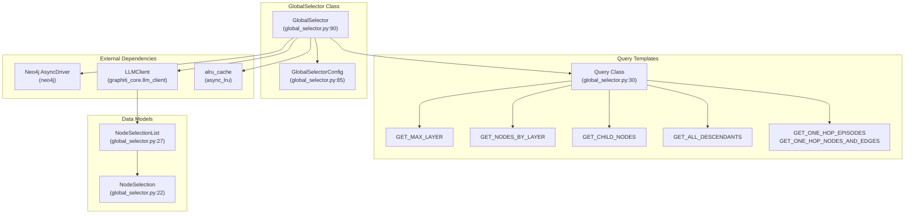
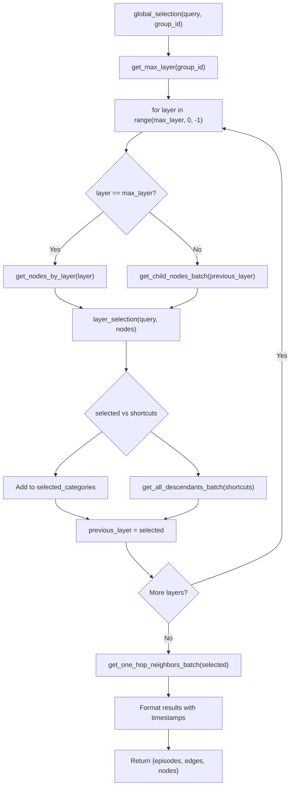
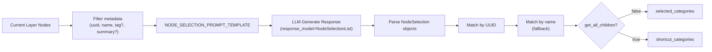
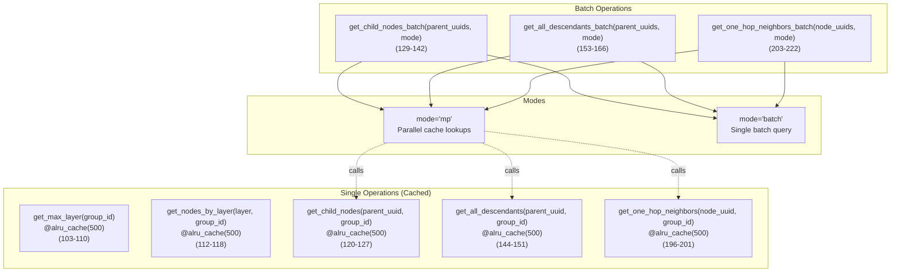
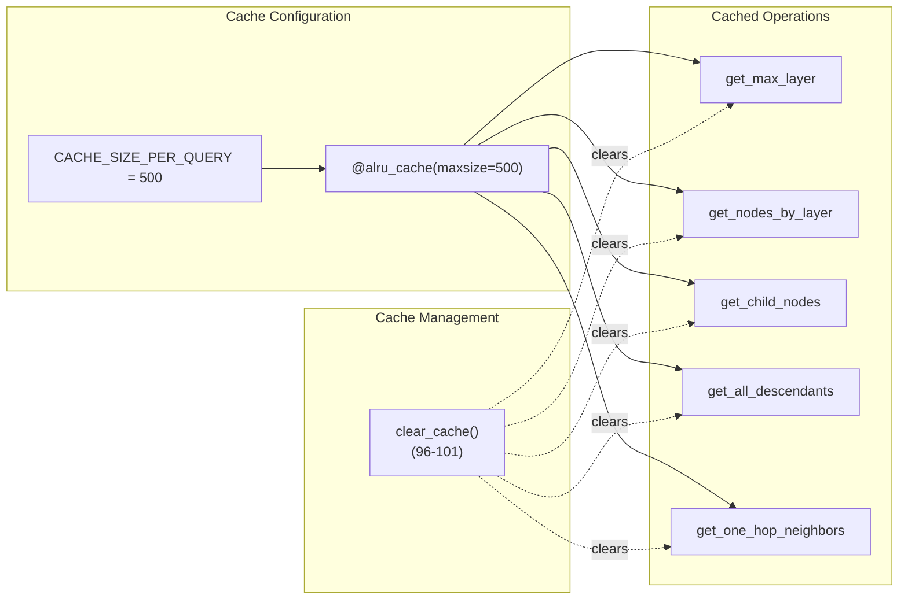
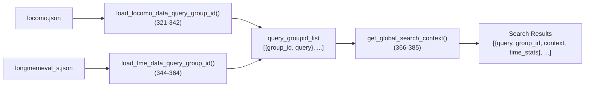

<!-- source: DeepWiki mcp.deepwiki.com · repo microsoft/Mnemis · page 2.3 System-2 Global Selection · fetched 2026-10-26 -->

# System-2 Global Selection

<details>
<summary>Relevant source files</summary>

The following files were used as context for generating this wiki page:

- [README.md](README.md)
- [global_selection/global_selector.py](global_selection/global_selector.py)
- [global_selection/prompts.py](global_selection/prompts.py)

</details>


## Purpose and Scope

This page documents System-2 Global Selection, the deliberate top-down hierarchical traversal mechanism that enables global reasoning over the knowledge graph. System-2 performs layer-by-layer LLM-guided filtering of semantic categories to identify structurally relevant memory items, complementing System-1's similarity-based retrieval.

For information about System-1's similarity search mechanism, see [System-1 Similarity Search](#2.2). For details on how System-1 and System-2 results are combined, see [RAG_GRAPH Merge Strategy](#2.4). For implementation details and API reference, see [GlobalSelector Class Reference](#3.1).

**Sources:** [README.md:15-29](), [global_selection/global_selector.py:1-319]()

---

## Overview

System-2 Global Selection implements deliberate, analytical memory retrieval by traversing the hierarchical graph from abstract semantic categories down to concrete entities. At each layer, an LLM evaluates which nodes are relevant to the query, enabling intelligent pruning of irrelevant branches while maintaining comprehensive coverage of relevant information.

The implementation centers on the `GlobalSelector` class, which orchestrates:
1. **Top-down hierarchical traversal** through category layers
2. **LLM-guided node selection** at each layer using structured prompts
3. **Shortcut mechanisms** to efficiently retrieve entire subtrees
4. **Context expansion** via one-hop neighbor retrieval
5. **Optimization** through caching and batch processing

**Sources:** [global_selection/global_selector.py:90-319](), [README.md:20-23]()

---

## System Architecture

### Core Components



**Sources:** [global_selection/global_selector.py:22-94]()

### Data Model Structure

The system uses Pydantic models for type-safe LLM responses:

| Model | Fields | Purpose |
|-------|--------|---------|
| `NodeSelection` | `name: str`<br/>`uuid: str`<br/>`get_all_children: bool` | Represents a single selected node with optional subtree retrieval flag |
| `NodeSelectionList` | `selections: list[NodeSelection]` | Container for LLM's structured selection response |
| `GlobalSelectorConfig` | `use_summary: bool`<br/>`use_tag: bool` | Configuration for node metadata inclusion |

**Sources:** [global_selection/global_selector.py:22-88]()

---

## Hierarchical Traversal Algorithm

### Global Selection Flow

The `global_selection` method implements the complete traversal algorithm:



**Sources:** [global_selection/global_selector.py:267-319]()

### Algorithm Steps

The traversal proceeds as follows:

1. **Initialization** [global_selector.py:271](): Query the hierarchical graph for maximum layer depth
2. **Layer Iteration** [global_selector.py:277](): Iterate from highest layer down to layer 1
3. **Node Retrieval**:
   - Top layer [global_selector.py:279](): Get all category nodes at max_layer
   - Subsequent layers [global_selector.py:281](): Get children of previously selected nodes
4. **LLM Selection** [global_selector.py:285](): Invoke `layer_selection` to filter relevant nodes
5. **Shortcut Processing** [global_selector.py:289](): Retrieve all descendants for nodes marked with `get_all_children=true`
6. **Context Expansion** [global_selector.py:299](): Retrieve one-hop neighbors (episodes and edges) for all selected nodes
7. **Result Formatting** [global_selector.py:302-318](): Format timestamps and organize output

**Sources:** [global_selection/global_selector.py:267-319]()

---

## LLM-Guided Node Selection

### Layer Selection Mechanism

The `layer_selection` method uses LLM intelligence to evaluate node relevance:



**Sources:** [global_selection/global_selector.py:224-265]()

### Prompt Template Structure

The `NODE_SELECTION_PROMPT_TEMPLATE` guides the LLM's selection criteria:

```
You are analyzing a hierarchical knowledge graph to help answer a user query.

Select all nodes that could help answer the query. A node is helpful if it:
- Directly relates to the query
- Covers a clearly relevant topic, concept, or category
- Provides useful background or context
- Contains user-specific information (e.g. interests, goals, constraints)
- Likely has sub-nodes that may be helpful

Do not be overly strict: include nodes that might provide context or personalization...

For each selected node:
- "name" is the node's name
- "uuid" is the node's unique identifier
- "get_all_children" is a boolean value. Set true only if you're confident all its 
  sub-nodes are helpful
```

**Sources:** [global_selection/prompts.py:1-23]()

### Selection Process Details

1. **Metadata Preparation** [global_selector.py:225-235]():
   - Filter node attributes based on `GlobalSelectorConfig`
   - Always include: `uuid`, `name`
   - Conditionally include: `tag`, `summary`

2. **LLM Invocation** [global_selector.py:241-245]():
   - Format prompt with query and node metadata
   - Use structured output with `response_model=NodeSelectionList`
   - Returns type-safe Pydantic objects

3. **Node Matching** [global_selector.py:254-260]():
   - Primary matching by UUID
   - Fallback matching by name
   - Warning logged if no match found

4. **Classification** [global_selector.py:261-264]():
   - Nodes with `get_all_children=false`: Continue traversal to children
   - Nodes with `get_all_children=true`: Retrieve entire subtree immediately

**Sources:** [global_selection/global_selector.py:224-265]()

---

## Graph Query Operations

### Query Template Catalog

The `Query` class defines Cypher templates for graph operations:

| Method | Query Template | Purpose |
|--------|---------------|---------|
| `get_max_layer` | `GET_MAX_LAYER` [30-34]() | Find highest layer in hierarchy |
| `get_nodes_by_layer` | `GET_NODES_BY_LAYER` [36-39]() | Retrieve all nodes at specific layer |
| `get_child_nodes` | `GET_CHILD_NODES` [41-44]() | Get immediate children of a category |
| `get_all_descendants` | `GET_ALL_DESCENDANTS` [51-54]() | Recursively get all descendants |
| `get_one_hop_neighbors` | `GET_ONE_HOP_EPISODES` [61-65]()<br/>`GET_ONE_HOP_NODES_AND_EDGES` [73-77]() | Retrieve episodes and related entities |

**Sources:** [global_selection/global_selector.py:30-83]()

### Node Retrieval Methods



**Sources:** [global_selection/global_selector.py:103-222]()

### Cypher Query Examples

**Get Child Nodes:**
```cypher
match (parent:Category)-[:CATEGORIZES]->(child:Category|Entity) 
where parent.group_id = $group_id and parent.uuid = $parent_uuid
return distinct child.uuid, child.name, child.tag, child.summary, child.layer
```

**Get All Descendants (Recursive):**
```cypher
match (parent:Category|Entity)-[:CATEGORIZES*1..]->(child:Category|Entity) 
where parent.group_id = $group_id and parent.uuid = $parent_uuid
return distinct child.uuid, child.name, child.tag, child.summary
```

**Get One-Hop Episodes:**
```cypher
match (n)-[:MENTIONS]-(m:Episodic)
where n.group_id = $group_id and n.uuid = $node_uuid
return distinct m.uuid, m.content, m.valid_at
```

**Get One-Hop Edges and Entities:**
```cypher
match (n)-[r:RELATES_TO]-(m:Entity)
where n.group_id = $group_id and n.uuid = $node_uuid
return r.uuid as fact_uuid, r.fact, r.valid_at, r.invalid_at, 
       m.uuid as entity_uuid, m.name, m.tag, m.summary
```

**Sources:** [global_selection/global_selector.py:30-83]()

---

## Optimization Strategies

### Caching Architecture

The system uses `alru_cache` (async LRU cache) to minimize database queries:



**Caching Strategy:**
- **Cache Size:** 500 entries per query operation [global_selector.py:20]()
- **Scope:** Individual cached methods operate independently
- **Invalidation:** Manual via `clear_cache()` method [global_selector.py:96-101]()
- **Benefit:** Eliminates redundant database queries for identical parameters

**Sources:** [global_selection/global_selector.py:20](), [global_selection/global_selector.py:96-101](), [global_selection/global_selector.py:103-201]()

### Batch Processing Modes

Batch operations support two execution modes:

| Mode | Implementation | Use Case |
|------|---------------|----------|
| `mp` (multiprocessing) | Parallel `asyncio.gather()` of cached single operations | Maximizes cache hits when many UUIDs overlap with cache |
| `batch` | Single Cypher query with `IN` clause | More efficient for cold cache or distinct UUID sets |

**Mode Selection Logic:**

```python
async def get_child_nodes_batch(self, parent_uuids: list[str], 
                                group_id: str, 
                                mode: Literal['mp', 'batch'] = 'mp') -> list[dict]:
    if mode == 'mp':
        # Leverage cache via parallel single operations
        tasks = [self.get_child_nodes(uuid, group_id=group_id) 
                 for uuid in parent_uuids]
        results = await asyncio.gather(*tasks)
        return list({item['uuid']: item for sublist in results 
                     for item in sublist}.values())
    elif mode == 'batch':
        # Single database query with batch parameters
        result = await self.driver.execute_query(
            Query.GET_CHILD_NODES_BATCH,
            group_id=group_id,
            parent_uuids=parent_uuids
        )
        return [dict(record) for record in result.records]
```

**Sources:** [global_selection/global_selector.py:129-166](), [global_selection/global_selector.py:203-222]()

### Concurrent Execution

The evaluation harness demonstrates concurrent query processing:

```python
async def get_global_search_context(query_groupid_list, 
                                   global_searcher: GlobalSelector, 
                                   max_concurrent=5):
    semaphore = asyncio.Semaphore(max_concurrent)
    
    async def search_with_semaphore(query_data):
        async with semaphore:
            # ... perform search
    
    tasks = [search_with_semaphore(query_data) 
             for query_data in query_groupid_list]
    search_results = await asyncio.gather(*tasks)
```

**Concurrency Parameters:**
- **Semaphore Control:** `max_concurrent=5` for general use [global_selector.py:366-385]()
- **Evaluation Batching:** `batch_size=50` (LoCoMo), `batch_size=30` (LongMemEval-S) [global_selector.py:390-429]()
- **Connection Pool:** Neo4j driver configured with `max_connection_pool_size=1000` [global_selector.py:435]()

**Sources:** [global_selection/global_selector.py:366-449]()

---

## Output Structure

### Result Format

The `global_selection` method returns a tuple of `(results, time_stats)`:

```python
results = {
    'episodes': [
        {
            'uuid': str,
            'content': str,
            'valid_at': str  # Formatted: "%Y/%m/%d (%a) %H:%M"
        },
        ...
    ],
    'edges': [
        {
            'uuid': str,
            'fact': str,
            'valid_at': str,
            'invalid_at': str | None
        },
        ...
    ],
    'nodes': [
        {
            'uuid': str,
            'name': str,
            'tag': str,
            'summary': str
        },
        ...
    ]
}

time_stats = {
    'init': float,              # Time to get max_layer
    'layer_selection': float,   # Time for all layer traversals
    'one_hop_neighbors': float  # Time to retrieve neighbors
}
```

**Sources:** [global_selection/global_selector.py:302-319]()

### Timestamp Formatting

Temporal information is formatted for human readability:

```python
def format(item: dict):
    if item.get('valid_at') and type(item['valid_at']) != str:
        item['valid_at'] = item['valid_at'].strftime("%Y/%m/%d (%a) %H:%M")
    if item.get('invalid_at') and type(item['invalid_at']) != str:
        item['invalid_at'] = item['invalid_at'].strftime("%Y/%m/%d (%a) %H:%M")
    return item
```

Example: `2024/03/15 (Fri) 14:30`

**Sources:** [global_selection/global_selector.py:302-307]()

---

## Integration with Evaluation Pipeline

### Dataset Loading

The module provides utilities for benchmark dataset integration:



**Functions:**
- `load_locomo_data_query_group_id(file_path, group_id_prefix)` [321-342](): Loads LoCoMo dataset, returns 1,986 query-group_id pairs
- `load_lme_data_query_group_id(file_path, group_id_prefix)` [344-364](): Loads LongMemEval-S dataset, returns 500 query-group_id pairs
- `get_global_search_context(query_groupid_list, global_searcher, max_concurrent)` [366-385](): Batch processes queries with concurrency control

**Sources:** [global_selection/global_selector.py:321-385]()

### Batch Evaluation

The `parse_locomo` and `parse_lme` functions demonstrate production evaluation:

```python
async def parse_locomo(selector: GlobalSelector):
    group_id_prefix = 'locomo_mnemis_coreAI_tel_b20_nec_full'
    max_concurrent = 10
    batch_size = 50
    output_path = '/data/zh/gs/v2_locomo_mnemis_coreAI_tel_b20_nec_full.json'
    
    query_groupid_list = load_locomo_data_query_group_id(
        'data/locomo.json', 
        group_id_prefix=group_id_prefix
    )
    
    with open(output_path, 'w', encoding='utf-8') as output_file:
        for i in tqdm(range(0, all_data_count, batch_size)):
            batch = query_groupid_list[i:i + batch_size]
            search_results = await get_global_search_context(
                batch, selector, max_concurrent=max_concurrent
            )
            for result in search_results:
                print(json.dumps(result, ensure_ascii=False), file=output_file)
```

**Configuration:**
- **LoCoMo:** 50 queries per batch, 10 concurrent operations [387-407]()
- **LongMemEval-S:** 30 queries per batch, 10 concurrent operations [409-429]()
- **Output Format:** JSONL (one JSON object per line)

**Sources:** [global_selection/global_selector.py:387-429]()

---

## Usage Example

### Basic Initialization and Execution

```python
from neo4j import AsyncGraphDatabase
from graphiti_core.llm_client import OpenAIClient
from openai import AsyncOpenAI
from global_selection.global_selector import GlobalSelector

# Initialize Neo4j driver
driver = AsyncGraphDatabase.driver(
    'bolt://localhost:7687',
    auth=('username', 'password'),
    max_connection_pool_size=1000
)

# Initialize LLM client
raw_client = AsyncOpenAI(base_url="...", api_key="...")
llm_client = OpenAIClient(client=raw_client)

# Create GlobalSelector
selector = GlobalSelector(driver, llm_client)

# Execute global selection
results, time_stats = await selector.global_selection(
    query="What restaurants did the user like?",
    group_id="user_12345"
)

# Access results
for episode in results['episodes']:
    print(f"Episode: {episode['content']}")
    
for edge in results['edges']:
    print(f"Fact: {edge['fact']}")
    
for node in results['nodes']:
    print(f"Entity: {node['name']} ({node['tag']})")

# Performance metrics
print(f"Init time: {time_stats['init']}s")
print(f"Layer selection time: {time_stats['layer_selection']}s")
print(f"Neighbor retrieval time: {time_stats['one_hop_neighbors']}s")
```

**Sources:** [global_selection/global_selector.py:431-449]()

---

## Performance Characteristics

### Time Complexity

The traversal algorithm exhibits the following characteristics:

| Operation | Complexity | Notes |
|-----------|-----------|-------|
| Layer traversal | O(L) | L = number of layers (typically 3-5) |
| LLM selection per layer | O(N) | N = nodes at current layer |
| Child retrieval | O(S) | S = number of selected nodes |
| Descendant retrieval | O(D × S') | D = average subtree depth, S' = shortcut nodes |
| One-hop expansion | O(S × E) | E = average edges per node |

**Optimization Impact:**
- **Cache Hit Rate:** Dramatically reduces database queries for repeated UUID patterns
- **Batch Mode:** Reduces network round-trips for large parent_uuid sets
- **Concurrent Execution:** Enables parallel processing of independent queries

**Sources:** [global_selection/global_selector.py:267-319]()

### Typical Statistics

Based on evaluation runs:

- **Average layers traversed:** 3-4 layers
- **Nodes evaluated per layer:** 10-50 nodes
- **Selection rate:** 20-40% of nodes per layer
- **Shortcut usage:** 5-15% of selections
- **Final node count:** 20-60 nodes (typical graph_top_k values)
- **Episodes retrieved:** Variable, depends on node connectivity
- **Total execution time:** 2-5 seconds per query (with network latency)

**Sources:** [README.md:31-40]()

---

