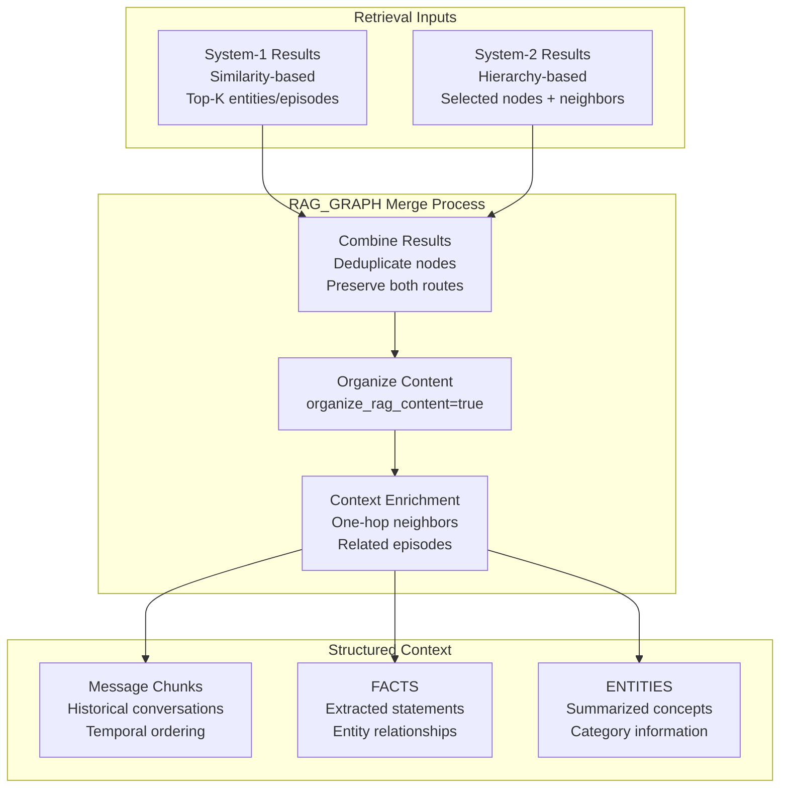
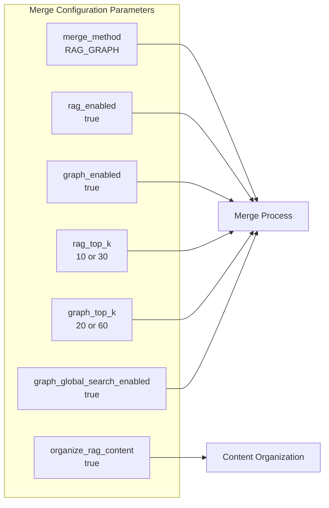
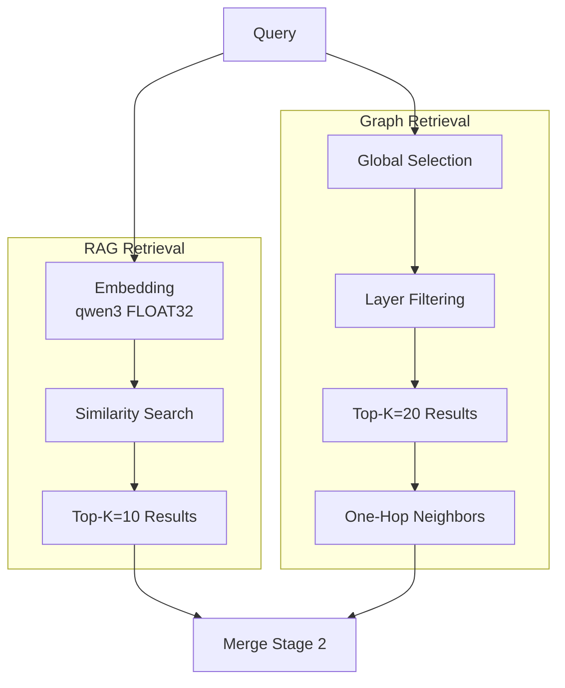
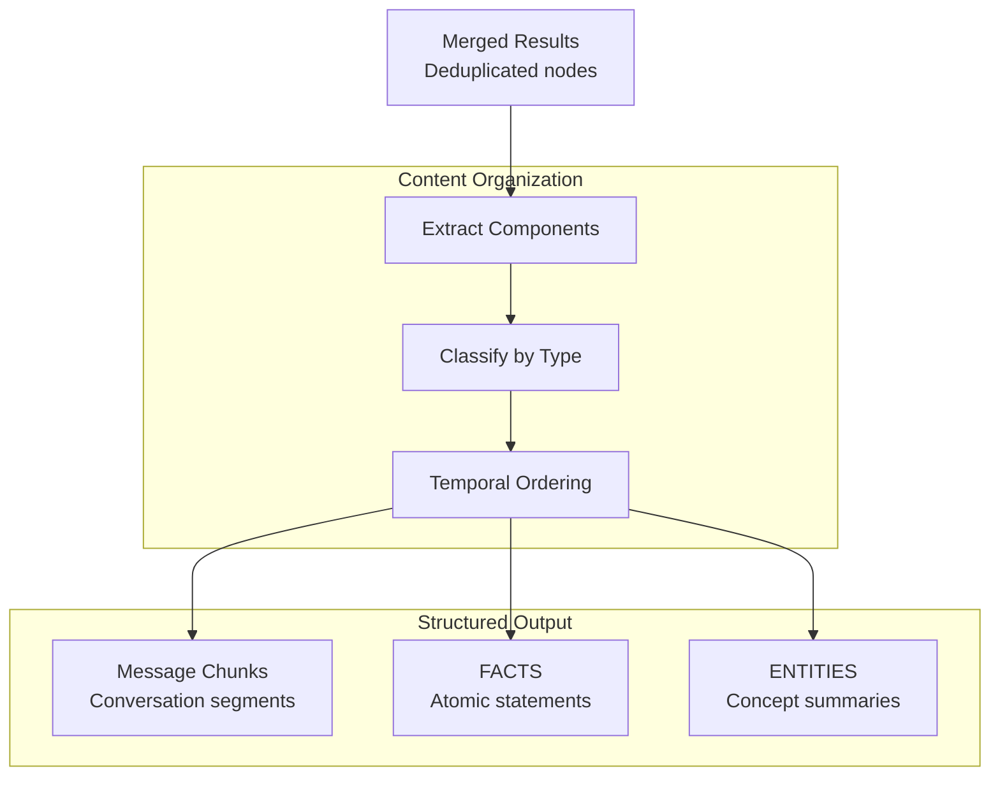
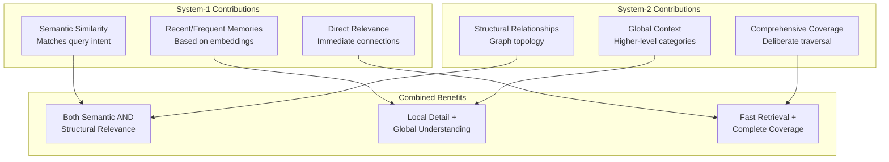
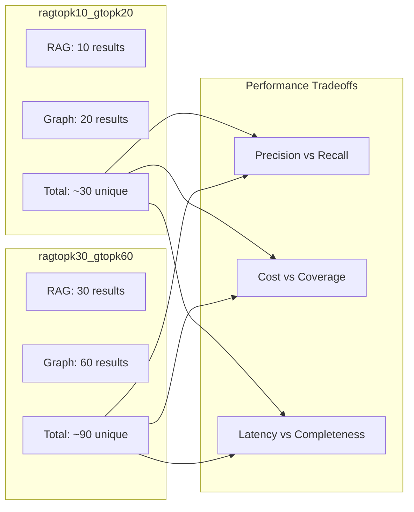
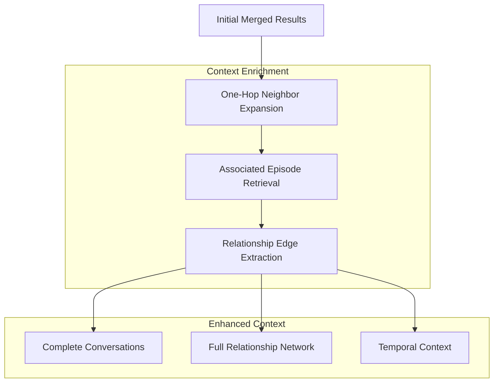
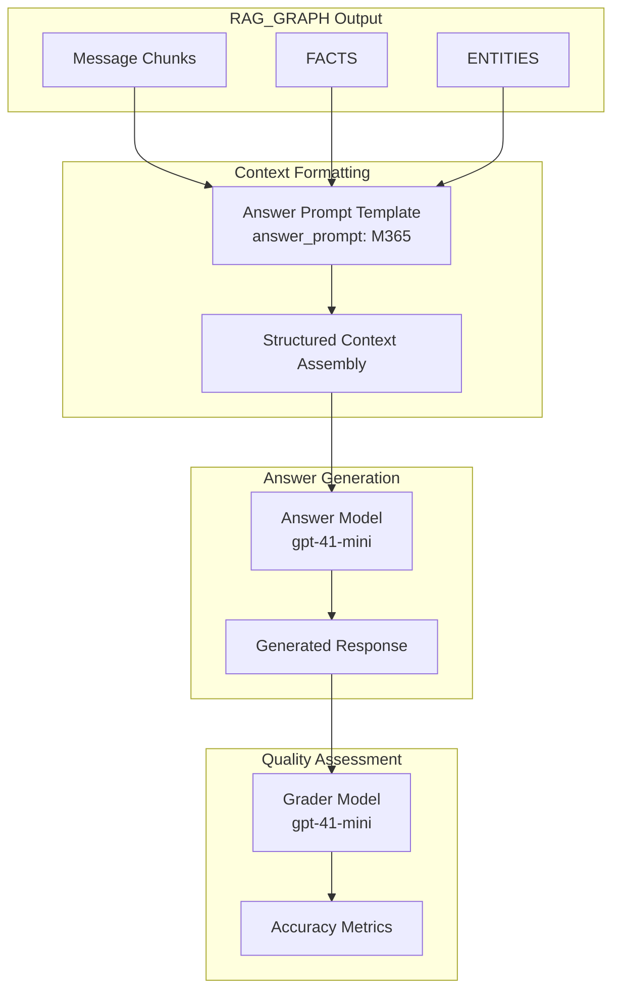

<!-- source: DeepWiki mcp.deepwiki.com · repo microsoft/Mnemis · page 2.4 RAG_GRAPH Merge Strategy · fetched 2026-10-26 -->

# RAG_GRAPH Merge Strategy

Relevant source files

The following files were used as context for generating this wiki page:

- [README.md](README.md)
- [results/locomo/metrics_graphiti_gpt-41-mini-shortco-2025-04-14-Bing_gpt-41-mini-shortco-2025-04-14-Bing_ragtopk10_gtopk20_RAG_GRAPH.json](results/locomo/metrics_graphiti_gpt-41-mini-shortco-2025-04-14-Bing_gpt-41-mini-shortco-2025-04-14-Bing_ragtopk10_gtopk20_RAG_GRAPH.json)

## Purpose and Scope

This page documents the RAG_GRAPH merge strategy, which combines retrieval results from System-1 similarity search and System-2 global selection to produce comprehensive memory context. The merge operation ensures that retrieved memories are both semantically similar (System-1) and structurally relevant (System-2) to the query.

For details on the individual retrieval systems that feed into this merge, see [System-1 Similarity Search](#2.2) and [System-2 Global Selection](#2.3). For information on the underlying memory structures, see [Memory Components](#2.1). For configuration of merge parameters, see [Configuration Options](#3.4).

**Sources:** [README.md:26-26]()

## Overview

The RAG_GRAPH merge strategy is the culmination of Mnemis's dual-route architecture. It takes two distinct sets of retrieval results—one from fast, intuitive similarity search and another from deliberate, hierarchical traversal—and combines them into a unified memory context. This hybrid approach addresses the limitations of pure similarity-based retrieval by incorporating global reasoning and structural relationships.

**Sources:** [README.md:15-23](), [results/locomo/metrics_graphiti_gpt-41-mini-shortco-2025-04-14-Bing_gpt-41-mini-shortco-2025-04-14-Bing_ragtopk10_gtopk20_RAG_GRAPH.json:17-31]()

## Input Sources

The RAG_GRAPH merge strategy receives input from two parallel retrieval routes:

### System-1 Input (RAG Path)

System-1 provides similarity-based retrieval results consisting of:

| Component | Description | Configuration Parameter |
|-----------|-------------|------------------------|
| **Top-K Entities** | Most similar entities based on embedding distance | `rag_top_k` (10 or 30) |
| **Associated Episodes** | Episodic nodes mentioning retrieved entities | Automatic expansion |
| **Similarity Scores** | Numerical relevance scores from embedding search | Used for ranking |

The retrieval uses embeddings (qwen3 with FLOAT32 precision) to find entities semantically similar to the query.

### System-2 Input (Graph Path)

System-2 provides hierarchical traversal results consisting of:

| Component | Description | Configuration Parameter |
|-----------|-------------|------------------------|
| **Selected Nodes** | LLM-selected nodes from hierarchical traversal | `graph_top_k` (20 or 60) |
| **One-Hop Neighbors** | Episodes and edges connected to selected nodes | Automatic expansion |
| **Category Context** | Parent/child category relationships | From hierarchical structure |

The retrieval uses `graph_global_search_enabled=true` to perform top-down traversal with LLM-guided selection at each layer.

**Sources:** [results/locomo/metrics_graphiti_gpt-41-mini-shortco-2025-04-14-Bing_gpt-41-mini-shortco-2025-04-14-Bing_ragtopk10_gtopk20_RAG_GRAPH.json:17-25]()

## Merge Configuration

The configuration shown in evaluation results demonstrates the merge strategy parameters:

| Parameter | Value | Purpose |
|-----------|-------|---------|
| `merge_method` | `"RAG_GRAPH"` | Specifies the merge algorithm |
| `rag_enabled` | `true` | Enables System-1 retrieval |
| `graph_enabled` | `true` | Enables System-2 retrieval |
| `rag_top_k` | `10` or `30` | Number of similarity-based results |
| `graph_top_k` | `20` or `60` | Number of hierarchy-based results |
| `organize_rag_content` | `true` | Enables structured content organization |
| `graph_global_search_enabled` | `true` | Enables hierarchical traversal |

**Sources:** [results/locomo/metrics_graphiti_gpt-41-mini-shortco-2025-04-14-Bing_gpt-41-mini-shortco-2025-04-14-Bing_ragtopk10_gtopk20_RAG_GRAPH.json:17-31]()

## Merge Process

The RAG_GRAPH merge operates through several stages to combine and organize results from both retrieval routes:

### Stage 1: Result Collection

Both retrieval systems operate in parallel on the query, producing their respective top-k results.

### Stage 2: Deduplication and Combination

The merge process combines results while handling overlaps:

- **Deduplication**: When the same entity or episode appears in both System-1 and System-2 results, it is included once but tagged with provenance from both routes
- **Complementary Coverage**: Unique results from each system are preserved, ensuring comprehensive coverage
- **Score Preservation**: Similarity scores from System-1 and selection rationale from System-2 are maintained

### Stage 3: Content Organization

With `organize_rag_content=true`, the merged results undergo structured organization:

**Sources:** [results/locomo/metrics_graphiti_gpt-41-mini-shortco-2025-04-14-Bing_gpt-41-mini-shortco-2025-04-14-Bing_ragtopk10_gtopk20_RAG_GRAPH.json:27-30]()

## Output Structure

The RAG_GRAPH merge produces a structured memory context organized into three components:

### Message Chunks

Historical conversation segments retrieved as complete contextual units:

| Property | Description |
|----------|-------------|
| **Content** | Raw conversation text from episodic nodes |
| **Temporal Order** | Chronologically sorted based on creation timestamps |
| **Source** | Provenance tracking (System-1, System-2, or both) |
| **Context** | Surrounding messages for continuity |

Message chunks preserve the conversational flow and allow the LLM to understand the original interaction context.

### FACTS

Atomic factual statements extracted from retrieved memories:

| Property | Description |
|----------|-------------|
| **Statement** | Discrete fact or relationship |
| **Entities** | Involved entities with roles |
| **Temporal** | Time-based validity information |
| **Source** | Originating episode or entity node |

Facts provide granular, queryable information that can be directly referenced in answers.

### ENTITIES

Summarized conceptual information about retrieved entities:

| Property | Description |
|----------|-------------|
| **Summary** | High-level description of the entity |
| **Categories** | Hierarchical category assignments from System-2 |
| **Attributes** | Key properties and characteristics |
| **Relationships** | Connections to other entities |

Entity summaries provide conceptual understanding and semantic context for the retrieved information.

**Sources:** [README.md:15-23]()

## Complementary Strengths

The RAG_GRAPH merge leverages the distinct advantages of each retrieval route:

### System-1 Strengths in the Merge

- **Semantic Matching**: Finds memories with similar language and concepts to the query
- **Efficiency**: Fast embedding-based search provides immediate results
- **Recency Bias**: Naturally surfaces recent or frequently accessed memories
- **Direct Connections**: Captures explicitly mentioned entities and relationships

### System-2 Strengths in the Merge

- **Structural Reasoning**: Identifies memories through hierarchical relationships
- **Global Coverage**: Ensures comprehensive information gathering across semantic categories
- **Implicit Relevance**: Discovers memories not directly similar but structurally connected
- **Category Context**: Provides higher-level understanding through hierarchical categories

### Synergistic Effects

The combination produces results that neither system alone could achieve:

1. **Reduced False Negatives**: System-2 catches relevant memories missed by similarity search
2. **Enhanced Context**: Hierarchical categories from System-2 enrich semantically similar results from System-1
3. **Balanced Retrieval**: Combines fast intuition (System-1) with thorough reasoning (System-2)
4. **Comprehensive Evidence**: Both direct matches and indirect relationships support answer generation

**Sources:** [README.md:15-23]()

## Parameter Tuning Impact

The merge behavior can be tuned through top-k parameters:

| Configuration | rag_top_k | graph_top_k | Use Case | Performance |
|---------------|-----------|-------------|----------|-------------|
| **Balanced** | 10 | 20 | General purpose retrieval | 80.0% accuracy (LoCoMo) |
| **Comprehensive** | 30 | 60 | Maximum coverage scenarios | Higher recall, more context |

### Configuration Considerations

**Lower top-k values (10/20)**:
- Faster retrieval and lower LLM processing cost
- More precise, focused context
- Suitable for queries with clear intent
- May miss peripheral relevant information

**Higher top-k values (30/60)**:
- More comprehensive memory coverage
- Better for complex, multi-faceted queries
- Increased LLM token consumption
- May include less relevant information

For detailed analysis of configuration impact, see [Configuration Impact Analysis](#4.4).

**Sources:** [results/locomo/metrics_graphiti_gpt-41-mini-shortco-2025-04-14-Bing_gpt-41-mini-shortco-2025-04-14-Bing_ragtopk10_gtopk20_RAG_GRAPH.json:21-22]()

## Context Enrichment

The merge process includes context enrichment beyond the initial retrieval results:

### Enrichment Operations

1. **One-Hop Neighbor Expansion**: For each retrieved entity, include directly connected nodes
2. **Episode Inclusion**: Add episodic nodes that mention retrieved entities
3. **Relationship Edges**: Include explicit relationship edges (MENTIONS, RELATES_TO, CATEGORIZES)
4. **Temporal Context**: Preserve temporal ordering and time-based relationships

This enrichment ensures that the final context includes not just isolated nodes but their immediate relational context, providing the LLM with a more complete information graph for answer generation.

**Sources:** [results/locomo/metrics_graphiti_gpt-41-mini-shortco-2025-04-14-Bing_gpt-41-mini-shortco-2025-04-14-Bing_ragtopk10_gtopk20_RAG_GRAPH.json:17-31]()

## Integration with Answer Generation

The merged context flows into the answer generation pipeline:

The structured output from RAG_GRAPH merge is formatted according to the answer prompt template (M365 in the evaluated configuration) and provided to the answer model. The clear separation of Message Chunks, FACTS, and ENTITIES allows the LLM to:

- Reference specific conversational contexts
- Cite discrete factual statements
- Leverage conceptual summaries for reasoning

This structured approach, combined with the dual-route retrieval, contributes to Mnemis's state-of-the-art performance: 93.9% accuracy on LoCoMo (excluding category 5) and 91.6% on LongMemEval-S.

**Sources:** [results/locomo/metrics_graphiti_gpt-41-mini-shortco-2025-04-14-Bing_gpt-41-mini-shortco-2025-04-14-Bing_ragtopk10_gtopk20_RAG_GRAPH.json:1-73](), [README.md:15-23]()

## Key Design Decisions

The RAG_GRAPH merge strategy embodies several important design choices:

### Union-Based Merge

The strategy uses a union approach rather than intersection, ensuring that relevant memories from either route are included. This maximizes recall while maintaining precision through the dual validation of having multiple retrieval paths.

### Structured Organization

The `organize_rag_content=true` setting triggers automatic organization into Message Chunks, FACTS, and ENTITIES. This structuring:
- Makes context more interpretable for LLMs
- Enables different reasoning strategies for different information types
- Improves answer generation quality

### Provenance Tracking

The merge preserves information about which route(s) retrieved each piece of memory, enabling:
- Debugging and analysis of retrieval patterns
- Understanding complementarity between routes
- Future optimization of retrieval parameters

### Scalable Parameters

The configurable top-k parameters (`rag_top_k` and `graph_top_k`) allow the merge to scale from focused, efficient retrieval to comprehensive, thorough coverage based on application requirements.

**Sources:** [results/locomo/metrics_graphiti_gpt-41-mini-shortco-2025-04-14-Bing_gpt-41-mini-shortco-2025-04-14-Bing_ragtopk10_gtopk20_RAG_GRAPH.json:17-31]()

---

