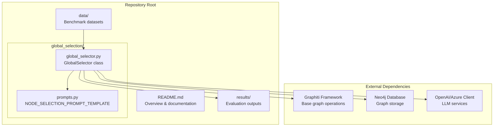
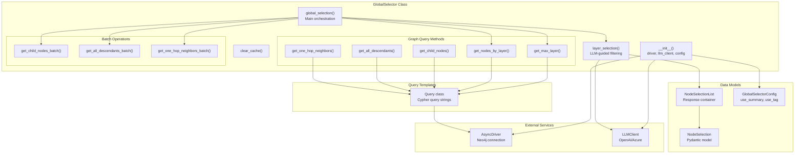
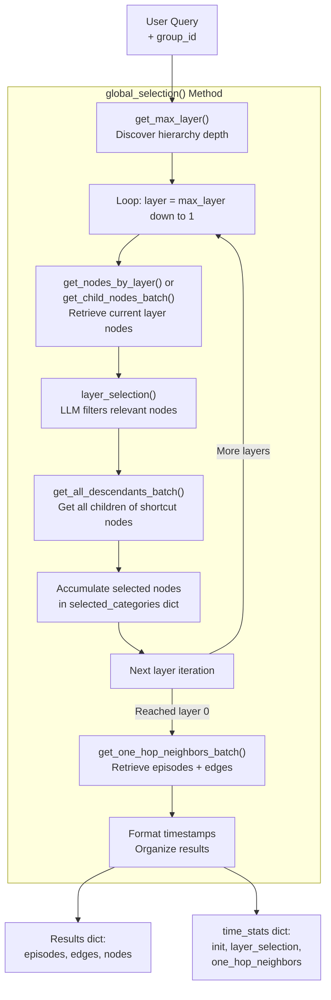
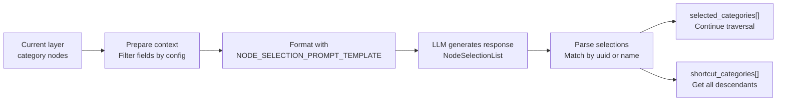
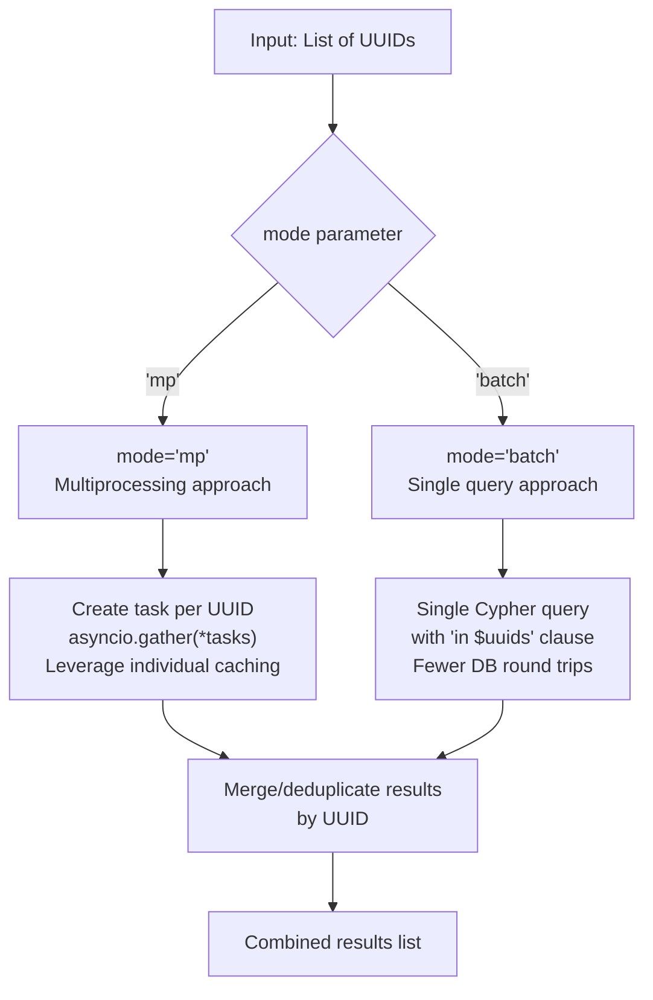

<!-- source: DeepWiki mcp.deepwiki.com · repo microsoft/Mnemis · page 3 Implementation Guide · fetched 2026-10-26 -->

# Implementation Guide

<details>
<summary>Relevant source files</summary>

The following files were used as context for generating this wiki page:

- [README.md](README.md)
- [global_selection/global_selector.py](global_selection/global_selector.py)
- [global_selection/prompts.py](global_selection/prompts.py)

</details>


This page provides technical guidance for working with the Mnemis codebase, focusing on the System-2 Global Selection implementation. It covers the repository structure, key classes, and practical usage patterns for integrating the dual-route retrieval system into applications.

For architectural concepts and theory behind System-2, see [System-2 Global Selection](#2.3). For detailed API documentation, see [GlobalSelector Class Reference](#3.1). For benchmark evaluation procedures, see [Running Evaluations](#6.3).

---

## Repository Structure

The Mnemis implementation is organized around the Global Selection module, which implements System-2's hierarchical traversal mechanism. The codebase builds upon the Graphiti framework for base graph operations.



**Core Implementation Files:**

| File Path | Purpose | Key Components |
|-----------|---------|----------------|
| `global_selection/global_selector.py` | System-2 implementation | `GlobalSelector`, `Query`, `NodeSelection` classes |
| `global_selection/prompts.py` | LLM prompt templates | `NODE_SELECTION_PROMPT_TEMPLATE` |
| `data/locomo.json` | LoCoMo benchmark dataset | 1,986 questions across 5 categories |
| `data/longmemeval_s.json` | LongMemEval-S benchmark | 500 questions across 6 types |
| `results/` | Evaluation results | Metrics and full context outputs |

**Sources:** [global_selection/global_selector.py:1-453](), [global_selection/prompts.py:1-23](), [README.md:1-72]()

---

## Core Components Architecture

The implementation centers around the `GlobalSelector` class, which orchestrates Neo4j database queries, LLM-based node selection, and caching operations.



**Key Classes and Their Roles:**

| Class | Location | Purpose |
|-------|----------|---------|
| `GlobalSelector` | [global_selection/global_selector.py:90-319]() | Main orchestrator for System-2 retrieval |
| `Query` | [global_selection/global_selector.py:30-83]() | Cypher query template container |
| `NodeSelection` | [global_selection/global_selector.py:22-25]() | Pydantic model for LLM selection output |
| `NodeSelectionList` | [global_selection/global_selector.py:27-28]() | Container for multiple selections |
| `GlobalSelectorConfig` | [global_selection/global_selector.py:85-87]() | Configuration for selection behavior |

**Sources:** [global_selection/global_selector.py:22-319]()

---

## Basic Usage Pattern

The typical workflow for using the Global Selection implementation follows this pattern:

### 1. Initialize Dependencies

```python
from neo4j import AsyncGraphDatabase
from graphiti_core.llm_client import OpenAIClient
from openai import AsyncOpenAI
from global_selection.global_selector import GlobalSelector

# Neo4j driver with connection pooling
driver = AsyncGraphDatabase.driver(
    'bolt://localhost:7687',
    auth=('username', 'password'),
    max_connection_pool_size=1000
)

# LLM client wrapper
raw_client = AsyncOpenAI(base_url="...", api_key="...")
llm_client = OpenAIClient(client=raw_client)

# GlobalSelector instance
selector = GlobalSelector(driver, llm_client)
```

### 2. Execute Global Selection

```python
# Run hierarchical traversal for a query
query = "What are my travel preferences?"
group_id = "user_123"

results, time_stats = await selector.global_selection(query, group_id)

# Results contain:
# - episodes: List of episodic memories (conversations)
# - edges: List of relationship facts
# - nodes: List of selected category/entity nodes
```

### 3. Process Retrieved Context

```python
print(f"Retrieved {len(results['episodes'])} episodes")
print(f"Retrieved {len(results['edges'])} facts")
print(f"Retrieved {len(results['nodes'])} nodes")

# Time statistics
print(f"Layer selection took: {time_stats['layer_selection']}s")
print(f"One-hop neighbor retrieval: {time_stats['one_hop_neighbors']}s")
```

**Sources:** [global_selection/global_selector.py:431-452](), [global_selection/global_selector.py:267-319]()

---

## Query Execution Flow

This diagram shows how a user query flows through the `global_selection()` method to produce retrieved context.



**Method Call Sequence:**

1. **Initialization** [global_selection/global_selector.py:268-272]()
   - `get_max_layer()` determines hierarchy depth
   
2. **Layer-by-Layer Traversal** [global_selection/global_selector.py:274-294]()
   - `get_nodes_by_layer()` or `get_child_nodes_batch()` retrieves candidates
   - `layer_selection()` uses LLM to filter relevant nodes
   - `get_all_descendants_batch()` handles shortcut selections
   
3. **Context Expansion** [global_selection/global_selector.py:298-300]()
   - `get_one_hop_neighbors_batch()` retrieves episodes and relationship edges
   
4. **Result Assembly** [global_selection/global_selector.py:302-318]()
   - Format timestamps
   - Organize into episodes, edges, and nodes

**Sources:** [global_selection/global_selector.py:267-319]()

---

## Database Query Operations

The `Query` class defines Cypher query templates used throughout the traversal process.

**Query Template Categories:**

| Query Constant | Purpose | Return Values |
|----------------|---------|---------------|
| `GET_MAX_LAYER` | Find maximum layer number | `max_layer` (int) |
| `GET_NODES_BY_LAYER` | Get all nodes at specific layer | `uuid`, `name`, `tag`, `summary` |
| `GET_CHILD_NODES` | Get direct children of parent | `uuid`, `name`, `tag`, `summary`, `layer` |
| `GET_CHILD_NODES_BATCH` | Batch version for multiple parents | Same as above |
| `GET_ALL_DESCENDANTS` | Get entire subtree | `uuid`, `name`, `tag`, `summary` |
| `GET_ALL_DESCENDANTS_BATCH` | Batch version for multiple parents | Same as above |
| `GET_ONE_HOP_EPISODES` | Get connected episodic nodes | `uuid`, `content`, `valid_at` |
| `GET_ONE_HOP_EPISODES_BATCH` | Batch version | Same as above |
| `GET_ONE_HOP_NODES_AND_EDGES` | Get connected entities + facts | `fact_uuid`, `fact`, `valid_at`, `invalid_at`, `entity_uuid`, `name`, `tag`, `summary` |
| `GET_ONE_HOP_NODES_AND_EDGES_BATCH` | Batch version | Same as above |

**Example Query Pattern:**

```cypher
# GET_CHILD_NODES
match (parent:Category)-[:CATEGORIZES]->(child:Category|Entity) 
where parent.group_id = $group_id and parent.uuid = $parent_uuid
return distinct child.uuid as uuid, child.name as name, 
       child.tag as tag, child.summary as summary, child.layer as layer
```

**Sources:** [global_selection/global_selector.py:30-83]()

---

## LLM-Based Node Selection

The `layer_selection()` method uses LLM intelligence to filter relevant nodes at each hierarchical level.



**Configuration Fields:**

The `GlobalSelectorConfig` controls what information the LLM receives:

```python
class GlobalSelectorConfig(BaseModel):
    use_summary: bool = False  # Include node.summary field
    use_tag: bool = True       # Include node.tag field
```

**Allowed Fields Based on Config:**
- Always included: `uuid`, `name`
- Conditional: `tag` (if `use_tag=True`), `summary` (if `use_summary=True`)

**LLM Response Model:**

Each selection specifies:
- `name`: Node's name
- `uuid`: Node's unique identifier  
- `get_all_children`: Boolean flag for shortcut (get entire subtree)

**Sources:** [global_selection/global_selector.py:224-265](), [global_selection/global_selector.py:85-87](), [global_selection/prompts.py:1-23]()

---

## Caching Strategy

The implementation uses `alru_cache` (async LRU cache) to minimize redundant database queries during hierarchical traversal.

**Cached Methods:**

| Method | Cache Size | Rationale |
|--------|------------|-----------|
| `get_max_layer()` | 500 per query | Hierarchy depth rarely changes |
| `get_nodes_by_layer()` | 500 per query | Layer contents stable during query |
| `get_child_nodes()` | 500 per query | Parent-child relationships stable |
| `get_all_descendants()` | 500 per query | Subtrees rarely change mid-query |
| `get_one_hop_neighbors()` | 500 per query | Node neighbors stable |

**Cache Management:**

```python
# Clear all caches when needed
selector.clear_cache()

# Individual method caches auto-managed by @alru_cache decorator
```

The `CACHE_SIZE_PER_QUERY` constant is set to 500 entries [global_selection/global_selector.py:20](). This provides substantial performance improvement for hierarchies with repeated node access patterns while maintaining bounded memory usage.

**Sources:** [global_selection/global_selector.py:20](), [global_selection/global_selector.py:96-101](), [global_selection/global_selector.py:103-222]()

---

## Batch Processing Modes

Many methods support two processing modes for handling multiple items:



**Mode Comparison:**

| Aspect | `mode='mp'` | `mode='batch'` |
|--------|-------------|----------------|
| **DB Queries** | N queries (one per UUID) | 1 query (batch clause) |
| **Caching** | Leverages `@alru_cache` per UUID | No per-item caching |
| **Concurrency** | High (asyncio.gather) | Single query execution |
| **Best For** | Repeated access patterns | One-time batch operations |

**Implementation Example:**

```python
# In get_child_nodes_batch()
if mode == 'mp':
    tasks = [self.get_child_nodes(uuid, group_id=group_id) 
             for uuid in parent_uuids]
    results = await asyncio.gather(*tasks)
    # Deduplicate by uuid
    return list({item['uuid']: item for sublist in results 
                 for item in sublist}.values())
elif mode == 'batch':
    result = await self.driver.execute_query(
        Query.GET_CHILD_NODES_BATCH,
        group_id=group_id,
        parent_uuids=parent_uuids
    )
    return [dict(record) for record in result.records]
```

The production implementation uses `mode='batch'` [global_selection/global_selector.py:269]() for optimal throughput during evaluation.

**Sources:** [global_selection/global_selector.py:129-222]()

---

## Dataset Loading Utilities

The module includes helper functions for loading benchmark datasets and running batch evaluations.

**LoCoMo Dataset Loading:**

```python
def load_locomo_data_query_group_id(file_path, group_id_prefix='locomo_ziyu'):
    """
    Returns: List of dicts with 'group_id' and 'query' keys
    """
```

Each user in the LoCoMo dataset gets a unique `group_id`, and each QA pair becomes a query record.

**LongMemEval-S Dataset Loading:**

```python
def load_lme_data_query_group_id(file_path, group_id_prefix='lme_s_ziyu'):
    """
    Returns: List of dicts with 'group_id', 'query', and 'question_id' keys
    """
```

**Batch Evaluation Framework:**

The `get_global_search_context()` function orchestrates concurrent query processing:

```python
async def get_global_search_context(
    query_groupid_list, 
    global_searcher: GlobalSelector, 
    max_concurrent=5
):
    """
    Args:
        query_groupid_list: List of query dicts
        global_searcher: GlobalSelector instance
        max_concurrent: Semaphore limit for concurrency
    
    Returns:
        List of dicts with query, group_id, context, time_stats
    """
```

Uses `asyncio.Semaphore` to limit concurrent executions and prevent overwhelming the Neo4j connection pool.

**Production Evaluation Pattern:**

```python
# Process dataset in batches
batch_size = 50
max_concurrent = 10

for i in range(0, total_queries, batch_size):
    batch = query_groupid_list[i:i + batch_size]
    search_results = await get_global_search_context(
        batch, selector, max_concurrent=max_concurrent
    )
    # Save results incrementally
```

**Sources:** [global_selection/global_selector.py:321-429]()

---

## Connection Pool Configuration

For high-throughput evaluation, the Neo4j driver requires adequate connection pooling:

```python
driver = AsyncGraphDatabase.driver(
    url='bolt://localhost:7687',
    auth=(user, password),
    max_connection_pool_size=1000  # Critical for concurrent operations
)
```

**Recommended Settings:**

| Parameter | Value | Rationale |
|-----------|-------|-----------|
| `max_connection_pool_size` | 1000 | Supports 10+ concurrent users with 50+ batch size |
| `max_concurrent` (semaphore) | 10 | Limits concurrent global_selection calls |
| `batch_size` | 30-50 | Balances throughput and memory |

The large connection pool is necessary because:
- Each `global_selection()` call makes multiple database queries
- Batch processing creates many concurrent database operations
- Cached operations still need connections for cache misses

**Sources:** [global_selection/global_selector.py:435]()

---

## Integration with Graphiti Framework

Mnemis builds upon the Graphiti framework, which provides:
- Base graph construction and maintenance
- Entity extraction from conversations
- Episodic memory storage
- LLM client abstraction (`LLMClient`, `OpenAIClient`)

The `GlobalSelector` extends Graphiti's capabilities by adding:
- Hierarchical graph traversal
- LLM-guided node selection
- Global selection retrieval mechanism

**Key Graphiti Dependencies:**

```python
from graphiti_core.llm_client import LLMClient, ModelSize, OpenAIClient
from graphiti_core.prompts.models import Message
```

The `LLMClient` provides:
- Standardized LLM API across OpenAI/Azure
- Response model parsing (Pydantic models)
- Token usage tracking

**Message Format:**

```python
messages = [Message(role='user', content=prompt)]
response = await llm_client.generate_response(
    messages=messages,
    response_model=NodeSelectionList,
    model_size=ModelSize.large
)
```

**Sources:** [global_selection/global_selector.py:16-18](), [global_selection/global_selector.py:241-245](), [README.md:54]()

---

## Next Steps

For detailed information on specific topics:

- **API Reference:** See [GlobalSelector Class Reference](#3.1) for complete method documentation
- **Graph Schema:** See [Graph Database Schema](#3.2) for Neo4j node and relationship types
- **Prompts:** See [Prompt Engineering](#3.3) for details on `NODE_SELECTION_PROMPT_TEMPLATE`
- **Configuration:** See [Configuration Options](#3.4) for all available settings
- **Performance:** See [Performance Optimization](#3.5) for advanced tuning strategies
- **Setup:** See [Installation & Setup](#6.1) for environment configuration
- **Usage:** See [Usage Examples](#6.2) for practical code examples

**Sources:** [README.md:1-72](), [global_selection/global_selector.py:1-453]()

---

