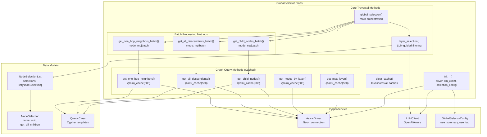
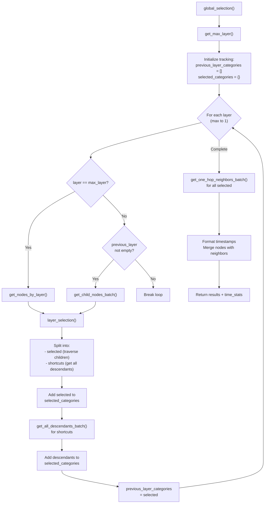
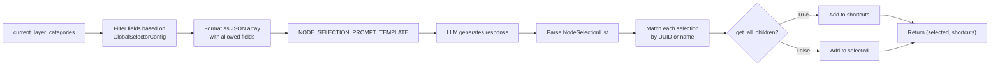
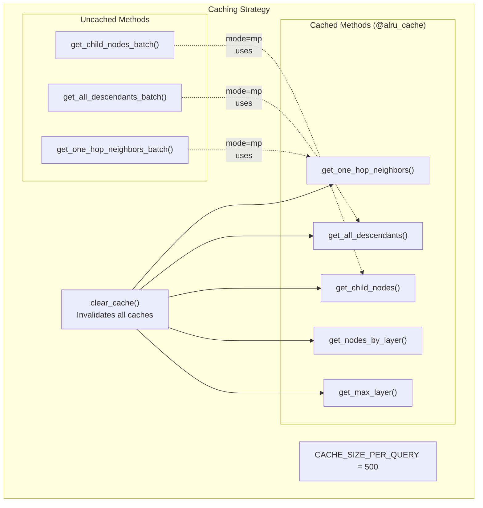
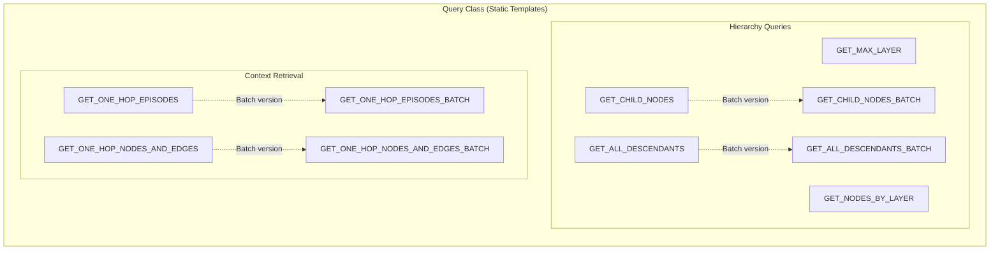
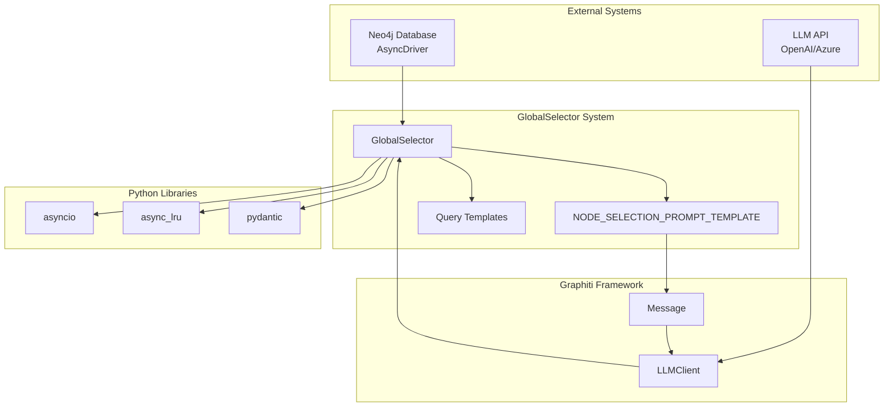

<!-- source: DeepWiki mcp.deepwiki.com · repo microsoft/Mnemis · page 3.1 GlobalSelector Class Reference · fetched 2026-10-26 -->

# GlobalSelector Class Reference

<details>
<summary>Relevant source files</summary>

The following files were used as context for generating this wiki page:

- [global_selection/global_selector.py](global_selection/global_selector.py)

</details>


This document provides comprehensive API documentation for the `GlobalSelector` class, which implements System-2's deliberate, top-down hierarchical graph traversal with LLM-guided node selection. This class is the core implementation enabling global reasoning over large knowledge graphs stored in Neo4j.

For conceptual understanding of System-2's role in the dual-route architecture, see [System-2 Global Selection](#2.3). For the prompt templates used in LLM-guided selection, see [Prompt Engineering](#3.3). For configuration options, see [Configuration Options](#3.4).

**Sources:** [global_selection/global_selector.py:1-453]()

---

## Class Architecture

The `GlobalSelector` class orchestrates hierarchical graph traversal through a combination of Neo4j graph queries, LLM-based decision making, and aggressive caching. The following diagram shows the class structure and key components:



**Sources:** [global_selection/global_selector.py:90-319]()

---

## Constructor and Configuration

### GlobalSelector.__init__()

```python
def __init__(
    self, 
    driver: AsyncDriver, 
    llm_client: LLMClient, 
    selection_config: GlobalSelectorConfig = GlobalSelectorConfig()
)
```

**Parameters:**

| Parameter | Type | Description |
|-----------|------|-------------|
| `driver` | `AsyncDriver` | Neo4j async driver instance for graph database operations |
| `llm_client` | `LLMClient` | LLM client for intelligent node selection (OpenAI/Azure) |
| `selection_config` | `GlobalSelectorConfig` | Configuration controlling node information visibility (optional) |

**Sources:** [global_selection/global_selector.py:91-94]()

### GlobalSelectorConfig

Configuration model controlling what node information is provided to the LLM during selection:

| Field | Type | Default | Description |
|-------|------|---------|-------------|
| `use_summary` | `bool` | `False` | Include node summaries in LLM prompt |
| `use_tag` | `bool` | `True` | Include node tags in LLM prompt |

**Sources:** [global_selection/global_selector.py:85-88]()

**Usage Example:**

```python
from neo4j import AsyncGraphDatabase
from graphiti_core.llm_client import OpenAIClient
from global_selection.global_selector import GlobalSelector, GlobalSelectorConfig

# Initialize dependencies
driver = AsyncGraphDatabase.driver(
    "bolt://localhost:7687", 
    auth=("neo4j", "password"),
    max_connection_pool_size=1000
)
llm_client = OpenAIClient(client=your_openai_client)

# Create selector with default config
selector = GlobalSelector(driver, llm_client)

# Or with custom config
config = GlobalSelectorConfig(use_summary=True, use_tag=True)
selector = GlobalSelector(driver, llm_client, selection_config=config)
```

**Sources:** [global_selection/global_selector.py:432-441]()

---

## Core Orchestration Methods

### global_selection()

The main entry point that orchestrates the complete top-down hierarchical traversal with LLM-guided selection at each layer.

```python
async def global_selection(
    self, 
    query: str, 
    group_id: str
) -> tuple[dict, dict]
```

**Parameters:**

| Parameter | Type | Description |
|-----------|------|-------------|
| `query` | `str` | User query for context-aware node selection |
| `group_id` | `str` | Graph partition identifier (e.g., user ID) |

**Returns:** Tuple of `(results, time_stats)`

**Results Dictionary Structure:**

| Key | Type | Description |
|-----|------|-------------|
| `episodes` | `list[dict]` | Episodic nodes (memories) connected to selected entities |
| `edges` | `list[dict]` | RELATES_TO relationships (facts) between entities |
| `nodes` | `list[dict]` | Selected category and entity nodes |

**Time Stats Dictionary:**

| Key | Description |
|-----|-------------|
| `init` | Time to initialize and get max layer |
| `layer_selection` | Total time for all layer selections |
| `one_hop_neighbors` | Time to retrieve neighbors of selected nodes |

**Algorithm Flow:**



**Sources:** [global_selection/global_selector.py:267-319]()

**Example Usage:**

```python
# Execute global selection
results, time_stats = await selector.global_selection(
    query="What movies has the user watched recently?",
    group_id="user_123"
)

# Access results
episodes = results['episodes']  # Memory chunks
edges = results['edges']        # Facts/relationships
nodes = results['nodes']        # Entities and categories

# Check performance
print(f"Layer selection took: {time_stats['layer_selection']:.2f}s")
print(f"Neighbor retrieval took: {time_stats['one_hop_neighbors']:.2f}s")
```

**Sources:** [global_selection/global_selector.py:267-319]()

---

### layer_selection()

LLM-guided selection of relevant nodes at a specific layer of the hierarchy.

```python
async def layer_selection(
    self, 
    query: str, 
    current_layer_categories: list[dict]
) -> tuple[list[dict], list[dict]]
```

**Parameters:**

| Parameter | Type | Description |
|-----------|------|-------------|
| `query` | `str` | User query for relevance determination |
| `current_layer_categories` | `list[dict]` | All nodes available at current layer |

**Returns:** Tuple of `(selected_categories, shortcut_categories)`

- `selected_categories`: Nodes to traverse further (continue to children)
- `shortcut_categories`: Nodes whose all descendants should be retrieved (pruning optimization)

**LLM Response Model:**

The LLM returns structured output conforming to `NodeSelectionList`:

```python
class NodeSelection(BaseModel):
    name: str              # Node name (for human readability)
    uuid: str              # Node UUID (for precise matching)
    get_all_children: bool # True = shortcut, False = continue traversal
```

**Selection Logic Flow:**



**Sources:** [global_selection/global_selector.py:224-265]()

**Field Visibility:**

The method respects `GlobalSelectorConfig` to control what information the LLM sees:

| Config | Fields Provided to LLM |
|--------|------------------------|
| `use_summary=False, use_tag=True` (default) | `uuid`, `name`, `tag` |
| `use_summary=True, use_tag=True` | `uuid`, `name`, `tag`, `summary` |
| `use_summary=False, use_tag=False` | `uuid`, `name` |

**Sources:** [global_selection/global_selector.py:225-235]()

---

## Graph Query Methods (Cached)

All graph query methods use `@alru_cache(maxsize=500)` for performance optimization. Cache is scoped per query execution.

### get_max_layer()

Retrieves the maximum layer number in the hierarchical graph.

```python
@alru_cache(maxsize=CACHE_SIZE_PER_QUERY)
async def get_max_layer(self, group_id: str) -> int
```

**Cypher Query:** `Query.GET_MAX_LAYER`

```cypher
MATCH (n:Category) WHERE n.group_id = $group_id
RETURN max(n.layer) as max_layer
```

**Sources:** [global_selection/global_selector.py:103-110](), [global_selection/global_selector.py:31-34]()

---

### get_nodes_by_layer()

Retrieves all nodes at a specific layer. Layer 0 returns `Entity` nodes, higher layers return `Category` nodes.

```python
@alru_cache(maxsize=CACHE_SIZE_PER_QUERY)
async def get_nodes_by_layer(self, layer: int, group_id: str) -> list[dict]
```

**Cypher Query:** `Query.GET_NODES_BY_LAYER`

```cypher
MATCH (n:Category_{layer}) WHERE n.group_id = $group_id
RETURN n.uuid, n.name, n.tag, n.summary
```

For layer 0, the label becomes `Entity` instead of `Category_0`.

**Returned Fields:**

| Field | Type | Description |
|-------|------|-------------|
| `uuid` | `str` | Unique node identifier |
| `name` | `str` | Node name |
| `tag` | `str` | Category/entity tag |
| `summary` | `str` | Node summary |

**Sources:** [global_selection/global_selector.py:112-118](), [global_selection/global_selector.py:36-39]()

---

### get_child_nodes()

Retrieves direct children of a parent category node.

```python
@alru_cache(maxsize=CACHE_SIZE_PER_QUERY)
async def get_child_nodes(self, parent_uuid: str, group_id: str) -> list[dict]
```

**Cypher Query:** `Query.GET_CHILD_NODES`

```cypher
MATCH (parent:Category)-[:CATEGORIZES]->(child:Category|Entity)
WHERE parent.group_id = $group_id AND parent.uuid = $parent_uuid
RETURN DISTINCT child.uuid, child.name, child.tag, child.summary, child.layer
```

**Sources:** [global_selection/global_selector.py:120-127](), [global_selection/global_selector.py:41-44]()

---

### get_all_descendants()

Retrieves all descendants (children, grandchildren, etc.) of a node using recursive path matching.

```python
@alru_cache(maxsize=CACHE_SIZE_PER_QUERY)
async def get_all_descendants(self, parent_uuid: str, group_id: str) -> list[dict]
```

**Cypher Query:** `Query.GET_ALL_DESCENDANTS`

```cypher
MATCH (parent:Category|Entity)-[:CATEGORIZES*1..]->(child:Category|Entity)
WHERE parent.group_id = $group_id AND parent.uuid = $parent_uuid
RETURN DISTINCT child.uuid, child.name, child.tag, child.summary
```

The `*1..` syntax matches paths of any length ≥ 1.

**Sources:** [global_selection/global_selector.py:144-151](), [global_selection/global_selector.py:51-54]()

---

### get_one_hop_neighbors()

Retrieves episodic nodes (memories) and related entity nodes connected to a given node.

```python
@alru_cache(maxsize=CACHE_SIZE_PER_QUERY)
async def get_one_hop_neighbors(self, node_uuid: str, group_id: str) -> dict
```

**Returns Dictionary Structure:**

| Key | Type | Description |
|-----|------|-------------|
| `episodes` | `list[dict]` | Episodic nodes with `uuid`, `content`, `valid_at` |
| `edges` | `list[dict]` | RELATES_TO edges with `uuid`, `fact`, `valid_at`, `invalid_at` |
| `nodes` | `list[dict]` | Connected entity nodes with `uuid`, `name`, `tag`, `summary` |

**Cypher Queries Used:**

1. `Query.GET_ONE_HOP_EPISODES`:
```cypher
MATCH (n)-[:MENTIONS]-(m:Episodic)
WHERE n.group_id = $group_id AND n.uuid = $node_uuid
RETURN DISTINCT m.uuid, m.content, m.valid_at
```

2. `Query.GET_ONE_HOP_NODES_AND_EDGES`:
```cypher
MATCH (n)-[r:RELATES_TO]-(m:Entity)
WHERE n.group_id = $group_id AND n.uuid = $node_uuid
RETURN r.uuid, r.fact, r.valid_at, r.invalid_at, m.uuid, m.name, m.tag, m.summary
```

**Sources:** [global_selection/global_selector.py:196-201](), [global_selection/global_selector.py:61-83]()

---

## Batch Processing Methods

Batch methods provide two execution modes for processing multiple nodes simultaneously:

| Mode | Description | Use Case |
|------|-------------|----------|
| `mp` | Multiprocessing mode using `asyncio.gather()` with cached single queries | Better for small batches with potential cache hits |
| `batch` | Single batched Cypher query processing all UUIDs at once | Better for large batches without cache hits |

### get_child_nodes_batch()

```python
async def get_child_nodes_batch(
    self, 
    parent_uuids: list[str], 
    group_id: str, 
    mode: Literal['mp', 'batch'] = 'mp'
) -> list[dict]
```

**Mode 'mp':**
- Creates parallel tasks calling `get_child_nodes()` for each UUID
- Leverages cache for previously seen UUIDs
- Deduplicates results by UUID

**Mode 'batch':**
- Executes single query with `parent_uuid IN $parent_uuids`
- More efficient for large, uncached batches

**Cypher Query (batch mode):** `Query.GET_CHILD_NODES_BATCH`

```cypher
MATCH (parent:Category)-[:CATEGORIZES]->(child:Category|Entity)
WHERE parent.group_id = $group_id AND parent.uuid IN $parent_uuids
RETURN DISTINCT child.uuid, child.name, child.tag, child.summary, child.layer
```

**Sources:** [global_selection/global_selector.py:129-142](), [global_selection/global_selector.py:46-49]()

---

### get_all_descendants_batch()

```python
async def get_all_descendants_batch(
    self, 
    parent_uuids: list[str], 
    group_id: str, 
    mode: Literal['mp', 'batch'] = 'mp'
) -> list[dict]
```

Batch version of `get_all_descendants()` with same mode options.

**Cypher Query (batch mode):** `Query.GET_ALL_DESCENDANTS_BATCH`

```cypher
MATCH (parent:Category|Entity)-[:CATEGORIZES*1..]->(child:Category|Entity)
WHERE parent.group_id = $group_id AND parent.uuid IN $parent_uuids
RETURN DISTINCT child.uuid, child.name, child.tag, child.summary
```

**Sources:** [global_selection/global_selector.py:153-166](), [global_selection/global_selector.py:56-59]()

---

### get_one_hop_neighbors_batch()

```python
async def get_one_hop_neighbors_batch(
    self, 
    node_uuids: list[str], 
    group_id: str, 
    mode: Literal['mp', 'batch'] = 'mp'
) -> dict
```

Returns aggregated neighbors from all provided node UUIDs.

**Return Structure:**

```python
{
    'episodes': list[dict],  # Deduplicated by UUID
    'edges': list[dict],     # Deduplicated by UUID
    'nodes': list[dict]      # Deduplicated by UUID
}
```

**Cypher Queries (batch mode):**

1. `Query.GET_ONE_HOP_EPISODES_BATCH`:
```cypher
MATCH (n)-[:MENTIONS]-(m:Episodic)
WHERE n.group_id = $group_id AND n.uuid IN $node_uuids
RETURN DISTINCT m.uuid, m.content, m.valid_at
```

2. `Query.GET_ONE_HOP_NODES_AND_EDGES_BATCH`:
```cypher
MATCH (n)-[r:RELATES_TO]-(m:Entity)
WHERE n.group_id = $group_id AND n.uuid IN $node_uuids
RETURN r.uuid, r.fact, r.valid_at, r.invalid_at, m.uuid, m.name, m.tag, m.summary
```

**Sources:** [global_selection/global_selector.py:203-222](), [global_selection/global_selector.py:67-83]()

---

## Caching Architecture

The `GlobalSelector` uses aggressive caching via `@alru_cache` (async LRU cache) with 500 entries per query to minimize database roundtrips.



### Cache Management

**clear_cache()**

Invalidates all caches. Should be called between different query executions to prevent stale data.

```python
def clear_cache(self):
    self.get_max_layer.cache_clear()
    self.get_nodes_by_layer.cache_clear()
    self.get_child_nodes.cache_clear()
    self.get_all_descendants.cache_clear()
    self.get_one_hop_neighbors.cache_clear()
```

**Sources:** [global_selection/global_selector.py:96-101](), [global_selection/global_selector.py:20]()

**Cache Hit Patterns:**

During hierarchical traversal, caching provides significant benefits:

| Scenario | Cache Benefit |
|----------|---------------|
| Multiple queries reference same parent | `get_child_nodes()` hits cached |
| Repeated shortcut operations | `get_all_descendants()` hits cached |
| Entity appears in multiple categories | `get_one_hop_neighbors()` hits cached |
| Layer accessed multiple times | `get_nodes_by_layer()` hits cached |

**Sources:** [global_selection/global_selector.py:103-201]()

---

## Query Templates

The `Query` class provides Cypher query templates used throughout the selector. All queries filter by `group_id` to partition the graph by user/session.

### Query Class Structure



### Relationship Types Used

| Relationship | Direction | Description |
|--------------|-----------|-------------|
| `CATEGORIZES` | `Category → Category\|Entity` | Hierarchical parent-child structure |
| `MENTIONS` | `Entity ↔ Episodic` | Entity mentioned in episodic memory |
| `RELATES_TO` | `Entity ↔ Entity` | Fact/relationship between entities |

**Sources:** [global_selection/global_selector.py:30-83]()

---

## Helper Functions

### Data Loading Functions

**load_locomo_data_query_group_id()**

Loads LoCoMo benchmark data and extracts query-group_id pairs.

```python
def load_locomo_data_query_group_id(
    file_path: str, 
    group_id_prefix: str = 'locomo_ziyu'
) -> list[dict]
```

Returns list of dicts with `group_id` and `query` keys.

**Sources:** [global_selection/global_selector.py:321-342]()

---

**load_lme_data_query_group_id()**

Loads LongMemEval-S benchmark data and extracts query-group_id pairs.

```python
def load_lme_data_query_group_id(
    file_path: str, 
    group_id_prefix: str = 'lme_s_ziyu'
) -> list[dict]
```

Returns list of dicts with `group_id`, `query`, and `question_id` keys.

**Sources:** [global_selection/global_selector.py:344-364]()

---

### Batch Processing Functions

**get_global_search_context()**

Executes global selection for multiple queries with concurrency control.

```python
async def get_global_search_context(
    query_groupid_list: list[dict], 
    global_searcher: GlobalSelector, 
    max_concurrent: int = 5
) -> list[dict]
```

**Parameters:**

| Parameter | Type | Description |
|-----------|------|-------------|
| `query_groupid_list` | `list[dict]` | List of `{group_id, query}` dicts |
| `global_searcher` | `GlobalSelector` | Configured selector instance |
| `max_concurrent` | `int` | Maximum concurrent queries (default: 5) |

Uses `asyncio.Semaphore` to limit concurrent LLM calls and database operations.

**Sources:** [global_selection/global_selector.py:366-385]()

---

**parse_locomo() and parse_lme()**

Pipeline functions for processing complete benchmark datasets with batching.

```python
async def parse_locomo(selector: GlobalSelector)
async def parse_lme(selector: GlobalSelector)
```

Both functions:
1. Load dataset using corresponding load function
2. Process in batches (50 for LoCoMo, 30 for LongMemEval-S)
3. Control concurrency (10 parallel queries)
4. Save results to JSON file (one result per line)

**Sources:** [global_selection/global_selector.py:387-429]()

---

## Usage Example: Complete Pipeline

```python
import asyncio
from neo4j import AsyncGraphDatabase
from graphiti_core.llm_client import OpenAIClient
from openai import AsyncOpenAI
from global_selection.global_selector import GlobalSelector, GlobalSelectorConfig

async def main():
    # 1. Initialize Neo4j driver
    driver = AsyncGraphDatabase.driver(
        "bolt://localhost:7687",
        auth=("neo4j", "password"),
        max_connection_pool_size=1000
    )
    
    # 2. Initialize LLM client
    openai_client = AsyncOpenAI(api_key="your-api-key")
    llm_client = OpenAIClient(client=openai_client)
    
    # 3. Create selector with custom config
    config = GlobalSelectorConfig(use_summary=True, use_tag=True)
    selector = GlobalSelector(driver, llm_client, selection_config=config)
    
    # 4. Execute global selection
    query = "What are the user's favorite movies?"
    group_id = "user_123"
    
    results, time_stats = await selector.global_selection(query, group_id)
    
    # 5. Process results
    print(f"Found {len(results['episodes'])} episodes")
    print(f"Found {len(results['edges'])} facts")
    print(f"Found {len(results['nodes'])} entities")
    
    # 6. Access specific data
    for episode in results['episodes']:
        print(f"Memory: {episode['content']}")
        print(f"Time: {episode['valid_at']}")
    
    for fact in results['edges']:
        print(f"Fact: {fact['fact']}")
    
    # 7. Clean up
    selector.clear_cache()
    await driver.close()

if __name__ == "__main__":
    asyncio.run(main())
```

**Sources:** [global_selection/global_selector.py:431-452]()

---

## Performance Characteristics

### Concurrency Configuration

The implementation example uses the following concurrency parameters:

| Parameter | Value | Purpose |
|-----------|-------|---------|
| `max_connection_pool_size` | 1000 | Neo4j driver connection pool |
| `max_concurrent` | 10 | Parallel query processing |
| `batch_size` | 50 (LoCoMo), 30 (LME-S) | Results saved per batch |

**Sources:** [global_selection/global_selector.py:389-412](), [global_selection/global_selector.py:435]()

### Time Complexity

| Operation | Complexity | Notes |
|-----------|------------|-------|
| `get_max_layer()` | O(1) with cache | O(V) without cache (V = category nodes) |
| `get_nodes_by_layer()` | O(L) with cache | O(V) without cache (L = nodes in layer) |
| `layer_selection()` | O(L) + LLM call | L = nodes in current layer |
| `global_selection()` | O(H × L × LLM) | H = hierarchy depth, L = avg layer size |
| `get_one_hop_neighbors()` | O(1) with cache | O(E) without cache (E = connected edges) |

**Sources:** [global_selection/global_selector.py:103-319]()

---

## Data Models

### NodeSelection

Pydantic model representing a single node selection decision from the LLM.

```python
class NodeSelection(BaseModel):
    name: str              # Human-readable node name
    uuid: str              # Unique node identifier
    get_all_children: bool # Shortcut flag
```

**Sources:** [global_selection/global_selector.py:22-25]()

### NodeSelectionList

Container for LLM response with multiple node selections.

```python
class NodeSelectionList(BaseModel):
    selections: list[NodeSelection]
```

Used as `response_model` parameter in LLM client calls to ensure structured output.

**Sources:** [global_selection/global_selector.py:27-28](), [global_selection/global_selector.py:243-244]()

---

## Integration Points



**Sources:** [global_selection/global_selector.py:1-18]()

---

## Error Handling

### LLM Response Validation

When the LLM returns node names/UUIDs that don't match input nodes:

```python
if uuid in category_dict:
    selected_nodes = category_dict[uuid]
elif name in category_name_dict:
    selected_nodes = category_name_dict[name]
else:
    print(f"Warning: LLM returned name '{name}' and uuid '{uuid}' "
          f"that do not match any input node. Skipping.")
    continue
```

The system attempts UUID matching first, falls back to name matching, and skips invalid selections with a warning.

**Sources:** [global_selection/global_selector.py:254-260]()

### Batch Mode Validation

```python
if mode == 'mp':
    # ... multiprocessing logic
elif mode == 'batch':
    # ... batch query logic
else:
    raise ValueError("mode must be 'mp' or 'batch'")
```

All batch methods validate the `mode` parameter and raise `ValueError` for invalid values.

**Sources:** [global_selection/global_selector.py:141-142](), [global_selection/global_selector.py:165-166](), [global_selection/global_selector.py:221-222]()

---

## See Also

- [System-2 Global Selection](#2.3) - Conceptual architecture
- [Prompt Engineering](#3.3) - NODE_SELECTION_PROMPT_TEMPLATE details
- [Graph Database Schema](#3.2) - Neo4j schema and relationships
- [Configuration Options](#3.4) - System-wide configuration
- [Performance Optimization](#3.5) - Optimization strategies

**Sources:** [global_selection/global_selector.py:1-453]()

---

