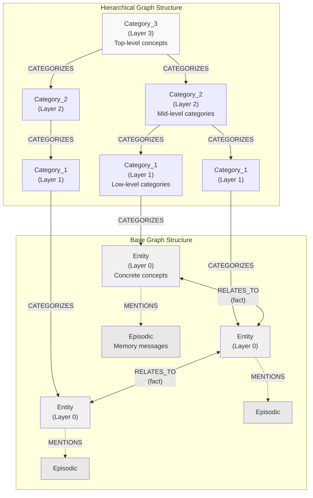
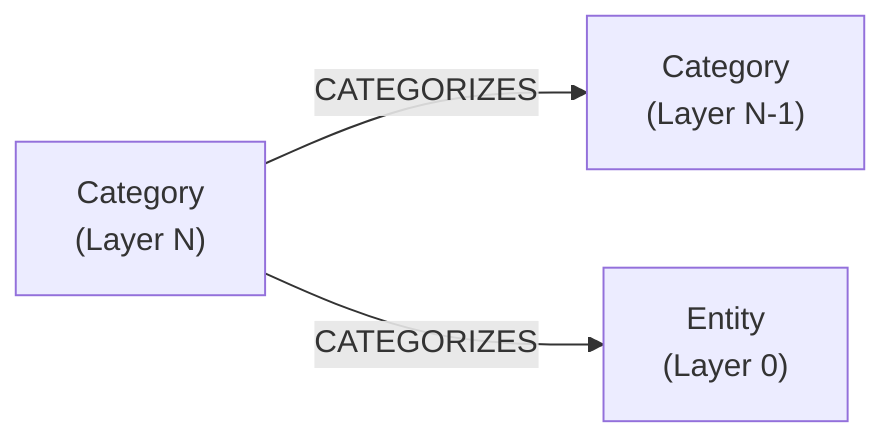
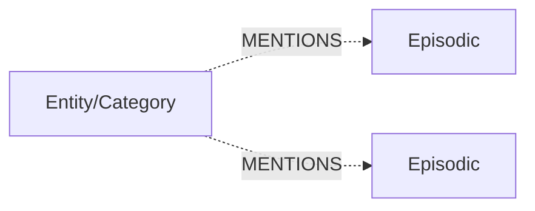
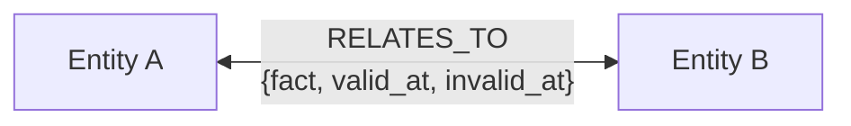
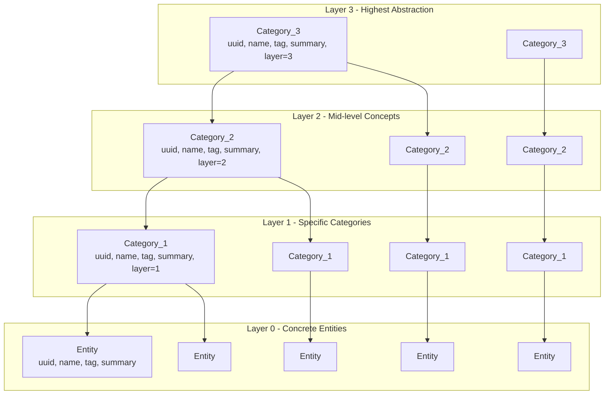
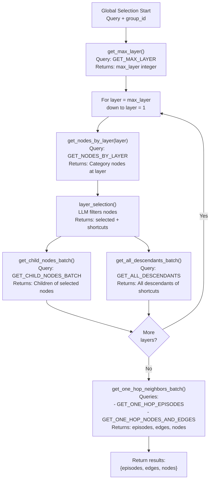
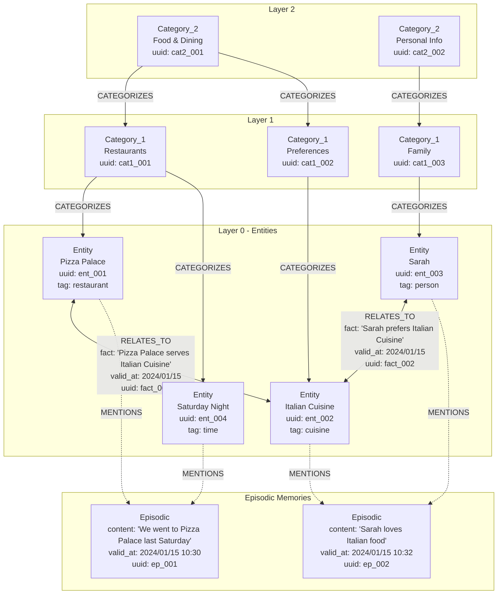

<!-- source: DeepWiki mcp.deepwiki.com · repo microsoft/Mnemis · page 3.2 Graph Database Schema · fetched 2026-10-26 -->

# Graph Database Schema

<details>
<summary>Relevant source files</summary>

The following files were used as context for generating this wiki page:

- [README.md](README.md)
- [global_selection/global_selector.py](global_selection/global_selector.py)

</details>


## Purpose and Scope

This document provides a comprehensive reference for the Neo4j graph database schema used by Mnemis. It details the node types, relationship types, properties, and hierarchical organization that enable both System-1 similarity search and System-2 global selection retrieval mechanisms.

For information about how this schema is used in retrieval operations, see [System-2 Global Selection](#2.3). For implementation details of the GlobalSelector class that queries this schema, see [GlobalSelector Class Reference](#3.1).

## Schema Overview

The Mnemis graph database implements two distinct but interconnected graph structures:

1. **Base Graph**: A flat structure connecting Entity and Episodic nodes through MENTIONS and RELATES_TO relationships, optimized for System-1 similarity search
2. **Hierarchical Graph**: A tree structure of Category nodes with multiple layers, enabling System-2's top-down traversal and global selection

All nodes within a user's memory space share a common `group_id` property for isolation and efficient querying.



**Sources**: [global_selection/global_selector.py:30-83](), [README.md:26-29]()

## Node Types and Properties

### Category Nodes

Category nodes form the hierarchical structure, organized into discrete layers. Each layer is represented by a distinct label (`Category_1`, `Category_2`, etc.).

| Property | Type | Description | Required |
|----------|------|-------------|----------|
| `uuid` | String | Unique identifier for the category | Yes |
| `name` | String | Human-readable category name | Yes |
| `tag` | String | Classification tag for the category | Yes |
| `summary` | String | Descriptive summary of the category's semantic scope | Yes |
| `layer` | Integer | Hierarchical layer number (1, 2, 3, ...) | Yes |
| `group_id` | String | Isolation key for user/session-specific graphs | Yes |

Categories at higher layers represent more abstract concepts, while lower layers represent more specific concepts. The `layer` property enables efficient layer-by-layer traversal in System-2 global selection.

**Sources**: [global_selection/global_selector.py:31-39](), [global_selection/global_selector.py:113-118]()

### Entity Nodes

Entity nodes represent concrete concepts and facts extracted from conversations. They reside at layer 0 and form the foundation of both the base and hierarchical graphs.

| Property | Type | Description | Required |
|----------|------|-------------|----------|
| `uuid` | String | Unique identifier for the entity | Yes |
| `name` | String | Entity name or key phrase | Yes |
| `tag` | String | Entity type classification | Yes |
| `summary` | String | Summarized description of the entity | Yes |
| `group_id` | String | Isolation key for user/session-specific graphs | Yes |

Entity nodes do not have a `layer` property or are implicitly at layer 0. They are retrieved using the `Entity` label directly.

**Sources**: [global_selection/global_selector.py:36-39](), [global_selection/global_selector.py:113-118]()

### Episodic Nodes

Episodic nodes store the raw conversational messages or memory episodes from which entities and relationships are extracted.

| Property | Type | Description | Required |
|----------|------|-------------|----------|
| `uuid` | String | Unique identifier for the episode | Yes |
| `content` | String | Raw message content | Yes |
| `valid_at` | DateTime | Timestamp when the episode was created | Yes |
| `group_id` | String | Isolation key for user/session-specific graphs | Yes |

The `valid_at` timestamp enables temporal reasoning and chronological ordering of memories.

**Sources**: [global_selection/global_selector.py:61-65](), [global_selection/global_selector.py:302-307]()

## Relationship Types and Properties

### CATEGORIZES Relationship

The `CATEGORIZES` relationship builds the hierarchical graph structure, connecting Category nodes to other Category nodes or to Entity nodes.



**Direction**: Parent → Child (top-down)

**Connects**:
- `Category` → `Category` (between layers)
- `Category` → `Entity` (layer N to layer 0)

**Properties**: None

**Query Usage**: The relationship is traversed bidirectionally in queries. Top-down traversal retrieves children for a given parent ([global_selection/global_selector.py:41-44]()), while the `[:CATEGORIZES*1..]` syntax retrieves all descendants ([global_selection/global_selector.py:51-54]()).

**Sources**: [global_selection/global_selector.py:41-59]()

### MENTIONS Relationship

The `MENTIONS` relationship connects Entity or Category nodes to Episodic nodes, indicating that an entity or category is mentioned or discussed in a specific conversation episode.



**Direction**: Undirected (bidirectional)

**Connects**:
- `Entity` ↔ `Episodic`
- `Category` ↔ `Episodic`

**Properties**: None

**Query Usage**: Retrieved as part of one-hop neighbor expansion to gather evidence messages for selected entities or categories ([global_selection/global_selector.py:61-71]()).

**Sources**: [global_selection/global_selector.py:61-71]()

### RELATES_TO Relationship

The `RELATES_TO` relationship represents factual statements or assertions connecting two Entity nodes. This forms the knowledge graph portion of the base graph.



**Direction**: Undirected (bidirectional)

**Connects**:
- `Entity` ↔ `Entity`

**Properties**:

| Property | Type | Description | Required |
|----------|------|-------------|----------|
| `uuid` | String | Unique identifier for the fact/edge | Yes |
| `fact` | String | Natural language statement of the relationship | Yes |
| `valid_at` | DateTime | Timestamp when the fact became valid | Yes |
| `invalid_at` | DateTime | Timestamp when the fact became invalid (null if still valid) | No |

The temporal properties (`valid_at`, `invalid_at`) enable tracking of fact evolution and temporal reasoning.

**Query Usage**: Retrieved during one-hop neighbor expansion to gather related entities and connecting facts ([global_selection/global_selector.py:73-83]()).

**Sources**: [global_selection/global_selector.py:73-83](), [global_selection/global_selector.py:168-194]()

## Hierarchical Layer Structure

The hierarchical graph organizes Category nodes into discrete layers, with each layer labeled as `Category_N` where N is the layer number. The layer system follows these principles:

1. **Layer 0**: Entity nodes (not labeled as Category)
2. **Layer 1+**: Category nodes with increasing abstraction
3. **Maximum Layer**: Determined dynamically per `group_id`

### Layer Organization



### Layer Discovery and Traversal

The `GlobalSelector` class implements layer-aware operations:

1. **Maximum Layer Query**: Finds the highest layer in the hierarchy for a given `group_id`:
   ```cypher
   MATCH (n:Category) WHERE n.group_id = $group_id
   RETURN max(n.layer) AS max_layer
   ```

2. **Layer-specific Node Retrieval**: Queries nodes at a specific layer using dynamic label construction:
   ```cypher
   MATCH (n:Category_2) WHERE n.group_id = $group_id
   RETURN n.uuid, n.name, n.tag, n.summary
   ```

3. **Child Node Retrieval**: Gets immediate children of a parent node:
   ```cypher
   MATCH (parent:Category)-[:CATEGORIZES]->(child:Category|Entity)
   WHERE parent.group_id = $group_id AND parent.uuid = $parent_uuid
   RETURN child.uuid, child.name, child.tag, child.summary, child.layer
   ```

**Sources**: [global_selection/global_selector.py:31-49](), [global_selection/global_selector.py:104-118]()

## Query Patterns and Access Methods

### Primary Query Templates

The `Query` class in `GlobalSelector` defines reusable Cypher query templates:

| Query Method | Purpose | Complexity |
|--------------|---------|------------|
| `GET_MAX_LAYER` | Find maximum layer in hierarchy | O(1) |
| `GET_NODES_BY_LAYER` | Retrieve all nodes at specific layer | O(n) per layer |
| `GET_CHILD_NODES` | Get immediate children of a node | O(1) per node |
| `GET_ALL_DESCENDANTS` | Retrieve entire subtree | O(n) per subtree |
| `GET_ONE_HOP_EPISODES` | Get episodic memories mentioning a node | O(1) per node |
| `GET_ONE_HOP_NODES_AND_EDGES` | Get related entities and facts | O(1) per node |

### Batch vs. Single Query Modes

Each query method has two execution modes:

1. **Single Mode**: Executes one query per node (cached with `@alru_cache`)
2. **Batch Mode**: Executes one query for multiple nodes using `IN` operator

Example comparison for child node retrieval:

**Single Mode** (leverages cache):
```python
tasks = [get_child_nodes(uuid, group_id) for uuid in parent_uuids]
results = await asyncio.gather(*tasks)
```

**Batch Mode** (single query):
```cypher
MATCH (parent:Category)-[:CATEGORIZES]->(child:Category|Entity)
WHERE parent.group_id = $group_id AND parent.uuid IN $parent_uuids
RETURN child.uuid, child.name, child.tag, child.summary, child.layer
```

The system defaults to batch mode for efficiency in layer-by-layer traversal ([global_selection/global_selector.py:269]()).

**Sources**: [global_selection/global_selector.py:30-83](), [global_selection/global_selector.py:129-166]()

## Graph Isolation with group_id

The `group_id` property implements multi-tenancy and user isolation in the graph database. Every node contains a `group_id` that:

1. **Isolates User Memory**: Each user or session has a unique `group_id` prefix
2. **Enables Efficient Filtering**: All queries filter on `group_id` first
3. **Supports Parallel Processing**: Multiple users can be processed concurrently

### group_id Naming Convention

```
{dataset}_{variant}_{user_index}

Examples:
- locomo_mnemis_coreAI_tel_b20_nec_full_0
- locomo_mnemis_coreAI_tel_b20_nec_full_1
- lme_s_mnemis_coreAI_tel_b20_nec_full_0
```

Every Cypher query in the system includes a `WHERE n.group_id = $group_id` clause to ensure data isolation.

**Sources**: [global_selection/global_selector.py:31-83](), [global_selection/global_selector.py:321-364]()

## Schema Traversal Flow in Global Selection

The following diagram illustrates how the GlobalSelector traverses the schema during System-2 retrieval:



**Process Steps**:

1. **Initialization** ([global_selection/global_selector.py:271-272]()): Query maximum layer for the `group_id`
2. **Layer Iteration** ([global_selection/global_selector.py:277-294]()): Traverse from highest to lowest layer
3. **Node Selection** ([global_selection/global_selector.py:285]()): LLM filters relevant nodes at each layer
4. **Child Expansion** ([global_selection/global_selector.py:281]()): Retrieve children of selected nodes for next iteration
5. **Shortcut Expansion** ([global_selection/global_selector.py:289-291]()): For "shortcut" nodes, retrieve all descendants at once
6. **Context Expansion** ([global_selection/global_selector.py:299]()): Retrieve one-hop neighbors (episodes and edges) for all selected nodes
7. **Result Assembly** ([global_selection/global_selector.py:314-318]()): Format and return episodes, edges, and nodes

**Sources**: [global_selection/global_selector.py:267-319]()

## Temporal Properties and Formatting

Multiple node and relationship types include temporal properties for chronological reasoning:

### DateTime Properties

| Property | Found On | Format |
|----------|----------|--------|
| `valid_at` | Episodic nodes, RELATES_TO edges | DateTime object → `YYYY/MM/DD (Day) HH:MM` |
| `invalid_at` | RELATES_TO edges | DateTime object → `YYYY/MM/DD (Day) HH:MM` |

### Formatting Implementation

The `global_selection()` method applies consistent datetime formatting before returning results:

```python
def format(item: dict):
    if item.get('valid_at') and type(item['valid_at']) != str:
        item['valid_at'] = item['valid_at'].strftime("%Y/%m/%d (%a) %H:%M")
    if item.get('invalid_at') and type(item['invalid_at']) != str:
        item['invalid_at'] = item['invalid_at'].strftime("%Y/%m/%d (%a) %H:%M")
    return item
```

This ensures consistent timestamp representation in the output JSON, facilitating temporal reasoning by downstream components.

**Sources**: [global_selection/global_selector.py:302-312]()

## Schema-to-Code Entity Mapping

The following table maps graph schema elements to their corresponding code entities in the GlobalSelector implementation:

| Schema Element | Query Template Constant | Method | Return Type |
|----------------|------------------------|---------|-------------|
| Category nodes | `Query.GET_NODES_BY_LAYER` | `get_nodes_by_layer()` | `list[dict]` |
| CATEGORIZES children | `Query.GET_CHILD_NODES` | `get_child_nodes()` | `list[dict]` |
| CATEGORIZES descendants | `Query.GET_ALL_DESCENDANTS` | `get_all_descendants()` | `list[dict]` |
| Episodic via MENTIONS | `Query.GET_ONE_HOP_EPISODES` | Part of `get_one_hop_neighbors()` | `dict['episodes']` |
| Entity via RELATES_TO | `Query.GET_ONE_HOP_NODES_AND_EDGES` | Part of `get_one_hop_neighbors()` | `dict['nodes']` |
| RELATES_TO edges | `Query.GET_ONE_HOP_NODES_AND_EDGES` | Part of `get_one_hop_neighbors()` | `dict['edges']` |
| Maximum layer value | `Query.GET_MAX_LAYER` | `get_max_layer()` | `int` |

All query methods support caching via `@alru_cache(maxsize=CACHE_SIZE_PER_QUERY)` where `CACHE_SIZE_PER_QUERY = 500`.

**Sources**: [global_selection/global_selector.py:30-222]()

## Example Schema Instance

The following diagram shows a concrete example of a populated graph for a user discussing restaurants and preferences:



**Sources**: Inferred from [global_selection/global_selector.py:30-83]() query structure

---

