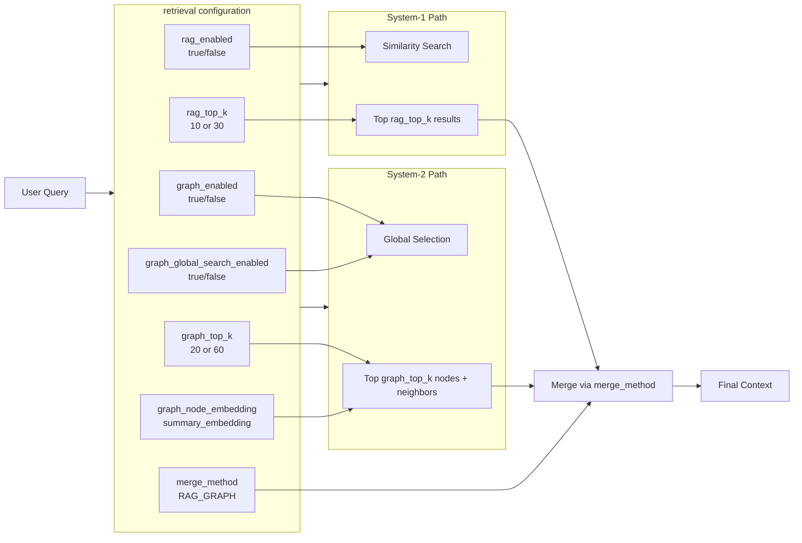
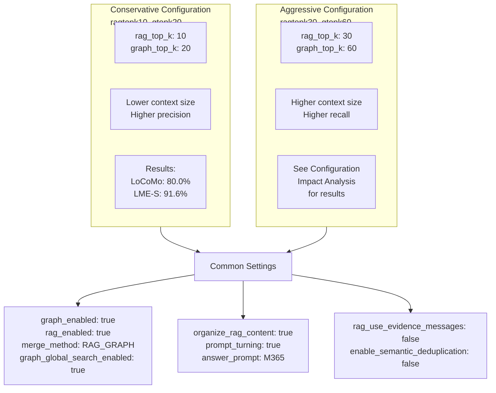

<!-- source: DeepWiki mcp.deepwiki.com · repo microsoft/Mnemis · page 3.4 Configuration Options · fetched 2026-10-26 -->

# Configuration Options

Relevant source files

The following files were used as context for generating this wiki page:

- [results/lme-s/metrics_graphiti_gpt-41-mini-shortco-2025-04-14-Bing_gpt-41-mini-shortco-2025-04-14-Bing_ragtopk10_gtopk20_RAG_GRAPH.json](results/lme-s/metrics_graphiti_gpt-41-mini-shortco-2025-04-14-Bing_gpt-41-mini-shortco-2025-04-14-Bing_ragtopk10_gtopk20_RAG_GRAPH.json)
- [results/locomo/metrics_graphiti_gpt-41-mini-shortco-2025-04-14-Bing_gpt-41-mini-shortco-2025-04-14-Bing_ragtopk10_gtopk20_RAG_GRAPH.json](results/locomo/metrics_graphiti_gpt-41-mini-shortco-2025-04-14-Bing_gpt-41-mini-shortco-2025-04-14-Bing_ragtopk10_gtopk20_RAG_GRAPH.json)

## Purpose and Scope

This document provides a complete reference for configuring the Mnemis system. It covers all configuration parameters used to control model selection, embedding generation, retrieval behavior, prompt engineering, and experimental settings. For information on how these configurations impact performance, see [Configuration Impact Analysis](#4.4). For details on the retrieval mechanisms themselves, see [System-2 Global Selection](#2.3) and [RAG_GRAPH Merge Strategy](#2.4).

## Configuration Structure Overview

The Mnemis configuration system is organized into six primary sections that control different aspects of the system's behavior.

**Configuration Hierarchy Diagram**

```mermaid
graph TB
    Root["Configuration Root"]
    
    Models["models<br/>LLM model selection"]
    Embedder["embedder<br/>Embedding generation"]
    Retrieval["retrieval<br/>Retrieval parameters"]
    Prompt["prompt<br/>Prompt engineering"]
    Advanced["advanced<br/>Advanced features"]
    Experiment["experiment<br/>Experiment metadata"]
    
    Root --> Models
    Root --> Embedder
    Root --> Retrieval
    Root --> Prompt
    Root --> Advanced
    Root --> Experiment
    
    Models --> GM["graph_model"]
    Models --> AM["answer_model"]
    Models --> GrM["grader_model"]
    
    Embedder --> ET["type"]
    Embedder --> EP["precision"]
    
    Retrieval --> GE["graph_enabled"]
    Retrieval --> RE["rag_enabled"]
    Retrieval --> MM["merge_method"]
    Retrieval --> RTK["rag_top_k"]
    Retrieval --> GTK["graph_top_k"]
    Retrieval --> GNE["graph_node_embedding"]
    Retrieval --> GGSE["graph_global_search_enabled"]
    
    Prompt --> AP["answer_prompt"]
    Prompt --> PT["prompt_turning"]
    Prompt --> ORC["organize_rag_content"]
    Prompt --> ERC["enrich_rag_context"]
    
    Advanced --> REM["rag_use_evidence_messages"]
    Advanced --> BI["bulk_ingestion"]
    Advanced --> SD["enable_semantic_deduplication"]
    Advanced --> EPML["evidence_previous_messages_limit"]
    
    Experiment --> EN["name"]
    Experiment --> GIP["group_id_prefix"]
    Experiment --> EQT["eval_question_types"]
```

**Sources:** [results/lme-s/metrics_graphiti_gpt-41-mini-shortco-2025-04-14-Bing_gpt-41-mini-shortco-2025-04-14-Bing_ragtopk10_gtopk20_RAG_GRAPH.json:37-79](), [results/locomo/metrics_graphiti_gpt-41-mini-shortco-2025-04-14-Bing_gpt-41-mini-shortco-2025-04-14-Bing_ragtopk10_gtopk20_RAG_GRAPH.json:7-39]()

## Models Configuration

The `models` section controls which LLM models are used for the three distinct roles in the Mnemis system. All three roles can use the same or different models depending on performance and cost requirements.

| Parameter | Type | Description | Example Value |
|-----------|------|-------------|---------------|
| `graph_model` | string | Model used for System-2 global selection LLM-guided node filtering | `"gpt-41-mini-shortco-2025-04-14-Bing"` |
| `answer_model` | string | Model used to generate final answers from retrieved context | `"gpt-41-mini-shortco-2025-04-14-Bing"` |
| `grader_model` | string | Model used to evaluate answer correctness during evaluation | `"gpt-41-mini-shortco-2025-04-14-Bing"` |

### Model Roles

**graph_model**: This model powers the System-2 deliberate reasoning path. It receives the `NODE_SELECTION_PROMPT_TEMPLATE` at each layer of the hierarchical graph and must intelligently select which nodes to traverse. The model must balance precision (selecting only relevant nodes) with recall (not missing important information). See [Prompt Engineering](#3.3) for details on the prompts used.

**answer_model**: This model synthesizes the final response using the merged context from both System-1 (RAG) and System-2 (global selection). It receives organized context including Message Chunks, FACTS, and ENTITIES.

**grader_model**: Used only during evaluation, this model compares generated answers against ground truth to compute accuracy metrics. It follows specific grading rubrics defined in the answer prompts.

**Sources:** [results/lme-s/metrics_graphiti_gpt-41-mini-shortco-2025-04-14-Bing_gpt-41-mini-shortco-2025-04-14-Bing_ragtopk10_gtopk20_RAG_GRAPH.json:38-42](), [results/locomo/metrics_graphiti_gpt-41-mini-shortco-2025-04-14-Bing_gpt-41-mini-shortco-2025-04-14-Bing_ragtopk10_gtopk20_RAG_GRAPH.json:8-12]()

## Embedder Configuration

The `embedder` section configures the embedding model used for System-1 similarity search and graph node embeddings.

| Parameter | Type | Description | Example Value |
|-----------|------|-------------|---------------|
| `type` | string | Embedding model identifier | `"qwen3"` |
| `precision` | string | Float precision for embeddings | `"Precision.FLOAT32"` |

### Precision Considerations

The system uses `Precision.FLOAT32` for embeddings, which provides a balance between memory efficiency and semantic representation quality. This precision level is sufficient for similarity search operations in System-1 and for node embeddings used in graph retrieval.

The `qwen3` embedder generates embeddings that are used in two contexts:
1. **System-1 RAG**: Episodic node embeddings enable fast similarity search
2. **Graph Node Embeddings**: The `graph_node_embedding` retrieval parameter (see below) specifies which node field contains embeddings for graph-based retrieval

**Sources:** [results/lme-s/metrics_graphiti_gpt-41-mini-shortco-2025-04-14-Bing_gpt-41-mini-shortco-2025-04-14-Bing_ragtopk10_gtopk20_RAG_GRAPH.json:43-46](), [results/locomo/metrics_graphiti_gpt-41-mini-shortco-2025-04-14-Bing_gpt-41-mini-shortco-2025-04-14-Bing_ragtopk10_gtopk20_RAG_GRAPH.json:13-16]()

## Retrieval Parameters

The `retrieval` section contains the most critical parameters for controlling Mnemis's dual-route memory retrieval behavior.

**Retrieval Pipeline Configuration**

**Sources:** [results/lme-s/metrics_graphiti_gpt-41-mini-shortco-2025-04-14-Bing_gpt-41-mini-shortco-2025-04-14-Bing_ragtopk10_gtopk20_RAG_GRAPH.json:47-55](), [results/locomo/metrics_graphiti_gpt-41-mini-shortco-2025-04-14-Bing_gpt-41-mini-shortco-2025-04-14-Bing_ragtopk10_gtopk20_RAG_GRAPH.json:17-25]()

### Retrieval Parameters Reference

| Parameter | Type | Description | Typical Values |
|-----------|------|-------------|----------------|
| `graph_enabled` | boolean | Enable System-2 hierarchical graph retrieval | `true` |
| `rag_enabled` | boolean | Enable System-1 similarity-based retrieval | `true` |
| `merge_method` | string | Strategy for combining System-1 and System-2 results | `"RAG_GRAPH"` |
| `rag_top_k` | integer | Number of top results from similarity search | `10`, `30` |
| `graph_top_k` | integer | Number of top nodes from global selection | `20`, `60` |
| `graph_node_embedding` | string | Node field containing embeddings for graph retrieval | `"summary_embedding"` |
| `graph_global_search_enabled` | boolean | Enable global selection (vs local search) | `true` |

### Parameter Details

**graph_enabled / rag_enabled**: These boolean flags control which retrieval paths are active. For optimal performance, both should be `true` to leverage the dual-route architecture. Setting only one to `true` degrades to single-route retrieval.

**merge_method**: The `RAG_GRAPH` merge strategy combines results from both paths, organizing them into structured context sections (Message Chunks, FACTS, ENTITIES). See [RAG_GRAPH Merge Strategy](#2.4) for implementation details.

**rag_top_k / graph_top_k**: These parameters control retrieval depth. Benchmark experiments show two tested configurations:
- Conservative: `rag_top_k=10, graph_top_k=20`
- Aggressive: `rag_top_k=30, graph_top_k=60`

Higher values increase context size but may introduce noise. See [Configuration Impact Analysis](#4.4) for performance comparisons.

**graph_node_embedding**: Specifies which node property contains the embedding vector. The value `"summary_embedding"` indicates that node summaries are embedded and used for semantic matching within the hierarchical graph structure.

**graph_global_search_enabled**: When `true`, activates the System-2 global selection mechanism that performs top-down hierarchical traversal. When `false`, the system may fall back to local search patterns.

**Sources:** [results/lme-s/metrics_graphiti_gpt-41-mini-shortco-2025-04-14-Bing_gpt-41-mini-shortco-2025-04-14-Bing_ragtopk10_gtopk20_RAG_GRAPH.json:47-55](), [results/locomo/metrics_graphiti_gpt-41-mini-shortco-2025-04-14-Bing_gpt-41-mini-shortco-2025-04-14-Bing_ragtopk10_gtopk20_RAG_GRAPH.json:17-25]()

## Prompt Settings

The `prompt` section configures prompt engineering features that affect answer generation quality.

| Parameter | Type | Description | Example Value |
|-----------|------|-------------|---------------|
| `answer_prompt` | string | Prompt template identifier for answer generation | `"M365"` |
| `prompt_turning` | boolean | Enable dynamic prompt optimization | `true` |
| `organize_rag_content` | boolean | Structure retrieved content into semantic categories | `true` |
| `enrich_rag_context` | integer | Level of context enrichment (0 = disabled) | `0` |

### Prompt Features

**answer_prompt**: The `"M365"` identifier refers to a Microsoft 365-optimized prompt template designed for conversational memory retrieval tasks. This template structures how the answer model synthesizes responses from retrieved context.

**prompt_turning**: When enabled (`true`), the system may apply dynamic adjustments to prompts based on query characteristics. This can improve answer quality by adapting the prompt structure to different question types.

**organize_rag_content**: This critical parameter controls whether retrieved content is organized into structured sections before being passed to the answer model:
- **Message Chunks**: Historical conversation excerpts
- **FACTS**: Temporal statements and factual knowledge
- **ENTITIES**: Summarized entity information

Setting this to `true` significantly improves answer quality by providing semantic organization rather than a flat list of retrieved nodes.

**enrich_rag_context**: Controls additional context enrichment. A value of `0` disables enrichment. Higher values may trigger additional graph traversal to gather more contextual information around retrieved nodes.

**Sources:** [results/lme-s/metrics_graphiti_gpt-41-mini-shortco-2025-04-14-Bing_gpt-41-mini-shortco-2025-04-14-Bing_ragtopk10_gtopk20_RAG_GRAPH.json:56-61](), [results/locomo/metrics_graphiti_gpt-41-mini-shortco-2025-04-14-Bing_gpt-41-mini-shortco-2025-04-14-Bing_ragtopk10_gtopk20_RAG_GRAPH.json:26-31]()

## Advanced Options

The `advanced` section contains specialized features for fine-tuning system behavior.

| Parameter | Type | Description | Available In |
|-----------|------|-------------|--------------|
| `rag_use_evidence_messages` | boolean | Include raw evidence messages in RAG context | LME-S, LoCoMo |
| `bulk_ingestion` | boolean | Enable batch processing for memory ingestion | LME-S |
| `enable_semantic_deduplication` | boolean | Remove semantically duplicate content | LME-S |
| `evidence_previous_messages_limit` | integer | Maximum previous messages to include as evidence | LoCoMo |

### Advanced Parameter Details

**rag_use_evidence_messages**: When `false`, the system excludes raw conversation messages from RAG retrieval, relying instead on structured FACTS and ENTITIES extracted from those messages. This reduces context size and improves focus on semantic content rather than verbatim conversations.

**bulk_ingestion**: Enables optimized batch processing during memory graph construction. When `true`, the system can ingest large datasets more efficiently by batching database operations. See [Performance Optimization](#3.5) for details on batch processing modes.

**enable_semantic_deduplication**: When enabled, the system attempts to identify and remove semantically similar content during retrieval to reduce redundancy. Setting this to `false` (as in both configurations) preserves all retrieved content without deduplication.

**evidence_previous_messages_limit**: Limits how many previous conversation messages are included as contextual evidence. A value of `5` means up to 5 preceding messages will be included to provide conversational context. This parameter only appears in the LoCoMo configuration.

**Sources:** [results/lme-s/metrics_graphiti_gpt-41-mini-shortco-2025-04-14-Bing_gpt-41-mini-shortco-2025-04-14-Bing_ragtopk10_gtopk20_RAG_GRAPH.json:62-67](), [results/locomo/metrics_graphiti_gpt-41-mini-shortco-2025-04-14-Bing_gpt-41-mini-shortco-2025-04-14-Bing_ragtopk10_gtopk20_RAG_GRAPH.json:32-35]()

## Experiment Configuration

The `experiment` section contains metadata for tracking and organizing evaluation runs.

| Parameter | Type | Description | Example Value |
|-----------|------|-------------|---------------|
| `name` | string | Unique identifier for the experiment run | `"lme_s_mnemis_exp_41mini_gs8B"` |
| `group_id_prefix` | string | Prefix for grouping related experiments | `"lme_s_mnemis_exp_41mini"` |
| `eval_question_types` | array | List of question types to evaluate | `["single-session-assistant", "multi-session", ...]` |

### Experiment Tracking

**name**: Provides a unique identifier for each experiment run, typically encoding key configuration details such as dataset (`lme_s` or `locomo`), experiment type (`mnemis_exp`), model (`41mini`), and other distinguishing features (`gs8B` for global search with 8B parameters).

**group_id_prefix**: Allows multiple related experiment runs to be grouped together for comparison. Experiments with the same prefix can be analyzed collectively to understand the impact of specific parameter variations.

**eval_question_types**: Specifies which question categories to evaluate. For LongMemEval-S, this includes:
- `single-session-assistant`: Single-session assistant queries
- `multi-session`: Cross-session memory queries
- `single-session-preference`: User preference queries
- `knowledge-update`: Knowledge update scenarios
- `temporal-reasoning`: Temporal relationship queries
- `single-session-user`: Single-session user queries

The LoCoMo benchmark uses numeric category identifiers (1-5) instead.

**Sources:** [results/lme-s/metrics_graphiti_gpt-41-mini-shortco-2025-04-14-Bing_gpt-41-mini-shortco-2025-04-14-Bing_ragtopk10_gtopk20_RAG_GRAPH.json:67-78](), [results/locomo/metrics_graphiti_gpt-41-mini-shortco-2025-04-14-Bing_gpt-41-mini-shortco-2025-04-14-Bing_ragtopk10_gtopk20_RAG_GRAPH.json:36-39]()

## Configuration Presets Comparison

The following table compares the two main configuration variants tested in benchmark evaluations:

**Configuration Variants**

**Sources:** [results/lme-s/metrics_graphiti_gpt-41-mini-shortco-2025-04-14-Bing_gpt-41-mini-shortco-2025-04-14-Bing_ragtopk10_gtopk20_RAG_GRAPH.json:47-55](), [results/locomo/metrics_graphiti_gpt-41-mini-shortco-2025-04-14-Bing_gpt-41-mini-shortco-2025-04-14-Bing_ragtopk10_gtopk20_RAG_GRAPH.json:17-25]()

### Common Configuration Patterns

Both benchmark evaluations share these consistent settings:

**Dual-Route Enabled**: Both `graph_enabled` and `rag_enabled` are `true`, activating the full Mnemis dual-route architecture.

**RAG_GRAPH Merge**: The `merge_method` is consistently set to `"RAG_GRAPH"` to combine System-1 and System-2 results.

**Global Search Active**: `graph_global_search_enabled` is `true`, enabling System-2's hierarchical traversal mechanism.

**Content Organization**: `organize_rag_content` is `true`, structuring retrieved content into semantic categories (Message Chunks, FACTS, ENTITIES).

**Evidence Exclusion**: `rag_use_evidence_messages` is `false`, focusing on structured content rather than raw messages.

**No Deduplication**: `enable_semantic_deduplication` is `false`, preserving all retrieved content without filtering.

### Tuning Recommendations

For optimal performance based on benchmark results:

1. **Start with conservative settings** (`rag_top_k=10, graph_top_k=20`) for balanced precision and recall
2. **Enable both retrieval paths** (`graph_enabled=true, rag_enabled=true`) for maximum coverage
3. **Use RAG_GRAPH merge** to benefit from dual-route complementarity
4. **Enable content organization** (`organize_rag_content=true`) for better context structure
5. **Keep evidence messages disabled** (`rag_use_evidence_messages=false`) to reduce noise
6. **Test aggressive settings** (`rag_top_k=30, graph_top_k=60`) if more recall is needed, accepting potential precision trade-offs

See [Configuration Impact Analysis](#4.4) for detailed performance comparisons between these presets.

**Sources:** [results/lme-s/metrics_graphiti_gpt-41-mini-shortco-2025-04-14-Bing_gpt-41-mini-shortco-2025-04-14-Bing_ragtopk10_gtopk20_RAG_GRAPH.json:1-79](), [results/locomo/metrics_graphiti_gpt-41-mini-shortco-2025-04-14-Bing_gpt-41-mini-shortco-2025-04-14-Bing_ragtopk10_gtopk20_RAG_GRAPH.json:1-73]()

---

