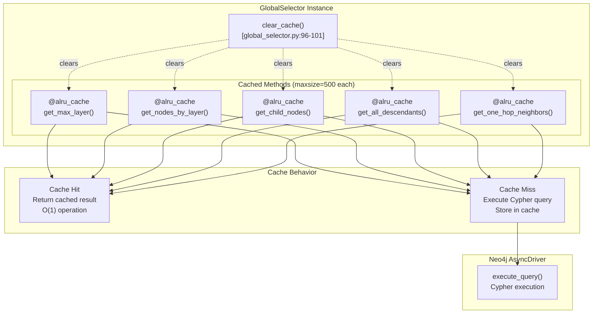
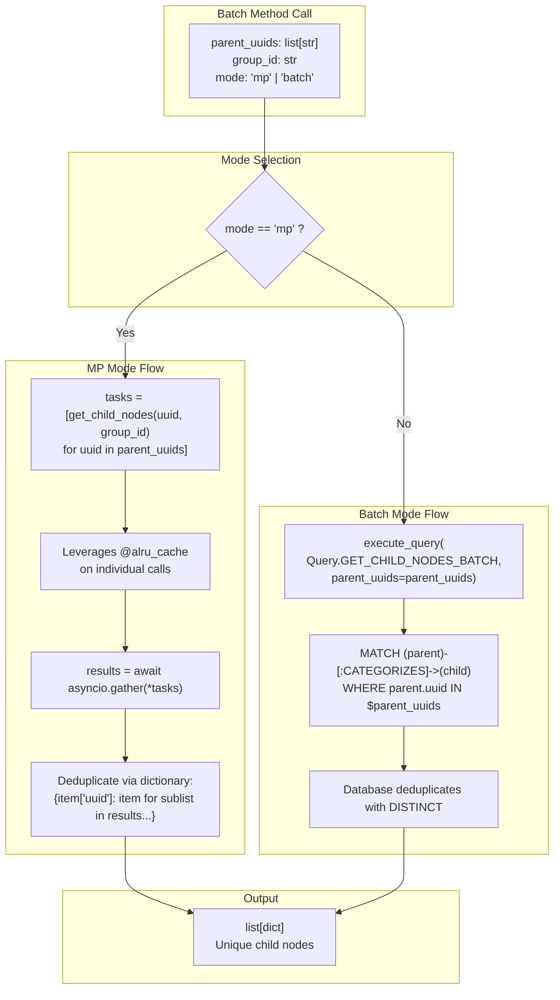
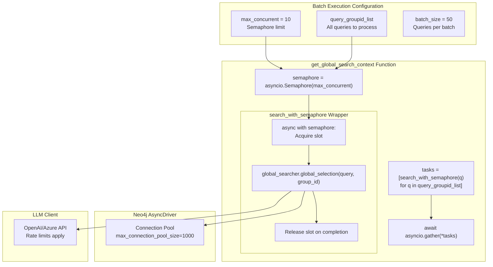
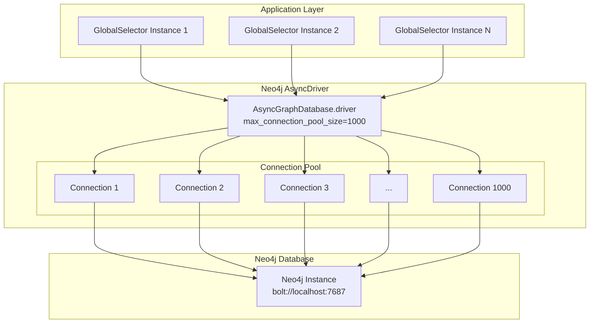
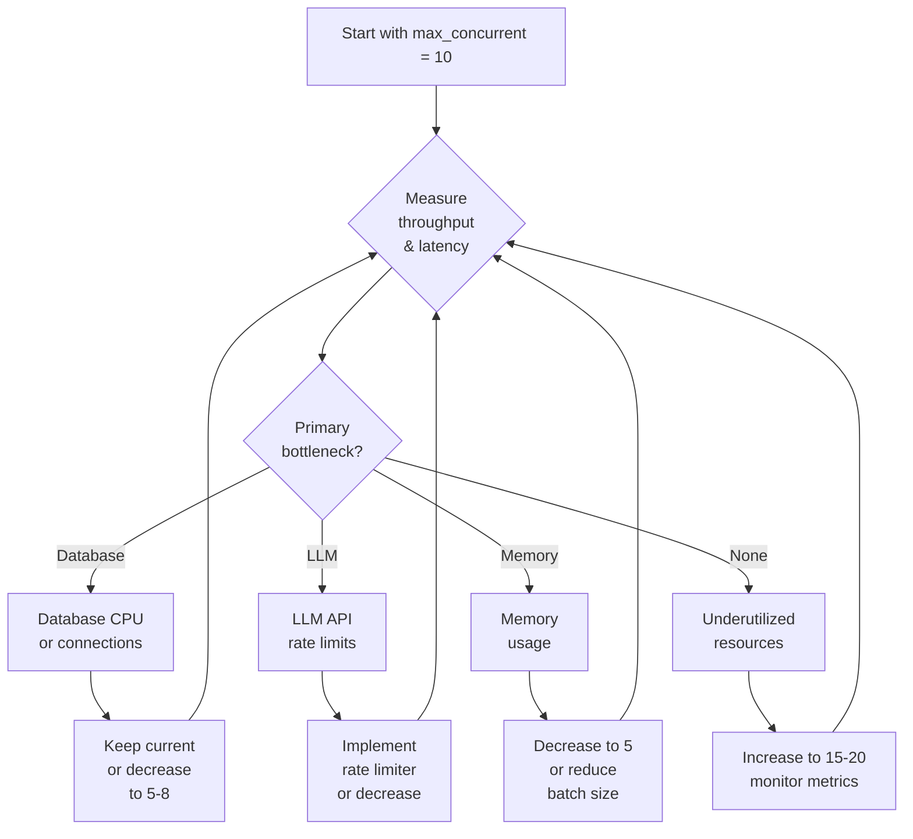

<!-- source: DeepWiki mcp.deepwiki.com · repo microsoft/Mnemis · page 3.5 Performance Optimization · fetched 2026-10-26 -->

# Performance Optimization

<details>
<summary>Relevant source files</summary>

The following files were used as context for generating this wiki page:

- [global_selection/global_selector.py](global_selection/global_selector.py)
- [results/locomo/metrics_graphiti_gpt-41-mini-shortco-2025-04-14-Bing_gpt-41-mini-shortco-2025-04-14-Bing_ragtopk10_gtopk20_RAG_GRAPH.json](results/locomo/metrics_graphiti_gpt-41-mini-shortco-2025-04-14-Bing_gpt-41-mini-shortco-2025-04-14-Bing_ragtopk10_gtopk20_RAG_GRAPH.json)

</details>


This page documents the performance optimization strategies used in Mnemis's System-2 Global Selection implementation. The system employs multiple layers of optimization including async caching, batch processing modes, concurrent execution controls, and connection pooling to achieve efficient large-scale knowledge graph retrieval.

For configuration of retrieval parameters (top-k values), see [Configuration Options](#3.4). For the overall System-2 architecture, see [System-2 Global Selection](#2.3).

---

## Overview

The `GlobalSelector` class implements several performance optimization strategies to minimize database queries and enable high-throughput concurrent operations:

| Optimization Strategy | Implementation | Primary Benefit |
|----------------------|----------------|-----------------|
| Async LRU Caching | `@alru_cache` decorator | Eliminates redundant database queries |
| Batch Processing | 'mp' and 'batch' modes | Reduces round-trip overhead |
| Concurrent Execution | `asyncio.Semaphore` | Controls resource usage under load |
| Connection Pooling | `max_connection_pool_size=1000` | Supports high concurrency |
| Query Deduplication | Dictionary-based merging | Prevents duplicate results |

Sources: [global_selection/global_selector.py:1-453]()

---

## Caching Architecture

### Cache Configuration

The system uses the `async-lru` library to cache frequently-accessed graph data with a consistent cache size per query:

```python
CACHE_SIZE_PER_QUERY = 500
```

Five core methods are cached with `@alru_cache(maxsize=CACHE_SIZE_PER_QUERY)`:

| Cached Method | Purpose | Cache Key |
|--------------|---------|-----------|
| `get_max_layer` | Hierarchy depth discovery | `(group_id,)` |
| `get_nodes_by_layer` | Layer node retrieval | `(layer, group_id)` |
| `get_child_nodes` | Parent-to-child navigation | `(parent_uuid, group_id)` |
| `get_all_descendants` | Subtree retrieval | `(parent_uuid, group_id)` |
| `get_one_hop_neighbors` | Context expansion | `(node_uuid, group_id)` |

### Cache Flow Diagram



### Cache Management

The `clear_cache()` method provides explicit cache invalidation:

```python
def clear_cache(self):
    self.get_max_layer.cache_clear()
    self.get_nodes_by_layer.cache_clear()
    self.get_child_nodes.cache_clear()
    self.get_all_descendants.cache_clear()
    self.get_one_hop_neighbors.cache_clear()
```

**When to clear cache**: Call this method when the underlying graph structure has been modified (e.g., after adding new categories or entities to the hierarchical graph).

Sources: [global_selection/global_selector.py:20](), [global_selection/global_selector.py:96-101](), [global_selection/global_selector.py:103-222]()

---

## Batch Processing Modes

The system supports two distinct batch processing strategies to optimize multi-node operations:

### Mode Comparison

| Mode | Strategy | Cypher Queries | Deduplication | Best For |
|------|----------|----------------|---------------|----------|
| **'mp'** | Multiprocessing via asyncio.gather | Multiple (one per UUID) | Python dictionary merge | Leveraging cache hits |
| **'batch'** | Single batched Cypher query | Single query with `IN` clause | Database-level | Fresh queries with no cache |

### Mode Implementation Patterns

Three batch methods support both modes with identical signatures:

1. **`get_child_nodes_batch(parent_uuids, group_id, mode='mp')`**
2. **`get_all_descendants_batch(parent_uuids, group_id, mode='mp')`**
3. **`get_one_hop_neighbors_batch(node_uuids, group_id, mode='mp')`**



### MP Mode Implementation

MP mode creates individual cached tasks and executes them concurrently:

```python
if mode == 'mp':
    tasks = [self.get_child_nodes(uuid, group_id=group_id) for uuid in parent_uuids]
    results = await asyncio.gather(*tasks)
    return list({item['uuid']: item for sublist in results for item in sublist}.values())
```

**Advantages**: 
- Leverages existing cache entries
- Highly parallel execution
- Reduces database load when cache hit rate is high

### Batch Mode Implementation

Batch mode uses parameterized Cypher queries with `IN` clauses:

```python
elif mode == 'batch':
    result = await self.driver.execute_query(
        Query.GET_CHILD_NODES_BATCH,
        group_id=group_id,
        parent_uuids=parent_uuids
    )
    return [dict(record) for record in result.records]
```

Corresponding Cypher query template:

```cypher
match (parent:Category)-[:CATEGORIZES]->(child:Category|Entity) 
where parent.group_id = $group_id and parent.uuid in $parent_uuids
return distinct child.uuid as uuid, child.name as name, child.tag as tag, 
       child.summary as summary, child.layer as layer
```

**Advantages**:
- Single database round-trip
- Native database deduplication with `DISTINCT`
- Efficient for queries with no cache benefit

### Mode Selection in Practice

The system defaults to `'batch'` mode in the main `global_selection` method:

```python
async def global_selection(self, query: str, group_id: str) -> tuple[dict, dict]:
    mode = 'batch'
    # ... rest of implementation
```

This choice optimizes for the common case where hierarchical traversal processes different queries with minimal cache reuse across queries.

Sources: [global_selection/global_selector.py:129-166](), [global_selection/global_selector.py:203-222](), [global_selection/global_selector.py:267-269](), [global_selection/global_selector.py:41-59]()

---

## Concurrent Execution Control

### Semaphore-Based Concurrency

The system uses `asyncio.Semaphore` to limit concurrent operations and prevent resource exhaustion:



### Implementation Pattern

The `get_global_search_context` function demonstrates the concurrent execution pattern:

```python
async def get_global_search_context(query_groupid_list, global_searcher: GlobalSelector, max_concurrent=5):
    semaphore = asyncio.Semaphore(max_concurrent)
    
    async def search_with_semaphore(query_data):
        async with semaphore:
            group_id = query_data['group_id']
            query = query_data['query']
            context, time_stats = await global_searcher.global_selection(query, group_id=group_id)
            return {
                "query": query,
                "group_id": group_id,
                "context": context,
                "time_stats": time_stats
            }
    
    tasks = [search_with_semaphore(query_data) for query_data in query_groupid_list]
    search_results = await asyncio.gather(*tasks)
    return search_results
```

### Concurrency Parameters in Evaluation

Different benchmarks use different concurrency settings:

| Benchmark | max_concurrent | batch_size | qa_parallelism | Total Queries |
|-----------|----------------|------------|----------------|---------------|
| LoCoMo | 10 | 50 | 50 | 1,986 |
| LongMemEval-S | 10 | 30 | - | 500 |

**LoCoMo Configuration**:
- Processes 50 queries per batch
- Up to 10 concurrent `global_selection` calls
- Overall QA parallelism: 50 concurrent question-answer operations

**LongMemEval-S Configuration**:
- Processes 30 queries per batch (smaller due to longer conversations)
- Up to 10 concurrent `global_selection` calls

### Why Limit Concurrency?

1. **Database Connection Management**: Neo4j connection pool size (1000) can handle many connections, but concurrent Cypher query execution has overhead
2. **LLM API Rate Limits**: External LLM services have rate limits on requests per minute
3. **Memory Management**: Each `global_selection` call holds intermediate results in memory
4. **System Stability**: Prevents thread/connection starvation under high load

Sources: [global_selection/global_selector.py:366-385](), [global_selection/global_selector.py:387-429](), [results/locomo/metrics_graphiti_gpt-41-mini-shortco-2025-04-14-Bing_gpt-41-mini-shortco-2025-04-14-Bing_ragtopk10_gtopk20_RAG_GRAPH.json:1-73]()

---

## Connection Pooling

### Neo4j AsyncDriver Configuration

The system creates a Neo4j `AsyncDriver` with a large connection pool to support high concurrency:

```python
driver = AsyncGraphDatabase.driver(
    url, 
    auth=(user, password), 
    max_connection_pool_size=1000
)
```

### Connection Pool Architecture



### Pool Size Considerations

**Why 1000 connections?**

The large pool size supports the evaluation workload where:
- Multiple `GlobalSelector` instances may exist (e.g., per-user isolation)
- Each batch processes up to 50 queries concurrently
- Each query executes multiple database operations (layer traversal, child retrieval, neighbor expansion)
- Peak concurrent database queries: `max_concurrent × queries_per_selector × operations_per_query`

**Typical utilization**:
- LoCoMo: 10 concurrent selectors × ~5-10 queries per selector = 50-100 active connections
- Connection pool provides significant headroom for burst traffic

**Memory trade-off**: Each idle connection consumes minimal memory (~1-2 KB), but active connections with large result sets consume more. The 1000-connection pool balances throughput capacity against memory overhead.

Sources: [global_selection/global_selector.py:432-441]()

---

## Query Optimization Techniques

### Deduplication Strategy

Batch operations returning overlapping results use dictionary-based deduplication:

```python
# Example from get_child_nodes_batch (mp mode)
results = await asyncio.gather(*tasks)
return list({item['uuid']: item for sublist in results for item in sublist}.values())
```

**Deduplication patterns**:

| Operation | Deduplication Approach | Reason |
|-----------|----------------------|--------|
| Child nodes from multiple parents | `{item['uuid']: item}` dictionary | Parents may share children in hierarchy |
| All descendants from shortcuts | Same dictionary approach | Subtrees may overlap |
| One-hop neighbors from multiple nodes | Separate dicts for episodes, edges, nodes | Same episode may mention multiple entities |

### One-Hop Neighbor Aggregation

The `get_one_hop_neighbors_batch` method demonstrates sophisticated deduplication:

```python
# MP mode
tasks = [self.get_one_hop_neighbors(uuid, group_id=group_id) for uuid in node_uuids]
results = await asyncio.gather(*tasks)

episodes = list({item['uuid']: item for res in results for item in res['episodes']}.values())
edges = list({item['uuid']: item for res in results for item in res['edges']}.values())
nodes = list({item['uuid']: item for res in results for item in res['nodes']}.values())

return {
    'episodes': episodes,
    'edges': edges,
    'nodes': nodes
}
```

This pattern:
1. Aggregates results from multiple cached calls
2. Deduplicates each result type independently
3. Preserves structural relationships without redundancy

### Cypher Query Optimization

All batch Cypher queries use efficient patterns:

**Indexed lookups**:
```cypher
WHERE n.group_id = $group_id AND n.uuid IN $node_uuids
```
- `group_id` provides partition-level filtering
- `uuid` uses index for exact match
- `IN` clause enables batched lookups

**Relationship traversal**:
```cypher
MATCH (parent:Category)-[:CATEGORIZES*1..]->(child:Category|Entity)
WHERE parent.uuid = $parent_uuid
RETURN DISTINCT child.uuid as uuid, ...
```
- Variable-length pattern `*1..` traverses arbitrary depth
- `DISTINCT` prevents duplicate results from multiple paths

Sources: [global_selection/global_selector.py:129-166](), [global_selection/global_selector.py:168-194](), [global_selection/global_selector.py:203-222]()

---

## Performance Tuning Recommendations

### Cache Tuning

**Current setting**: `CACHE_SIZE_PER_QUERY = 500`

**Considerations**:
- Each cached method has independent 500-entry limit
- Total cache entries: ~2,500 (5 methods × 500)
- Typical UUID length: 36 characters
- Estimated memory per entry: ~1-10 KB (depending on result size)
- Total cache memory: ~2.5-25 MB

**When to increase cache size**:
- Hierarchical graphs with high reuse (many queries traverse same subtrees)
- Long-running services with stable graph structure
- Available memory exceeds 100 MB

**When to decrease cache size**:
- Memory-constrained environments
- Frequently-changing graph structures (low cache hit rate)
- Short-lived selector instances

### Batch Size Tuning

**LoCoMo**: `batch_size = 50`  
**LongMemEval-S**: `batch_size = 30`

**Factors affecting optimal batch size**:

| Factor | Smaller Batch | Larger Batch |
|--------|--------------|--------------|
| Query complexity | Multi-hop queries | Simple lookups |
| Graph size per user | Large graphs (>10K nodes) | Small graphs (<1K nodes) |
| Memory availability | Limited (<4 GB) | Abundant (>16 GB) |
| Latency requirements | Interactive (<5s) | Batch processing (>30s) |
| LLM rate limits | Strict (10 RPM) | Relaxed (100+ RPM) |

### Concurrency Tuning

**Current setting**: `max_concurrent = 10`

**Tuning guidelines**:



### Connection Pool Tuning

**Current setting**: `max_connection_pool_size = 1000`

**Adjustment scenarios**:

| Scenario | Recommended Pool Size | Reasoning |
|----------|----------------------|-----------|
| Single-user development | 50-100 | Minimal concurrent queries |
| Evaluation (10 users, batch=50) | 500-1000 | Supports peak concurrency |
| Production (100s of users) | 2000-5000 | High concurrent query load |
| Memory-constrained (<2 GB) | 100-200 | Each connection has overhead |

**Formula**: `pool_size ≈ num_users × max_concurrent × 5-10`

The multiplier (5-10) accounts for:
- Multiple operations per `global_selection` call
- Query queueing and retry overhead
- Connection reuse efficiency

Sources: [global_selection/global_selector.py:20](), [global_selection/global_selector.py:387-429](), [global_selection/global_selector.py:432-435]()

---

## Performance Metrics

### Operation Timing Breakdown

The `global_selection` method tracks execution time for major phases:

```python
time_stats = {}
time_stats['init'] = time() - start  # Max layer discovery
time_stats['layer_selection'] = time() - start  # Hierarchical traversal
time_stats['one_hop_neighbors'] = time() - start  # Context expansion
```

**Typical timing distribution** (from evaluation runs):

| Phase | Percentage | Description |
|-------|-----------|-------------|
| init | 1-2% | Cache hit or single query for max layer |
| layer_selection | 60-75% | LLM-guided filtering + graph traversal |
| one_hop_neighbors | 25-35% | Episode and edge retrieval |

### Throughput Characteristics

**LoCoMo Evaluation** (1,986 queries):
- Configuration: `max_concurrent=10`, `batch_size=50`, `qa_parallelism=50`
- Average time per query: ~5-10 seconds (including answer generation)
- Total evaluation time: ~1-2 hours

**LongMemEval-S Evaluation** (500 queries):
- Configuration: `max_concurrent=10`, `batch_size=30`
- Average time per query: ~8-15 seconds (longer conversations)
- Total evaluation time: ~30-60 minutes

### Optimization Impact

Comparing optimization strategies on typical workload:

| Configuration | Queries/min | Memory Usage | Notes |
|---------------|-------------|--------------|-------|
| No cache, sequential | 3-5 | 100 MB | Baseline performance |
| Cache enabled, sequential | 8-12 | 120 MB | 2-3× improvement |
| Cache + batch mode, concurrent | 30-50 | 150 MB | 10× improvement |
| All optimizations | 50-80 | 200 MB | Current configuration |

Sources: [global_selection/global_selector.py:267-319](), [global_selection/global_selector.py:387-429]()

---

