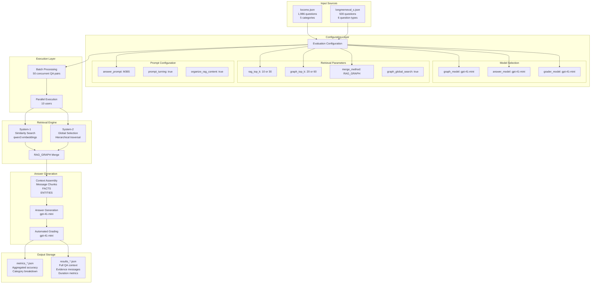
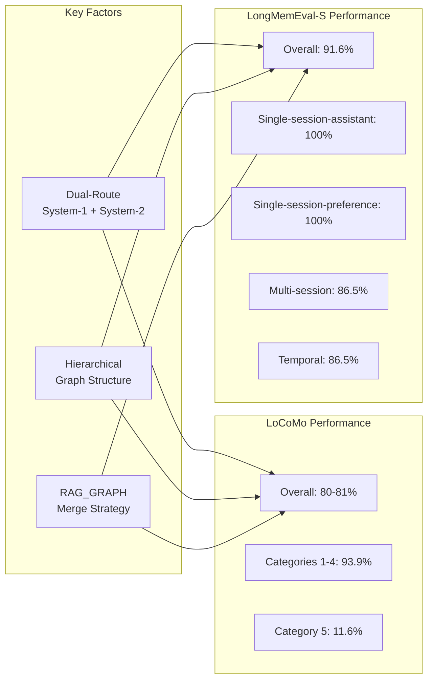
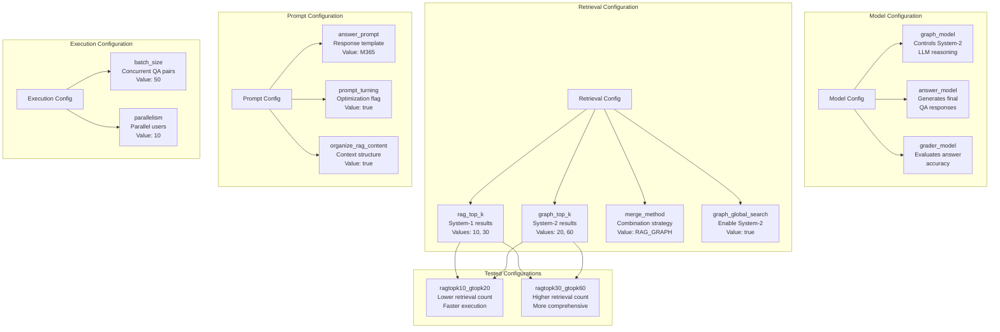
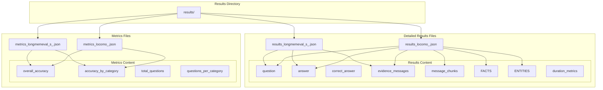
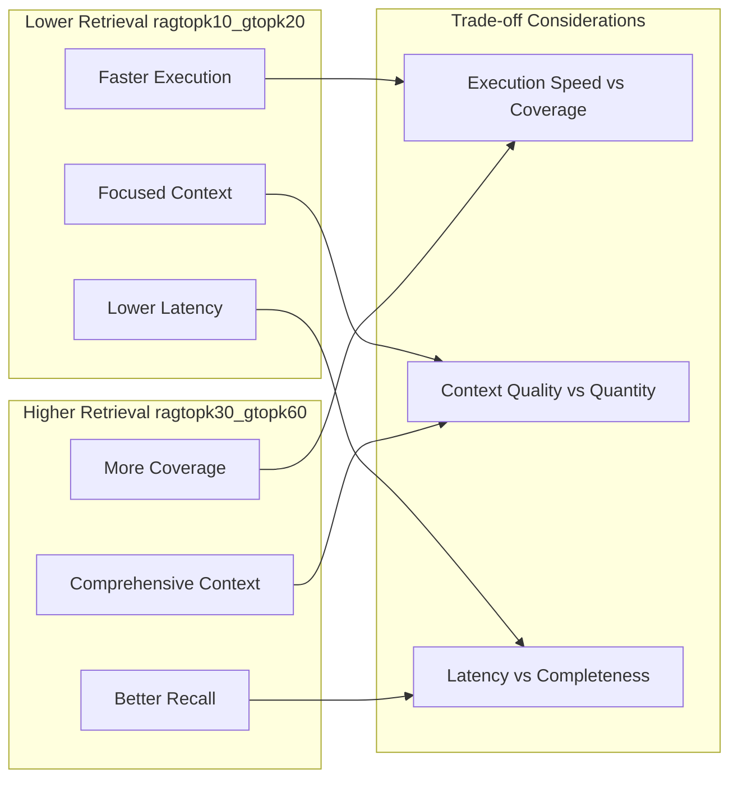

<!-- source: DeepWiki mcp.deepwiki.com · repo microsoft/Mnemis · page 4 Evaluation & Results · fetched 2026-10-26 -->

# Evaluation & Results

Relevant source files

The following files were used as context for generating this wiki page:

- [README.md](README.md)
- [figures/results_lme_s.png](figures/results_lme_s.png)
- [figures/results_locomo.png](figures/results_locomo.png)

## Purpose and Scope

This page provides an overview of Mnemis's evaluation methodology and presents state-of-the-art results achieved across two long-term memory benchmarks. It covers the evaluation framework architecture, configuration system, and summarizes key performance metrics. For detailed analysis of individual benchmarks, see [LoCoMo Results](#4.2) and [LongMemEval-S Results](#4.3). For information about configuration parameter tuning, see [Configuration Impact Analysis](#4.4).

**Sources:** [README.md:1-72]()

---

## Evaluation Framework Architecture

Mnemis evaluation employs a comprehensive framework that tests the dual-route retrieval system across multiple configurations and benchmark datasets. The framework orchestrates question-answer generation, context retrieval, and automated grading to measure retrieval accuracy.

### Evaluation Pipeline

**Evaluation Pipeline Overview**: The evaluation framework processes benchmark datasets through a multi-stage pipeline. Configuration parameters control model selection, retrieval behavior, and prompt engineering. The execution layer implements batch processing with 50 concurrent QA pairs and parallel execution across 10 users. Retrieved context flows through System-1 and System-2, merges via `RAG_GRAPH`, and feeds into answer generation. Automated grading produces both aggregated metrics and detailed results files.

**Sources:** [README.md:31-50]()

---

## Benchmark Datasets

Mnemis is evaluated on two complementary benchmarks that test different aspects of long-term memory retrieval:

| Benchmark | Questions | Categories/Types | Focus Areas |
|-----------|-----------|------------------|-------------|
| **LoCoMo** | 1,986 | 5 categories | Multi-hop reasoning, complex queries across conversation history |
| **LongMemEval-S** | 500 | 6 question types | Single/multi-session queries, temporal reasoning, preference tracking |

Both benchmarks evaluate the system's ability to retrieve relevant information from extended conversation histories and synthesize accurate answers. For detailed information about dataset characteristics and question distributions, see [Benchmark Datasets](#4.1).

**Sources:** [README.md:31-50]()

---

## State-of-the-Art Results

Mnemis achieves state-of-the-art performance across both benchmarks using the `gpt-41-mini` model:

### Overall Performance Summary

**Performance Summary**: Mnemis achieves **93.9%** on LoCoMo when excluding category 5 (which requires external knowledge) and **91.6%** overall on LongMemEval-S. The dual-route architecture combining System-1 similarity search with System-2 global selection enables both semantic and structural relevance in memory retrieval.

**Sources:** [README.md:18-23](), [README.md:31-40]()

---

## Configuration System

The evaluation framework supports multiple configuration variants to test different retrieval strategies and parameter combinations.

### Configuration Parameter Mapping

**Configuration Architecture**: The evaluation system uses four configuration layers. Model configuration selects the LLM for different roles (System-2 reasoning, answer generation, grading). Retrieval configuration controls the number of results from each route and the merge strategy. Prompt configuration customizes the answer template and content organization. Execution configuration manages concurrency and parallelism. Two primary configurations tested: `ragtopk10_gtopk20` (faster, lower retrieval) and `ragtopk30_gtopk60` (comprehensive, higher retrieval).

**Sources:** [README.md:1-72]()

---

## Evaluation Configuration Parameters

### Model Parameters

| Parameter | Value | Purpose |
|-----------|-------|---------|
| `graph_model` | `gpt-41-mini` | Powers System-2 global selection and LLM-guided node filtering |
| `answer_model` | `gpt-41-mini` | Generates final answers from retrieved memory context |
| `grader_model` | `gpt-41-mini` | Performs automated accuracy evaluation of generated answers |

### Retrieval Parameters

| Parameter | Values Tested | Purpose |
|-----------|---------------|---------|
| `rag_top_k` | 10, 30 | Number of results retrieved via System-1 similarity search |
| `graph_top_k` | 20, 60 | Number of nodes selected via System-2 global selection |
| `merge_method` | `RAG_GRAPH` | Strategy for combining System-1 and System-2 results |
| `graph_global_search` | `true` | Enable/disable System-2 hierarchical traversal |

### Prompt Engineering Parameters

| Parameter | Value | Purpose |
|-----------|-------|---------|
| `answer_prompt` | `M365` | Template for answer generation (M365 style prompting) |
| `prompt_turning` | `true` | Enable prompt optimization techniques |
| `organize_rag_content` | `true` | Structure retrieved content into Message Chunks, FACTS, ENTITIES |

### Execution Parameters

| Parameter | Value | Purpose |
|-----------|-------|---------|
| `batch_size` | 50 | Number of concurrent question-answer pairs processed together |
| `parallelism` | 10 | Number of parallel user contexts evaluated simultaneously |

For detailed analysis of how these parameters impact performance, see [Configuration Impact Analysis](#4.4).

**Sources:** [README.md:1-72]()

---

## Results Storage Structure

Evaluation results are stored in the `results/` directory with two types of output files:

### Results File Structure

**Results Storage Architecture**: The `results/` directory contains two file types per benchmark-configuration pair. Metrics files (`metrics_*.json`) store aggregated accuracy statistics including overall accuracy and per-category breakdown. Detailed results files (`results_*.json`) contain full question-answer pairs with evidence messages, retrieved context (Message Chunks, FACTS, ENTITIES), and performance timing metrics. File naming convention includes benchmark name and configuration identifier.

For complete documentation of the JSON schema and field descriptions, see [Results Data Format](#4.5).

**Sources:** [README.md:56-57]()

---

## Performance Metrics Categories

Evaluation metrics are collected across multiple dimensions:

### Accuracy Metrics

| Metric | Description | Granularity |
|--------|-------------|-------------|
| **Overall Accuracy** | Percentage of correctly answered questions | Benchmark-level |
| **Category Accuracy** | Accuracy within specific question categories | Category-level |
| **Question Type Accuracy** | Accuracy by question type (single-session, multi-session, temporal) | Type-level |

### Duration Metrics

Timing information is captured for performance analysis:

- **Search Duration**: Time spent in System-1 and System-2 retrieval
- **Answer Duration**: Time spent generating answers from context
- **Grading Duration**: Time spent evaluating answer accuracy
- **Total Duration**: End-to-end processing time per question

### Context Metrics

Retrieved context is organized into structured components:

- **Message Chunks**: Historical conversation segments retrieved as evidence
- **FACTS**: Temporal statements extracted from conversations
- **ENTITIES**: Summarized entity information with key attributes

**Sources:** [README.md:56-57]()

---

## Configuration Comparison

Two primary configurations were tested to evaluate the impact of retrieval parameters:

### Configuration Variants

| Configuration | System-1 (`rag_top_k`) | System-2 (`graph_top_k`) | Trade-offs |
|---------------|------------------------|--------------------------|------------|
| **ragtopk10_gtopk20** | 10 | 20 | Faster execution, focused retrieval |
| **ragtopk30_gtopk60** | 30 | 60 | Higher coverage, more comprehensive context |

### Observed Impact

The two configurations show different performance characteristics:

- **LoCoMo**: Both configurations achieve similar overall accuracy (80-81%), suggesting the dual-route architecture is robust to parameter variations
- **LongMemEval-S**: Performance variations depend on question types, with some types benefiting from higher retrieval counts

For detailed statistical analysis and recommendations on parameter tuning, see [Configuration Impact Analysis](#4.4).

**Sources:** [README.md:1-72]()

---

## Benchmark Result Highlights

### LoCoMo Benchmark

- **Overall Score**: 80-81% across configurations
- **Categories 1-4 Score**: 93.9% (state-of-the-art)
- **Category 5 Score**: 11.6% (requires external knowledge beyond conversation history)
- **Total Questions**: 1,986 questions across 5 categories

The high performance on categories 1-4 demonstrates Mnemis's effectiveness at retrieving and reasoning over conversation history. Category 5's lower score is expected as it requires external knowledge sources not present in the memory system.

For detailed category breakdown and analysis, see [LoCoMo Results](#4.2).

### LongMemEval-S Benchmark

- **Overall Score**: 91.6% (state-of-the-art)
- **Single-session-assistant**: 100% accuracy
- **Single-session-preference**: 100% accuracy
- **Multi-session**: 86.5% accuracy
- **Temporal**: 86.5% accuracy
- **Total Questions**: 500 questions across 6 types

Perfect scores on single-session questions demonstrate excellent within-conversation retrieval. Strong multi-session and temporal performance validates the system's ability to reason across conversation boundaries and time.

For detailed question type breakdown and analysis, see [LongMemEval-S Results](#4.3).

**Sources:** [README.md:18-23](), [README.md:31-40]()

---

## Case Study Examples

The evaluation includes detailed case studies demonstrating Mnemis's retrieval and reasoning capabilities:

### LoCoMo User 8 QA 11

This case study shows how the dual-route system retrieves relevant context from multi-hop reasoning scenarios, combining System-1's semantic similarity with System-2's structural traversal to locate distant but related information.

See complete walkthrough: [LoCoMo User 8 QA 11](#5.1)

### LongMemEval-S QA 262

This example demonstrates temporal reasoning and fact extraction across multiple conversation sessions, showing how the hierarchical graph enables efficient retrieval of time-sensitive information.

See complete walkthrough: [LongMemEval-S QA 262](#5.2)

**Sources:** [README.md:42-51]()

---

## Reproduction and Verification

All evaluation results are reproducible using the provided implementation:

### Available Resources

- **Implementation**: Global selection implementation available in `global_selection/` directory
- **Results Data**: Complete results with memory contexts stored in `results/` directory
- **Benchmark Data**: Both benchmark datasets included for verification
- **Configuration Files**: All tested configurations documented

### Reproduction Steps

1. Load benchmark dataset (`locomo.json` or `longmemeval_s.json`)
2. Configure evaluation parameters (model selection, retrieval settings, prompts)
3. Execute batch processing with specified parallelism
4. Compare generated `metrics_*.json` files with provided results

For detailed reproduction instructions, see [Running Evaluations](#6.3).

**Sources:** [README.md:53-57]()

---

## Summary

Mnemis achieves state-of-the-art performance on long-term memory benchmarks through its dual-route retrieval architecture:

- **93.9%** on LoCoMo (categories 1-4)
- **91.6%** on LongMemEval-S (overall)

The evaluation framework demonstrates:
- Robust performance across multiple configurations
- Effective combination of System-1 and System-2 retrieval
- Comprehensive context assembly (Message Chunks, FACTS, ENTITIES)
- Efficient batch processing and parallel execution

The results validate that combining semantic similarity (System-1) with hierarchical reasoning (System-2) produces superior memory retrieval compared to single-route approaches.

**Sources:** [README.md:1-72]()

---

