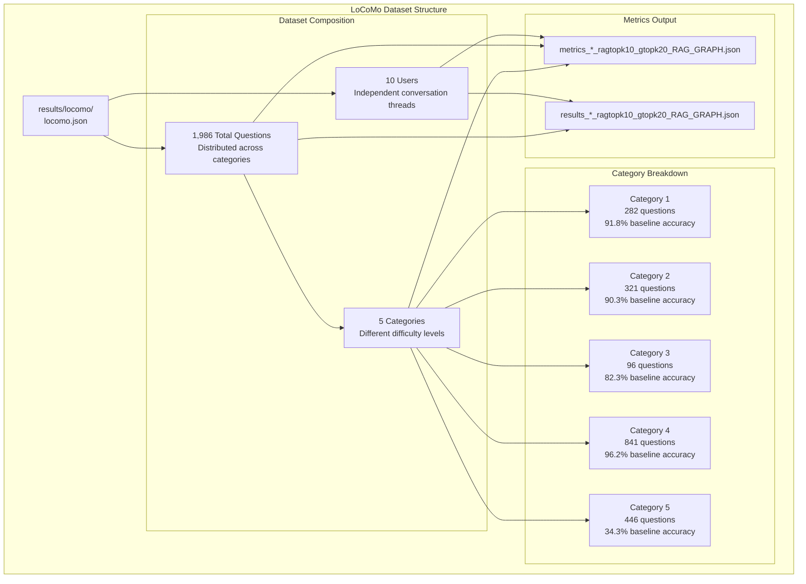
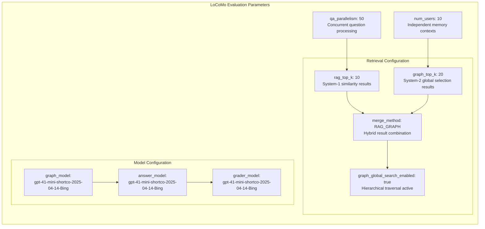
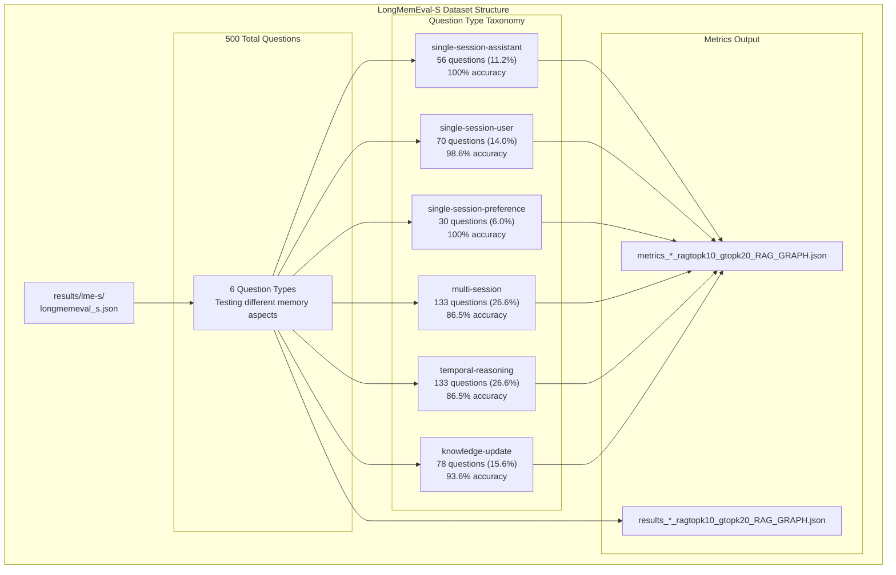
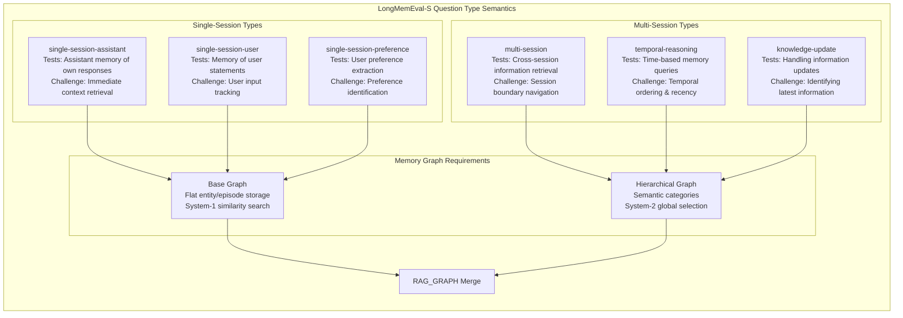
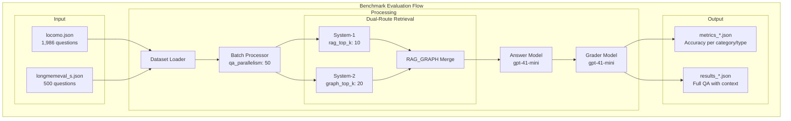

<!-- source: DeepWiki mcp.deepwiki.com · repo microsoft/Mnemis · page 4.1 Benchmark Datasets · fetched 2026-10-26 -->

# Benchmark Datasets

Relevant source files

The following files were used as context for generating this wiki page:

- [README.md](README.md)
- [results/lme-s/metrics_graphiti_gpt-41-mini-shortco-2025-04-14-Bing_gpt-41-mini-shortco-2025-04-14-Bing_ragtopk10_gtopk20_RAG_GRAPH.json](results/lme-s/metrics_graphiti_gpt-41-mini-shortco-2025-04-14-Bing_gpt-41-mini-shortco-2025-04-14-Bing_ragtopk10_gtopk20_RAG_GRAPH.json)
- [results/locomo/metrics_graphiti_gpt-41-mini-shortco-2025-04-14-Bing_gpt-41-mini-shortco-2025-04-14-Bing_ragtopk10_gtopk20_RAG_GRAPH.json](results/locomo/metrics_graphiti_gpt-41-mini-shortco-2025-04-14-Bing_gpt-41-mini-shortco-2025-04-14-Bing_ragtopk10_gtopk20_RAG_GRAPH.json)

## Purpose and Scope

This document describes the two benchmark datasets used to evaluate Mnemis: **LoCoMo** and **LongMemEval-S**. It covers their structure, question types, scale, and the evaluation methodology used to test long-term memory retrieval capabilities. For detailed performance results, see [LoCoMo Results](#4.2) and [LongMemEval-S Results](#4.3). For configuration parameter analysis, see [Configuration Impact Analysis](#4.4).

---

## Overview

Mnemis is evaluated on two established benchmarks for long-term LLM memory:

| Benchmark | Questions | Categories/Types | Users | Primary Focus |
|-----------|-----------|------------------|-------|---------------|
| **LoCoMo** | 1,986 | 5 categories | 10 | Multi-turn conversational memory across diverse topics |
| **LongMemEval-S** | 500 | 6 question types | Varies | Single/multi-session scenarios with temporal reasoning |

Both benchmarks test the system's ability to retrieve and reason over historical conversation context stored in the graph database.

**Sources:** [README.md:15-23](), [results/locomo/metrics_graphiti_gpt-41-mini-shortco-2025-04-14-Bing_gpt-41-mini-shortco-2025-04-14-Bing_ragtopk10_gtopk20_RAG_GRAPH.json:1-72](), [results/lme-s/metrics_graphiti_gpt-41-mini-shortco-2025-04-14-Bing_gpt-41-mini-shortco-2025-04-14-Bing_ragtopk10_gtopk20_RAG_GRAPH.json:1-79]()

---

## LoCoMo Benchmark

### Dataset Structure

LoCoMo (Long Conversational Memory) is a comprehensive benchmark designed to test memory retrieval across extended multi-turn conversations with multiple users.

**Dataset Characteristics:**

The LoCoMo benchmark exhibits significant variation in difficulty across categories, as evidenced by the accuracy distribution in the metrics files:

| Category | Questions | Accuracy (Mnemis) | Characteristic |
|----------|-----------|-------------------|----------------|
| Category 1 | 282 (14.2%) | 91.8% | High baseline performance |
| Category 2 | 321 (16.2%) | 90.3% | High baseline performance |
| Category 3 | 96 (4.8%) | 82.3% | Moderate difficulty |
| Category 4 | 841 (42.4%) | 96.2% | Easiest category |
| Category 5 | 446 (22.5%) | 34.3% | Significantly harder |

Category 5 represents a substantial challenge, with only 34.3% accuracy, suggesting it tests particularly complex memory retrieval scenarios. When excluding Category 5, the system achieves 93.3% accuracy across the remaining 1,540 questions.

**Sources:** [results/locomo/metrics_graphiti_gpt-41-mini-shortco-2025-04-14-Bing_gpt-41-mini-shortco-2025-04-14-Bing_ragtopk10_gtopk20_RAG_GRAPH.json:1-72]()

### Evaluation Configuration

The configuration shows 50-way parallelism for question answering, processing questions from 10 independent user contexts simultaneously. This tests the system's ability to maintain separate memory graphs for different users while efficiently retrieving relevant context.

**Sources:** [results/locomo/metrics_graphiti_gpt-41-mini-shortco-2025-04-14-Bing_gpt-41-mini-shortco-2025-04-14-Bing_ragtopk10_gtopk20_RAG_GRAPH.json:5-39]()

---

## LongMemEval-S Benchmark

### Dataset Structure

LongMemEval-S tests memory retrieval across six distinct question types, each targeting specific memory capabilities.

**Question Type Characteristics:**

The six question types test different aspects of long-term memory:

| Question Type | Count | Accuracy | Memory Challenge |
|---------------|-------|----------|------------------|
| `single-session-assistant` | 56 | 100% | Assistant's responses within single session |
| `single-session-user` | 70 | 98.6% | User's statements within single session |
| `single-session-preference` | 30 | 100% | User preferences within session |
| `multi-session` | 133 | 86.5% | Information across multiple sessions |
| `temporal-reasoning` | 133 | 86.5% | Time-based memory queries |
| `knowledge-update` | 78 | 93.6% | Handling updated/changed information |

The data reveals that single-session queries achieve near-perfect accuracy, while multi-session and temporal reasoning questions are significantly more challenging, dropping to 86.5% accuracy. This highlights the difficulty of maintaining temporal context and reasoning across conversation boundaries.

**Sources:** [results/lme-s/metrics_graphiti_gpt-41-mini-shortco-2025-04-14-Bing_gpt-41-mini-shortco-2025-04-14-Bing_ragtopk10_gtopk20_RAG_GRAPH.json:1-36]()

### Question Type Semantics

The question taxonomy reflects different retrieval strategies:
- **Single-session types** primarily benefit from System-1 similarity search on the base graph
- **Multi-session types** require System-2 global selection to reason across session boundaries and temporal dimensions
- Both systems merge results via the `RAG_GRAPH` method for comprehensive coverage

**Sources:** [results/lme-s/metrics_graphiti_gpt-41-mini-shortco-2025-04-14-Bing_gpt-41-mini-shortco-2025-04-14-Bing_ragtopk10_gtopk20_RAG_GRAPH.json:2-31]()

---

## Evaluation Methodology

### Configuration Parameters

Both benchmarks use identical configuration parameters stored in the metrics files:

```mermaid
graph TB
    subgraph "Evaluation Configuration Structure"
        direction TB
        
        CONFIG["config object<br/>metrics_*.json"]
        
        subgraph "models"
            GM["graph_model<br/>gpt-41-mini-shortco-2025-04-14-Bing"]
            AM["answer_model<br/>gpt-41-mini-shortco-2025-04-14-Bing"]
            GRM["grader_model<br/>gpt-41-mini-shortco-2025-04-14-Bing"]
        end
        
        subgraph "embedder"
            EMB_TYPE["type: qwen3"]
            EMB_PREC["precision: Precision.FLOAT32"]
        end
        
        subgraph "retrieval"
            GRAPH_EN["graph_enabled: true"]
            RAG_EN["rag_enabled: true"]
            MERGE["merge_method: RAG_GRAPH"]
            RAG_K["rag_top_k: 10"]
            GRAPH_K["graph_top_k: 20"]
            NODE_EMB["graph_node_embedding: summary_embedding"]
            GS["graph_global_search_enabled: true"]
        end
        
        subgraph "prompt"
            AP["answer_prompt: M365"]
            PT["prompt_turning: true"]
            ORC["organize_rag_content: true"]
            ERC["enrich_rag_context: 0"]
        end
        
        CONFIG --> GM
        CONFIG --> AM
        CONFIG --> GRM
        CONFIG --> EMB_TYPE
        CONFIG --> EMB_PREC
        CONFIG --> GRAPH_EN
        CONFIG --> RAG_EN
        CONFIG --> MERGE
        CONFIG --> RAG_K
        CONFIG --> GRAPH_K
        CONFIG --> NODE_EMB
        CONFIG --> GS
        CONFIG --> AP
        CONFIG --> PT
        CONFIG --> ORC
        CONFIG --> ERC
    end
```

**Key Configuration Elements:**

| Parameter | Value | Purpose |
|-----------|-------|---------|
| `graph_model` | `gpt-41-mini-shortco-2025-04-14-Bing` | LLM for global selection node filtering |
| `answer_model` | `gpt-41-mini-shortco-2025-04-14-Bing` | LLM for answer generation |
| `grader_model` | `gpt-41-mini-shortco-2025-04-14-Bing` | LLM for accuracy evaluation |
| `embedder.type` | `qwen3` | Embedding model for similarity search |
| `embedder.precision` | `Precision.FLOAT32` | Float32 precision for embeddings |
| `rag_top_k` | `10` | Top-K results from System-1 |
| `graph_top_k` | `20` | Top-K nodes from System-2 |
| `merge_method` | `RAG_GRAPH` | Hybrid result combination |
| `graph_global_search_enabled` | `true` | Enable hierarchical traversal |
| `answer_prompt` | `M365` | Microsoft 365-style prompting |
| `organize_rag_content` | `true` | Structure retrieved content |

**Sources:** [results/locomo/metrics_graphiti_gpt-41-mini-shortco-2025-04-14-Bing_gpt-41-mini-shortco-2025-04-14-Bing_ragtopk10_gtopk20_RAG_GRAPH.json:7-39](), [results/lme-s/metrics_graphiti_gpt-41-mini-shortco-2025-04-14-Bing_gpt-41-mini-shortco-2025-04-14-Bing_ragtopk10_gtopk20_RAG_GRAPH.json:37-78]()

### Evaluation Pipeline

The evaluation pipeline processes questions in batches with 50-way parallelism for LoCoMo. Each question triggers:
1. **Dual-route retrieval**: System-1 similarity search (top-10) and System-2 global selection (top-20)
2. **Result merging**: RAG_GRAPH method combines both retrieval paths
3. **Answer generation**: GPT-4.1-mini generates answers from retrieved context
4. **Accuracy grading**: GPT-4.1-mini evaluates answer correctness

Results are stored in two formats:
- **metrics_*.json**: Aggregated accuracy statistics per category/question type
- **results_*.json**: Complete QA pairs with retrieved context (see [Results Data Format](#4.5))

**Sources:** [results/locomo/metrics_graphiti_gpt-41-mini-shortco-2025-04-14-Bing_gpt-41-mini-shortco-2025-04-14-Bing_ragtopk10_gtopk20_RAG_GRAPH.json:1-72](), [results/lme-s/metrics_graphiti_gpt-41-mini-shortco-2025-04-14-Bing_gpt-41-mini-shortco-2025-04-14-Bing_ragtopk10_gtopk20_RAG_GRAPH.json:1-79]()

---

## Dataset Comparison

### Scale and Complexity

| Aspect | LoCoMo | LongMemEval-S |
|--------|--------|---------------|
| **Total Questions** | 1,986 | 500 |
| **Categorization** | 5 categories (difficulty-based) | 6 question types (capability-based) |
| **User Contexts** | 10 independent users | Varies by question type |
| **Parallelism** | 50 concurrent QA | N/A (sequential) |
| **Primary Challenge** | Multi-user conversational memory | Multi-session temporal reasoning |
| **Overall Accuracy** | 80.1% (93.3% excl. Cat5) | 91.6% |
| **Hardest Subset** | Category 5 (34.3%) | Multi-session & temporal (86.5%) |
| **Easiest Subset** | Category 4 (96.2%) | Single-session preference (100%) |

### Complementary Testing

The two benchmarks provide complementary evaluation:

**LoCoMo** emphasizes:
- Large-scale evaluation (4x more questions)
- Multi-user memory isolation
- Varied difficulty levels across categories
- High concurrency testing (50-way parallelism)

**LongMemEval-S** emphasizes:
- Fine-grained capability testing (6 question types)
- Temporal and multi-session reasoning
- Knowledge update handling
- Preference extraction

Together, they comprehensively evaluate both the scale and sophistication of Mnemis's dual-route memory system.

**Sources:** [README.md:15-23](), [results/locomo/metrics_graphiti_gpt-41-mini-shortco-2025-04-14-Bing_gpt-41-mini-shortco-2025-04-14-Bing_ragtopk10_gtopk20_RAG_GRAPH.json:1-72](), [results/lme-s/metrics_graphiti_gpt-41-mini-shortco-2025-04-14-Bing_gpt-41-mini-shortco-2025-04-14-Bing_ragtopk10_gtopk20_RAG_GRAPH.json:1-79]()

---

