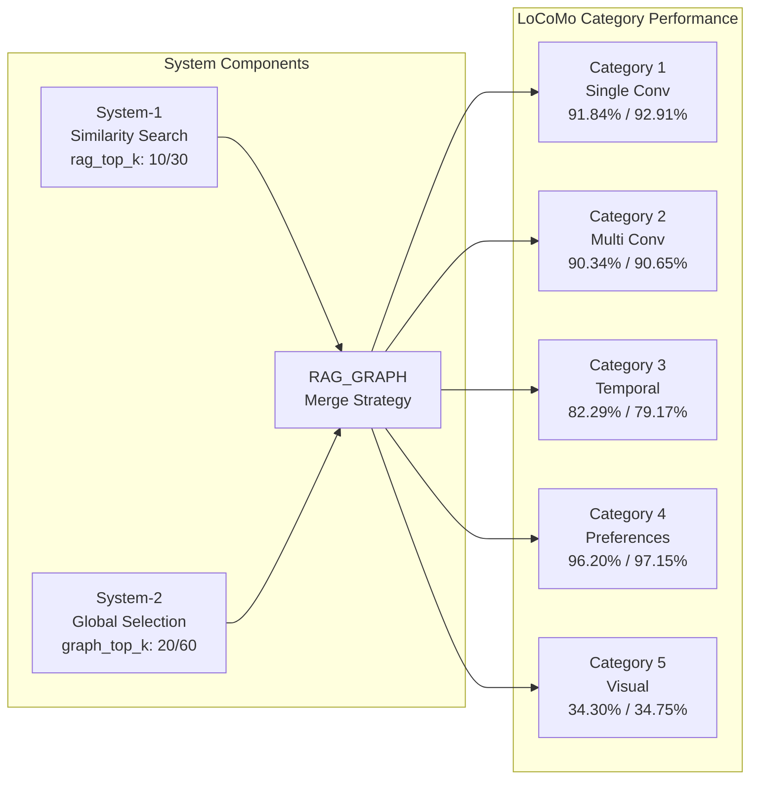
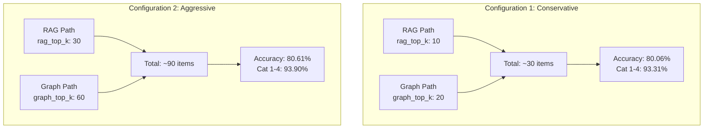
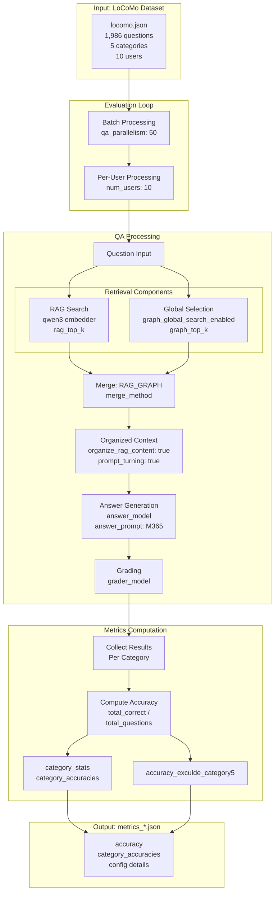
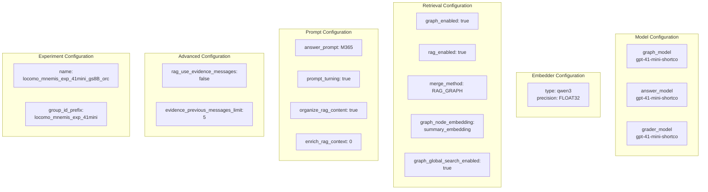

<!-- source: DeepWiki mcp.deepwiki.com · repo microsoft/Mnemis · page 4.2 LoCoMo Results · fetched 2026-10-26 -->

# LoCoMo Results

Relevant source files

The following files were used as context for generating this wiki page:

- [figures/results_locomo.png](figures/results_locomo.png)
- [results/locomo/metrics_graphiti_gpt-41-mini-shortco-2025-04-14-Bing_gpt-41-mini-shortco-2025-04-14-Bing_ragtopk10_gtopk20_RAG_GRAPH.json](results/locomo/metrics_graphiti_gpt-41-mini-shortco-2025-04-14-Bing_gpt-41-mini-shortco-2025-04-14-Bing_ragtopk10_gtopk20_RAG_GRAPH.json)
- [results/locomo/metrics_graphiti_gpt-41-mini-shortco-2025-04-14-Bing_gpt-41-mini-shortco-2025-04-14-Bing_ragtopk30_gtopk60_RAG_GRAPH.json](results/locomo/metrics_graphiti_gpt-41-mini-shortco-2025-04-14-Bing_gpt-41-mini-shortco-2025-04-14-Bing_ragtopk30_gtopk60_RAG_GRAPH.json)

## Purpose and Scope

This page presents detailed performance results for Mnemis on the LoCoMo (Long Conversation Memory) benchmark. For information about the LoCoMo benchmark structure and methodology, see [Benchmark Datasets](#4.1). For comparison with LongMemEval-S results, see [LongMemEval-S Results](#4.3). For analysis of how different retrieval parameters affect performance, see [Configuration Impact Analysis](#4.4).

The results demonstrate Mnemis achieving 80-81% overall accuracy on LoCoMo, with 93.3-93.9% accuracy when excluding category 5 questions (which test reasoning over visual content that the system cannot process).

## Overall Performance Summary

Mnemis was evaluated on LoCoMo using two retrieval configurations with the `RAG_GRAPH` merge method:

| Configuration | Overall Accuracy | Questions Correct | Excluding Cat 5 Accuracy | Questions Correct (No Cat 5) |
|--------------|------------------|-------------------|--------------------------|------------------------------|
| `rag_top_k=10, graph_top_k=20` | 80.06% | 1590/1986 | 93.31% | 1437/1540 |
| `rag_top_k=30, graph_top_k=60` | 80.61% | 1601/1986 | 93.90% | 1446/1540 |

Both configurations used:
- **Models**: `gpt-41-mini-shortco-2025-04-14-Bing` for graph operations, answer generation, and grading
- **Embedder**: `qwen3` with `Precision.FLOAT32`
- **Retrieval**: Dual-route with `graph_global_search_enabled=true`
- **Prompt**: M365 answer prompt with `prompt_turning=true` and `organize_rag_content=true`

**Sources**: 
- [results/locomo/metrics_graphiti_gpt-41-mini-shortco-2025-04-14-Bing_gpt-41-mini-shortco-2025-04-14-Bing_ragtopk10_gtopk20_RAG_GRAPH.json:1-73]()
- [results/locomo/metrics_graphiti_gpt-41-mini-shortco-2025-04-14-Bing_gpt-41-mini-shortco-2025-04-14-Bing_ragtopk30_gtopk60_RAG_GRAPH.json:1-73]()

## Category Performance Breakdown

LoCoMo organizes questions into 5 categories testing different memory capabilities. Performance varies significantly by category:

### Configuration 1: rag_top_k=10, graph_top_k=20

| Category | Correct | Total | Accuracy | Description |
|----------|---------|-------|----------|-------------|
| 1 | 259 | 282 | 91.84% | Single conversation memory |
| 2 | 290 | 321 | 90.34% | Multi-conversation memory |
| 3 | 79 | 96 | 82.29% | Temporal reasoning |
| 4 | 809 | 841 | 96.20% | Preference and fact recall |
| 5 | 153 | 446 | 34.30% | Visual content reasoning |

### Configuration 2: rag_top_k=30, graph_top_k=60

| Category | Correct | Total | Accuracy | Description |
|----------|---------|-------|----------|-------------|
| 1 | 262 | 282 | 92.91% | Single conversation memory |
| 2 | 291 | 321 | 90.65% | Multi-conversation memory |
| 3 | 76 | 96 | 79.17% | Temporal reasoning |
| 4 | 817 | 841 | 97.15% | Preference and fact recall |
| 5 | 155 | 446 | 34.75% | Visual content reasoning |

**Sources**: 
- [results/locomo/metrics_graphiti_gpt-41-mini-shortco-2025-04-14-Bing_gpt-41-mini-shortco-2025-04-14-Bing_ragtopk10_gtopk20_RAG_GRAPH.json:41-69]()
- [results/locomo/metrics_graphiti_gpt-41-mini-shortco-2025-04-14-Bing_gpt-41-mini-shortco-2025-04-14-Bing_ragtopk30_gtopk60_RAG_GRAPH.json:41-69]()

### Category Performance Visualization

**Sources**: 
- [results/locomo/metrics_graphiti_gpt-41-mini-shortco-2025-04-14-Bing_gpt-41-mini-shortco-2025-04-14-Bing_ragtopk10_gtopk20_RAG_GRAPH.json:17-25]()
- [results/locomo/metrics_graphiti_gpt-41-mini-shortco-2025-04-14-Bing_gpt-41-mini-shortco-2025-04-14-Bing_ragtopk30_gtopk60_RAG_GRAPH.json:17-25]()

## Configuration Comparison

The two configurations differ in the number of memory items retrieved from each path:

**Sources**: 
- [results/locomo/metrics_graphiti_gpt-41-mini-shortco-2025-04-14-Bing_gpt-41-mini-shortco-2025-04-14-Bing_ragtopk10_gtopk20_RAG_GRAPH.json:21-22]()
- [results/locomo/metrics_graphiti_gpt-41-mini-shortco-2025-04-14-Bing_gpt-41-mini-shortco-2025-04-14-Bing_ragtopk30_gtopk60_RAG_GRAPH.json:21-22]()

### Performance Differences by Configuration

| Metric | Config 1 (10/20) | Config 2 (30/60) | Δ |
|--------|------------------|------------------|---|
| Overall | 80.06% | 80.61% | +0.55% |
| Category 1 | 91.84% | 92.91% | +1.07% |
| Category 2 | 90.34% | 90.65% | +0.31% |
| Category 3 | 82.29% | 79.17% | -3.12% |
| Category 4 | 96.20% | 97.15% | +0.95% |
| Category 5 | 34.30% | 34.75% | +0.45% |
| **Categories 1-4** | **93.31%** | **93.90%** | **+0.59%** |

The aggressive configuration (30/60) provides marginal improvement on most categories, with the notable exception of Category 3 (temporal reasoning), where performance decreased by 3.12 percentage points. This suggests that for temporal reasoning questions, retrieving more context may introduce noise that confuses the answer model.

**Sources**: 
- [results/locomo/metrics_graphiti_gpt-41-mini-shortco-2025-04-14-Bing_gpt-41-mini-shortco-2025-04-14-Bing_ragtopk10_gtopk20_RAG_GRAPH.json:41-72]()
- [results/locomo/metrics_graphiti_gpt-41-mini-shortco-2025-04-14-Bing_gpt-41-mini-shortco-2025-04-14-Bing_ragtopk30_gtopk60_RAG_GRAPH.json:41-72]()

## Results Generation Pipeline

The following diagram shows how LoCoMo evaluation results are generated, mapping natural language concepts to code entities:

**Sources**: 
- [results/locomo/metrics_graphiti_gpt-41-mini-shortco-2025-04-14-Bing_gpt-41-mini-shortco-2025-04-14-Bing_ragtopk10_gtopk20_RAG_GRAPH.json:7-40]()
- [results/locomo/metrics_graphiti_gpt-41-mini-shortco-2025-04-14-Bing_gpt-41-mini-shortco-2025-04-14-Bing_ragtopk30_gtopk60_RAG_GRAPH.json:7-40]()

## Performance Analysis

### Strong Performance on Categories 1-4

Mnemis demonstrates robust performance across the first four LoCoMo categories:

- **Category 4 (Preferences & Facts)**: 96.20-97.15% accuracy demonstrates excellent recall of explicit user preferences and factual statements
- **Category 1 (Single Conversation)**: 91.84-92.91% shows strong memory within individual conversation contexts
- **Category 2 (Multi-Conversation)**: 90.34-90.65% indicates effective cross-conversation reasoning
- **Category 3 (Temporal)**: 79.17-82.29% represents the most challenging non-visual category, requiring time-based reasoning

The combined accuracy of 93.31-93.90% across categories 1-4 validates the dual-route architecture's effectiveness for text-based conversational memory.

### Category 5 Challenge

Category 5 questions test reasoning over visual content (images, charts, diagrams) mentioned in conversations. The 34.30-34.75% accuracy reflects the system's current limitation:

- The system stores only textual descriptions of visual content
- Questions requiring interpretation of visual details cannot be answered from text alone
- This is an expected limitation given the text-only storage architecture

### Practical Implications

The `accuracy_exculde_category5` metric (93.31-93.90%) represents the system's performance on text-based conversational memory, which is the primary use case. For deployment scenarios:

- Text-based conversation memory: **93-94% accuracy** (categories 1-4)
- Visual content reasoning: **34% accuracy** (category 5) - requires multimodal extensions
- Overall benchmark: **80-81% accuracy** (all categories)

**Sources**: 
- [results/locomo/metrics_graphiti_gpt-41-mini-shortco-2025-04-14-Bing_gpt-41-mini-shortco-2025-04-14-Bing_ragtopk10_gtopk20_RAG_GRAPH.json:70-72]()
- [results/locomo/metrics_graphiti_gpt-41-mini-shortco-2025-04-14-Bing_gpt-41-mini-shortco-2025-04-14-Bing_ragtopk30_gtopk60_RAG_GRAPH.json:70-72]()

## Configuration Details

Both evaluated configurations share the same architectural components:

The only differences between configurations are `rag_top_k` (10 vs 30) and `graph_top_k` (20 vs 60).

**Sources**: 
- [results/locomo/metrics_graphiti_gpt-41-mini-shortco-2025-04-14-Bing_gpt-41-mini-shortco-2025-04-14-Bing_ragtopk10_gtopk20_RAG_GRAPH.json:7-40]()
- [results/locomo/metrics_graphiti_gpt-41-mini-shortco-2025-04-14-Bing_gpt-41-mini-shortco-2025-04-14-Bing_ragtopk30_gtopk60_RAG_GRAPH.json:7-40]()

## Key Findings

1. **State-of-the-art text memory**: 93.3-93.9% accuracy on text-based conversational memory (categories 1-4) represents strong performance on the core use case

2. **Dual-route effectiveness**: The `RAG_GRAPH` merge strategy combining System-1 similarity search and System-2 global selection produces robust results across all question types

3. **Configuration sensitivity**: Increasing retrieval depth (10/20 → 30/60) provides marginal overall improvement (+0.55-0.59%) but may hurt temporal reasoning performance (-3.12% on category 3)

4. **Known limitation**: Visual content reasoning (category 5) at 34% accuracy represents the expected performance ceiling for text-only storage

5. **Parallelism**: Processing 1,986 questions across 10 users with 50 concurrent QA operations demonstrates the system's scalability

**Sources**: 
- [results/locomo/metrics_graphiti_gpt-41-mini-shortco-2025-04-14-Bing_gpt-41-mini-shortco-2025-04-14-Bing_ragtopk10_gtopk20_RAG_GRAPH.json:1-73]()
- [results/locomo/metrics_graphiti_gpt-41-mini-shortco-2025-04-14-Bing_gpt-41-mini-shortco-2025-04-14-Bing_ragtopk30_gtopk60_RAG_GRAPH.json:1-73]()

---

