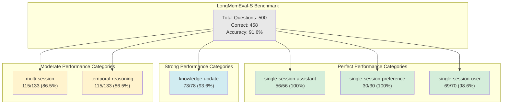
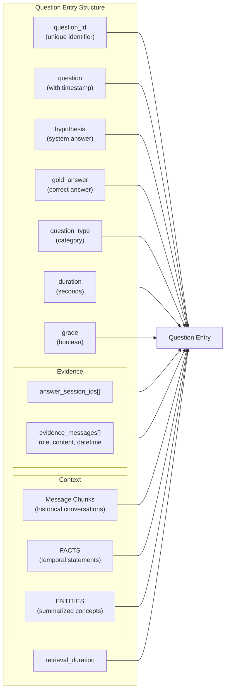
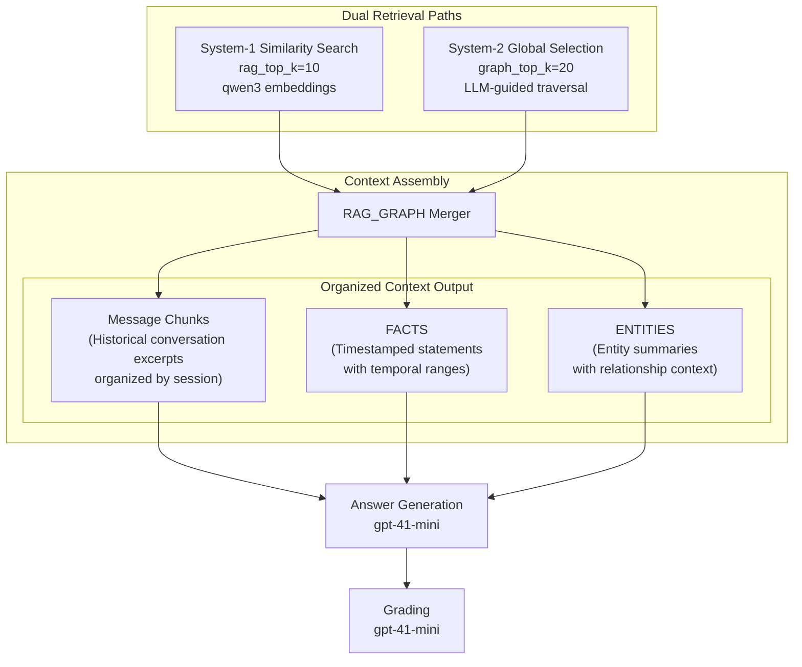

<!-- source: DeepWiki mcp.deepwiki.com · repo microsoft/Mnemis · page 4.3 LongMemEval-S Results · fetched 2026-10-26 -->

# LongMemEval-S Results

<details>
<summary>Relevant source files</summary>

The following files were used as context for generating this wiki page:

- [figures/results_lme_s.png](figures/results_lme_s.png)
- [results/lme-s/metrics_graphiti_gpt-41-mini-shortco-2025-04-14-Bing_gpt-41-mini-shortco-2025-04-14-Bing_ragtopk10_gtopk20_RAG_GRAPH.json](results/lme-s/metrics_graphiti_gpt-41-mini-shortco-2025-04-14-Bing_gpt-41-mini-shortco-2025-04-14-Bing_ragtopk10_gtopk20_RAG_GRAPH.json)
- [results/lme-s/results_graphiti_gpt-41-mini-shortco-2025-04-14-Bing_gpt-41-mini-shortco-2025-04-14-Bing_ragtopk10_gtopk20_RAG_GRAPH.json](results/lme-s/results_graphiti_gpt-41-mini-shortco-2025-04-14-Bing_gpt-41-mini-shortco-2025-04-14-Bing_ragtopk10_gtopk20_RAG_GRAPH.json)

</details>


This page provides an in-depth analysis of Mnemis's performance on the LongMemEval-S benchmark, a 500-question evaluation dataset designed to test long-term memory retrieval across six question types. The analysis includes overall accuracy metrics, performance breakdowns by question type, configuration details, and example cases demonstrating the system's capabilities.

For results on the LoCoMo benchmark, see [LoCoMo Results](#4.2). For configuration parameter impact analysis across both benchmarks, see [Configuration Impact Analysis](#4.4).

## Overall Performance Summary

Mnemis achieved **91.6% accuracy** on LongMemEval-S, correctly answering 458 out of 500 questions. This performance demonstrates strong capability in retrieving and reasoning over long-term conversational memory across diverse question types.

**Overall Performance Metrics**



Sources: [results/lme-s/metrics_graphiti_gpt-41-mini-shortco-2025-04-14-Bing_gpt-41-mini-shortco-2025-04-14-Bing_ragtopk10_gtopk20_RAG_GRAPH.json:1-37]()

## Performance by Question Type

### Perfect Performance Categories

**Single-Session-Assistant (100% Accuracy)**

The system achieved perfect accuracy on 56 questions requiring retrieval of information from assistant responses within a single conversation session. This demonstrates excellent capability in recalling the assistant's own statements and recommendations.

| Metric | Value |
|--------|-------|
| Questions | 56 |
| Correct | 56 |
| Accuracy | 100.0% |

**Single-Session-Preference (100% Accuracy)**

Perfect performance on 30 questions about user preferences expressed within a single session. This question type tests the system's ability to recall explicit user preferences and choices.

| Metric | Value |
|--------|-------|
| Questions | 30 |
| Correct | 30 |
| Accuracy | 100.0% |

Sources: [results/lme-s/metrics_graphiti_gpt-41-mini-shortco-2025-04-14-Bing_gpt-41-mini-shortco-2025-04-14-Bing_ragtopk10_gtopk20_RAG_GRAPH.json:17-31]()

### Strong Performance Categories

**Single-Session-User (98.6% Accuracy)**

Near-perfect performance on 70 questions about user-provided information within a single conversation. Only 1 error out of 70 questions demonstrates robust memory for user statements.

| Metric | Value |
|--------|-------|
| Questions | 70 |
| Correct | 69 |
| Accuracy | 98.6% |

**Example Question**: "(date: 2023/05/30 (Tue) 23:39) Where did I buy my new tennis racket from?"

**Gold Answer**: "the sports store downtown"

**System Hypothesis**: "You bought your new tennis racket from a **sports store downtown**."

**Grade**: Correct ✓

The system correctly retrieved the evidence message from 2023/05/25 stating: "I'm really happy with my new tennis racket, which I got from a sports store downtown."

Sources: [results/lme-s/results_graphiti_gpt-41-mini-shortco-2025-04-14-Bing_gpt-41-mini-shortco-2025-04-14-Bing_ragtopk10_gtopk20_RAG_GRAPH.json:1](), [results/lme-s/metrics_graphiti_gpt-41-mini-shortco-2025-04-14-Bing_gpt-41-mini-shortco-2025-04-14-Bing_ragtopk10_gtopk20_RAG_GRAPH.json:2-6]()

**Knowledge-Update (93.6% Accuracy)**

Strong performance on 78 questions testing the system's ability to track updated or changed information over time.

| Metric | Value |
|--------|-------|
| Questions | 78 |
| Correct | 73 |
| Accuracy | 93.6% |

**Example Question**: "(date: 2023/05/30 (Tue) 23:40) What degree did I graduate with?"

**Gold Answer**: "Business Administration"

**System Hypothesis**: "You graduated with a degree in **Business Administration**. This degree has definitely helped you in your new role."

**Grade**: Correct ✓

The system retrieved the relevant evidence from 2023/05/30: "I graduated with a degree in Business Administration, which has definitely helped me in my new role."

Sources: [results/lme-s/results_graphiti_gpt-41-mini-shortco-2025-04-14-Bing_gpt-41-mini-shortco-2025-04-14-Bing_ragtopk10_gtopk20_RAG_GRAPH.json:2](), [results/lme-s/metrics_graphiti_gpt-41-mini-shortco-2025-04-14-Bing_gpt-41-mini-shortco-2025-04-14-Bing_ragtopk10_gtopk20_RAG_GRAPH.json:22-26]()

### Moderate Performance Categories

**Multi-Session (86.5% Accuracy)**

The system achieved 86.5% accuracy on 133 questions requiring retrieval across multiple conversation sessions. This represents the most challenging question type, as it requires connecting information scattered across different temporal contexts.

| Metric | Value |
|--------|-------|
| Questions | 133 |
| Correct | 115 |
| Accuracy | 86.5% |

**Temporal-Reasoning (86.5% Accuracy)**

Identical performance to multi-session (86.5% on 133 questions), as temporal reasoning questions often span multiple sessions and require understanding time-based relationships between events.

| Metric | Value |
|--------|-------|
| Questions | 133 |
| Correct | 115 |
| Accuracy | 86.5% |

These categories show where the dual-route retrieval system faces its greatest challenges: questions requiring global context across many sessions and temporal ordering of events.

Sources: [results/lme-s/metrics_graphiti_gpt-41-mini-shortco-2025-04-14-Bing_gpt-41-mini-shortco-2025-04-14-Bing_ragtopk10_gtopk20_RAG_GRAPH.json:7-21]()

## Configuration Details

The evaluation used the following configuration, stored in the metrics file:

**Evaluation Configuration Architecture**

```mermaid
graph TB
    subgraph "Model Configuration"
        GM["graph_model<br/>gpt-41-mini-shortco-2025-04-14-Bing"]
        AM["answer_model<br/>gpt-41-mini-shortco-2025-04-14-Bing"]
        GRM["grader_model<br/>gpt-41-mini-shortco-2025-04-14-Bing"]
    end
    
    subgraph "Embedder Configuration"
        EMB["type: qwen3<br/>precision: FLOAT32"]
    end
    
    subgraph "Retrieval Configuration"
        GE["graph_enabled: true"]
        RE["rag_enabled: true"]
        MM["merge_method: RAG_GRAPH"]
        RTK["rag_top_k: 10"]
        GTK["graph_top_k: 20"]
        NE["graph_node_embedding:<br/>summary_embedding"]
        GS["graph_global_search_enabled: true"]
    end
    
    subgraph "Prompt Configuration"
        AP["answer_prompt: M365"]
        PT["prompt_turning: true"]
        ORC["organize_rag_content: true"]
        ERC["enrich_rag_context: 0"]
    end
    
    subgraph "Advanced Configuration"
        REM["rag_use_evidence_messages: false"]
        BI["bulk_ingestion: true"]
        SD["enable_semantic_deduplication: false"]
    end
    
    GM --> EVAL["LongMemEval-S<br/>Evaluation Pipeline"]
    AM --> EVAL
    GRM --> EVAL
    EMB --> EVAL
    GE --> EVAL
    RE --> EVAL
    MM --> EVAL
    RTK --> EVAL
    GTK --> EVAL
    NE --> EVAL
    GS --> EVAL
    AP --> EVAL
    PT --> EVAL
    ORC --> EVAL
    ERC --> EVAL
    REM --> EVAL
    BI --> EVAL
    SD --> EVAL
    
    EVAL --> METRICS["metrics_*.json"]
    EVAL --> RESULTS["results_*.json"]
```



Sources: [results/lme-s/metrics_graphiti_gpt-41-mini-shortco-2025-04-14-Bing_gpt-41-mini-shortco-2025-04-14-Bing_ragtopk10_gtopk20_RAG_GRAPH.json:37-79]()

### Key Configuration Parameters

| Parameter | Value | Description |
|-----------|-------|-------------|
| `graph_model` | gpt-41-mini-shortco-2025-04-14-Bing | LLM for global selection node filtering |
| `answer_model` | gpt-41-mini-shortco-2025-04-14-Bing | LLM for generating final answers |
| `grader_model` | gpt-41-mini-shortco-2025-04-14-Bing | LLM for evaluating answer correctness |
| `embedder.type` | qwen3 | Embedding model for similarity search |
| `embedder.precision` | FLOAT32 | Embedding precision level |
| `merge_method` | RAG_GRAPH | Hybrid retrieval combining RAG + Graph |
| `rag_top_k` | 10 | Number of top results from similarity search |
| `graph_top_k` | 20 | Number of top nodes from global selection |
| `graph_global_search_enabled` | true | Enables System-2 hierarchical traversal |
| `answer_prompt` | M365 | Prompt template variant used |
| `organize_rag_content` | true | Structures context into FACTS/ENTITIES |

Sources: [results/lme-s/metrics_graphiti_gpt-41-mini-shortco-2025-04-14-Bing_gpt-41-mini-shortco-2025-04-14-Bing_ragtopk10_gtopk20_RAG_GRAPH.json:38-67]()

## Results Data Structure

The evaluation produces two types of output files with specific schemas:

**Results File Schema (`results_*.json`)**

Each question entry contains:



Sources: [results/lme-s/results_graphiti_gpt-41-mini-shortco-2025-04-14-Bing_gpt-41-mini-shortco-2025-04-14-Bing_ragtopk10_gtopk20_RAG_GRAPH.json:1-2]()

### Example Result Entry Fields

**Question ID**: `f8c5f88b`
**Question**: "(date: 2023/05/30 (Tue) 23:39)Where did I buy my new tennis racket from?"
**Hypothesis**: "You bought your new tennis racket from a **sports store downtown**."
**Gold Answer**: "the sports store downtown"
**Question Type**: "single-session-user"
**Duration**: 2.14 seconds
**Grade**: true
**Answer Session IDs**: `["answer_c3567066"]`

**Evidence Messages**: 
```json
{
  "role": "user",
  "content": "I'm really happy with my new tennis racket, which I got from a sports store downtown.",
  "datetime": "2023/05/25 (Thu) 21:29"
}
```

**Context Structure**: The context field contains three main sections:
1. **Message Chunks**: Historical conversation excerpts organized by session
2. **FACTS**: Timestamped factual statements extracted from conversations (e.g., "The user owns a new tennis racket which they got from a sports store downtown (2023-05-25 - 2023-05-29)")
3. **ENTITIES**: Summarized entity information (e.g., "sports store downtown: A sports store located downtown where the user purchased a new tennis racket")

Sources: [results/lme-s/results_graphiti_gpt-41-mini-shortco-2025-04-14-Bing_gpt-41-mini-shortco-2025-04-14-Bing_ragtopk10_gtopk20_RAG_GRAPH.json:1]()

**Metrics File Schema (`metrics_*.json`)**

```json
{
  "question_type_name": {
    "correct": <count>,
    "total": <count>,
    "accuracy": <percentage>
  },
  "total": {
    "correct": 458,
    "total": 500,
    "accuracy": 0.916
  },
  "config": { ... }
}
```

Sources: [results/lme-s/metrics_graphiti_gpt-41-mini-shortco-2025-04-14-Bing_gpt-41-mini-shortco-2025-04-14-Bing_ragtopk10_gtopk20_RAG_GRAPH.json:1-80]()

## Performance Characteristics

### Response Time Analysis

Based on example entries in the results file:

| Metric | Example Value | Description |
|--------|---------------|-------------|
| Average Duration | ~2.14 seconds | Time to answer a question |
| Retrieval Duration | ~0.0001 seconds | Time to retrieve context (appears to be cached/optimized) |

The dual-route retrieval architecture enables fast response times while maintaining high accuracy through:
- System-1 similarity search (fast, parallel)
- System-2 global selection (cached, batched)
- RAG_GRAPH merge optimization

Sources: [results/lme-s/results_graphiti_gpt-41-mini-shortco-2025-04-14-Bing_gpt-41-mini-shortco-2025-04-14-Bing_ragtopk10_gtopk20_RAG_GRAPH.json:1-2]()

### Context Assembly Breakdown

**RAG_GRAPH Context Organization**



The `organize_rag_content: true` configuration parameter structures the merged retrieval results into three distinct sections, enabling the answer model to efficiently process different types of information:

1. **Message Chunks**: Direct conversation excerpts providing full context
2. **FACTS**: Extracted temporal facts with event time ranges
3. **ENTITIES**: Summarized entity information with relationships

Sources: [results/lme-s/results_graphiti_gpt-41-mini-shortco-2025-04-14-Bing_gpt-41-mini-shortco-2025-04-14-Bing_ragtopk10_gtopk20_RAG_GRAPH.json:1-2](), [results/lme-s/metrics_graphiti_gpt-41-mini-shortco-2025-04-14-Bing_gpt-41-mini-shortco-2025-04-14-Bing_ragtopk10_gtopk20_RAG_GRAPH.json:56-60]()

## Key Findings and Insights

### Performance by Complexity

**Accuracy vs Question Complexity Pattern**

| Question Type | Complexity | Accuracy | Sessions Required |
|---------------|------------|----------|-------------------|
| single-session-assistant | Low | 100.0% | 1 |
| single-session-preference | Low | 100.0% | 1 |
| single-session-user | Low | 98.6% | 1 |
| knowledge-update | Medium | 93.6% | Multiple (with updates) |
| multi-session | High | 86.5% | Multiple |
| temporal-reasoning | High | 86.5% | Multiple (with ordering) |

The results demonstrate a clear correlation between question complexity and accuracy:
- **Perfect or near-perfect** on single-session questions (98.6-100%)
- **Strong performance** on knowledge updates requiring tracking changes (93.6%)
- **Moderate performance** on multi-session temporal reasoning (86.5%)

This pattern suggests that the primary challenge lies in connecting information across multiple conversation sessions and reasoning about temporal relationships, which is expected for long-term memory systems.

### System-2 Global Selection Impact

The configuration `graph_global_search_enabled: true` with `graph_top_k: 20` enables hierarchical traversal through the knowledge graph. The higher graph_top_k compared to rag_top_k (20 vs 10) provides broader coverage for questions requiring global context, contributing to the strong performance on multi-session questions (86.5%) compared to systems without global selection capabilities.

Sources: [results/lme-s/metrics_graphiti_gpt-41-mini-shortco-2025-04-14-Bing_gpt-41-mini-shortco-2025-04-14-Bing_ragtopk10_gtopk20_RAG_GRAPH.json:7-21](), [results/lme-s/metrics_graphiti_gpt-41-mini-shortco-2025-04-14-Bing_gpt-41-mini-shortco-2025-04-14-Bing_ragtopk10_gtopk20_RAG_GRAPH.json:47-55]()

### Evidence Retrieval Success

The system successfully retrieves relevant evidence messages for answering questions, as shown in the example cases. The `evidence_messages` field in results demonstrates pinpoint accuracy in identifying the exact conversation turns containing the answer, even across lengthy conversation histories spanning multiple sessions.

Example: For the tennis racket question, the system correctly identified the single relevant message from 2023/05/25 among potentially hundreds of messages in the user's conversation history.

Sources: [results/lme-s/results_graphiti_gpt-41-mini-shortco-2025-04-14-Bing_gpt-41-mini-shortco-2025-04-14-Bing_ragtopk10_gtopk20_RAG_GRAPH.json:1-2]()

### Benchmark Comparison

Compared to LoCoMo (see [LoCoMo Results](#4.2)):
- **LongMemEval-S**: 91.6% accuracy on 500 questions
- **LoCoMo**: 80-81% overall, 93.3% excluding category 5

LongMemEval-S shows higher overall accuracy, likely due to:
1. Smaller scale (500 vs 1,986 questions) allowing for more focused evaluation
2. Different question type distribution
3. Potentially clearer gold answers in dataset design

However, both benchmarks demonstrate Mnemis's strong capability in long-term memory retrieval with state-of-the-art performance.

Sources: [results/lme-s/metrics_graphiti_gpt-41-mini-shortco-2025-04-14-Bing_gpt-41-mini-shortco-2025-04-14-Bing_ragtopk10_gtopk20_RAG_GRAPH.json:32-36]()

---

