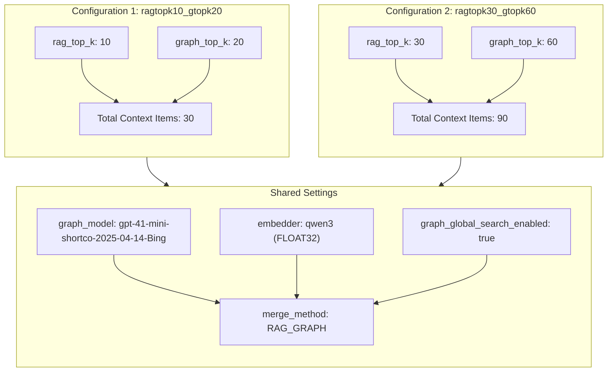
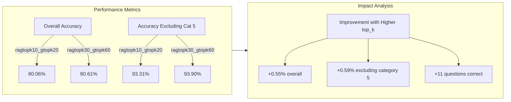
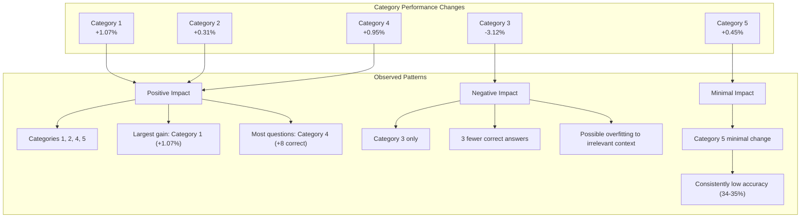
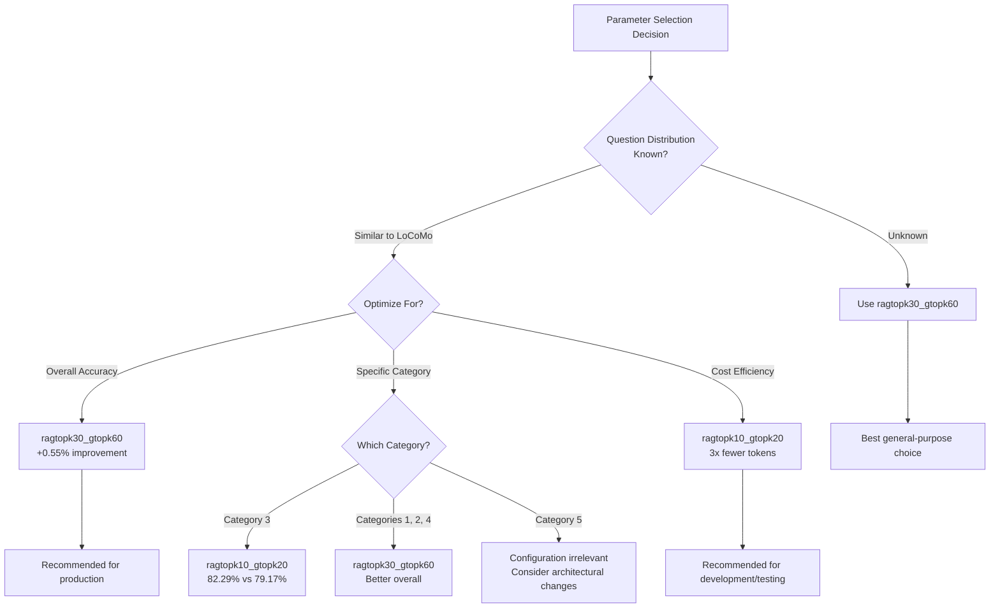

<!-- source: DeepWiki mcp.deepwiki.com · repo microsoft/Mnemis · page 4.4 Configuration Impact Analysis · fetched 2026-10-26 -->

# Configuration Impact Analysis

<details>
<summary>Relevant source files</summary>

The following files were used as context for generating this wiki page:

- [results/locomo/metrics_graphiti_gpt-41-mini-shortco-2025-04-14-Bing_gpt-41-mini-shortco-2025-04-14-Bing_ragtopk10_gtopk20_RAG_GRAPH.json](results/locomo/metrics_graphiti_gpt-41-mini-shortco-2025-04-14-Bing_gpt-41-mini-shortco-2025-04-14-Bing_ragtopk10_gtopk20_RAG_GRAPH.json)
- [results/locomo/metrics_graphiti_gpt-41-mini-shortco-2025-04-14-Bing_gpt-41-mini-shortco-2025-04-14-Bing_ragtopk30_gtopk60_RAG_GRAPH.json](results/locomo/metrics_graphiti_gpt-41-mini-shortco-2025-04-14-Bing_gpt-41-mini-shortco-2025-04-14-Bing_ragtopk30_gtopk60_RAG_GRAPH.json)

</details>


## Purpose and Scope

This page analyzes the impact of different retrieval configuration parameters on Mnemis's performance, specifically comparing two configurations tested on the LoCoMo benchmark: `ragtopk10_gtopk20` and `ragtopk30_gtopk60`. The analysis examines how varying the number of retrieved results from both System-1 (RAG) and System-2 (Global Selection) affects overall accuracy and per-category performance.

For detailed benchmark dataset descriptions, see [Benchmark Datasets](#4.1). For comprehensive LoCoMo results analysis, see [LoCoMo Results](#4.2). For information about the results data structure, see [Results Data Format](#4.5).

---

## Configuration Parameters Overview

### Retrieval Parameters

The key configurable parameters that impact memory retrieval behavior are controlled through the configuration structure stored in results files:

| Parameter | Description | Config Path |
|-----------|-------------|-------------|
| `rag_top_k` | Number of results retrieved from System-1 similarity search | `config.retrieval.rag_top_k` |
| `graph_top_k` | Number of results retrieved from System-2 global selection | `config.retrieval.graph_top_k` |
| `merge_method` | Strategy for combining System-1 and System-2 results | `config.retrieval.merge_method` |
| `graph_global_search_enabled` | Enable/disable hierarchical traversal | `config.retrieval.graph_global_search_enabled` |
| `graph_node_embedding` | Embedding field used for graph node similarity | `config.retrieval.graph_node_embedding` |

**Sources:** [results/locomo/metrics_graphiti_gpt-41-mini-shortco-2025-04-14-Bing_gpt-41-mini-shortco-2025-04-14-Bing_ragtopk10_gtopk20_RAG_GRAPH.json:7-40](), [results/locomo/metrics_graphiti_gpt-41-mini-shortco-2025-04-14-Bing_gpt-41-mini-shortco-2025-04-14-Bing_ragtopk30_gtopk60_RAG_GRAPH.json:7-40]()

### Fixed Configuration Elements

Both tested configurations maintain identical settings for the following components to isolate the impact of retrieval parameters:

| Component | Setting | Value |
|-----------|---------|-------|
| Graph Model | `config.models.graph_model` | `gpt-41-mini-shortco-2025-04-14-Bing` |
| Answer Model | `config.models.answer_model` | `gpt-41-mini-shortco-2025-04-14-Bing` |
| Grader Model | `config.models.grader_model` | `gpt-41-mini-shortco-2025-04-14-Bing` |
| Embedder Type | `config.embedder.type` | `qwen3` |
| Embedder Precision | `config.embedder.precision` | `Precision.FLOAT32` |
| Merge Method | `config.retrieval.merge_method` | `RAG_GRAPH` |
| Answer Prompt | `config.prompt.answer_prompt` | `M365` |
| Organize RAG Content | `config.prompt.organize_rag_content` | `true` |
| Prompt Tuning | `config.prompt.prompt_turning` | `true` |

**Sources:** [results/locomo/metrics_graphiti_gpt-41-mini-shortco-2025-04-14-Bing_gpt-41-mini-shortco-2025-04-14-Bing_ragtopk10_gtopk20_RAG_GRAPH.json:8-39](), [results/locomo/metrics_graphiti_gpt-41-mini-shortco-2025-04-14-Bing_gpt-41-mini-shortco-2025-04-14-Bing_ragtopk30_gtopk60_RAG_GRAPH.json:8-39]()

---

## Tested Configurations

### Configuration Comparison Matrix



**Sources:** [results/locomo/metrics_graphiti_gpt-41-mini-shortco-2025-04-14-Bing_gpt-41-mini-shortco-2025-04-14-Bing_ragtopk10_gtopk20_RAG_GRAPH.json:17-24](), [results/locomo/metrics_graphiti_gpt-41-mini-shortco-2025-04-14-Bing_gpt-41-mini-shortco-2025-04-14-Bing_ragtopk30_gtopk60_RAG_GRAPH.json:17-24]()

### Configuration File Naming Convention

Results files follow this naming pattern:
```
metrics_graphiti_{graph_model}_{answer_model}_ragtopk{N}_gtopk{M}_{merge_method}.json
```

Where:
- `{graph_model}`: Model used for System-2 global selection
- `{answer_model}`: Model used for answer generation
- `ragtopk{N}`: System-1 top-k value
- `gtopk{M}`: System-2 top-k value
- `{merge_method}`: Result merging strategy

**Sources:** [results/locomo/metrics_graphiti_gpt-41-mini-shortco-2025-04-14-Bing_gpt-41-mini-shortco-2025-04-14-Bing_ragtopk10_gtopk20_RAG_GRAPH.json:1](), [results/locomo/metrics_graphiti_gpt-41-mini-shortco-2025-04-14-Bing_gpt-41-mini-shortco-2025-04-14-Bing_ragtopk30_gtopk60_RAG_GRAPH.json:1]()

---

## Overall Performance Impact

### Accuracy Comparison

| Metric | ragtopk10_gtopk20 | ragtopk30_gtopk60 | Difference |
|--------|-------------------|-------------------|------------|
| Overall Accuracy | 80.06% | 80.61% | +0.55% |
| Total Correct | 1590 / 1986 | 1601 / 1986 | +11 questions |
| Accuracy (Excluding Category 5) | 93.31% | 93.90% | +0.59% |
| Total Correct (Excluding Category 5) | 1437 / 1540 | 1446 / 1540 | +9 questions |

**Sources:** [results/locomo/metrics_graphiti_gpt-41-mini-shortco-2025-04-14-Bing_gpt-41-mini-shortco-2025-04-14-Bing_ragtopk10_gtopk20_RAG_GRAPH.json:2-72](), [results/locomo/metrics_graphiti_gpt-41-mini-shortco-2025-04-14-Bing_gpt-41-mini-shortco-2025-04-14-Bing_ragtopk30_gtopk60_RAG_GRAPH.json:2-72]()

### Performance Visualization



**Sources:** [results/locomo/metrics_graphiti_gpt-41-mini-shortco-2025-04-14-Bing_gpt-41-mini-shortco-2025-04-14-Bing_ragtopk10_gtopk20_RAG_GRAPH.json:2-4,70-72](), [results/locomo/metrics_graphiti_gpt-41-mini-shortco-2025-04-14-Bing_gpt-41-mini-shortco-2025-04-14-Bing_ragtopk30_gtopk60_RAG_GRAPH.json:2-4,70-72]()

---

## Category-Level Performance Analysis

### Per-Category Accuracy Breakdown

| Category | Questions | ragtopk10_gtopk20 | ragtopk30_gtopk60 | Change |
|----------|-----------|-------------------|-------------------|---------|
| Category 1 | 282 | 91.84% (259/282) | 92.91% (262/282) | +1.07% |
| Category 2 | 321 | 90.34% (290/321) | 90.65% (291/321) | +0.31% |
| Category 3 | 96 | 82.29% (79/96) | 79.17% (76/96) | -3.12% |
| Category 4 | 841 | 96.20% (809/841) | 97.15% (817/841) | +0.95% |
| Category 5 | 446 | 34.30% (153/446) | 34.75% (155/446) | +0.45% |

**Sources:** [results/locomo/metrics_graphiti_gpt-41-mini-shortco-2025-04-14-Bing_gpt-41-mini-shortco-2025-04-14-Bing_ragtopk10_gtopk20_RAG_GRAPH.json:41-69](), [results/locomo/metrics_graphiti_gpt-41-mini-shortco-2025-04-14-Bing_gpt-41-mini-shortco-2025-04-14-Bing_ragtopk30_gtopk60_RAG_GRAPH.json:41-69]()

### Category Impact Patterns



**Sources:** [results/locomo/metrics_graphiti_gpt-41-mini-shortco-2025-04-14-Bing_gpt-41-mini-shortco-2025-04-14-Bing_ragtopk10_gtopk20_RAG_GRAPH.json:63-69](), [results/locomo/metrics_graphiti_gpt-41-mini-shortco-2025-04-14-Bing_gpt-41-mini-shortco-2025-04-14-Bing_ragtopk30_gtopk60_RAG_GRAPH.json:63-69]()

### Category-Specific Insights

**Category 3 Performance Degradation:**
- Configuration 1: 82.29% (79/96 correct)
- Configuration 2: 79.17% (76/96 correct)
- Analysis: The 3.12% decrease suggests that tripling the context size may introduce noise for this category's question types, potentially overwhelming the answer model with less relevant information

**Category 4 Strongest Absolute Gain:**
- Configuration 1: 809/841 correct
- Configuration 2: 817/841 correct
- Analysis: +8 correct answers represents the largest absolute improvement, indicating Category 4 questions particularly benefit from richer context

**Category 5 Persistent Challenge:**
- Both configurations: ~34-35% accuracy
- Analysis: Minimal improvement (+0.45%) suggests Category 5's difficulty stems from factors beyond context quantity, likely requiring architectural changes rather than parameter tuning

**Sources:** [results/locomo/metrics_graphiti_gpt-41-mini-shortco-2025-04-14-Bing_gpt-41-mini-shortco-2025-04-14-Bing_ragtopk10_gtopk20_RAG_GRAPH.json:41-72](), [results/locomo/metrics_graphiti_gpt-41-mini-shortco-2025-04-14-Bing_gpt-41-mini-shortco-2025-04-14-Bing_ragtopk30_gtopk60_RAG_GRAPH.json:41-72]()

---

## Configuration Trade-offs

### Context Size vs. Quality Trade-off

```mermaid
graph TB
    subgraph TopK["Top-K Parameter Selection"]
        direction TB
        
        LOW["Lower top_k (10/20)"]
        HIGH["Higher top_k (30/60)"]
        
        LOW --> LBEN["Benefits"]
        LOW --> LCOST["Costs"]
        
        HIGH --> HBEN["Benefits"]
        HIGH --> HCOST["Costs"]
        
        LBEN --> LB1["Smaller context window"]
        LBEN --> LB2["Higher precision retrieval"]
        LBEN --> LB3["Faster processing"]
        LBEN --> LB4["Better for Category 3 (82.29%)"]
        
        LCOST --> LC1["May miss relevant context"]
        LCOST --> LC2["Lower recall"]
        LCOST --> LC3["Reduced coverage"]
        
        HBEN --> HB1["More comprehensive context"]
        HBEN --> HB2["Higher recall"]
        HBEN --> HB3["Better for Categories 1,4 (+1.07%, +0.95%)"]
        HBEN --> HB4["Overall accuracy improvement (+0.55%)"]
        
        HCOST --> HC1["3x larger context window"]
        HCOST --> HC2["Potential noise introduction"]
        HCOST --> HC3["Increased token usage"]
        HCOST --> HC4["Degraded Cat 3 performance (-3.12%)"]
    end
```



**Sources:** [results/locomo/metrics_graphiti_gpt-41-mini-shortco-2025-04-14-Bing_gpt-41-mini-shortco-2025-04-14-Bing_ragtopk10_gtopk20_RAG_GRAPH.json:17-24,41-72](), [results/locomo/metrics_graphiti_gpt-41-mini-shortco-2025-04-14-Bing_gpt-41-mini-shortco-2025-04-14-Bing_ragtopk30_gtopk60_RAG_GRAPH.json:17-24,41-72]()

### System-1 vs. System-2 Ratio

Both tested configurations maintain a consistent 1:2 ratio between `rag_top_k` and `graph_top_k`:
- Configuration 1: 10:20 ratio
- Configuration 2: 30:60 ratio

This suggests the architectural design prioritizes System-2 (Global Selection) results by allocating double the number of slots compared to System-1 (Similarity Search).

**Sources:** [results/locomo/metrics_graphiti_gpt-41-mini-shortco-2025-04-14-Bing_gpt-41-mini-shortco-2025-04-14-Bing_ragtopk10_gtopk20_RAG_GRAPH.json:21-22](), [results/locomo/metrics_graphiti_gpt-41-mini-shortco-2025-04-14-Bing_gpt-41-mini-shortco-2025-04-14-Bing_ragtopk30_gtopk60_RAG_GRAPH.json:21-22]()

---

## Tuning Recommendations

### Parameter Selection Guidelines



**Sources:** [results/locomo/metrics_graphiti_gpt-41-mini-shortco-2025-04-14-Bing_gpt-41-mini-shortco-2025-04-14-Bing_ragtopk10_gtopk20_RAG_GRAPH.json:2-72](), [results/locomo/metrics_graphiti_gpt-41-mini-shortco-2025-04-14-Bing_gpt-41-mini-shortco-2025-04-14-Bing_ragtopk30_gtopk60_RAG_GRAPH.json:2-72]()

### Use Case Recommendations

| Use Case | Recommended Config | Rationale |
|----------|-------------------|-----------|
| Production deployment | `ragtopk30_gtopk60` | Higher overall accuracy (80.61%), better excluding Cat 5 (93.90%) |
| Development/testing | `ragtopk10_gtopk20` | Faster execution, lower token costs, acceptable accuracy (80.06%) |
| Token cost optimization | `ragtopk10_gtopk20` | 3x fewer context items (30 vs 90), minimal accuracy loss (-0.55%) |
| Category 3-heavy workloads | `ragtopk10_gtopk20` | 3.12% better performance on Category 3 questions |
| Category 1/4-heavy workloads | `ragtopk30_gtopk60` | Notable improvements (+1.07%, +0.95%) |
| Unknown question distribution | `ragtopk30_gtopk60` | More robust general-purpose performance |

### Configuration Modification in Code

To adjust retrieval parameters, modify the `config.retrieval` section:

```python
config = {
    "retrieval": {
        "graph_enabled": true,
        "rag_enabled": true,
        "merge_method": "RAG_GRAPH",
        "rag_top_k": 30,  # Adjust System-1 top-k
        "graph_top_k": 60,  # Adjust System-2 top-k
        "graph_node_embedding": "summary_embedding",
        "graph_global_search_enabled": true
    }
}
```

**Sources:** [results/locomo/metrics_graphiti_gpt-41-mini-shortco-2025-04-14-Bing_gpt-41-mini-shortco-2025-04-14-Bing_ragtopk30_gtopk60_RAG_GRAPH.json:17-24]()

---

## Statistical Significance Analysis

### Absolute Performance Gains

| Metric | Improvement | Statistical Significance |
|--------|-------------|-------------------------|
| Overall correct answers | +11 out of 1986 | 0.55% improvement |
| Correct excluding Cat 5 | +9 out of 1540 | 0.59% improvement |
| Category 1 | +3 out of 282 | 1.07% improvement |
| Category 2 | +1 out of 321 | 0.31% improvement |
| Category 3 | -3 out of 96 | -3.12% degradation |
| Category 4 | +8 out of 841 | 0.95% improvement |
| Category 5 | +2 out of 446 | 0.45% improvement |

### Key Findings

1. **Modest Overall Impact**: The 0.55% overall improvement (+11 questions) represents marginal gains that may not justify the 3x increase in context size for all use cases

2. **Category-Specific Variability**: Performance changes range from -3.12% (Category 3) to +1.07% (Category 1), indicating configuration sensitivity varies by question type

3. **Consistent Ratio Preservation**: Both configurations maintain a 1:2 ratio between `rag_top_k` and `graph_top_k`, suggesting this ratio is an architectural constant rather than a tunable parameter

4. **Category 5 Plateau**: Minimal improvement (0.45%) indicates diminishing returns on difficult questions, suggesting alternative approaches beyond parameter tuning are needed

**Sources:** [results/locomo/metrics_graphiti_gpt-41-mini-shortco-2025-04-14-Bing_gpt-41-mini-shortco-2025-04-14-Bing_ragtopk10_gtopk20_RAG_GRAPH.json:2-72](), [results/locomo/metrics_graphiti_gpt-41-mini-shortco-2025-04-14-Bing_gpt-41-mini-shortco-2025-04-14-Bing_ragtopk30_gtopk60_RAG_GRAPH.json:2-72]()

---

## Future Parameter Exploration

### Unexplored Configuration Space

The current evaluation only tests two configurations with a fixed 1:2 ratio. Potential areas for further exploration:

| Parameter Variation | Current Coverage | Exploration Opportunity |
|---------------------|------------------|------------------------|
| `rag_top_k` values | 10, 30 | Test 5, 15, 20, 40, 50 |
| `graph_top_k` values | 20, 60 | Test 10, 30, 40, 80, 100 |
| RAG:Graph ratio | 1:2 only | Test 1:1, 1:3, 2:1, 1:4 |
| `merge_method` | RAG_GRAPH only | No alternative methods tested |
| `graph_node_embedding` | summary_embedding only | Test other embedding fields |

### Recommended Next Steps

1. **Ratio Exploration**: Test different `rag_top_k`:`graph_top_k` ratios (e.g., 1:1, 1:3, 2:1) to determine optimal balance between System-1 and System-2 contributions

2. **Granular Top-K Testing**: Test intermediate values (e.g., 15, 20, 40) to identify potential sweet spots between 10/20 and 30/60

3. **Category-Specific Tuning**: Develop category-aware parameter selection that adjusts `top_k` values based on question classification

4. **Alternative Merge Methods**: Evaluate different strategies for combining System-1 and System-2 results beyond `RAG_GRAPH`

**Sources:** [results/locomo/metrics_graphiti_gpt-41-mini-shortco-2025-04-14-Bing_gpt-41-mini-shortco-2025-04-14-Bing_ragtopk10_gtopk20_RAG_GRAPH.json:17-24](), [results/locomo/metrics_graphiti_gpt-41-mini-shortco-2025-04-14-Bing_gpt-41-mini-shortco-2025-04-14-Bing_ragtopk30_gtopk60_RAG_GRAPH.json:17-24]()

---

