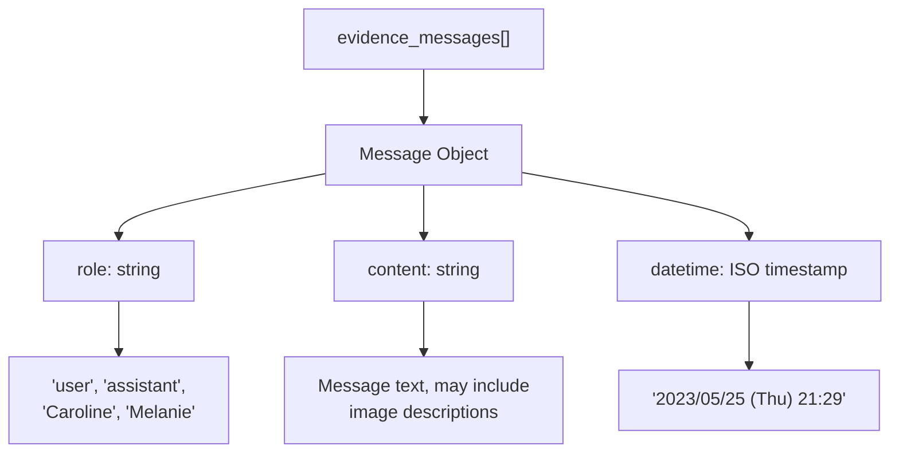
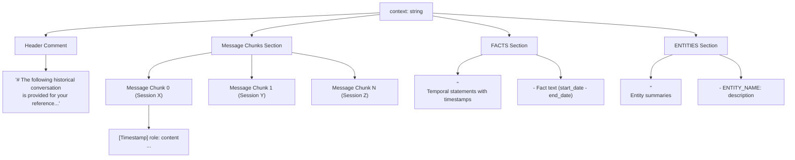
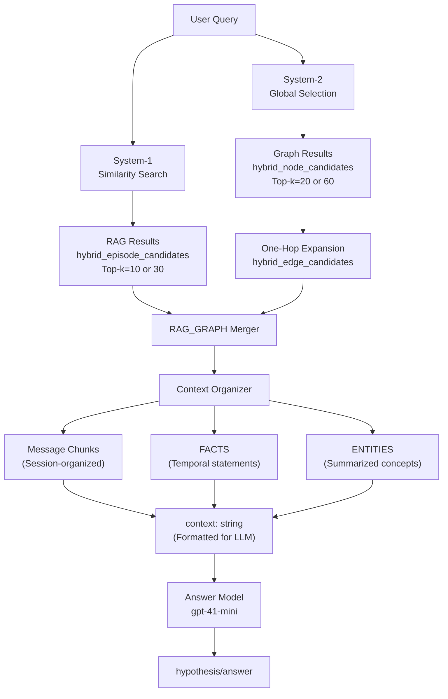
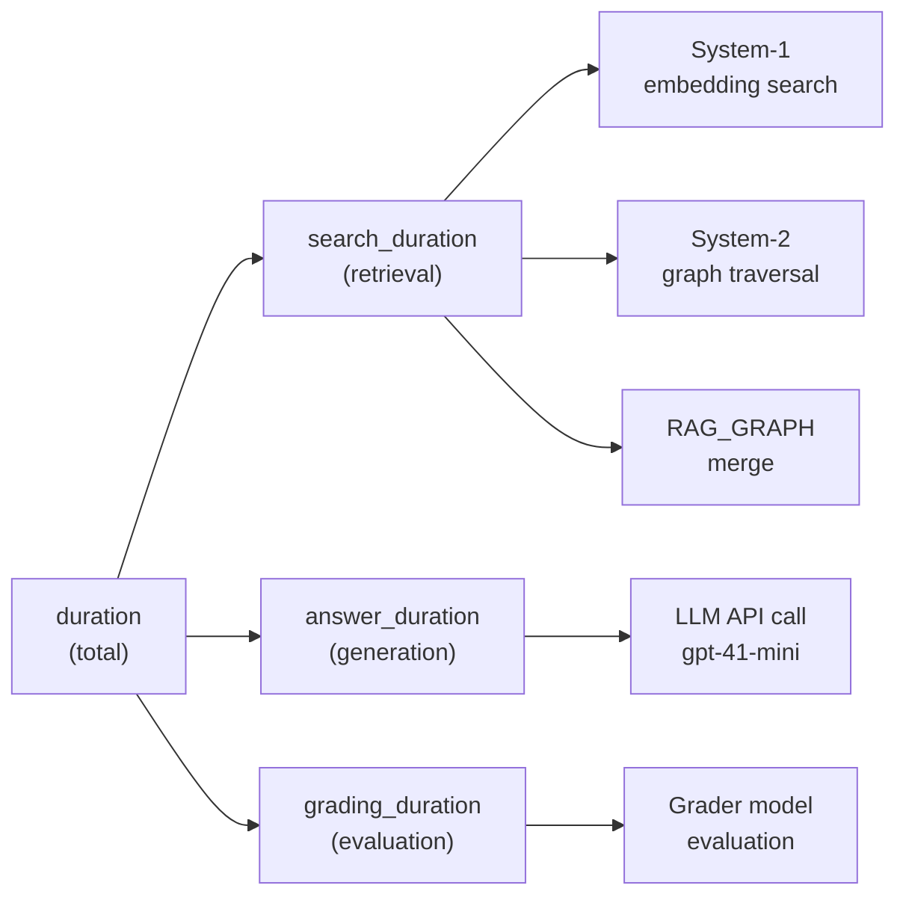

<!-- source: DeepWiki mcp.deepwiki.com · repo microsoft/Mnemis · page 4.5 Results Data Format · fetched 2026-10-26 -->

# Results Data Format

<details>
<summary>Relevant source files</summary>

The following files were used as context for generating this wiki page:

- [results/lme-s/results_graphiti_gpt-41-mini-shortco-2025-04-14-Bing_gpt-41-mini-shortco-2025-04-14-Bing_ragtopk10_gtopk20_RAG_GRAPH.json](results/lme-s/results_graphiti_gpt-41-mini-shortco-2025-04-14-Bing_gpt-41-mini-shortco-2025-04-14-Bing_ragtopk10_gtopk20_RAG_GRAPH.json)
- [results/locomo/results_graphiti_gpt-41-mini-shortco-2025-04-14-Bing_gpt-41-mini-shortco-2025-04-14-Bing_ragtopk10_gtopk20_RAG_GRAPH.json](results/locomo/results_graphiti_gpt-41-mini-shortco-2025-04-14-Bing_gpt-41-mini-shortco-2025-04-14-Bing_ragtopk10_gtopk20_RAG_GRAPH.json)

</details>


This page documents the structure and content of the JSON results files generated by Mnemis evaluation runs. These files contain detailed question-answer pairs, retrieval context, evidence messages, and performance metrics for benchmark evaluation.

For information about the evaluation process itself and how these results are generated, see [Running Evaluations](#6.3). For analysis of specific benchmark performance, see [LoCoMo Results](#4.2) and [LongMemEval-S Results](#4.3).

---

## Overview

Results files are stored in the `results/` directory, organized by benchmark dataset (e.g., `results/locomo/`, `results/lme-s/`). Each file is a newline-delimited JSON (NDJSON) format where each line represents a single question-answer evaluation record. The filename encodes the configuration used:

```
results_<graph_model>_<answer_model>_<retrieval_config>_<merge_method>.json
```

Example: `results_graphiti_gpt-41-mini-shortco-2025-04-14-Bing_gpt-41-mini-shortco-2025-04-14-Bing_ragtopk10_gtopk20_RAG_GRAPH.json`

**Sources:** [results/lme-s/results_graphiti_gpt-41-mini-shortco-2025-04-14-Bing_gpt-41-mini-shortco-2025-04-14-Bing_ragtopk10_gtopk20_RAG_GRAPH.json:1-7]()

---

## Top-Level Record Structure

Each JSON record in a results file contains the following top-level fields:

### Core Question-Answer Fields

| Field | Type | Description |
|-------|------|-------------|
| `question_id` | string | Unique identifier for the question (e.g., "f8c5f88b") |
| `question` | string | The question text, including date context in format "(date: YYYY/MM/DD (Day) HH:MM)Question" |
| `hypothesis` / `answer` | string | The generated answer from the system |
| `gold_answer` / `golden_answer` | string | The expected correct answer for evaluation |
| `question_type` | string | Category of question (e.g., "single-session-user", "single-session-assistant") |
| `grade` | boolean | Whether the answer was judged correct (true/false) |

### Dataset-Specific Indices

| Field | Type | Description | Dataset |
|-------|------|-------------|---------|
| `user_idx` | integer | User index in the dataset | LoCoMo |
| `qa_idx` | integer | Question-answer pair index | LoCoMo |
| `category` | integer | Question category number (1-5) | LoCoMo |

### Timing Metrics

| Field | Type | Description |
|-------|------|-------------|
| `duration` | float | Total processing time in seconds |
| `search_duration` | float | Time spent on retrieval (System-1 + System-2) |
| `answer_duration` | float | Time spent generating the answer via LLM |
| `grading_duration` | float | Time spent evaluating the answer |
| `retrieval_duration` | float | Low-level retrieval operation time |

**Sources:** [results/lme-s/results_graphiti_gpt-41-mini-shortco-2025-04-14-Bing_gpt-41-mini-shortco-2025-04-14-Bing_ragtopk10_gtopk20_RAG_GRAPH.json:1](), [results/locomo/results_graphiti_gpt-41-mini-shortco-2025-04-14-Bing_gpt-41-mini-shortco-2025-04-14-Bing_ragtopk10_gtopk20_RAG_GRAPH.json:1]()

---

## Evidence Messages Structure

The `evidence` or `evidence_messages` field contains the specific conversation messages that directly answer the question. This is the ground truth evidence from the dataset.

### Evidence Message Object



### Evidence Configuration

| Field | Type | Description |
|-------|------|-------------|
| `answer_session_ids` | string[] | List of session IDs used in answer generation (LongMemEval-S) |
| `evidence_previous_messages_limit` | integer | Context window size for evidence messages (LoCoMo) |

**Example Evidence Message:**
```json
{
  "role": "user",
  "content": "I'll definitely do those exercises before playing tennis. By the way, I'm really happy with my new tennis racket, which I got from a sports store downtown.",
  "datetime": "2023/05/25 (Thu) 21:29"
}
```

**Sources:** [results/lme-s/results_graphiti_gpt-41-mini-shortco-2025-04-14-Bing_gpt-41-mini-shortco-2025-04-14-Bing_ragtopk10_gtopk20_RAG_GRAPH.json:1]()

---

## Context Structure

The `context` field contains the full structured context assembled by the RAG_GRAPH merge strategy. This is a formatted string containing three main sections: Message Chunks, FACTS, and ENTITIES.



### Message Chunks Section

Message Chunks organize historical conversations by session:

```
Message Chunk 0 (Session 1):
[2023/05/08 (Mon) 13:57] Caroline: I went to a LGBTQ support group yesterday...

Message Chunk 1 (Session 3):
[2023/06/09 (Fri) 19:55] Caroline: Hey Melanie! How's it going?...
```

Each chunk includes:
- **Session identifier**: `(Session N)` indicates which conversation session
- **Timestamped messages**: Format `[YYYY/MM/DD (Day) HH:MM] role: content`
- **Truncation indicators**: `...` shows where content is abbreviated

### FACTS Section

The FACTS section contains temporal statements extracted from the knowledge graph:

```xml
<FACTS>
  - The user owns a new tennis racket which they got from a sports store downtown. (2023-05-25 - 2023-05-29)
  - Caroline attended a LGBTQ support group yesterday. (2023-05-07 - now)
  - Melanie ran a charity race for mental health last Saturday. (2023-05-20 - now)
</FACTS>
```

**Format**: `- [Fact statement] ([start_date] - [end_date])`
- **Timestamps represent event time**, not when the fact was stated
- Date format: `YYYY-MM-DD` or `now` for ongoing facts
- Facts are temporally grounded and include validity periods

### ENTITIES Section

The ENTITIES section contains summarized entity descriptions:

```xml
<ENTITIES>
  - sports store downtown: A sports store located downtown where the user purchased a new tennis racket.
  - tennis racket: Sports equipment mentioned as a new purchase that improved the user's game.
  - Caroline: A transgender woman and artist preparing for adoption.
</ENTITIES>
```

**Format**: `- [ENTITY_NAME]: [summary description]`
- Entity names are extracted from the hierarchical graph
- Summaries consolidate information from multiple mentions
- Cross-references to related entities and events

**Sources:** [results/lme-s/results_graphiti_gpt-41-mini-shortco-2025-04-14-Bing_gpt-41-mini-shortco-2025-04-14-Bing_ragtopk10_gtopk20_RAG_GRAPH.json:1]()

---

## Retrieval Candidates Fields

These fields track intermediate retrieval results from the dual-route system:

| Field | Type | Description |
|-------|------|-------------|
| `hybrid_episode_candidates` | object[] / null | Episode node candidates from System-1 similarity search |
| `hybrid_edge_candidates` | object[] / null | Edge/relationship candidates from graph traversal |
| `hybrid_node_candidates` | object[] / null | Entity node candidates from System-2 global selection |
| `num_retrieved_messages` | integer | Total number of messages retrieved |
| `similarity_scores` | float[] | Similarity scores from embedding-based retrieval |

These fields may be `null` or empty arrays depending on the retrieval configuration.

**Sources:** [results/lme-s/results_graphiti_gpt-41-mini-shortco-2025-04-14-Bing_gpt-41-mini-shortco-2025-04-14-Bing_ragtopk10_gtopk20_RAG_GRAPH.json:1]()

---

## Merge Method Field

The `merge_method` field indicates the strategy used to combine System-1 and System-2 results:

| Value | Description |
|-------|-------------|
| `RAG_GRAPH` | Hybrid merge combining similarity search (RAG) and hierarchical graph selection |
| `RAG` | System-1 only (similarity search) |
| `GRAPH` | System-2 only (global selection) |

The RAG_GRAPH method produces the richest context by merging:
- Top-k results from embedding-based similarity search
- Top-k nodes from LLM-guided hierarchical traversal
- One-hop neighbors of selected nodes
- Organized into Message Chunks, FACTS, and ENTITIES

**Sources:** [results/locomo/results_graphiti_gpt-41-mini-shortco-2025-04-14-Bing_gpt-41-mini-shortco-2025-04-14-Bing_ragtopk10_gtopk20_RAG_GRAPH.json:1]()

---

## Context Assembly Flow

This diagram shows how retrieval results are transformed into the structured context format:



**Sources:** [results/lme-s/results_graphiti_gpt-41-mini-shortco-2025-04-14-Bing_gpt-41-mini-shortco-2025-04-14-Bing_ragtopk10_gtopk20_RAG_GRAPH.json:1]()

---

## Performance Metrics Interpretation

### Timing Breakdown



### Typical Timing Values

Based on the sample data:

| Metric | Typical Range | Example |
|--------|---------------|---------|
| `duration` | 2-3 seconds | 2.143 s |
| `search_duration` | 0.3-1.0 seconds | 0.374 s |
| `answer_duration` | 3-6 seconds | 4.050 s |
| `grading_duration` | 0.6-1.7 seconds | 0.886 s |
| `retrieval_duration` | 1e-5 seconds | 1.168e-05 s (cached) |

**Note**: Very low `retrieval_duration` values (e.g., 1e-5) indicate cache hits from the `alru_cache` layer.

**Sources:** [results/lme-s/results_graphiti_gpt-41-mini-shortco-2025-04-14-Bing_gpt-41-mini-shortco-2025-04-14-Bing_ragtopk10_gtopk20_RAG_GRAPH.json:1-7]()

---

## Example Record Walkthrough

Here's a complete example showing all major components:

```json
{
  "question_id": "f8c5f88b",
  "question": "(date: 2023/05/30 (Tue) 23:39)Where did I buy my new tennis racket from?",
  "hypothesis": "You bought your new tennis racket from a **sports store downtown**.",
  "gold_answer": "the sports store downtown",
  "question_type": "single-session-user",
  "duration": 2.143,
  "grade": true,
  "answer_session_ids": ["answer_c3567066"],
  "evidence_messages": [
    {
      "role": "user",
      "content": "I'm really happy with my new tennis racket, which I got from a sports store downtown.",
      "datetime": "2023/05/25 (Thu) 21:29"
    }
  ],
  "context": "# The following historical conversation...\nMessage Chunk 0 (Session 2):\n...\n<FACTS>\n  - The user owns a new tennis racket from a sports store downtown. (2023-05-25 - 2023-05-29)\n</FACTS>\n<ENTITIES>\n  - sports store downtown: A sports store located downtown...\n</ENTITIES>",
  "merge_method": "RAG_GRAPH",
  "search_duration": 0.374,
  "answer_duration": 4.050,
  "grading_duration": 0.886,
  "num_retrieved_messages": 0,
  "similarity_scores": []
}
```

**Interpretation:**
- Question correctly answered (grade=true)
- Retrieved context includes relevant evidence from Session 2
- FACTS section contains temporally grounded statement (2023-05-25)
- Entity summary provides location context
- Fast retrieval (0.374s) suggests effective caching
- Answer generation took 4.05s (LLM API call)

**Sources:** [results/lme-s/results_graphiti_gpt-41-mini-shortco-2025-04-14-Bing_gpt-41-mini-shortco-2025-04-14-Bing_ragtopk10_gtopk20_RAG_GRAPH.json:1]()

---

## File Naming Convention

Results files follow this naming pattern:

```
results_<graph_model>_<answer_model>_<retrieval_config>_<merge_method>.json
```

### Component Breakdown

| Component | Example Values | Description |
|-----------|----------------|-------------|
| `graph_model` | `graphiti` | Base graph framework used |
| `answer_model` | `gpt-41-mini-shortco-2025-04-14-Bing` | LLM used for answer generation with version date |
| `retrieval_config` | `ragtopk10_gtopk20` | RAG top-k and Graph top-k parameters |
| `merge_method` | `RAG_GRAPH` | Strategy for combining retrieval results |

### Retrieval Configuration Format

The `retrieval_config` component encodes key retrieval parameters:

- `ragtopk10`: System-1 retrieves top-10 results from similarity search
- `gtopk20`: System-2 retrieves top-20 nodes from hierarchical traversal
- Alternative configurations: `ragtopk30_gtopk60` (higher recall settings)

**Sources:** [results/lme-s/results_graphiti_gpt-41-mini-shortco-2025-04-14-Bing_gpt-41-mini-shortco-2025-04-14-Bing_ragtopk10_gtopk20_RAG_GRAPH.json:1](), [results/locomo/results_graphiti_gpt-41-mini-shortco-2025-04-14-Bing_gpt-41-mini-shortco-2025-04-14-Bing_ragtopk10_gtopk20_RAG_GRAPH.json:1]()

---

## Reading Results Files Programmatically

Results files use newline-delimited JSON (NDJSON) format. Each line is a valid JSON object:

```python
import json

# Read NDJSON results file
results = []
with open('results/lme-s/results_..._RAG_GRAPH.json', 'r') as f:
    for line in f:
        record = json.loads(line)
        results.append(record)

# Access fields
for record in results:
    question_id = record['question_id']
    grade = record['grade']
    duration = record['duration']
    
    # Parse context sections
    context = record['context']
    facts_section = context.split('<FACTS>')[1].split('</FACTS>')[0]
    entities_section = context.split('<ENTITIES>')[1].split('</ENTITIES>')[0]
```

### Key Access Patterns

```python
# Extract evidence messages
evidence = record['evidence_messages']
for msg in evidence:
    print(f"{msg['datetime']} {msg['role']}: {msg['content']}")

# Check grading result
if record['grade']:
    print(f"✓ Correct: {record['hypothesis']}")
else:
    print(f"✗ Incorrect. Expected: {record['gold_answer']}")

# Analyze timing
print(f"Search: {record['search_duration']:.3f}s")
print(f"Answer: {record['answer_duration']:.3f}s")
print(f"Total: {record['duration']:.3f}s")
```

**Sources:** Based on NDJSON format observed in [results/lme-s/results_graphiti_gpt-41-mini-shortco-2025-04-14-Bing_gpt-41-mini-shortco-2025-04-14-Bing_ragtopk10_gtopk20_RAG_GRAPH.json]()

---

## Dataset-Specific Variations

### LongMemEval-S Format

- Uses `hypothesis` for generated answer
- Includes `answer_session_ids` field
- `question_type` values: `"single-session-user"`, `"single-session-assistant"`, `"multi-session"`, `"temporal"`
- No `user_idx` or `category` fields

### LoCoMo Format

- Uses `answer` for generated answer
- Uses `golden_answer` instead of `gold_answer`
- Includes `user_idx`, `qa_idx`, and `category` fields
- Includes `evidence_previous_messages_limit` parameter
- `category` ranges from 1-5

**Sources:** [results/lme-s/results_graphiti_gpt-41-mini-shortco-2025-04-14-Bing_gpt-41-mini-shortco-2025-04-14-Bing_ragtopk10_gtopk20_RAG_GRAPH.json:1-7](), [results/locomo/results_graphiti_gpt-41-mini-shortco-2025-04-14-Bing_gpt-41-mini-shortco-2025-04-14-Bing_ragtopk10_gtopk20_RAG_GRAPH.json:1-7]()

---

