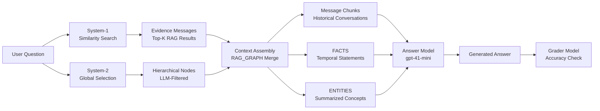
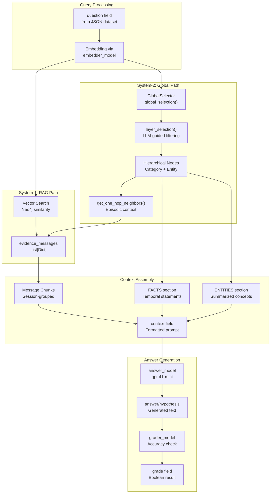
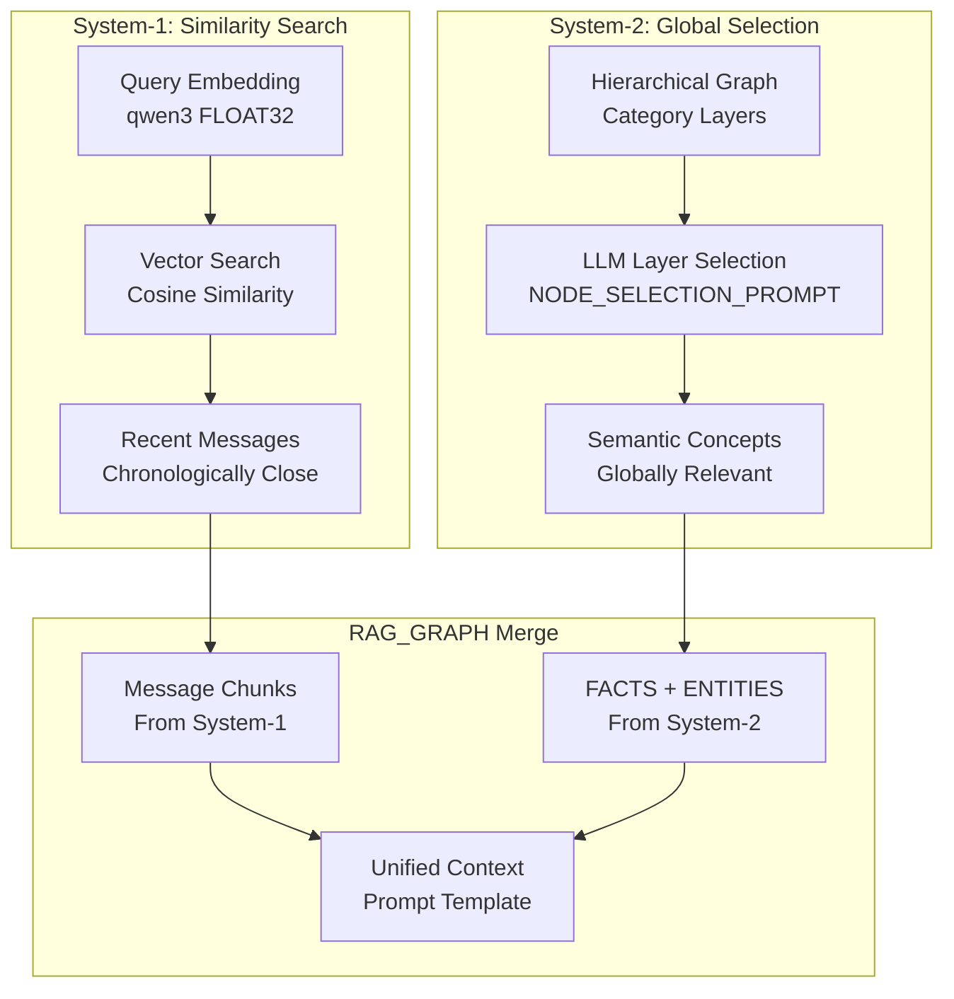

<!-- source: DeepWiki mcp.deepwiki.com · repo microsoft/Mnemis · page 5 Case Studies · fetched 2026-10-26 -->

# Case Studies

<details>
<summary>Relevant source files</summary>

The following files were used as context for generating this wiki page:

- [figures/figure_case_0.png](figures/figure_case_0.png)
- [figures/figure_case_1.png](figures/figure_case_1.png)
- [results/lme-s/results_graphiti_gpt-41-mini-shortco-2025-04-14-Bing_gpt-41-mini-shortco-2025-04-14-Bing_ragtopk10_gtopk20_RAG_GRAPH.json](results/lme-s/results_graphiti_gpt-41-mini-shortco-2025-04-14-Bing_gpt-41-mini-shortco-2025-04-14-Bing_ragtopk10_gtopk20_RAG_GRAPH.json)
- [results/locomo/results_graphiti_gpt-41-mini-shortco-2025-04-14-Bing_gpt-41-mini-shortco-2025-04-14-Bing_ragtopk10_gtopk20_RAG_GRAPH.json](results/locomo/results_graphiti_gpt-41-mini-shortco-2025-04-14-Bing_gpt-41-mini-shortco-2025-04-14-Bing_ragtopk10_gtopk20_RAG_GRAPH.json)

</details>


This page demonstrates Mnemis's dual-route memory retrieval through concrete question-answering scenarios from the benchmark evaluations. Each case study walks through the complete pipeline: question processing, System-1 similarity search, System-2 global selection, context assembly with structured memory components (Message Chunks, FACTS, ENTITIES), and answer generation with accuracy evaluation.

For detailed analysis of benchmark results and performance metrics, see [LoCoMo Results](#4.2) and [LongMemEval-S Results](#4.3). For implementation details of the retrieval mechanisms, see [System-2 Global Selection](#2.3) and [RAG_GRAPH Merge Strategy](#2.4).

---

## Overview of Case Study Structure

Each case study in this section demonstrates the following pipeline stages:



**Sources:** [results/lme-s/results_graphiti_gpt-41-mini-shortco-2025-04-14-Bing_gpt-41-mini-shortco-2025-04-14-Bing_ragtopk10_gtopk20_RAG_GRAPH.json:1-50](), [results/locomo/results_graphiti_gpt-41-mini-shortco-2025-04-14-Bing_gpt-41-mini-shortco-2025-04-14-Bing_ragtopk10_gtopk20_RAG_GRAPH.json:1-50]()

### Case Study Components

Each case study documents:

| Component | Description | Source |
|-----------|-------------|--------|
| **Question** | The user query requiring memory retrieval | `question` field in results JSON |
| **Evidence Messages** | Raw messages retrieved by System-1 similarity search | `evidence_messages` or `evidence` arrays |
| **Structured Context** | Organized memory: Message Chunks, FACTS, ENTITIES | `context` field containing formatted sections |
| **Generated Answer** | LLM response based on retrieved context | `answer` or `hypothesis` field |
| **Golden Answer** | Ground truth for evaluation | `golden_answer` or `gold_answer` field |
| **Grade** | Boolean accuracy assessment | `grade` field (true/false) |
| **Duration** | Retrieval and generation time in seconds | `duration` field |

**Sources:** [results/lme-s/results_graphiti_gpt-41-mini-shortco-2025-04-14-Bing_gpt-41-mini-shortco-2025-04-14-Bing_ragtopk10_gtopk20_RAG_GRAPH.json:1-50](), [results/locomo/results_graphiti_gpt-41-mini-shortco-2025-04-14-Bing_gpt-41-mini-shortco-2025-04-14-Bing_ragtopk10_gtopk20_RAG_GRAPH.json:1-50]()

---

## System-Level Data Flow Architecture

The following diagram maps the conceptual retrieval process to concrete code entities and data structures:



**Sources:** [results/lme-s/results_graphiti_gpt-41-mini-shortco-2025-04-14-Bing_gpt-41-mini-shortco-2025-04-14-Bing_ragtopk10_gtopk20_RAG_GRAPH.json:1-100](), [results/locomo/results_graphiti_gpt-41-mini-shortco-2025-04-14-Bing_gpt-41-mini-shortco-2025-04-14-Bing_ragtopk10_gtopk20_RAG_GRAPH.json:1-100]()

---

## Context Structure Format

The `context` field in results JSON files contains formatted memory organized into three sections:

### Message Chunks
Chronologically grouped conversation messages, segmented by session:

```
Message Chunk 0 (Session 1):
[2023/05/08 (Mon) 13:57] Caroline: I went to a LGBTQ support group yesterday...

Message Chunk 1 (Session 3):
[2023/06/09 (Fri) 19:55] Caroline: Hey Melanie! How's it going?...
```

### FACTS Section
Temporal statements extracted from the knowledge graph with datetime ranges:

```xml
<FACTS>
  - Caroline attended the LGBTQ support group yesterday. (2023-05-07 - now)
  - Caroline joined a mentorship program for LGBTQ youth last weekend. (2023-07-17 - now)
</FACTS>
```

### ENTITIES Section
Summarized concepts and relationships from the hierarchical graph:

```xml
<ENTITIES>
  - Caroline: A person who is an active member of the LGBTQ community...
  - LGBTQ Support Group: A group that provides support for LGBTQ individuals...
</ENTITIES>
```

**Sources:** [results/lme-s/results_graphiti_gpt-41-mini-shortco-2025-04-14-Bing_gpt-41-mini-shortco-2025-04-14-Bing_ragtopk10_gtopk20_RAG_GRAPH.json:1-100](), [results/locomo/results_graphiti_gpt-41-mini-shortco-2025-04-14-Bing_gpt-41-mini-shortco-2025-04-14-Bing_ragtopk10_gtopk20_RAG_GRAPH.json:1-100]()

---

## Evaluation Metrics in Case Studies

Each case study result includes performance measurements:

| Metric | Description | Example Value |
|--------|-------------|---------------|
| `duration` | Total processing time (retrieval + generation) in seconds | 2.143 seconds |
| `grade` | Boolean accuracy: does answer match ground truth? | `true` or `false` |
| `question_type` | Classification of question complexity | `"single-session-user"`, `"multi-session"`, etc. |
| `answer_session_ids` | Session IDs containing ground truth evidence | `["answer_c3567066"]` |

### Configuration Parameters

The case studies in this section use the following configuration:

- **RAG top-k**: 10 messages retrieved by similarity search
- **Graph top-k**: 20 nodes selected through hierarchical traversal
- **Merge method**: `RAG_GRAPH` (combines both routes)
- **Answer model**: `gpt-41-mini-shortco-2025-04-14-Bing`
- **Grader model**: `gpt-41-mini-shortco-2025-04-14-Bing`

**Sources:** [results/lme-s/results_graphiti_gpt-41-mini-shortco-2025-04-14-Bing_gpt-41-mini-shortco-2025-04-14-Bing_ragtopk10_gtopk20_RAG_GRAPH.json:1-50](), [results/locomo/results_graphiti_gpt-41-mini-shortco-2025-04-14-Bing_gpt-41-mini-shortco-2025-04-14-Bing_ragtopk10_gtopk20_RAG_GRAPH.json:1-50]()

---

## Retrieval Method Contributions

The dual-route architecture enables complementary retrieval strategies:



### Complementary Strengths

| Retrieval Route | Strength | Example Use Case |
|-----------------|----------|------------------|
| **System-1** | Finds lexically/semantically similar recent messages | "Where did I buy my tennis racket?" → retrieves message mentioning "sports store downtown" |
| **System-2** | Extracts thematic concepts across entire history | "When did Caroline attend LGBTQ events?" → traverses category hierarchy to find all LGBTQ-related facts across months |

**Sources:** [results/lme-s/results_graphiti_gpt-41-mini-shortco-2025-04-14-Bing_gpt-41-mini-shortco-2025-04-14-Bing_ragtopk10_gtopk20_RAG_GRAPH.json:1-100](), [results/locomo/results_graphiti_gpt-41-mini-shortco-2025-04-14-Bing_gpt-41-mini-shortco-2025-04-14-Bing_ragtopk10_gtopk20_RAG_GRAPH.json:1-100]()

---

## Reading the Case Studies

The following subsections present detailed walkthroughs of specific questions from each benchmark:

- **[LoCoMo User 8 QA 11](#5.1)**: Multi-session temporal reasoning about LGBTQ support group attendance
- **[LongMemEval-S QA 262](#5.2)**: Single-session fact retrieval about a tennis racket purchase

Each case study shows:
1. The exact question text
2. Evidence messages retrieved by System-1
3. Structured context (Message Chunks, FACTS, ENTITIES) assembled via RAG_GRAPH
4. Generated answer with reasoning
5. Ground truth comparison and grade
6. Processing duration

These examples demonstrate how Mnemis's dual-route architecture enables accurate memory retrieval across different question types and temporal ranges.

**Sources:** [figures/figure_case_0.png:1-10](), [figures/figure_case_1.png:1-10](), [results/lme-s/results_graphiti_gpt-41-mini-shortco-2025-04-14-Bing_gpt-41-mini-shortco-2025-04-14-Bing_ragtopk10_gtopk20_RAG_GRAPH.json:1-100](), [results/locomo/results_graphiti_gpt-41-mini-shortco-2025-04-14-Bing_gpt-41-mini-shortco-2025-04-14-Bing_ragtopk10_gtopk20_RAG_GRAPH.json:1-100]()

---

